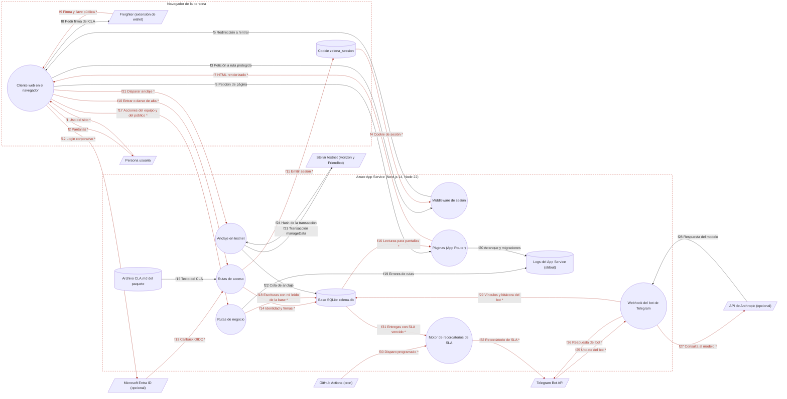

# Paso 0: esqueleto común

Dueño: QA (por asignar) · Revisor: John · Fecha: 2026-10-21 · Commit de referencia: 0e07d8f

Este documento responde las preguntas del Paso 0 de la guía, deja el DFD nivel 0 del sistema y fija la lista de features con su orden de trabajo. Casi todos los features dependen de lo que se describe aquí (arranque, sesión, base de datos y servicios externos), así que cada ficha puede remitir a este archivo en vez de repetirlo.

Stack: monorepo npm (workspaces `apps/*` y `packages/*`) con Next.js 14 (App Router) y TypeScript estricto en `apps/web`, SQLite como base de datos y Stellar testnet para el anclaje. Se despliega en Azure App Service (Linux, Node 22). Nada toca mainnet ni mueve dinero real; lo financiero vive en Odoo, fuera de esta app.

## 1. Preguntas del Paso 0

La columna "Dónde buscar" ya está ajustada a este stack.

| Pregunta | Dónde buscar | Respuesta |
| --- | --- | --- |
| ¿Cómo arranca la aplicación? | `apps/web/package.json`, `apps/web/start-azure.sh`, `apps/web/start-standalone.sh`, `apps/web/next.config.mjs` | En local, `npm run dev` dentro de `apps/web` levanta `next dev` en el puerto 3000; la base se crea y se siembra sola en el primer acceso (`getDb()` en `src/lib/db.ts`). En Azure hay dos arranques: `start-azure.sh` corre `next start` sobre `.next` + `node_modules`, y `start-standalone.sh` corre el `server.js` del paquete standalone que arma `.github/workflows/paquete-azure.yml`. Los dos verifican el paquete con `scripts/verificar-paquete.mjs` antes de arrancar y se niegan a arrancar si falta algo (CLA.md con su hash, `docs/whitepaper.md`, `schema.sql`, el `next` correcto); los dos activan `--experimental-sqlite` si Node no trae `node:sqlite` sin flag. `next.config.mjs` define las cabeceras de seguridad (CSP, X-Frame-Options, etc.), las redirecciones permanentes de rutas renombradas, la salida standalone (solo con `NEXT_STANDALONE=1`) y los archivos que el runtime lee con `fs` y deben ir en el paquete. |
| ¿Cómo se organizan las carpetas? | Árbol de la sección 2 | Toda la aplicación vive en `apps/web`: `app/` son las pantallas y la API, `src/lib/` la lógica y el acceso a datos (con sus pruebas al lado), `src/components/` los componentes de React. `packages/scripts/` tiene procesos que se corren aparte (worker de anclaje, bot de Telegram en modo polling, importador). `docs/` es documentación y especificaciones; `.github/workflows/` la integración continua y el cron de recordatorios. |
| ¿Cómo se enrutan las peticiones? | `apps/web/app/**/page.tsx` y `apps/web/app/api/**/route.ts`, `apps/web/middleware.ts` | Enrutamiento por carpetas del App Router: cada `page.tsx` es una pantalla y cada `route.ts` en `app/api/` un endpoint (37 hoy), que exporta funciones con el nombre del verbo (`GET`, `POST`, `PATCH`). Los handlers solo validan la entrada y llaman a una función de `src/lib/` (regla del repo, ver `CLAUDE.md`). `/whitepaper` pasa a redirigir a `/manifiesto` (cambio en curso en otra rama; se documenta así). |
| ¿Cómo se autentica y se mantiene la sesión? | `apps/web/middleware.ts`, `apps/web/src/lib/jwt.ts`, `apps/web/src/lib/session.ts`, `apps/web/src/lib/authz.ts`, `apps/web/src/lib/roles.ts` | La sesión es una cookie `zelena_session` con un JWT HS256 firmado con `SESSION_SECRET` (httpOnly, SameSite=Lax, `secure` en producción, 24 horas). Hay tres puertas y todas emiten la misma cookie: alta con código de invitación + wallet + firma del CLA (`/api/onboard`), reingreso firmando con la wallet (`/api/login`), y Microsoft Entra ID con la cuenta del dominio corporativo cuando `AUTH_ENTRA_ENABLED=true` (`/api/auth/[...nextauth]` y `/api/auth/entra/exchange`). La wallet es la llave primaria de `users` (`users.wallet`); quien entra por Entra no necesita wallet porque recibe un principal `entra:<oid>` o el `pending:<nombre>` del roster. No existe entrada con correo y contraseña. `middleware.ts` exige sesión en `/equipo` y `/clientes`, y sesión con CLA firmado en `/perfil` y `/admin`; sin ella redirige (307) a `/entrar?next=`. La autorización no se toma de la cookie: se lee el rol de la base en cada acción (`authz.ts`, `roles.ts`), y un test estático (`sin-gates-por-persona.test.ts`) impide comparar contra la wallet de una persona en `app/` o `src/components/`. Esto lo detalla la ficha `login-y-sesion`. |
| ¿Qué base de datos usa y con qué modelos? | `apps/web/src/lib/db.ts`, `apps/web/src/lib/schema.sql`, `apps/web/src/lib/__fixtures__/schema-58ee2fd.sql` | SQLite. En local, `apps/web/data/zelena.db`; en producción, el archivo que indique `DATABASE_FILE` (la base real está en el almacenamiento persistente del App Service y nunca se borra). `db.ts` es la única puerta: elige driver (Azure SQL con `mssql` si hay `AZURE_SQL_*`, libSQL si hay `DATABASE_URL`/`TURSO_DATABASE_URL`, y si no `better-sqlite3` o `node:sqlite`) y expone una interfaz síncrona `prepare().get/all/run`. No hay ORM: el modelo es `schema.sql` (46 tablas, solo `CREATE ... IF NOT EXISTS`) y los tipos de TypeScript de cada módulo de `src/lib/`. Las migraciones van en `db.ts`: `COLUMNAS_NUEVAS` para columnas nuevas sobre tablas existentes y `prepararSqlite` para cambios de forma, con respaldo `VACUUM INTO` previo. Puntos y reputación se derivan con `SUM()` sobre tablas de solo inserción (`points_ledger`, `reputation_events`), nunca de un saldo mutable. |
| ¿Qué servicios externos consume? | Variables de entorno (sección 5), `src/lib/anchor.ts`, `src/lib/telegram.ts`, `src/lib/bot-agent.ts`, `app/api/auth/entra-options.ts`, `.github/workflows/` | Stellar testnet (Horizon y Friendbot) para anclar hashes con `manageData`, desde `/api/anchor/run` (el `packages/scripts/anchor-worker.mjs` que también se documenta está truncado y no corre). Telegram Bot API para el bot y los recordatorios de SLA (webhook en Azure, polling en local con `packages/scripts/telegram-bot.mjs`). API de Anthropic, opcional, para el texto libre del bot. Microsoft Entra ID, opcional y apagado por defecto. GitHub Actions dispara el motor de recordatorios cada 15 minutos en horario hábil (`recordatorios.yml`). En el navegador, la extensión Freighter firma el CLA. Azure SQL (`mssql`) existe como driver pero producción corre en SQLite. |
| ¿Dónde se registran logs y errores? | `console.*` en `src/lib/db.ts`, `src/lib/seed.ts`, `src/lib/genome.ts`, `app/api/ritos/*`, `app/api/admin/epoca/route.ts` | No hay librería ni configuración de logging: unas 20 llamadas a `console.info/warn/error` escriben en stdout y stderr del proceso, que en Azure se ven en el log stream del App Service. Se registra el arranque (driver, migración aplicada, estado del founder con la wallet abreviada) y los errores de algunas rutas, sin secretos (el secreto del cron "nunca se registra"). Las rutas de API devuelven errores genéricos al cliente. La trazabilidad de negocio vive en tablas de solo inserción: `assignment_events`, `talent_events`, `decision_log`, `credential_access_log`, `bot_actions` y `reminders_sent`. |
| ¿Cómo se ejecutan las pruebas existentes? | `apps/web/package.json`, `apps/web/vitest.config.ts`, `.github/workflows/ci.yml`, `.github/workflows/paquete-azure.yml` | `cd apps/web && npm test` corre Vitest sobre `src/**/*.test.ts` con `TZ=UTC`; un archivo suelto con `npx vitest run src/lib/<archivo>.test.ts`. Las pruebas crean su base en memoria con `openDb(":memory:")` y ejecutan `schema.sql` (o un archivo temporal cuando prueban migraciones). Antes de un commit también se corren `npx tsc --noEmit -p .` y `npx next lint`. Línea base del 2026-10-21 sin las pruebas de caracterización nuevas: 61 archivos y 1.200 pruebas en verde (1 archivo y 15 pruebas omitidas: las 13 de `client-graph.test.ts`, que necesitan un fixture privado que no está en el repo, y 2 que dependen de variables de entorno con la lista privada de nombres), en unos 20 segundos. En GitHub, `ci.yml` (pull requests y push a `main`) solo corre lint y build; los tests corren en `paquete-azure.yml`, en push a `develop` y `feat/v1-unificada`. |

## 2. Árbol de carpetas

Salida equivalente a `tree -L 3` sin `node_modules`, con `apps/web` abierto un nivel más porque ahí está todo el código.

```text
.
├── .claude/workflows/ola.mjs        grafo ejecutable de las olas de trabajo
├── .github/workflows/
│   ├── ci.yml                       lint + build en PR y en main
│   ├── paquete-azure.yml            tipos, tests, build standalone, ensayo y zip para Azure
│   └── recordatorios.yml            cron que llama a /api/cron/recordatorios
├── apps/web/
│   ├── app/                         App Router: una carpeta por ruta
│   │   ├── api/                     37 endpoints route.ts (login, onboard, equipo/*, ritos, telegram, cron, anchor...)
│   │   ├── entrar/  equipo/  admin/  perfil/  clientes/   pantallas con sesión
│   │   ├── agora/  academia/  gobernanza/  comunidad/  encuentros/  empresas/   pantallas públicas
│   │   ├── manifiesto/  metodo/  privacidad/  acuerdo/  whitepaper/
│   │   └── layout.tsx  page.tsx  globals.css
│   ├── middleware.ts                puerta de sesión (edge)
│   ├── next.config.mjs              cabeceras, redirecciones, standalone, archivos de runtime
│   ├── public/                      imágenes y logo
│   ├── scripts/verificar-paquete.mjs   verificación del paquete antes de arrancar
│   ├── src/
│   │   ├── components/              45 componentes de React
│   │   ├── data/pruebas-testnet.json
│   │   └── lib/                     lógica, acceso a datos y pruebas (*.test.ts al lado de cada módulo)
│   │       ├── db.ts  schema.sql  seed.ts   capa de datos, esquema y siembra
│   │       ├── __fixtures__/        esquema desplegado (58ee2fd) y CSV de demo
│   │       └── caracterizacion/     pruebas de caracterización de esta auditoría
│   ├── start-azure.sh  start-standalone.sh
│   └── vitest.config.ts  tsconfig.json  tailwind.config.ts
├── docs/
│   ├── features/                    fichas de esta auditoría (este archivo)
│   ├── dfd/                         fuentes JSON de los DFD, .tm7, .svg y el generador
│   ├── specs/                       WP*.md, QUEUE.md, FEEDBACK.md
│   ├── blueprints/                  planos de arquitectura, identidad y fases
│   └── architecture.md  deploy.md  security-review.md  DESPLIEGUE-V1.md ...
├── packages/scripts/                anchor-worker.mjs, telegram-bot.mjs, import-tareas.mjs, sim/, smoke-wp31.sh
├── CLA.md                           texto del acuerdo; su sha256 es lo que se firma (no se toca)
└── package.json                     workspaces apps/* y packages/*
```

## 3. DFD nivel 0 del sistema

Fuente: [`docs/dfd/00-sistema.json`](../dfd/00-sistema.json). Modelo para la herramienta: `docs/dfd/00-sistema.tm7`. Imagen: [`docs/dfd/00-sistema.svg`](../dfd/00-sistema.svg). Se regeneran con `python docs/dfd/generar_tm7.py docs/dfd/00-sistema.json` (ver [`docs/dfd/README.md`](../dfd/README.md)).

Los flujos marcados con `*` (en rojo) llevan credenciales, tokens, firmas o datos personales.



Lectura de izquierda a derecha: la persona usa el cliente web, que habla con el middleware (rutas protegidas), con las páginas y con las rutas de API. Las rutas de acceso son las únicas que emiten la cookie de sesión, ya sea con invitación, wallet y firma (Freighter) o con el callback de Entra. Todo dato persistente pasa por la base SQLite. Tres procesos hablan con el exterior: el anclaje con Stellar testnet, el webhook con Telegram (y opcionalmente con Anthropic) y el motor de recordatorios, que despierta GitHub Actions y escribe por Telegram.

### Elementos del DFD en el código

| Elemento | Tipo | Archivo y función | Notas |
| --- | --- | --- | --- |
| Persona usuaria | Actor | `apps/web/src/lib/jwt.ts#SessionData` | En el código, la persona es su principal (`users.wallet`) y su sesión. |
| Cliente web en el navegador | Proceso | `apps/web/app/entrar/page.tsx#Entrar` | Componentes `"use client"`; `/entrar` es el que más hace (invitación, wallet de prueba en `localStorage`, Freighter). |
| Freighter (extensión de wallet) | Actor | `apps/web/app/entrar/page.tsx#signMessage` | `@stellar/freighter-api`, cargado solo en el navegador. |
| Cookie zelena_session | Almacén | `apps/web/src/lib/session.ts#setSessionCookie` | JWT HS256 de 24 h; la lee `getSession()` en páginas y rutas, y `verifySession()` en el middleware. |
| Middleware de sesión | Proceso | `apps/web/middleware.ts#middleware` | Corre en el edge; solo mira las rutas de `config.matcher`. Es la segunda capa: las páginas de `/equipo` y el layout de `/clientes` vuelven a comprobar la sesión y el rol. |
| Páginas (App Router) | Proceso | `apps/web/app/layout.tsx#RootLayout` | Server components: leen la base directamente vía funciones de `src/lib/`. |
| Rutas de acceso | Proceso | `apps/web/app/api/login/route.ts#POST` | También `app/api/onboard`, `app/api/invite/verify`, `app/api/cla`, `app/api/logout`, `app/api/auth/[...nextauth]` y `app/api/auth/entra/*`; lógica en `src/lib/onboard.ts` y `src/lib/entra.ts`. |
| Rutas de negocio | Proceso | `apps/web/app/api/equipo/asignacion/route.ts#POST` | Representa al resto de `app/api/`: `equipo/*`, `ritos/*`, `avisos`, `apply`, `governance/vote`, `academia/*`, `admin/*`, `clientes/grafo`, `empresas/contacto`, `encuentros/aviso`. Cada ficha abre su parte. |
| Anclaje en testnet | Proceso | `apps/web/app/api/anchor/run/route.ts#POST` | Lógica en `src/lib/anchor.ts#anclarPendientes`; existe además `packages/scripts/anchor-worker.mjs` para correrlo a mano. |
| Webhook del bot de Telegram | Proceso | `apps/web/app/api/telegram/webhook/route.ts#POST` | Lógica en `src/lib/bot-agent.ts#handleUpdate`. Apagado salvo `TELEGRAM_ENABLED=true`. |
| Motor de recordatorios de SLA | Proceso | `apps/web/app/api/cron/recordatorios/route.ts#POST` | Lógica en `src/lib/recordatorios-db.ts#correrRecordatorios`; envía solo con `SLA_REMINDERS_ENABLED=true`. |
| Base SQLite zelena.db | Almacén | `apps/web/src/lib/db.ts#getDb` | Esquema en `src/lib/schema.sql`. |
| Archivo CLA.md del paquete | Almacén | `apps/web/src/lib/cla.ts#readClaText` | Su sha256 (03293c93…) es lo que firman las altas; `verificar-paquete.mjs` lo comprueba al arrancar. |
| Logs del App Service (stdout) | Almacén | `apps/web/src/lib/db.ts#console.info` | Ver la fila de logs de la sección 1. |
| Microsoft Entra ID (opcional) | Actor | `apps/web/app/api/auth/entra-options.ts#AzureADProvider` | Proveedor de NextAuth v4 con id `microsoft-entra-id`. |
| Stellar testnet (Horizon y Friendbot) | Actor | `apps/web/src/lib/anchor.ts#HORIZON` | `https://horizon-testnet.stellar.org`, permitido en la CSP. |
| Telegram Bot API | Actor | `apps/web/src/lib/telegram.ts#createTelegramTransport` | `https://api.telegram.org/bot<token>/<método>`. |
| API de Anthropic (opcional) | Actor | `apps/web/src/lib/bot-agent.ts#createClaudeClient` | Sin `ANTHROPIC_API_KEY` el bot solo atiende comandos. |
| GitHub Actions (cron) | Actor | `.github/workflows/recordatorios.yml#disparar` | Cada 15 min, lunes a viernes de 07:00 a 18:59 hora de Bogotá. |

### Flujos de datos

| Flujo | De → a | Protocolo | Datos que viajan |
| --- | --- | --- | --- |
| f1 Uso del sitio * | Persona → Cliente web | Interfaz | Navegación, formularios, código de invitación |
| f2 Pantallas * | Cliente web → Persona | Interfaz | Lo que ve la persona, incluidos datos del equipo si tiene sesión |
| f3 Petición a ruta protegida | Cliente web → Middleware | HTTPS | Ruta pedida (`/equipo`, `/clientes`, `/perfil`, `/admin`) |
| f4 Cookie de sesión * | Cookie → Middleware | HTTPS (cabecera Cookie) | JWT con wallet, nombre, rol y `claSigned` |
| f5 Redirección a /entrar | Middleware → Cliente web | HTTPS | 307 a `/entrar?next=<ruta>` |
| f6 Petición de página | Cliente web → Páginas | HTTPS | Ruta; la cookie viaja si existe |
| f7 HTML renderizado * | Páginas → Cliente web | HTTPS | Contenido público; en `/equipo` y `/admin`, nombres, asignaciones, puntos |
| f8 Pedir firma del CLA | Cliente web → Freighter | API de la extensión | Payload del CLA con su sha256 y la fecha |
| f9 Firma y llave pública * | Freighter → Cliente web | API de la extensión | Dirección `G...` y firma ed25519 |
| f10 Entrar o darse de alta * | Cliente web → Rutas de acceso | HTTPS | Código de invitación, wallet, firma y payload |
| f11 Emitir sesión * | Rutas de acceso → Cookie | HTTPS (Set-Cookie) | JWT firmado con `SESSION_SECRET` |
| f12 Login corporativo * | Cliente web → Entra ID | HTTPS (OIDC) | Credenciales de Microsoft; no pasan por la app |
| f13 Callback OIDC * | Entra ID → Rutas de acceso | HTTPS (OIDC) | Código de autorización e id_token (tid, oid, correo, nombre) |
| f14 Identidad y firmas * | Rutas de acceso → Base | SQL | `users`, `user_emails`, `invites`, `cla_signatures`, `anchor_queue` |
| f15 Texto del CLA | CLA.md → Rutas de acceso | Archivo | Texto cuyo sha256 se firma |
| f16 Lecturas para pantallas * | Base → Páginas | SQL | Asignaciones, proyectos, puntos, ritos, avisos, Ágora |
| f17 Acciones del equipo y del público * | Cliente web → Rutas de negocio | HTTPS | Check-in, asignaciones, ritos, Ágora, contacto (nombre y correo del prospecto) |
| f18 Escrituras con rol leído de la base * | Rutas de negocio → Base | SQL | `assignments`, `assignment_events`, `checkins`, `rite_attendance`, `talent_events`, `points_ledger`, `leads` |
| f19 Errores de rutas | Rutas de negocio → Logs | stdout | Mensajes de error sin secretos |
| f20 Arranque y migraciones | Páginas → Logs | stdout | Driver, migración aplicada, estado del founder (wallet abreviada) |
| f21 Disparar anclaje * | Cliente web → Anclaje | HTTPS | `POST /api/anchor/run` con sesión de rol founder o cabecera `x-anchor-secret` |
| f22 Cola de anclaje | Anclaje → Base | SQL | `anchor_queue`, `cla_signatures.tx_id`, `periods` |
| f23 Transacción manageData | Anclaje → Stellar | Stellar (HTTPS a Horizon) | Hash de 64 caracteres firmado por la cuenta de servicio; la llave no viaja |
| f24 Hash de la transacción | Stellar → Anclaje | Stellar | Hash público de la transacción |
| f25 Update del bot * | Telegram → Webhook | HTTPS | Mensaje, chat id y cabecera `x-telegram-bot-api-secret-token` |
| f26 Respuesta del bot * | Webhook → Telegram | HTTPS | `sendMessage` con la respuesta |
| f27 Consulta al modelo * | Webhook → Anthropic | HTTPS | Texto libre y definición de herramientas |
| f28 Respuesta del modelo | Anthropic → Webhook | HTTPS | Texto y llamadas a herramientas |
| f29 Vínculos y bitácora del bot * | Webhook → Base | SQL | `telegram_links`, `bot_drafts`, `bot_actions`, `notes` |
| f30 Disparo programado * | GitHub Actions → Motor de recordatorios | HTTPS | `POST /api/cron/recordatorios` con cabecera `x-cron-secret` |
| f31 Entregas con SLA vencido * | Base → Motor de recordatorios | SQL | `assignments`, `initiatives`, `telegram_links`, `reminders_sent` |
| f32 Recordatorio de SLA * | Motor de recordatorios → Telegram | HTTPS | Texto sobre la entrega y chat id |

Fronteras de confianza: "Navegador de la persona" (lo controla quien usa el sitio: cliente web, Freighter y la cookie) y "Azure App Service" (lo controla Zelena: Next.js, la base y los logs). Los servicios externos quedan fuera de las dos.

## 4. Variables de entorno

Solo nombres y para qué sirven; los valores viven en App Settings de Azure y en `.env.local`, nunca en el repo.

| Variable | La lee | Para qué |
| --- | --- | --- |
| `SESSION_SECRET` | `src/lib/jwt.ts` | Firma del JWT de sesión. En producción, ausente o con menos de 32 caracteres detiene el arranque. |
| `FOUNDER_WALLET` | `src/lib/config.ts` | Dato (no regla): cada arranque promueve esa fila a `founder`. Obligatoria en producción. |
| `FOUNDER_BOOTSTRAP_CODE` | `src/lib/config.ts` | Código de invitación de arranque del founder (la "escotilla", de 16 a 40 caracteres); ver ficha `login-y-sesion`. |
| `DATABASE_FILE`, `DATABASE_DRIVER`, `DATABASE_URL`, `TURSO_DATABASE_URL`, `TURSO_AUTH_TOKEN`, `AZURE_SQL_*` | `src/lib/db.ts`, `src/lib/db-mssql.ts` | Ruta del archivo SQLite y elección de driver. |
| `AUTH_ENTRA_ENABLED`, `AZURE_AD_CLIENT_ID`, `AZURE_AD_CLIENT_SECRET`, `AZURE_AD_TENANT_ID`, `NEXTAUTH_SECRET`, `ZELENA_CORPORATE_DOMAIN` | `src/lib/config.ts`, `app/api/auth/entra-options.ts` | Puerta de Microsoft Entra ID; apagada por defecto. |
| `TELEGRAM_ENABLED`, `TELEGRAM_BOT_TOKEN`, `TELEGRAM_WEBHOOK_SECRET`, `TELEGRAM_BOT_USERNAME` | `src/lib/config.ts`, `packages/scripts/telegram-bot.mjs` | Bot de Telegram. |
| `ANTHROPIC_API_KEY`, `ANTHROPIC_BOT_MODEL` | `src/lib/config.ts` | Texto libre del bot (opcional). |
| `CRON_SECRET`, `SLA_REMINDERS_ENABLED`, `ZELENA_APP_URL` | `src/lib/config.ts`, `.github/workflows/recordatorios.yml` | Motor de recordatorios: secreto de 32 o más caracteres, interruptor de envío y URL base de los enlaces. |
| `SERVICE_ACCOUNT_SECRET`, `ANCHOR_RUN_SECRET` | `src/lib/anchor.ts`, `app/api/anchor/run/route.ts`, `packages/scripts/anchor-worker.mjs` | Llave de la cuenta de servicio de testnet y secreto para disparar el anclaje sin sesión. |
| `ZELENA_NOMBRES_VETADOS`, `ZELENA_NOMBRES_PRIVADOS`, `ZELENA_BARRIDO_NOMBRES` | `src/lib/contenido-publico.ts` | Lista de nombres que no pueden aparecer en lo público (repo público). |
| `ZELENA_OMITIR_VERIFICACION` | `start-azure.sh`, `start-standalone.sh` | Saltar la verificación del paquete en una emergencia consciente. |

## 5. Features y orden de trabajo

El orden sigue la guía: primero lo que todos usan (login y sesión), luego el dashboard y Actividades, después lo que toca puntos (el equivalente a dinero en esta app), estados, sincronizaciones y mensajes salientes, y al final lo periférico. Cada feature deja estos archivos:

- ficha: `docs/features/<feature>.md`
- fuente del DFD: `docs/dfd/<feature>.json`
- DFD generado: `docs/dfd/<feature>.tm7` y `docs/dfd/<feature>.svg`
- prueba de caracterización: `apps/web/src/lib/caracterizacion/<feature>.test.ts`

| # | Feature (slug) | Qué cubre | Por qué en este lugar |
| --- | --- | --- | --- |
| 0 | `00-esqueleto` | Este archivo y `docs/dfd/00-sistema.json` | Base común de todo lo demás |
| 1 | `login-y-sesion` | Invitación + wallet + firma del CLA, cookie JWT, middleware, Entra tras flag, escotilla del founder y puertas por rol | Todo lo demás depende de él |
| 2 | `dashboard` | `/equipo/dashboard` y el digest diario | Reúne datos de varios módulos |
| 3 | `actividades` | Mi día, entregas, máquina de estados, check-in y revisión de cuatro ojos | Primer feature con reglas de negocio propias |
| 4 | `agora-y-hitos` | Publicar desde el backlog, aplicar, asignar y aprobar hitos (1 USD = 1 punto) | Valora trabajo en puntos y mueve estados |
| 5 | `gamificacion-y-epocas` | Emisión al aprobar, puntos y reputación, tope por época, insignias, cierre y apertura con raíz Merkle | Es el libro de puntos |
| 6 | `anclaje-stellar` | Firma del acuerdo, `anchor_queue`, `/api/anchor/run`, worker y evidencia pública | Sincroniza con una red externa y cambia estados |
| 7 | `proyectos-y-membresias` | Iniciativas, membresías con rol, permisos por proyecto y tablero | Estados y permisos que usan Actividades y Ágora |
| 8 | `ritos-y-comunidad` | Código rotativo, asistencia, `/comunidad` y aviso de encuentros | La asistencia escribe puntos y reputación |
| 9 | `sla-recordatorios-y-avisos` | SLA, recordatorios por Telegram y avisos | Estados de plazo y mensajes salientes con tope |
| 10 | `talento-e-importador` | Directorio de talento, rol y supervisión, roster e importador CSV | Importación masiva (sincronización) |
| 11 | `clientes-y-grafo` | `/clientes`, `client_members`, grafo importado de zelena-ops e inventario de credenciales sin secretos | Sincronización desde otro repo y datos sensibles |
| 12 | `telegram` | Vinculación, webhook, comandos y focos del día | Canal externo de entrada y salida |
| 13 | `genoma-y-gobernanza` | Genoma versionado, mutaciones, fitness de la época, votos, decision log, auditorías latentes | Parámetros del sistema; cambia poco |
| 14 | `admin` | `/admin`, `/api/admin` y cierre y apertura de épocas | Pantalla del founder sobre los anteriores |
| 15 | `academia` | Contenido, lectura con tiempo mínimo, quiz y puntos de Academia | Periférico, aunque otorga puntos |
| 16 | `sitio-publico-y-formularios` | Landing, manifiesto, método, empresas, contacto, encuentros, legales, menú y pie | Cosmético, salvo el formulario de contacto (datos personales) |

El estado de cada uno se lleva en [`docs/features/README.md`](README.md).

## 6. Dependencias que comparten todos los features

- `login-y-sesion`: toda ruta con sesión usa `getSession()` y la autorización por rol de `authz.ts` y `roles.ts`.
- Capa de datos: `src/lib/db.ts` y `schema.sql`. Toda columna nueva sobre una tabla existente va en `COLUMNAS_NUEVAS`.
- `genoma-y-gobernanza`: los parámetros (plazos de SLA, presupuesto de época, límites) se leen del genoma versionado (`getActiveGenome()` en `src/lib/genome.ts`), no de constantes.
- `rate-limit.ts`: límite en memoria por instancia en login, cron, webhook y formularios.

## 7. Hallazgos del Paso 0

1. **Quitar el whitepaper toca el arranque de producción.** `scripts/verificar-paquete.mjs` exige `docs/whitepaper.md` y, si falta, `start-azure.sh` y `start-standalone.sh` se niegan a arrancar. Además `next.config.mjs` lo incluye en `ARCHIVOS_DE_RUNTIME`, el ensayo de `paquete-azure.yml` espera `/whitepaper` en 200 (con la redirección será 308), `contenido-publico.test.ts` y `verificar-paquete.test.ts` leen el archivo, y `src/lib/menu.ts` y `app/metodo/page.tsx` enlazan a `/whitepaper`. La rama que lo retira tiene que cambiar todo eso a la vez.
2. **Ninguna pantalla dispara el anclaje.** `/api/anchor/run` documenta "botón en /admin", pero ningún componente lo llama; en producción la cola `anchor_queue` solo avanza con un POST manual (sesión founder o `x-anchor-secret`). El otro camino documentado, `packages/scripts/anchor-worker.mjs`, tampoco sirve: está truncado y no parsea (`node --check` da `SyntaxError: Unexpected end of input`). Lo detalla la ficha `anclaje-stellar`.
3. **Los pull requests no corren las pruebas.** `ci.yml` solo hace lint y build (con Node 20, aunque producción usa Node 22); los tests corren en `paquete-azure.yml`, que no se dispara en PR. El job `cla-check` es un `echo`.
4. `.env.example` no lista la mayoría de variables de la sección 4 y trae `STELLAR_NETWORK`, que ningún código lee (la red está fija en testnet).
5. El script `contracts:build` del `package.json` raíz apunta a `packages/contracts`, que no existe en el repo.
6. La primera línea de `CLAUDE.md` dice "Azure SQL Database en producción", pero el mismo archivo más abajo y `docs/DESPLIEGUE-V1.md` ("Producción real hoy: SQLite … Azure SQL todavía no") indican que producción corre en SQLite con `node:sqlite`. El driver `mssql` existe pero no es el camino real; por eso `DESPLIEGUE-V1.md` pide fijar `DATABASE_DRIVER=sqlite` en App Settings.
7. `rate-limit.ts` guarda los contadores en memoria: con más de una instancia del App Service el límite no es global (ya anotado en el código).

## 8. Preguntas abiertas

- ¿Qué arranque usa hoy el App Service: `start-azure.sh` (`next start`) o el paquete standalone con `start-standalone.sh`? `next.config.mjs` dice lo primero y el workflow arma lo segundo.
- ¿Están activados los logs del App Service (log stream o archivos en `/home/LogFiles`) y por cuánto tiempo se guardan? No hay nada en el repo que lo diga.
- ¿Quién dispara hoy `/api/anchor/run` en producción, y con qué frecuencia?
- ¿Se encienden en producción `AUTH_ENTRA_ENABLED` y `TELEGRAM_ENABLED`? De eso depende si Entra y el bot entran en el análisis de amenazas o quedan como "Aceptada: apagado".
- De la guía: ¿todos los que van a editar los diagramas pueden usar Microsoft Threat Modeling Tool (solo Windows)? Mientras tanto, la imagen `.svg` y el Mermaid de la ficha se ven en cualquier sistema.
- De la guía: ¿el análisis de amenazas se hace en cada feature o queda para una segunda vuelta? Esta auditoría lo hace en cada ficha (sección 7).
