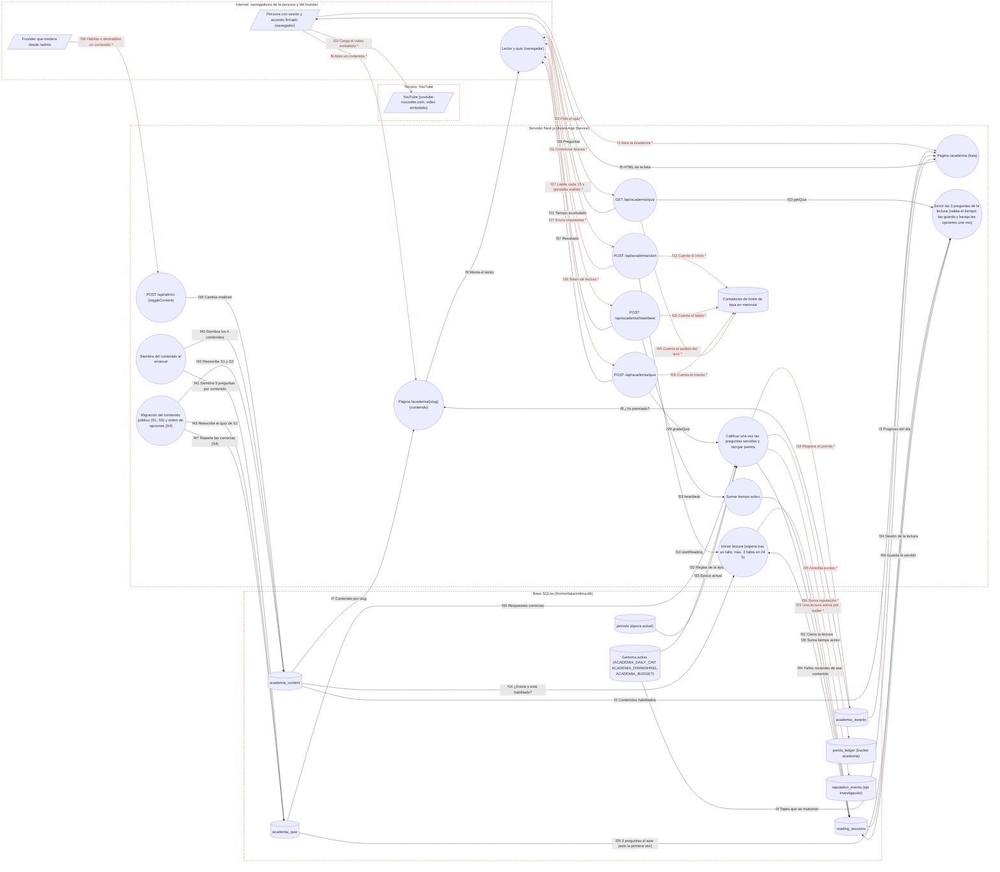

# Ficha: Academia

Dueño: QA (por asignar) · Revisor: John · Fecha: 2026-10-21 · Commit de referencia: 0e07d8f · Actualizada al release `wp/32-release` (4032c7c): secciones 1, 2, 3, 7, 8 y 9

## 1. Resumen

La Academia enseña cómo funciona Zelena con contenidos cortos (artículos en Markdown o un video) y premia aprender: quien lee el tiempo mínimo y aprueba un quiz gana **puntos de Academia** (bucket `academia` del `points_ledger`) y **reputación en el eje investigación**.

Quién la usa:

- **Cualquier visitante** lee la lista (`/academia`) y cada contenido (`/academia/<slug>`) sin entrar.
- **Una persona con sesión y el acuerdo firmado** (`claSigned` en la cookie) puede iniciar una lectura, hacer el quiz y ganar puntos.
- **El founder** publica o despublica contenidos desde `/admin`.

Casos de uso:

| Caso | Dónde | Qué escribe |
| --- | --- | --- |
| CU1. Ver los contenidos y el progreso del día | `/academia` | nada |
| CU2. Leer un contenido (artículo o video) | `/academia/<slug>` | nada |
| CU3. Leer con tiempo mínimo, pasar el quiz y ganar puntos | componente `Reader` → `/api/academia/start`, `/heartbeat`, `/quiz` | `reading_sessions`, `academia_awards`, `points_ledger`, `reputation_events` |
| CU4. Publicar o despublicar un contenido | `/admin` → `POST /api/admin` `toggleContent` | `academia_content.enabled` |
| CU5. Cargar o reescribir el contenido | al arrancar: `seedAcademia` (base vacía) y `aplicarContenidoPublico` (cada arranque) | `academia_content`, `academia_quiz` |

Reglas del motor (`src/lib/academia.ts`, comentario de las líneas 1-32), todas en el servidor:

1. Tiempo mínimo por contenido, medido con latidos (el servidor suma el tiempo real entre latidos, con tope de 20 s por latido) **y** con el tiempo transcurrido desde el inicio.
2. Quiz de 3 preguntas al azar de un grupo de 5; se aprueba con 2 de 3. Desde el release `wp/32-release` (hallazgo A2: ed5d167 y 8530cce) las preguntas servidas y el orden **barajado** de sus opciones quedan guardados en la lectura (`quiz_ids`, `quiz_orden`): pedir el quiz otra vez devuelve lo mismo, la calificación exige exactamente esas preguntas, distintas, y traduce cada respuesta de la posición mostrada a la guardada. Cada lectura se califica **una** vez (`graded_at`).
7. Si no apruebas, no se dice cuántas acertaste, hay que esperar 15 minutos y volver a leer; como mucho 3 intentos fallidos por contenido en 24 horas (`ACADEMIA_ESPERA_TRAS_FALLO_MS`, `ACADEMIA_FALLOS_MAX_24H`). Pedir el quiz tiene su propio límite (20 por minuto).
3. Tope diario: 3 contenidos con puntos por wallet (`ACADEMIA_DAILY_CAP`).
4. Rendimientos decrecientes: 100 %, 75 % y 50 % (`ACADEMIA_DIMINISHING`).
5. Presupuesto de Academia por época, separado del de ejecución (`ACADEMIA_BUDGET`, hoy 5.000).
6. Un contenido da puntos una sola vez por wallet; una sola lectura activa por wallet.

No hay editor de contenido: los 4 contenidos y sus 20 preguntas se siembran por código (`src/lib/seed.ts#seedAcademia`) y se corrigen con migraciones (`src/lib/contenido-publico.ts`).

## 2. Diagrama (DFD)

Archivo: [`docs/dfd/academia.tm7`](../dfd/academia.tm7), más la imagen exportada [`docs/dfd/academia.svg`](../dfd/academia.svg). Los dos se generan desde la fuente [`docs/dfd/academia.json`](../dfd/academia.json) con `python docs/dfd/generar_tm7.py docs/dfd/academia.json --estricto`, que pasa: cada `codigo` existe en el repo. La fuente tiene 26 elementos (3 actores, 14 procesos, 9 almacenes), 47 flujos (17 sensibles) y 4 fronteras de confianza.

Cambios del release `wp/32-release`: mismos elementos, flujos nuevos f44 (fallos recientes al iniciar), f45 (límite del GET del quiz), f46 (guardar preguntas y orden servidos) y f47 (migración S4 que reparte las respuestas correctas); f24-f26, f30, f31 y f37 describen la calificación única y la respuesta sin aciertos al reprobar.

Se lee de izquierda a derecha. Las dos páginas solo leen. El componente `Reader`, que corre en el navegador, hace cuatro llamadas en orden (iniciar, latir, pedir el quiz, responder). Cada ruta de API revisa sesión, límite de tasa y forma del cuerpo, y delega en una función de `src/lib/academia.ts`; solo `gradeQuiz` escribe puntos y reputación. Los flujos con `*` y en rojo llevan la cookie de sesión, el token de lectura, la wallet con la IP, o crean valor (puntos y reputación).

Notas de lectura:

- `/academia` y `/academia/<slug>` son públicas: no están en el `matcher` del middleware (`apps/web/middleware.ts:51`). La puerta de los puntos está en cada ruta de API.
- La identidad (la wallet) sale siempre de la cookie verificada (`getSession`, `src/lib/session.ts:11-15`), nunca del cuerpo de la petición.
- La reputación y los puntos se derivan por `SUM()` sobre tablas de solo inserción, como pide la regla del repo.

Nota: `f10` une dos actores (el navegador de la persona carga el video directo de YouTube) porque ese tramo no pasa por el servidor. Microsoft Threat Modeling Tool no genera amenazas para él; la sección 7 lo analiza a mano ("El video embebido entrega la IP del visitante a YouTube", Pendiente).

## 3. Recorrido de una acción

Acción elegida: **una persona con el acuerdo firmado lee "Cómo se mide el valor", aprueba el quiz y gana 150 puntos.**

1. **Pantalla o componente.** En `/academia` (`app/academia/page.tsx#AcademiaPage`) ve las tarjetas que da `listAcademia()` (`src/lib/repo.ts:199-202`: solo `enabled = 1`, por `ord`) y el contador "Contenidos con puntos hoy: 0 / 3" (`academiaAwardsToday` con el día UTC, líneas 13-14). Abre `/academia/como-se-mide-el-valor` (`app/academia/[slug]/page.tsx#AcademiaDetail`), que busca el contenido por slug (`getAcademiaBySlug`, `repo.ts:219-221`), pinta el Markdown con el renderizador propio (`src/components/Markdown.tsx`, sin HTML crudo) y monta `src/components/Reader.tsx#Reader` con `loggedIn` y `alreadyAwarded`.
2. **Llamadas al backend.** `Reader` hace, en orden:
   - `POST /api/academia/start` con `{ contentId }` al pulsar "Comenzar lectura" (`Reader.tsx:58-62`);
   - `POST /api/academia/heartbeat` con `{ token }` al empezar y cada 15 s, solo si la pestaña está visible (`Reader.tsx:34-45,70-71`);
   - `GET /api/academia/quiz?token=…` al pulsar "Ir al quiz" (`Reader.tsx:87`);
   - `POST /api/academia/quiz` con `{ token, quizIds, answers }` (`Reader.tsx:113-121`).
   Todas llevan la cookie `zelena_session`.
3. **Rutas y controladores.** `app/api/academia/start/route.ts#POST`, `app/api/academia/heartbeat/route.ts#POST`, `app/api/academia/quiz/route.ts#GET` y `#POST`. Cada una: sesión con `claSigned` o 401; límite por wallet e IP (30/min para iniciar, 12/min para latir, 20/min para pedir el quiz y 20/min para responder; `start:15`, `heartbeat:16`, `quiz:17` y `:37`); cuerpo con zod (`validation.ts:82-86`) o 400 "Entrada inválida.". El status de cada error de la lógica sale de su código (`statusDeErrorAcademia`, `academia.ts:447`).
4. **Lógica de negocio** (`src/lib/academia.ts`).
   - `startReading` (línea 103): el contenido debe existir y estar habilitado; exige la espera tras un fallo y el máximo de 3 fallos en 24 h (`exigirEsperaTrasFallo`, línea 76, si no 429); borra las lecturas incompletas de la wallet e inserta una nueva con un token aleatorio de 24 bytes.
   - `heartbeat` (línea 124): suma `min(20, segundos desde el último latido)` (línea 131).
   - `getQuiz` (línea 276): exige una lectura sin calificar (si no, 409) con `active_seconds` **y** tiempo transcurrido ≥ `min_seconds` (`getSessionForQuiz`, línea 153, si no 403 "Aún no cumples el tiempo mínimo de lectura."); la primera vez elige 3 preguntas al azar, baraja las opciones de cada una (`barajar`, línea 215) y guarda las dos cosas con un UPDATE condicional (línea 287); devuelve las preguntas en ese orden **sin** la respuesta.
   - `gradeQuiz` (línea 331): exige exactamente las preguntas servidas, distintas (líneas 346-355, si no 400), traduce cada respuesta de la posición mostrada a la guardada (línea 375), aprueba con 2 y reclama la lectura **una** vez con `UPDATE … WHERE completed = 0` y `graded_at` (líneas 382-393, si ya estaba calificada 409). Si no aprobó, responde sin aciertos y con la espera (línea 395). Si aprobó: si ya había premio para ese contenido, 0 puntos (línea 400); si no, mira el tope diario del genoma (línea 413, si no 409), aplica el multiplicador del día, recorta contra el presupuesto de Academia de la época actual (si no queda nada 409, línea 427) y escribe todo en una transacción (línea 430).
5. **Base de datos.**
   - Lee: `academia_content`, `academia_quiz`, `reading_sessions`, `academia_awards`, `genome_versions` (vía `getActiveGenome`), `periods` (vía `currentEpoch`) y `points_ledger` (vía `puntosDeEpoca`, `src/lib/gamificacion.ts:75`).
   - Escribe: `reading_sessions` (INSERT, UPDATE de tiempo, de lo servido —`quiz_ids`, `quiz_orden`— y de la calificación —`completed`, `passed`, `graded_at`—); y al aprobar, en una transacción: `academia_awards` (wallet, contenido, día UTC, orden del día, puntos), `points_ledger` (`bucket = 'academia'`, `period_id` = época actual, `ref = 'Academia #<id>'`) y `reputation_events` (`axis = 'investigacion'`, `delta = max(1, round(puntos/15))`, `ref = 'Academia completada'`).
6. **Respuesta y qué hace la pantalla.** `{ ok: true, passed: true, correct: 3, points: 150 }`. `Reader` muestra "+150 puntos · Aprobaste con 3/3" y un enlace a `/perfil`, y llama `router.refresh()` (`Reader.tsx:127-129`): al recargar, la tarjeta dice "completado" y el contador del día sube a 1. Si reprueba, la respuesta es `{ ok: true, passed: false, correct: null, points: 0, reintentarEnMin: 15 }`: el lector no dice cuántas acertó y pide volver a leer pasada la espera.
7. **Casos de falla.**
   - Sin sesión o sin el acuerdo firmado: 401 en las cuatro llamadas. Ojo: `Reader` decide qué mostrar con `loggedIn = !!session` (`app/academia/[slug]/page.tsx:47-53`), así que alguien que entró por correo corporativo y no ha firmado ve "Comenzar lectura" y recibe "Debes entrar y firmar el CLA.".
   - Contenido deshabilitado o inexistente: 400 "Contenido no disponible.".
   - Token de otra wallet o de una lectura descartada: 400 "Sesión de lectura no encontrada.".
   - Quiz antes de tiempo: 403. Lectura ya calificada, tope diario o presupuesto agotado: 409 con su mensaje.
   - Preguntas que no son las servidas (repetidas, del resto del pool): 400 "Las respuestas no corresponden a las preguntas de esta lectura." sin gastar la lectura.
   - Volver a leer antes de 15 min tras un fallo, o con 3 fallos en 24 h: 429 con el tiempo que falta.
   - Exceso de llamadas: 429. Error de red: "Error de red." en el lector.
   - Cualquier otro error (por ejemplo, de la base) se devuelve como 400 con el mensaje interno tal cual (`start/route.ts:26`, `quiz/route.ts:26` y `:48`).

## 4. Elementos del DFD en el código

| Elemento | Tipo | Archivo y función | Notas |
| --- | --- | --- | --- |
| Persona con sesión y acuerdo firmado (`u`) | Actor | `apps/web/src/lib/session.ts#getSession` | La wallet y `claSigned` salen de la cookie JWT verificada. Sin sesión puede leer, no ganar. |
| Founder que modera (`founder`) | Actor | `apps/web/app/admin/page.tsx#AdminPage` | Lista con `listAcademia(true)` (línea 50) y botones Publicar/Despublicar (líneas 436-450). |
| YouTube (`youtube`) | Actor | `apps/web/app/academia/[slug]/page.tsx#AcademiaDetail` | `iframe` a `youtube-nocookie.com` con `sandbox` (líneas 33-38); permitido por `frame-src` en `next.config.mjs:13`. |
| Página /academia (`p_lista`) | Proceso | `apps/web/app/academia/page.tsx#AcademiaPage` | `force-dynamic`; usa `listAcademia`, `academiaAwardsToday`, `academiaAlreadyAwarded`, `getActiveGenome`. |
| Página /academia/[slug] (`p_detalle`) | Proceso | `apps/web/app/academia/[slug]/page.tsx#AcademiaDetail` | `getAcademiaBySlug` no filtra `enabled`; `notFound()` si no existe. |
| Lector y quiz (`p_reader`) | Proceso | `apps/web/src/components/Reader.tsx#Reader` | Cliente. Fases idle → reading → quiz → done. El contador visible es solo de pantalla; el que manda es el del servidor. |
| POST /api/academia/start (`p_api_start`) | Proceso | `apps/web/app/api/academia/start/route.ts#POST` | 401 / 429 / 400; delega en `startReading`. |
| POST /api/academia/heartbeat (`p_api_beat`) | Proceso | `apps/web/app/api/academia/heartbeat/route.ts#POST` | 401 / 429 / 400; delega en `heartbeat`. |
| GET /api/academia/quiz (`p_api_quiz_get`) | Proceso | `apps/web/app/api/academia/quiz/route.ts#GET` | Token por query string; sin límite de tasa propio. 403 si es pronto. |
| POST /api/academia/quiz (`p_api_quiz_post`) | Proceso | `apps/web/app/api/academia/quiz/route.ts#POST` | 401 / 429 / 400 / 403 / 409; delega en `gradeQuiz`. |
| Iniciar lectura (`p_start`) | Proceso | `apps/web/src/lib/academia.ts#startReading` | Una lectura activa por wallet; `randomToken(24)` de `src/lib/crypto.ts`. |
| Sumar tiempo activo (`p_beat`) | Proceso | `apps/web/src/lib/academia.ts#heartbeat` | Tope de 20 s por latido. |
| Servir 3 preguntas (`p_quiz`) | Proceso | `apps/web/src/lib/academia.ts#getQuiz` | Usa `getSessionForQuiz` (línea 49) para validar el tiempo. |
| Calificar y otorgar puntos (`p_calificar`) | Proceso | `apps/web/src/lib/academia.ts#gradeQuiz` | Única función que escribe puntos y reputación de Academia. |
| Moderación (`p_moderar`) | Proceso | `apps/web/app/api/admin/route.ts#POST` | `adminActor` (línea 22) y `toggleContent` (`src/lib/admin.ts:108-112`). |
| Siembra del contenido (`p_siembra`) | Proceso | `apps/web/src/lib/seed.ts#seedAcademia` | Solo corre dentro de `seed()`, cuando la tabla `users` está vacía (`seed.ts:74-79`, `456-459`). |
| Migración del contenido (`p_migracion`) | Proceso | `apps/web/src/lib/contenido-publico.ts#aplicarContenidoPublico` | Idempotente; corre en cada arranque desde `seedIfEmpty` (`seed.ts:102`). |
| academia_content (`s_contenido`) | Almacén | `apps/web/src/lib/schema.sql#academia_content` | Líneas 280-293. `axis` existe pero no se usa (ver hallazgos). |
| academia_quiz (`s_preguntas`) | Almacén | `apps/web/src/lib/schema.sql#academia_quiz` | Líneas 295-303. `options` en JSON, `correct` es el índice. `pool` no se usa. |
| reading_sessions (`s_sesiones`) | Almacén | `apps/web/src/lib/schema.sql#reading_sessions` | Líneas 306-316. Tiempos en milisegundos. |
| academia_awards (`s_premios`) | Almacén | `apps/web/src/lib/schema.sql#academia_awards` | Líneas 319-328, con `UNIQUE (wallet, content_id)`. |
| points_ledger (`s_ledger`) | Almacén | `apps/web/src/lib/schema.sql#points_ledger` | Líneas 167-175. Solo inserción; `bucket = 'academia'`. |
| reputation_events (`s_reputacion`) | Almacén | `apps/web/src/lib/schema.sql#reputation_events` | Líneas 156-164. Eje `investigacion`. |
| Genoma activo (`s_genoma`) | Almacén | `apps/web/src/lib/genome.ts#getActiveGenome` | Línea 229. Valores por defecto en `GENOME_V1` (líneas 116-121). |
| Época actual (`s_epoca`) | Almacén | `apps/web/src/lib/genome.ts#currentEpoch` | Línea 218: el `id` más alto de `periods`. |
| Contadores de límite (`s_rl`) | Almacén | `apps/web/src/lib/rate-limit.ts#rateLimit` | Claves `aca-start:`, `aca-beat:`, `aca-quiz:` + wallet + IP. |

## 5. Flujos de datos

Los marcados **[sensible]** llevan la cookie de sesión, el token de lectura, la wallet con la IP, datos que salen a un tercero, o crean valor (puntos y reputación).

| Flujo | De → a | Protocolo | Datos que viajan |
| --- | --- | --- | --- |
| f1 | Persona → /academia | HTTPS | **[sensible: sesión]** GET `/academia` y cookie `zelena_session` (opcional) |
| f2 | academia_content → /academia | SQL | `listAcademia`: contenidos con `enabled = 1` por `ord` |
| f3 | academia_awards → /academia | SQL | premios de la wallet en el día UTC y por contenido |
| f4 | Genoma → /academia | SQL | `ACADEMIA_DAILY_CAP`, `ACADEMIA_BUDGET` |
| f5 | /academia → Persona | HTTPS | tarjetas con puntos, tiempo mínimo y estado; contador del día |
| f6 | Persona → /academia/[slug] | HTTPS | **[sensible: sesión]** GET `/academia/<slug>` y cookie (opcional) |
| f7 | academia_content → /academia/[slug] | SQL | título, resumen, cuerpo Markdown o `video_id` (sin filtrar `enabled`) |
| f8 | academia_awards → /academia/[slug] | SQL | si la wallet ya fue premiada por ese contenido |
| f9 | /academia/[slug] → Lector | HTTPS | `contentId`, `minSeconds`, `points`, `loggedIn`, `alreadyAwarded` |
| f10 | Persona → YouTube | HTTPS | **[sensible: datos personales a un tercero]** `iframe` del video; YouTube recibe la IP y el navegador |
| f11 | Lector → start | HTTPS | **[sensible: sesión]** POST `{contentId}` y cookie |
| f12 | start → Contadores | Memoria del proceso | **[sensible: wallet e IP]** `aca-start:<wallet>:<IP>` |
| f13 | start → Iniciar lectura | Llamada en proceso | wallet de la sesión y `contentId` |
| f14 | academia_content → Iniciar lectura | SQL | `min_seconds`, `enabled` |
| f15 | Iniciar lectura → reading_sessions | SQL | **[sensible: token de lectura]** DELETE de incompletas e INSERT de token, wallet, contenido, `started_at` |
| f16 | start → Lector | HTTPS | **[sensible: token de lectura]** `{ok, token, minSeconds}` |
| f17 | Lector → heartbeat | HTTPS | **[sensible: sesión y token]** POST `{token}` y cookie, cada 15 s |
| f18 | heartbeat → Contadores | Memoria del proceso | **[sensible: wallet e IP]** `aca-beat:<wallet>:<IP>` |
| f19 | heartbeat (ruta) → Sumar tiempo activo | Llamada en proceso | wallet y token |
| f20 | Sumar tiempo activo → reading_sessions | SQL | UPDATE `active_seconds`, `last_beat` |
| f21 | heartbeat → Lector | HTTPS | `{ok, activeSeconds}` |
| f22 | Lector → quiz (GET) | HTTPS | **[sensible: sesión y token]** GET `?token=<token>` y cookie |
| f23 | quiz (GET) → Servir preguntas | Llamada en proceso | wallet y token |
| f24 | reading_sessions → Servir preguntas | SQL | `active_seconds`, `started_at` |
| f25 | academia_quiz → Servir preguntas | SQL | `id`, `question`, `options` (sin `correct`) |
| f26 | quiz (GET) → Lector | HTTPS | `{ok, questions}` o 403 |
| f27 | Lector → quiz (POST) | HTTPS | **[sensible: sesión y token]** POST `{token, quizIds[3], answers[3]}` y cookie |
| f28 | quiz (POST) → Contadores | Memoria del proceso | **[sensible: wallet e IP]** `aca-quiz:<wallet>:<IP>` |
| f29 | quiz (POST) → Calificar | Llamada en proceso | wallet, token, `quizIds`, `answers` |
| f30 | academia_quiz → Calificar | SQL | `correct` y `content_id` de cada pregunta |
| f31 | Calificar → reading_sessions | SQL | UPDATE `completed = 1`, `passed` |
| f32 | Genoma → Calificar | SQL | `ACADEMIA_DAILY_CAP`, `ACADEMIA_DIMINISHING`, `ACADEMIA_BUDGET` |
| f33 | periods → Calificar | SQL | época actual |
| f34 | Calificar → academia_awards | SQL | **[sensible: valor]** conteo del día e INSERT del premio |
| f35 | Calificar → points_ledger | SQL | **[sensible: valor]** suma de la época e INSERT de los puntos (`bucket = 'academia'`) |
| f36 | Calificar → reputation_events | SQL | **[sensible: valor]** INSERT `investigacion` |
| f37 | quiz (POST) → Lector | HTTPS | `{ok, passed, correct, points}` o 403, 409, 400 |
| f38 | Founder → Moderación | HTTPS | **[sensible: sesión de founder]** POST `{action: 'toggleContent', contentId}` y cookie |
| f39 | Moderación → academia_content | SQL | UPDATE `enabled` |
| f40 | Siembra → academia_content | SQL | INSERT de los 4 contenidos (solo con `users` vacía) |
| f41 | Siembra → academia_quiz | SQL | INSERT de 5 preguntas por contenido |
| f42 | Migración → academia_content | SQL | UPDATE de slug, título, resumen, cuerpo y orden (S1, S3) |
| f43 | Migración → academia_quiz | SQL | UPDATE de las 5 preguntas de S1 con los mismos ids |

## 6. Dependencias con otras features

- **Login y sesión**: todas las rutas usan `getSession` y exigen `claSigned`. Sin wallet firmante no hay puntos: quien entra solo por correo corporativo (Entra) llega con `claSigned` igual al `cla_signed` de su fila (`src/lib/entra.ts:452`) y, si no ha firmado, recibe 401.
- **Gamificación y épocas**: comparte `points_ledger`, `reputation_events`, `currentEpoch`, `getActiveGenome` y `puntosDeEpoca` (`src/lib/gamificacion.ts:75`). El cierre de época (`src/lib/epocas.ts`) incluye estas filas en la raíz de la época. El presupuesto por época y bucket viene de WP31-B.
- **Genoma y mutaciones**: `ACADEMIA_BUDGET`, `ACADEMIA_DAILY_CAP` y `ACADEMIA_VOTE_WEIGHT` se pueden mutar desde `/admin` (`src/lib/mutation.ts:22`) y el banner público los anuncia (`src/components/MutationBanner.tsx:12-17`).
- **Admin**: moderación con `toggleContent` y lista con `listAcademia(true)`.
- **Perfil**: `/perfil` muestra los puntos por bucket (`pointsByBucket`, `src/lib/repo.ts:58`) y enlaza a la Academia.
- **Comunidad**: `/comunidad` muestra los 3 primeros contenidos (`app/comunidad/page.tsx:68`).
- **Sitio público**: enlaces del menú con sesión y del pie; redirección 308 de `/academia/por-que-sas-dao`; el contenido S1 lo reescribe la migración de contenido público (WP31-E2).
- **Talento (vincular principal)**: `vincularPrincipal` reescribe la wallet en `academia_awards` y `reading_sessions` (spec WP31 §5.A.7).

## 7. Amenazas relevantes

| Amenaza | Categoría | Elemento | Estado | Justificación |
| --- | --- | --- | --- | --- |
| Llamar a las APIs como otra wallet | Suplantación (S) | rutas de API, reading_sessions | Mitigada | La wallet sale de la cookie verificada (`session.ts:11-15`, `jwt.ts:48-55`) y el token de lectura solo sirve con su wallet (`academia.ts:37,50`, `WHERE token = ? AND wallet = ?`). |
| Aprobar el quiz mandando la misma pregunta tres veces, o eligiendo qué preguntas responder | Manipulación (T) | Calificar | Mitigada | Release `wp/32-release` (ed5d167, A2): las preguntas servidas se guardan en la lectura (`academia.ts:287`) y `gradeQuiz` exige exactamente esas, cada una una vez (`academia.ts:346-355`; 400 "Las respuestas no corresponden…"). Caso "ARREGLADO: el quiz exige exactamente las preguntas servidas" de la caracterización. |
| Volver a calificar una lectura ya reprobada sin releer (fuerza bruta de respuestas) | Manipulación (T) | Calificar, reading_sessions | Mitigada | Release `wp/32-release` (ed5d167, A2): una sola calificación por lectura con `UPDATE … WHERE completed = 0` y `graded_at` (`academia.ts:382-393`; 409 "Esta lectura ya se calificó…"); al reprobar no se dicen los aciertos (`:395`); volver a leer exige 15 min de espera y como mucho 3 fallos por contenido en 24 h (`exigirEsperaTrasFallo`, `:76-101`). Caso "ARREGLADO: una lectura se califica UNA vez…" de la caracterización. |
| Mandar latidos con un script sin leer de verdad | Manipulación (T) | Sumar tiempo activo | Aceptada | Es el límite del diseño: el servidor solo puede medir tiempo, no atención. Se acota con el tope de 20 s por latido (`academia.ts:43`), el doble control de tiempo activo y transcurrido (línea 67), el tope diario, los rendimientos decrecientes y el presupuesto por época. |
| Saltarse el límite por wallet e IP inventando la IP | Denegación de servicio (D) | Contadores | Mitigada | Release `wp/32-release` (05a2f4e, 642e412): `clientIp` toma el último valor de `X-Forwarded-For` (el que pone el proxy) o `X-Azure-ClientIP` solo con el `X-Azure-FDID` de nuestro Front Door (`src/lib/rate-limit.ts:78-93`). Además, el límite ya no es la única barrera contra la fuerza bruta: la calificación es única por lectura. Se prueba en la ficha de login (`login-y-sesion.test.ts`, caso 12). |
| Ganar puntos sin haber firmado el acuerdo | Elevación de privilegios (E) | rutas de API | Mitigada | Las cuatro rutas exigen `session.claSigned` (`start/route.ts:12`, `heartbeat/route.ts:12`, `quiz/route.ts:13,30`). |
| Premiar dos veces el mismo contenido (dos pestañas o carrera) | Manipulación (T) | academia_awards | Mitigada | `UNIQUE (wallet, content_id)` (`schema.sql:327`) y la comprobación previa (`academia.ts:120-121`); la escritura va en una transacción (154-165). |
| Agotar el presupuesto de Academia de la época con muchas cuentas | Denegación de servicio (D) | points_ledger | Aceptada | El presupuesto por época es el tope por diseño (`academia.ts:143-152`) y las cuentas entran solo por invitación con acuerdo firmado, lo que limita las cuentas falsas. |
| Negar que se otorgaron puntos o no saber por qué | Repudio (R) | points_ledger, academia_awards | Mitigada | Cada premio deja fila en `academia_awards` y en `points_ledger` con `ref = 'Academia #<id>'` (`academia.ts:155-160`); el ledger es de solo inserción. |
| Publicar o despublicar contenidos sin ser founder | Elevación de privilegios (E) | Moderación | Mitigada | `adminActor` resuelve el rol contra la base (`app/api/admin/route.ts:22`, `authz.ts:80-84`). |
| Moderación sin rastro (quién despublicó qué y cuándo) | Repudio (R) | Moderación, academia_content | Pendiente | `toggleContent` solo hace `UPDATE` (`admin.ts:108-112`); no escribe en `decision_log` ni en otra bitácora. |
| Ver las respuestas correctas desde el navegador | Divulgación de información (I) | Servir preguntas | Mitigada | `getQuiz` devuelve solo `id`, `question` y `options` en el orden mostrado (`academia.ts:276-325`); la caracterización comprueba las llaves de cada pregunta. |
| Aprobar sin leer respondiendo siempre la misma posición (la correcta solía ser la segunda opción) | Manipulación (T) | Servir preguntas, Calificar | Mitigada | Release `wp/32-release` (8530cce, revisión de A2): las opciones se barajan por lectura con `crypto.randomInt` (`barajar`, `academia.ts:215-222`) y se guardan en `quiz_orden`; `gradeQuiz` traduce la posición mostrada a la guardada (`:375`). La siembra reparte las correctas (ninguna posición con más de 2 por contenido) y la migración S4 (`reordenarOpcionesAcademia`) lleva a ese orden una base existente. Una posición fija aprueba 2 de 3 al azar el 15,6 % de las veces. Casos "ARREGLADO" de la caracterización (orden guardado, reparto de la siembra). |
| Filtrar mensajes internos de la base al cliente | Divulgación de información (I) | rutas de API | Pendiente | Los `catch` devuelven `(e as Error).message` tal cual (`start/route.ts:26`, `heartbeat/route.ts:26`, `quiz/route.ts:26` y `:48`); el status ya sale del código del error (`statusDeErrorAcademia`), pero un error que no es de la Academia sigue llegando con su texto y 400. |
| El token de lectura queda en registros por ir en la URL | Divulgación de información (I) | quiz (GET) | Aceptada | Va en `?token=` (`Reader.tsx:87`), pero solo sirve junto a la cookie de la misma wallet (`academia.ts:50`) y caduca al iniciar otra lectura. |
| Cuerpo de un contenido con HTML o JS | Elevación de privilegios (E) | /academia/[slug] | Mitigada | `Markdown.tsx` devuelve elementos de React y no usa `dangerouslySetInnerHTML` (comentario de las líneas 1-5); el contenido solo entra por siembra o migración. |
| El video embebido entrega la IP del visitante a YouTube sin que lo diga el aviso de privacidad | Divulgación de información (I) | YouTube | Pendiente | Se usa `youtube-nocookie.com` con `sandbox` (`app/academia/[slug]/page.tsx:33-38`), pero `/privacidad` no menciona a YouTube como tercero. |

## 8. Prueba de caracterización

Archivo: `apps/web/src/lib/caracterizacion/academia.test.ts` (15 casos, pasan con el release `wp/32-release`).

Cómo correrla: `cd apps/web && npx vitest run src/lib/caracterizacion/academia.test.ts`.

Qué cubre:

- **Flujo principal de punta a punta**, con las rutas REALES (`start`, `heartbeat`, `quiz` GET y POST) contra una base SQLite en memoria con `schema.sql` y la siembra (`seedIfEmpty`), inyectada en `globalThis.__zelenaDb`. El tiempo se mueve con el reloj falso de vitest (solo `Date`) y los latidos van de 15 en 15 s, como en `Reader`. Comprueba: el token, el 403 antes del mínimo, el tiempo acumulado `[15, 30, 45]`, que las preguntas no traen la respuesta, que la lectura guarda las preguntas servidas y una permutación de sus opciones, que pedir el quiz otra vez devuelve exactamente lo mismo, el resultado `{passed: true, correct: 3, points: 150}` y las filas que quedan en `reading_sessions` (con `graded_at`), `academia_awards`, `points_ledger` y `reputation_events`, más lo que vuelve a pintar la página.
- **Cómo responde**: como las opciones vienen barajadas, la prueba responde como quien sí leyó: busca en las opciones servidas el texto de la respuesta correcta (`correctasMostradas`).
- **Reglas**: la lista y su orden; 100 %, 75 % y 50 % y el 409 del cuarto contenido del día; reprobar no da puntos y responde `{passed: false, correct: null, points: 0, reintentarEnMin: 15}`; un contenido premiado da 0 la segunda vez; una lectura nueva descarta la anterior; el 409 por presupuesto agotado.
- **Puertas y fallas**: 401 sin sesión o sin acuerdo firmado en las cuatro rutas; contenido deshabilitado; entrada inválida; token de otra wallet.
- **ARREGLADO (A2)**: la misma pregunta repetida o una pregunta del pool que no se sirvió → 400 sin gastar la lectura; una lectura reprobada no se vuelve a calificar (409), volver a leer antes de 15 min da 429 y el tercer fallo en 24 h bloquea ese contenido (otro sí se puede leer); el GET del quiz tiene límite de 20 por minuto y siempre trae lo mismo; la siembra no concentra las correctas en una posición.
- **Rarezas que siguen fijadas (HALLAZGO)**: el día del tope es el día UTC; el detalle por slug sigue mostrando un contenido despublicado. Si alguien las corrige, la prueba falla a propósito y se actualiza en el mismo cambio.

Qué cambió respecto de la versión escrita contra 0e07d8f, y por qué commit: 8 casos fallaban. Seis porque respondían con el índice GUARDADO de la correcta y desde 8530cce la respuesta es la posición MOSTRADA (opciones barajadas): se cambió el ayudante, no lo que se afirma. El de reprobar, porque ed5d167 dejó de revelar los aciertos (`correct: null`, `reintentarEnMin`). Los dos HALLAZGOS del quiz (pregunta repetida y recalificación) los corrigió ed5d167 y pasaron a **ARREGLADO**. Ninguno es una regresión.

Lo único que se sustituye es `getSession()`, porque lee la cookie con `next/headers` y eso no existe fuera de una petición de Next; los alias `@/lib/…` se redirigen a los módulos reales.

La prueba unitaria del motor sigue en `apps/web/src/lib/academia.test.ts` (tiempo mínimo, preguntas servidas, calificación única, espera tras fallo, opciones barajadas, migración S4, presupuesto por época y bucket).

## 9. Preguntas abiertas

1. Quien entra solo con su correo corporativo no puede ganar puntos de Academia hasta firmar el acuerdo con una wallet. ¿Es lo que se quiere para el equipo interno, o el acuerdo debe poder firmarse sin wallet?
2. ¿El tope diario y el día de `academia_awards` deben usar la zona del negocio (`BUSINESS_TZ = America/Bogota` del genoma) en vez de UTC? Hoy el "día" cambia a las 19:00 de Bogotá.
3. ~~¿Se corrige la calificación (ids distintos, que sean los servidos y una sola calificación por lectura)?~~ Resuelta en el release (ed5d167 y 8530cce, hallazgo A2).
4. El gen `ACADEMIA_VOTE_WEIGHT` se puede mutar y el banner público lo anuncia como "peso de los puntos de la Academia en las votaciones", pero ningún código de la app lo usa (solo `src/lib/sim.ts:170`); el voto es uno por wallet (`app/api/governance/vote/route.ts:30-34`). ¿Se retira el gen o se implementa el peso?
5. `periods.academia_budget` se escribe al abrir cada época, pero el tope real sale del genoma (`ACADEMIA_BUDGET`). ¿Cuál es la fuente de verdad?
6. ¿Hace falta un editor de contenidos o basta con siembra y migraciones? Hoy cambiar un texto o una pregunta exige código y despliegue.
7. ¿Un contenido despublicado debe dejar de verse por su enlace directo? Hoy `/academia/<slug>` lo sigue mostrando.
8. ¿Debe quedar rastro de quién publica o despublica un contenido?
9. El texto de `/academia` dice "El 2.º del día vale 75 % y el 3.º, 50 %" y el lector dice "Aprueba 2 de 3" escritos a mano, mientras el multiplicador sale del genoma. ¿Se leen del genoma para que no se desalineen si cambia?
