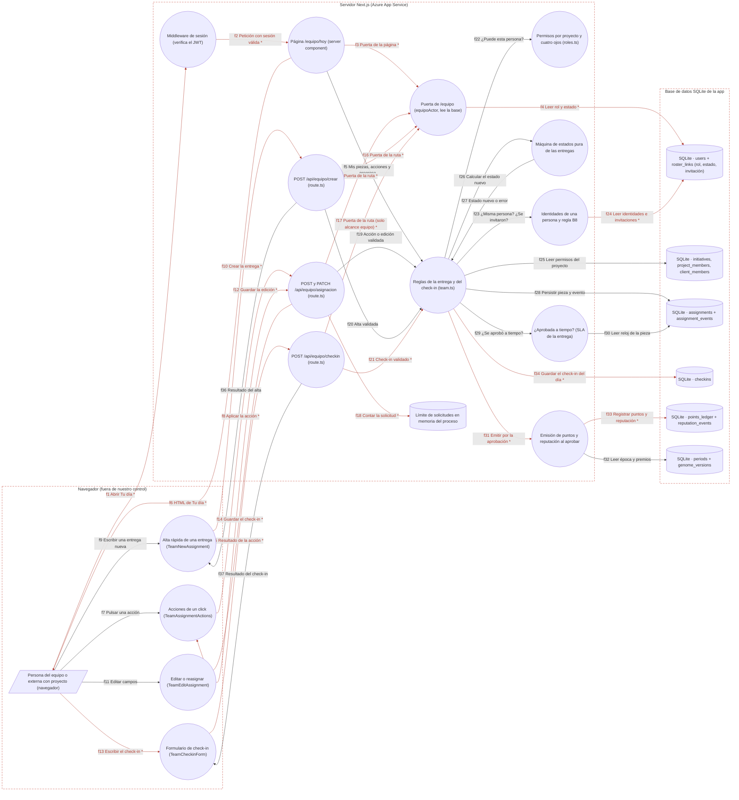

# Ficha: Actividades

Dueño: QA (por asignar) · Revisor: John · Fecha: 2026-10-21 · Commit de referencia: 0e07d8f

## 1. Resumen

Actividades es el trabajo diario: las **entregas** (tabla `assignments`), su ciclo de vida y el **check-in** del rito.

- **`/equipo/hoy` ("Tu día")** es la pantalla que abre cada persona. Muestra "Tus asignaciones de hoy" ordenadas por prioridad y vencimiento, cada una con su criterio de aceptación, su semáforo de plazo y solo las acciones que esa persona puede aplicar. También tiene un alta rápida, "Tu progreso" (comparación contigo mismo, con los puntos y la reputación de la temporada y las insignias) y el check-in del día. El founder y la supervisión ven además "Resto del equipo". Quien trabaja por proyecto (contributor con acuerdo y membresía, alcance `proyectos`) ve "Tus proyectos" y **no** tiene check-in: no se mide jornada.
- **Máquina de estados** (`team-state-machine.ts`, función pura): `Backlog → Asignada → En curso → En revisión → Hecha`, con la rama `Bloqueada` (motivo obligatorio) que vuelve al estado previo, y `devolver` ("Pedir ajustes", también con motivo obligatorio) de `En revisión` a `En curso`. Sin saltos.
- **Crear** (`POST /api/equipo/crear` → `createAssignmentAs`). Con responsable la entrega nace `Asignada`; sin responsable va al `Backlog`. Asignarle a otra persona es de quien planifica el proyecto. Quien no planifica crea sin tamaño, sin fecha y fuera de la bandeja del founder.
- **Editar o reasignar** (`PATCH /api/equipo/asignacion` → `editarAsignacion`, desde el tablero del proyecto). El dueño cambia el contexto (descripción y enlace); quien planifica, el resto. `Hecha` no se edita. En revisión, responsable, tamaño, fecha, prioridad, criterio y proyecto quedan fijos.
- **Acciones de un click** (`POST /api/equipo/asignacion` → `aplicarAccionAsignacion`): Tomar, Empezar, Enviar a revisión, Aprobar entrega, Pedir ajustes, Bloquear y Desbloquear.
- **Regla de revisión ("cuatro ojos")**: quien es dueño no aprueba ni devuelve lo suyo, con ninguna de sus identidades, ni siquiera el founder. Tampoco lo hacen quien la envió a revisión, quien invitó al dueño o fue invitado por él (B8, salvo el founder), ni quien le dio la pieza o lo sumó al proyecto (solo para aprobar). La entrega de un `pending:` sin vincular solo la revisa el founder o la supervisión. Una revisión no se bloquea: se devuelve.
- **Al aprobar** se emiten puntos y reputación en la **misma transacción** (`emitirPorAprobacion`). El tamaño (S/M/L) fija el premio, aprobar antes del vencimiento da un 25 % extra, el presupuesto de la época pone el tope y la operación es idempotente por `ref = assignment:<id>`.
- **Check-in** (`POST /api/equipo/checkin` → `upsertCheckin`): hecho, haciendo y bloqueado. Uno por persona y día, editable el mismo día. Es solo para el equipo interno.

## 2. Diagrama (DFD)

Archivo: [`docs/dfd/actividades.tm7`](../dfd/actividades.tm7), más la imagen exportada [`docs/dfd/actividades.svg`](../dfd/actividades.svg). Los dos se generan desde la fuente [`docs/dfd/actividades.json`](../dfd/actividades.json) con `python docs/dfd/generar_tm7.py docs/dfd/actividades.json --estricto`, que pasa: cada `codigo` existe en el repo. La fuente tiene 24 elementos (1 actores, 16 procesos, 7 almacenes), 37 flujos (20 sensibles) y 3 fronteras de confianza.

Leyenda: `[/ /]` actor, `(( ))` proceso, `[( )]` almacén y `subgraph` frontera de confianza. Un `*` y la flecha en rojo marcan un flujo con datos sensibles (sesión, datos personales o valor en puntos). Las fronteras van punteadas. El bloque sale de `python docs/dfd/generar_tm7.py docs/dfd/actividades.json --mermaid`.

## 3. Recorrido de una acción

Acción elegida: una supervisora (o quien tiene el rol `revisa` en el proyecto) pulsa **"Aprobar entrega"** sobre una pieza `En revisión` de otra persona.

1. **Pantalla o componente:** `/equipo/hoy`, sección "Resto del equipo" (`app/equipo/hoy/page.tsx:359-380`), o el tablero del proyecto. Cada tarjeta (`AssignmentCard`, 57-140) monta `TeamAssignmentActions` solo con las acciones que `accionesPermitidas` deja (`page.tsx:159`, `team.ts:811-818`). El dueño nunca ve "Aprobar entrega" sobre lo suyo; ve "La revisa otra persona del proyecto" (`page.tsx:135-137`).
2. **Llamada al backend (endpoint y datos enviados):** `TeamAssignmentActions.tsx:59-63` hace `fetch("/api/equipo/asignacion", { method: "POST", body: { assignmentId, action: "aprobar", reason: undefined } })` con la cookie `zelena_session` (`SameSite=Lax`, `httpOnly`).
3. **Ruta y controlador:** `app/api/equipo/asignacion/route.ts#POST` (38-81). Pasos: `getSession` (39-42, 401), `equipoActor` (43-45, 403), límite de 60 solicitudes por minuto por `wallet:ip` (46-48, 429), `assignmentActionSchema` de zod (50-52, `team.ts:2035-2039`, 400) y luego `aplicarAccionAsignacion` (55-60). `errorDe` (31-36) traduce los errores: falta de motivo → 400, transición inválida → 409, `TeamError` → su código, cualquier otro → 500.
4. **Lógica de negocio (validaciones, permisos, cálculos):** `team.ts#aplicarAccionAsignacion` (721-803).
   - Si la pieza no existe, 404 (722-723).
   - `flagsDeTransicion` (863-916) calcula:
     - `permisosDe(actor, proyecto)`: el rol global más los roles del proyecto (`roles.ts:306-317`);
     - `esDueno` con `mismaPersona` (`identidades.ts:95-99`), que trata como una sola persona todas las identidades: `pending:<slug>`, la wallet vinculada y las filas del founder;
     - `esQuienEnvio`: el último `enviar_a_revision` del historial (878-884);
     - `vinculoInvitacion`, con `reglaB8` (`identidades.ts:131`);
     - `vinculoAsignacion`, con `leDioLaPieza` (924-939): `project_members.added_by` o el último `crear`, `asignar` o `reasignar`;
     - `duenoPendiente`: un `pending:` sin `roster_links`.
   - `puedeTransicionar` (`roles.ts:371-392`) evalúa en orden dueño → quien envió → invitación → asignación → pendiente → permiso `revisar`. Si alguno falla responde 403 con un motivo que habla de la entrega (`MOTIVO_TRANSICION`, `roles.ts:320-332`).
   - `teamTransition` (`team-state-machine.ts:116-156`) pasa de `En revisión` a `Hecha`. Si la pieza no está en revisión lanza `InvalidTeamTransitionError` (409).
   - En **una sola transacción** (757-796):
     - `UPDATE assignments`: `status`, `closed_at` y `updated_at`;
     - `INSERT assignment_events (aprobar)` con `day = today(now)` y `created_at = now`;
     - `cargarPiezaSla` + `aprobadaATiempo`: se aprobó antes del cierre hábil del día de vencimiento (`sla.ts:332-339`);
     - `emitirPorAprobacion` (`gamificacion.ts:124-182`). Antes de emitir revisa, en orden: que haya dueño, que no sea autoaprobación, la regla B8, que la pieza no esté publicada en el Ágora y que el `ref` no se haya emitido antes. Puntos = mínimo entre (base + bono) y el presupuesto restante de la época. La reputación va completa.
   - La emisión **no tiene try/catch**: si falla la base, se revierte también la aprobación.
5. **Base de datos (tablas o modelos leídos y escritos):**
   - Lee `assignments`, `assignment_events`, `users` (rol, `invited_by`, filas founder), `roster_links`, `initiatives`, `project_members` (roles, `added_by`), `client_members`, `periods`, `genome_versions`, `points_ledger` y `reputation_events` (idempotencia y presupuesto).
   - Escribe `assignments`, `assignment_events`, `points_ledger` y `reputation_events`.
6. **Respuesta y qué hace la pantalla con ella:** `{ ok, status: "Hecha", blockedReason: null, emision: { emitido, motivo, puntos, reputacion, bono }, textoEmision }` (`route.ts:63-77`), sin wallets ni nombres. Si viene `textoEmision` (presupuesto agotado, o la pieza se paga por hitos en el Ágora), el componente muestra "Entrega aprobada" con la nota y un botón "Entendido" antes de refrescar (`TeamAssignmentActions.tsx:70-73` y `83-98`). Si no, hace `router.refresh()` y la tarjeta desaparece de la lista: `Hecha` no aparece en "hoy".
7. **Casos de falla:**
   - 401 sin sesión. 403 si `equipoActor` da `null`.
   - 429 por el límite de solicitudes. 400 si el JSON no cumple el esquema.
   - 404 si la pieza no existe. 403 con motivo de cuatro ojos o de permiso. 409 si la pieza no está `En revisión`.
   - 500 si falla la base: todo se revierte.
   - "Error de red." si el `fetch` falla.
   - **Detalle:** sobre una pieza que el actor no ve, esta ruta responde 403 con motivo, mientras que `PATCH` responde 404 (ver §9).

## 4. Elementos del DFD en el código

| Elemento | Tipo | Archivo y función | Notas |
| --- | --- | --- | --- |
| `u` Persona (navegador) | Actor | `apps/web/src/lib/authz.ts#EquipoActor` (103-107) | Alcance `equipo` (founder, core, supervisión) o `proyectos` (contributor con acuerdo y membresía). |
| `ui_acc` Acciones de un click | Proceso (cliente) | `apps/web/src/components/TeamAssignmentActions.tsx#TeamAssignmentActions` (41-166), `CON_MOTIVO` (24-39) | Pide el motivo antes de "Bloquear" y "Pedir ajustes". Las mismas reglas se repiten en el servidor. |
| `ui_new` Alta rápida | Proceso (cliente) | `apps/web/src/components/TeamNewAssignment.tsx#TeamNewAssignment` (34-), `crear` (97-136) | En `/equipo/hoy` y en el tablero. No envía `specUrl`. |
| `ui_edit` Editar o reasignar | Proceso (cliente) | `apps/web/src/components/TeamEditAssignment.tsx#TeamEditAssignment` (57-), `cambios` (105-124), `guardar` (126-153) | Se monta en el tablero (`TeamBoard.tsx:110-128`), no en `/equipo/hoy`. Envía solo lo que cambió. |
| `ui_chk` Check-in | Proceso (cliente) | `apps/web/src/components/TeamCheckinForm.tsx#TeamCheckinForm` (13-94), `save` (30-51) | Solo se pinta con alcance `equipo` (`hoy/page.tsx:347-357`). |
| `mw` Middleware | Proceso | `apps/web/middleware.ts#middleware` (33-48) | No cubre `/api/**`: cada ruta tiene su puerta. |
| `hoy` Página `/equipo/hoy` | Proceso | `apps/web/app/equipo/hoy/page.tsx#EquipoHoyPage` (142-383), `AssignmentCard` (57-140) | Puerta propia (143-149). `mine` = `assignmentsForOwner(actor.wallet)` (174), con la wallet exacta. |
| `api_acc` Asignación | Proceso | `apps/web/app/api/equipo/asignacion/route.ts#POST` (38-81), `PATCH` (83-106), `errorDe` (31-36) | Solo valida e invoca. |
| `api_new` Crear | Proceso | `apps/web/app/api/equipo/crear/route.ts#POST` (23-55) | Con alcance `proyectos`, `initiativeId` es obligatorio (44-46). |
| `api_chk` Check-in | Proceso | `apps/web/app/api/equipo/checkin/route.ts#POST` (20-45) | 403 si el alcance no es `equipo` (27-29). |
| `gate` Puerta | Proceso | `apps/web/src/lib/authz.ts#equipoActor` (120-154) | Lee la base. Alumni → `null` (136). |
| `logic` Reglas de la entrega | Proceso | `apps/web/src/lib/team.ts#aplicarAccionAsignacion` (721-803), `createAssignmentAs` (387-455), `editarAsignacion` (1859-2029), `upsertCheckin` (986-1010), `accionesPermitidas` (811-818), `flagsDeTransicion` (863-916) | Nunca escribe `status` a mano: siempre pasa por `teamTransition`. |
| `perm` Permisos y cuatro ojos | Proceso | `apps/web/src/lib/roles.ts#puedeTransicionar` (371-392), `permisosEnProyecto` (306-317), `MOTIVO_TRANSICION` (320-332) | Módulo puro. |
| `ident` Identidades y B8 | Proceso | `apps/web/src/lib/identidades.ts#identidadesDe` (65-92), `mismaPersona` (95-99), `reglaB8` (131-) | El founder se reconoce por rol en la base y por roster, nunca por `FOUNDER_WALLET`. |
| `sm` Máquina de estados | Proceso | `apps/web/src/lib/team-state-machine.ts#teamTransition` (116-156), `canTeamTransition` (99-104) | `LINEAR` (45-59), `BLOCKABLE` (39), `NEEDS_REASON` (62). |
| `sla` A tiempo | Proceso | `apps/web/src/lib/sla-db.ts#cargarPiezaSla` (82-89), `slaConfig` (24-26); `sla.ts#aprobadaATiempo` (332-339) | Solo para el bono. |
| `emi` Emisión | Proceso | `apps/web/src/lib/gamificacion.ts#emitirPorAprobacion` (124-182), `refYaEmitido` (105-111), `textoEmision` (184-) | Se une a la transacción del llamador. |
| `rl` Límite de solicitudes | Almacén (memoria) | `apps/web/src/lib/rate-limit.ts#rateLimit` (10-20), `clientIp` (22-26) | 60 por minuto en acción, edición y alta. 30 por minuto en check-in. |
| `db_users` users + roster_links | Almacén | `schema.sql#users` (18), `roster_links` (592) | `invited_by` alimenta la regla B8. |
| `db_proy` Proyecto y cliente | Almacén | `schema.sql#initiatives` (480), `project_members` (577), `client_members` (350) | `added_by` alimenta el vínculo de asignación. |
| `db_trabajo` Trabajo | Almacén | `schema.sql#assignments` (499), `assignment_events` (533) | `assignment_events` es append-only por convención; `vincularPrincipal` reescribe su `actor_wallet` (ver §9). |
| `db_checkins` Check-ins | Almacén | `schema.sql#checkins` (548) | `UNIQUE(wallet, day)`. También guarda `created_at` y `updated_at`. |
| `db_ledger` Puntos y reputación | Almacén | `schema.sql#points_ledger` (167), `reputation_events` (156) | Append-only. Saldo = `SUM()`. |
| `db_genoma` Época y genoma | Almacén | `schema.sql#periods` (177), `genome_versions` (251) | `TASK_POINTS`, `TASK_REP`, `ON_TIME_BONUS_PCT` y `EPOCH_BUDGET`. |

## 5. Flujos de datos

| Flujo | De → a | Protocolo | Datos que viajan |
| --- | --- | --- | --- |
| f1 | u → mw | HTTPS | **Sensible (sesión).** `GET /equipo/hoy` con la cookie `zelena_session`. |
| f2 | mw → hoy | En proceso (Next.js) | **Sensible (sesión).** Petición con el JWT verificado. |
| f3 | hoy → gate | Llamada de función | **Sensible (sesión).** Wallet de la sesión. |
| f4 | gate → db_users | SQL | **Sensible (datos personales).** Nombre, rol, supervisión, estado y acuerdo. |
| f5 | hoy → logic | Llamada de función | `assignmentsForOwner`, `accionesPermitidas`, `ownProgress`, `getCheckin` y `proyectosVisibles`. |
| f6 | hoy → u | HTTPS | **Sensible (datos personales y valor).** Tarjetas, puntos y reputación de la temporada, insignias y check-in de hoy. |
| f7 | u → ui_acc | Interacción | Acción elegida y motivo escrito. |
| f8 | ui_acc → api_acc | HTTPS | **Sensible (sesión).** `POST { assignmentId, action, reason }` con la cookie. |
| f9 | u → ui_new | Interacción | Título, proyecto, responsable, prioridad, tamaño, fecha y criterio. |
| f10 | ui_new → api_new | HTTPS | **Sensible (sesión).** `POST` con `createAssignmentSchema` y la cookie. |
| f11 | u → ui_edit | Interacción | Campos cambiados y motivo opcional. |
| f12 | ui_edit → api_acc | HTTPS | **Sensible (sesión).** `PATCH` con `editarAsignacionSchema` (solo lo que cambió) y la cookie. |
| f13 | u → ui_chk | Interacción | **Sensible (datos personales).** Texto libre del check-in. |
| f14 | ui_chk → api_chk | HTTPS | **Sensible (sesión y datos personales).** `POST { done, doing, blocked }` con la cookie. |
| f15 | api_acc → gate | Llamada de función | **Sensible (sesión).** Wallet de la sesión. |
| f16 | api_new → gate | Llamada de función | **Sensible (sesión).** Wallet de la sesión. |
| f17 | api_chk → gate | Llamada de función | **Sensible (sesión).** Wallet de la sesión. 403 si el alcance es `proyectos`. |
| f18 | api_acc → rl | En memoria | **Sensible (datos personales).** Clave `equipo:accion\|editar:<wallet>:<ip>`. |
| f19 | api_acc → logic | Llamada de función | Acción o edición validada por zod. |
| f20 | api_new → logic | Llamada de función | `createAssignmentAs(actor, entrada)`. |
| f21 | api_chk → logic | Llamada de función | **Sensible (datos personales).** `upsertCheckin(wallet, …)`. |
| f22 | logic → perm | Llamada de función | Acción y flags de cuatro ojos y permisos. |
| f23 | logic → ident | Llamada de función | Wallet del actor y del dueño. |
| f24 | ident → db_users | SQL | **Sensible (datos personales).** `roster_links`, filas founder e `invited_by`. |
| f25 | logic → db_proy | SQL | `client_id`, roles y `added_by` del proyecto, y `client_members`. |
| f26 | logic → sm | Llamada de función | Estado, estado previo al bloqueo, acción y motivo. |
| f27 | sm → logic | Llamada de función | Estado nuevo o error (`InvalidTeamTransitionError`, `BlockReasonRequiredError`). |
| f28 | logic → db_trabajo | SQL (transacción) | `UPDATE assignments` + `INSERT assignment_events`. |
| f29 | logic → sla | Llamada de función | Id de la pieza e instante de la aprobación. |
| f30 | sla → db_trabajo | SQL | `due_date`, prioridad y eventos de la pieza. |
| f31 | logic → emi | Llamada de función (misma transacción) | **Sensible (valor).** Dueño, aprobador, tamaño y `aTiempo`. |
| f32 | emi → db_genoma | SQL | Época actual y premios del genoma. |
| f33 | emi → db_ledger | SQL (misma transacción) | **Sensible (valor).** `INSERT points_ledger` + `reputation_events` con `ref = assignment:<id>`. |
| f34 | logic → db_checkins | SQL | **Sensible (datos personales).** `INSERT` o `UPDATE` del check-in. `day = today()` del servidor. |
| f35 | api_acc → ui_acc | HTTPS | **Sensible (valor).** `{ ok, status, blockedReason, emision, textoEmision }` o `{ error }`. |
| f36 | api_new → ui_new | HTTPS | `{ ok, id }` o `{ error }`. |
| f37 | api_chk → ui_chk | HTTPS | `{ ok, day }` o `{ error }`. |

## 6. Dependencias con otras features

- **Login y sesión:** `getSession`, `middleware.ts` y la cookie. `equipoActor` decide el alcance.
- **Proyectos y membresías:** `permisosDe`, `veIniciativa`, roles del proyecto (`project_members`), `rolesEnProyecto` y `validarDestino`. Crear dentro de un proyecto y revisar dependen del rol que se tenga en él. `quitarMiembro` se niega si la persona tiene entregas abiertas.
- **Gamificación y épocas:** `emitirPorAprobacion`, `progresoDeTareas`, `senalesProgreso`, `insignias`, `currentEpoch` y el presupuesto de la época.
- **SLA, recordatorios y avisos:** `SlaBadge` y `slaDeAsignaciones` en cada tarjeta. `aprobadaATiempo` para el bono. Los recordatorios leen las mismas piezas y eventos.
- **Dashboard:** consume todo lo que Actividades escribe (bloqueos, eventos y check-ins).
- **Talento e importador:** `vincularPrincipal` (`talento.ts:548`) mueve `owner_wallet`, `assignment_events.actor_wallet` y `checkins` de `pending:<slug>` a la cuenta real (y borra los check-ins que chocan). El importador crea piezas con `createAssignment` sin evento `crear` (`team-import.ts:555`).
- **Telegram:** el bot crea piezas con `createAssignment` directo (`bot-tools.ts:907-919`), las mueve con `applyAssignmentAction` (`bot-tools.ts:724`) y registra check-ins con `upsertCheckin` (`bot-tools.ts:940`). La escritura solo la tiene el founder (`bot-store.ts:10`).
- **Ágora e hitos:** una pieza publicada (`published_as_project_id`) no emite al aprobarse: se paga por hitos.
- **Clientes y grafo:** `client_id` y `graph_node_id` de la pieza (`clienteDeLaPieza`).

Dependencias inversas anotadas al integrar (la otra ficha ya las tenía; la guía pide anotarlas en las dos):

- **Sitio público y formularios** ([sitio-publico-y-formularios.md](sitio-publico-y-formularios.md)): las cifras en vivo de la landing (`cifrasEnVivo`, `src/lib/prueba-en-vivo.ts:40`) cuentan entregas aprobadas leyendo `assignment_events`.

## 7. Amenazas relevantes

| Amenaza | Categoría | Elemento | Estado | Justificación |
| --- | --- | --- | --- | --- |
| El dueño aprueba su propia entrega, también con su otra identidad (founder con dos filas) | Elevación de privilegios (E) | logic, perm, ident | Mitigada | `esDueno` usa `mismaPersona` (`team.ts:872`, `identidades.ts:95-99`). `puedeTransicionar` lo rechaza primero (`roles.ts:376`) y la emisión lo vuelve a frenar (`gamificacion.ts:141`). Tests: `caracterizacion/actividades.test.ts` y `team-puntos.test.ts`. |
| Quien planifica crea una segunda cuenta, la suma, le da la pieza y la aprueba para acuñar puntos | Elevación de privilegios (E) | logic, perm | Mitigada | `vinculoAsignacion` (`team.ts:893-895`, `leDioLaPieza` 924-939) y `roles.ts:379`. B8 en las dos direcciones (`identidades.ts:131-141`). |
| Escribir `status` u otros campos por `PATCH` para saltarse la máquina de estados | Manipulación (T) | api_acc, logic | Mitigada | `editarAsignacionSchema` no tiene `status` (`team.ts:1817-1841`). El estado solo cambia con `teamTransition` (`team.ts:737-745` y `1983-1986`). |
| Inflar el tamaño o mover la fecha de una entrega ya en revisión para cobrar más bono | Manipulación (T) | logic | Mitigada | `fijaPorRevision` + 409 (`team.ts:1806-1808` y `1928-1930`). Una revisión no se bloquea (`seBloqueaUnaRevision`, 828-830 y 733). Test: `caracterizacion/actividades.test.ts`. |
| Doble emisión por doble clic o por reintento | Manipulación (T) | emi, db_ledger | Mitigada | `refYaEmitido` en las dos tablas (`gamificacion.ts:105-111` y 152). La transición `Hecha → aprobar` es inválida (`team-state-machine.ts:52`) y todo va en una transacción (`team.ts:757-796`). |
| CSRF: otro sitio dispara `POST` o `PATCH` con la cookie de la persona | Manipulación (T) | api_acc, api_new, api_chk | Mitigada | La cookie es `SameSite=Lax` y `httpOnly` (`session.ts:19-25`): no viaja en un `POST` entre sitios. Las rutas esperan JSON. |
| XSS con `spec_url` (`javascript:`) pintado como enlace | Manipulación (T) | hoy, ui_edit | Mitigada | Al pintar solo se acepta http(s) (`hoy/page.tsx:112`, `TeamBoard.tsx:86`, `esEnlaceSeguro` `team.ts:1813-1815`). La edición lo valida (`team.ts:1820-1826`). **El alta no lo valida** (`team.ts:2065`): la defensa en profundidad queda pendiente (§9). |
| Saber si existe una pieza ajena (de un cliente donde no participo) por su id | Divulgación de información (I) | api_acc | Pendiente | `POST` responde 403 con motivo sobre una pieza que no veo, porque `aplicarAccionAsignacion` no oculta la existencia. En cambio `PATCH` responde 404 (`team.ts:1873`). Test: `caracterizacion/actividades.test.ts`. |
| Un contributor con alcance `proyectos` escribe un check-in (se mediría su jornada) | Elevación de privilegios (E) | api_chk | Mitigada | `route.ts:27-29` exige alcance `equipo`. Test estático: `authz.test.ts:386`. |
| Nadie sabe quién movió una pieza | Repudio (R) | db_trabajo | Mitigada | Cada creación, acción y edición deja un evento con `actor_wallet`, `day` y `created_at` (`team.ts:448-451`, 773-776 y 2022-2025). |
| El historial "append-only" se reescribe | Repudio (R) | db_trabajo, db_checkins | Aceptada | No hay trigger que lo impida. `vincularPrincipal` (`talento.ts:609-627`, solo el founder) reescribe `actor_wallet` y borra los check-ins que chocan. Se acepta porque es la misma persona y queda en `talent_events` con conteos exactos. |
| Saltarse el límite de 60 por minuto rotando `X-Forwarded-For` | Denegación de servicio (D) | rl | Pendiente | `clientIp` confía en el primer valor de `X-Forwarded-For` (`rate-limit.ts:22-24`). El `Map` es por proceso. Hace falta sesión. |
| Exposición del texto del check-in | Divulgación de información (I) | db_checkins, f13-f14 | Aceptada | Solo lo ve quien supervisa en el digest (`digest.ts:141-145`) y la propia persona. Viaja por HTTPS con sesión. La hora queda guardada en `created_at` y `updated_at` (`schema.sql:555-556`), aunque el comentario de la ruta dice que no (§9). |

## 8. Prueba de caracterización

Archivo: `apps/web/src/lib/caracterizacion/actividades.test.ts`. Se corre con `cd apps/web && npx vitest run src/lib/caracterizacion/actividades.test.ts` y el resultado es **9 de 9 pasan**.

Usa una base SQLite en memoria con `schema.sql`, `seedTeam` y la época 1 abierta. El caso central recorre la entrega de punta a punta con las funciones que invocan las rutas:

1. `createAssignmentSchema` + `createAssignmentAs`: la pieza nace `Asignada`, con el evento `crear`.
2. Bloquear sin motivo falla. Bloquear con motivo y desbloquear la devuelven a `Asignada`.
3. Aprobar desde `Asignada` es un salto inválido.
4. Empezar y enviar a revisión. En revisión, bloquear da 409 y replanificar da 409.
5. Cuatro ojos: el dueño recibe 403 (`dueno`) y un `core` sin rol frente a un dueño `pending:` recibe 403 (`pendiente`).
6. Pedir ajustes sin motivo falla. Con motivo, la pieza vuelve a `En curso` y el motivo queda en el evento.
7. Se reenvía y una supervisora aprueba: `Hecha`, con 38 puntos (30 + 25 %) y 3 de reputación en el ledger con `ref = assignment:<id>`.
8. Aprobar otra vez es inválido y editar da 409.
9. El historial completo queda en orden.

Además fija:

- la edición: el dueño cambia el contexto y no la prioridad; la reasignación deja `reasignar` con la lista de campos;
- el check-in: uno por día, editable, y vacío → 400;
- el alta de una persona externa con rol `ejecuta`;
- cuatro comportamientos actuales señalados como hallazgo: el día del check-in sale del reloj del servidor; "Tus asignaciones" filtra por la wallet exacta; `POST` da 403 y `PATCH` da 404 sobre una pieza ajena; el alta acepta un `specUrl` que no es http(s).

Ya hay pruebas que cubren más casos: `team-state-machine.test.ts` (16), `team.test.ts` (55), `team-puntos.test.ts` (24) y `team-proyectos.test.ts` (61).

## 9. Preguntas abiertas

1. **¿El día del check-in y del historial es el del servidor o el del negocio?** `today()` (`team.ts:105-110`) usa la hora del proceso (UTC en Azure). Un check-in a las 21:30 de Bogotá queda guardado como del día siguiente (probado en la caracterización). `zona-horaria.ts:5-8` ya lo advierte, pero `upsertCheckin` (987), `aplicarAccionAsignacion` (749), `createAssignmentAs` (431) y `editarAsignacion` (2025) lo siguen usando.
2. **¿"Tus asignaciones" debe sumar todas tus identidades?** La lista y "Tu progreso" (cerradas y abiertas) usan la wallet exacta (`assignmentsForOwner` `team.ts:512-518`, `ownProgress` 1059-1098). En cambio, los puntos de la temporada y los cuatro ojos suman todas las identidades (`progresoDeTareas`, `mismaPersona`). Si el founder entra con la wallet de su sesión, no ve como suyas las piezas que están a nombre de su fila del roster.
3. **¿Una pieza que no ves debe responder 404 también en `POST`?** Hoy `POST /api/equipo/asignacion` responde 403 con motivo y `PATCH` responde 404 (`team.ts:1873`). Eso permite saber qué ids existen en proyectos de cliente ajenos.
4. **¿El alta debe validar `specUrl` como la edición?** `createAssignmentSchema.specUrl` solo limita el largo (`team.ts:2065`), mientras que `editarAsignacionSchema` exige http(s) (1820-1826). Hoy lo salva el render (`esEnlaceSeguro`).
5. **¿Hay dos caminos de alta con reglas distintas?** La web usa `createAssignmentAs`, con permisos, cliente, campos de planificación y evento `crear`. El bot (`bot-tools.ts:907-919`) y el importador (`team-import.ts:555`) usan `createAssignment` directo, sin evento `crear` y sin `validarDestino` ni `clienteDeLaPieza`. Hoy el bot solo escribe para el founder, pero la regla está duplicada. ¿Se unifica?
6. **¿Se guarda la hora del check-in o no?** La ruta dice "No se registra hora de envío" (`checkin/route.ts:5`), pero `checkins.created_at` y `updated_at` sí la guardan (`schema.sql:555-556`; `upsertCheckin` escribe `updated_at`, `team.ts:997`). Hoy nada la lee, pero la promesa de doc 16 ("cero telemetría de presencia") no se cumple en la base.
7. **¿Hacen falta tres resolvedores de actor?** Están `equipoActor` (`authz.ts:120`), `actorEstricto` (`authz.ts:58`) y `actorFromSession` (`team.ts:1109`, cae a los claims de la cookie y no mira `status`). El test estático prohíbe `actorFromSession` en `app/`, pero el bot lo usa (`bot-agent.ts:290`). Conviene dejar uno solo con modos explícitos.
8. En `/equipo/hoy` solo el founder y la supervisión pueden asignar a otra persona o fijar el tamaño (`hoy/page.tsx:260-261`, `seesAll`), aunque el servidor también se lo permite a quien tiene el rol `estructura` en ese proyecto. ¿Es intencional que esa persona solo lo haga desde el tablero?
