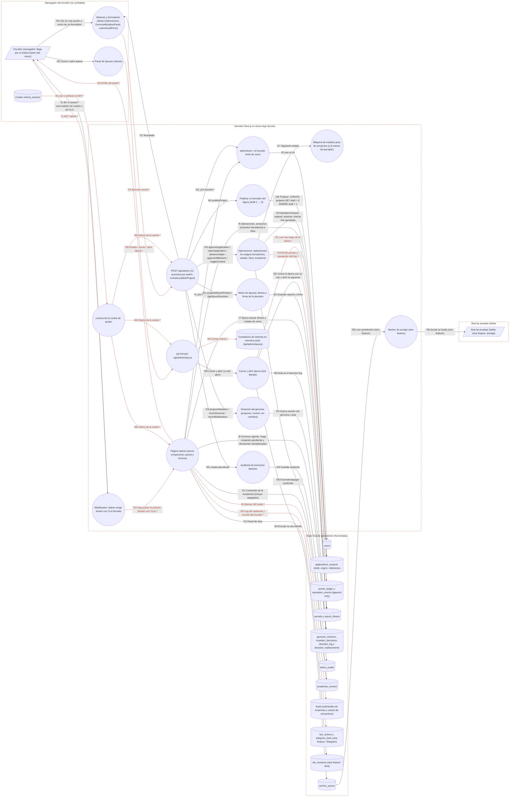

# Ficha: Admin

Dueño: QA (por asignar) · Revisor: John · Fecha: 2026-10-21 · Commit de referencia: 0e07d8f · Actualizada al release `wp/32-release` (4032c7c): secciones 1, 2, 4, 5, 7 y 8

## 1. Resumen

Qué hace: es el panel del founder. Una sola página (`/admin`, server component) lee casi todo el estado del sistema y monta los botones y formularios que cambian ese estado. Las escrituras pasan por dos rutas:

- `POST /api/admin`: una ruta con un `switch` de 12 acciones: publicar un proyecto en borrador del Ágora (`publishProject`, nueva en el release), aprobar o rechazar aplicaciones del Ágora, avanzar el estado de un proyecto, aprobar hitos (emite puntos y reputación), encender o apagar contenido de la Academia, calcular y firmar el fitness de la época, proponer o revertir una mutación del genoma, registrar "sin cambios" y crear una auditoría de funciones latentes.
- `GET/POST /api/admin/epoca`: ver qué falta para cerrar la época, cerrarla y abrir la siguiente en una operación (raíz Merkle de lo emitido, encolada para la red de pruebas), o abrir una cuando no hay ninguna abierta.

Además, la página muestra paneles de otras features que tienen su propia ruta: ritos (`/api/ritos`), el vínculo del asistente de Telegram (`/api/telegram/vincular`), y la bandeja de leads del sitio público (solicitudes de empresas y avisos de encuentros, con nombre y correo).

Quién lo usa: solo quien tiene `users.role = 'founder'` en la base (`src/lib/authz.ts#adminActor`). Hoy, en la práctica, John. Los supervisores no administran (`rolPuedeAdministrar`, `src/lib/authz.ts:41-43`).

Casos de uso:

1. Publicar los proyectos del Ágora que están en borrador (los sembrados nacen así desde 2c049eb) y elegir quién ejecuta cada uno (aprobar o rechazar aplicaciones; un borrador no se asigna).
2. Avanzar el estado de un proyecto con la máquina de estados pura (`Open → Assigned → Delivered → Scored → Distributed`).
3. Aprobar hitos: 1 USD = 1 punto de ejecución para el ejecutor, dentro del presupuesto de la época y con la regla B8.
4. Moderar la Academia.
5. Ciclo de época: calcular el fitness, decidir la mutación de la siguiente (o "sin cambios"), firmar la decisión y cerrar la época (raíz Merkle anclable).
6. Auditar funciones latentes de un mecanismo.
7. Leer los leads del sitio, el log del asistente de Telegram y preparar ritos.

## 2. Diagrama (DFD)

Archivo: [`docs/dfd/admin.tm7`](../dfd/admin.tm7), más la imagen exportada [`docs/dfd/admin.svg`](../dfd/admin.svg). Los dos se generan desde la fuente [`docs/dfd/admin.json`](../dfd/admin.json) con `python docs/dfd/generar_tm7.py docs/dfd/admin.json --estricto`, que pasa: cada `codigo` existe en el repo. La fuente tiene 31 elementos (2 actores, 16 procesos, 13 almacenes), 44 flujos (14 sensibles) y 4 fronteras de confianza.

Cambios del release `wp/32-release`: proceso nuevo "Publicar un borrador del Ágora" (`publicarProyecto`) con sus flujos f43-f44; `projects` lleva `draft` y `origin`; la página lee además los originales de las decisiones reemplazadas (`decision_replacements`, f8).

Vista para GitHub (salida de `--mermaid`): `[/ /]` actor, `(( ))` proceso, `[( )]` almacén, cada `subgraph` es una frontera de confianza y los flujos con `*` y en rojo llevan datos sensibles.



## 3. Recorrido de una acción

Acción elegida: **el founder aprueba un hito de un proyecto que ya tiene ejecutor** (es la acción que emite puntos).

1. **Pantalla o componente:** el founder llega por el enlace "Admin" del menú (`src/components/NavContextual.tsx`, l. 72-79), que se dibuja con los claims de la cookie (`src/components/Nav.tsx:34`, `claimsPuedenAdministrar`). `middleware.ts` exige sesión **con CLA firmado** para `/admin` (l. 24 y 41). `app/admin/page.tsx#AdminPage` repite su propia puerta (`if (!session) redirect("/entrar")`, l. 28; `if (!adminActor(session, db)) redirect("/perfil")`, l. 33). En la sección "Proyectos" (l. 382-430), cada proyecto con ejecutor muestra un botón `AdminAction` por hito: `"Aprobar <código> ($<monto>)"` (l. 414-422).
2. **Llamada al backend:** `src/components/AdminAction.tsx#AdminAction` (`run`, l. 24-44) hace `POST /api/admin` con `{ action: "approveMilestone", milestoneId }` y la cookie `zelena_session`. No pide confirmación.
3. **Ruta y controlador:** `app/api/admin/route.ts#POST`: lee la sesión (l. 20), puerta `adminActor` (l. 22 → 403 "Solo el founder puede administrar."), valida con `adminActionSchema` (l. 26-27; `src/lib/validation.ts:78-111`) y entra al `switch` (l. 51-112), caso `approveMilestone` (l. 65-69).
4. **Lógica de negocio:** `src/lib/admin.ts#approveMilestone` (l. 58-106):
   - el hito existe y no está aprobado (l. 62-63);
   - el proyecto tiene ejecutor (l. 70-71); no se mira el estado del proyecto;
   - regla B8, un supervisor no evalúa a su invitado directo (`src/lib/rules.ts#violatesB8`), con la excepción "Stage 0" cuando el supervisor es la wallet `FOUNDER_WALLET` (l. 76-82);
   - puntos = `amount_usd` del hito (l. 84);
   - tope: lo emitido en la época actual en el bucket `ejecucion` (`src/lib/gamificacion.ts#puntosDeEpoca`) más los puntos nuevos no puede pasar `EPOCH_BUDGET` del genoma vigente (l. 88-93);
   - escritura en una transacción (l. 95-104).
5. **Base de datos:** lee `milestones`, `projects`, `users.invited_by`, `points_ledger` (suma de la época), `periods` y el genoma; escribe `milestones.approved = 1`, una fila en `points_ledger` (`wallet`, `points`, `period_id`, `bucket = 'ejecucion'`, `ref = "<título> · <hito>"`) y una en `reputation_events` (eje `ejecucion`, `delta = max(1, round(puntos / 10))`). Ambas tablas son append-only: lo emitido no se borra (regla de producto "jamás confiscar").
6. **Respuesta y qué hace la pantalla:** 200 `{ ok: true, points, wallet }`. `AdminAction` llama a `router.refresh()` (l. 38): la página se vuelve a renderizar y el botón queda como `"<código> ✓"` deshabilitado (page.tsx l. 418-421). Lo emitido entra en la raíz Merkle cuando el founder cierre la época (`/api/admin/epoca`).
7. **Casos de falla:**

   | Situación | Respuesta | Qué ve el founder |
   | --- | --- | --- |
   | Sin sesión o sin CLA en la cookie | 307 del middleware a `/entrar?next=/admin` | La pantalla de entrar. |
   | Sesión sin rol founder en la base | Página: redirección a `/perfil`. API: 403. | Su perfil, o el error bajo el botón. |
   | Acción o forma inválida | 400 "Entrada inválida." | Error bajo el botón (`AdminAction.tsx:60`). |
   | Falta el id | 400 "Falta milestoneId." | Igual. |
   | Hito inexistente / ya aprobado / proyecto sin ejecutor | 400 con el mensaje de `lib/admin.ts` | Igual (el botón ya aprobado viene deshabilitado). |
   | Regla B8 | 400 "Regla B8: un supervisor no puede evaluar a su invitado directo." | Igual. |
   | Presupuesto de la época agotado | 400 "Emisión rechazada: excede el presupuesto de época." | Igual. |
   | Cualquier otra excepción | 400 con el mensaje **crudo** de la excepción (`route.ts:114-115`) | Texto técnico. |

## 4. Elementos del DFD en el código

| Elemento | Tipo | Archivo y función | Notas |
| --- | --- | --- | --- |
| Founder (navegador) | Cliente externo | `src/components/NavContextual.tsx#NavContextual` | El enlace "Admin" se dibuja con los claims de la cookie; la autoridad es la base. |
| Red de pruebas Stellar | Cliente externo | `src/lib/anchor.ts#anclarPendientes` | Otra feature (anclaje); aquí solo recibe la raíz Merkle encolada. |
| Middleware | Proceso | `middleware.ts#middleware` | `/admin` en `PROTECTED_CLA` (l. 24). No cubre `/api/admin`. |
| Página /admin | Proceso | `app/admin/page.tsx#AdminPage` | 10 secciones; consultas SQL directas para aplicaciones (l. 35-48) y leads (l. 63-73). |
| getSession | Proceso | `src/lib/session.ts#getSession` | Lee y verifica el JWT (`src/lib/jwt.ts#verifySession`). |
| adminActor | Proceso | `src/lib/authz.ts#adminActor` | Exige fila en `users` y `role = 'founder'`; no mira `status` ni `cla_signed`. |
| Botones y formularios | Proceso | `src/components/AdminAction.tsx#AdminAction` | También `GenomeMutationPanel` y `LatentAuditForm`, que llaman a la misma ruta. |
| Panel de épocas | Proceso | `src/components/EpocaPanel.tsx#EpocaPanel` | Llama a `/api/admin/epoca`. |
| POST /api/admin | Proceso | `app/api/admin/route.ts#POST` | 12 acciones (`publishProject` en l. 71-75); sin límite de tasa; devuelve 403 también sin sesión. |
| GET/POST /api/admin/epoca | Proceso | `app/api/admin/epoca/route.ts#POST` | Con `GET`; 401 sin sesión, 403 sin rol, límite de 10 por minuto, `Cache-Control: no-store`. |
| Operaciones de administración | Proceso | `src/lib/admin.ts#approveMilestone` | Con `approveApplication`, `rejectApplication`, `advanceState`, `toggleContent`. Usan `getDb()` global salvo `approveMilestone`, que acepta `db`. |
| Máquina de estados | Proceso | `src/lib/state-machine.ts#transition` | Con `nextAction`; función pura única (regla de `CLAUDE.md`). Desde el release también `esBorrador` y `recibeAplicaciones`: el borrador es una marca aparte del ciclo. |
| Publicar un borrador | Proceso | `src/lib/agora-borradores.ts#publicarProyecto` | `UPDATE projects SET draft = 0 WHERE id = ? AND draft = 1`; no toca el estado. Si ya estaba publicado lanza `BorradorError(409)`, pero la ruta lo devuelve como 400 (ver sección 8). |
| Motor de épocas | Proceso | `src/lib/epochs.ts#signEpochDecision` | Con `computeAndStoreEpochFitness`; exige mutación decidida antes de firmar. |
| Mutación del genoma | Proceso | `src/lib/mutation.ts#proposeMutation` | Con `revertToVersion`, `recordNoMutation`, `validateMutation`. |
| Auditoría de funciones latentes | Proceso | `src/lib/audits.ts#createLatentAudit` | |
| Cerrar y abrir época | Proceso | `src/lib/epocas.ts#cerrarYAbrirEpoca` | Con `abrirEpoca` y `estadoCierreEpoca`; relee el periodo dentro de la transacción. |
| Worker de anclaje | Proceso | `src/lib/anchor.ts#anclarPendientes` | Otra feature: lo corre `packages/scripts/anchor-worker.mjs` o `/api/anchor/run`. |
| Cookie zelena_session | Almacén de datos | `src/lib/jwt.ts#SESSION_COOKIE` | Ver ficha de login y sesión. |
| Contadores en memoria | Almacén de datos | `src/lib/rate-limit.ts#rateLimit` | Solo los usa `/api/admin/epoca`. |
| users | Almacén de datos | `src/lib/schema.sql#users` | Fuente del rol. |
| applications, projects, milestones | Almacén de datos | `src/lib/schema.sql#projects` | `projects.draft` (1 = borrador, no se ve en público) y `projects.origin` (`seed` o `agora`) llegan con el release. |
| points_ledger, reputation_events | Almacén de datos | `src/lib/schema.sql#points_ledger` | Append-only; saldos por `SUM()`. |
| periods, epoch_fitness | Almacén de datos | `src/lib/schema.sql#periods` | `epoch_fitness` es append-only: una fila por cálculo. |
| genome_versions, mutation_decisions, decision_log, decision_replacements | Almacén de datos | `src/lib/schema.sql#decision_log` | `decision_log` no tiene columna de autor. `decision_replacements` (release) dice qué decisión reemplaza a cuál; los originales solo se ven en /admin. |
| latent_audits | Almacén de datos | `src/lib/schema.sql#latent_audits` | |
| academia_content | Almacén de datos | `src/lib/schema.sql#academia_content` | |
| leads | Almacén de datos | `src/lib/schema.sql#leads` | Nombre, correo, empresa y mensaje del sitio público. |
| bot_actions, telegram_links | Almacén de datos | `src/lib/bot-store.ts#listBotActions` | Otra feature (Telegram); `/admin` los lee con `listBotActions` y `linkForWallet`. |
| rite_sessions | Almacén de datos | `src/lib/ritos.ts#panelRitosAdmin` | Otra feature (ritos). |
| anchor_queue | Almacén de datos | `src/lib/schema.sql#anchor_queue` | `kind = 'merkle_root'` al cerrar una época. |

## 5. Flujos de datos

Los flujos con **[sensible]** llevan sesión, datos personales o puntos (el equivalente a dinero dentro del sistema).

| Flujo | De → a | Protocolo | Datos que viajan |
| --- | --- | --- | --- |
| f1 | Founder → middleware | HTTPS (Cookie) | **[sensible]** JWT de sesión en `GET /admin` |
| f2 | Middleware → Founder | HTTPS (307) | redirección a `/entrar?next=/admin` sin sesión o sin CLA |
| f3 | Cookie → getSession | HTTPS (Cookie) | **[sensible]** claims (pista, no autoridad) |
| f4 | Página → adminActor | Llamada en proceso | wallet de la sesión |
| f5 | adminActor → users | SQL | display_name, role, is_supervisor, is_founder |
| f6 | Página → applications/projects/milestones | SQL | wallet del aplicante, propuesta, plazo, estados, hitos y la marca de borrador (`listProjects({ incluirBorradores: true })`) |
| f7 | Página → periods/epoch_fitness | SQL | época actual, fitness, faltantes para cerrar |
| f8 | Página → genoma y decisiones | SQL | parámetros vigentes, linaje, mutación pendiente y originales de las decisiones reemplazadas (`decisionesReemplazadas`) |
| f9 | Página → leads | SQL | **[sensible]** nombre, correo, empresa, mensaje (últimos 100) |
| f10 | Página → bot_actions/telegram_links | SQL | **[sensible]** log del asistente y vínculo de Telegram del founder |
| f11 | Página → rite_sessions | SQL | sesiones de ritos y conteos |
| f12 | Página → academia_content | SQL | contenido, incluido el apagado |
| f13 | Página → Founder | HTTPS (RSC) | **[sensible]** HTML del panel con correos de leads |
| f14 | Botones → POST /api/admin | HTTPS (JSON + Cookie) | **[sensible]** `{ action, ids, genes, justification, … }` con la sesión |
| f15 | /api/admin → adminActor | Llamada en proceso | sesión |
| f16 | /api/admin → lib/admin | Llamada en proceso | ids validados con zod |
| f17 | lib/admin → máquina de estados | Llamada en proceso | estado actual y acción |
| f18 | lib/admin → applications/projects/milestones | SQL | status, state, assignee_wallet, approved |
| f19 | lib/admin → points_ledger/reputation_events | SQL | **[sensible]** wallet, puntos (1 USD = 1 punto), period_id, bucket, delta |
| f20 | lib/admin → academia_content | SQL | enabled |
| f21 | /api/admin → epochs | Llamada en proceso | epoch, epochFitnessId, decision |
| f22 | epochs → periods/epoch_fitness | SQL | score, components, recommendation, signed |
| f23 | /api/admin → mutation | Llamada en proceso | genes (1 o 2), justificación, versión destino |
| f24 | mutation → genoma y decision_log | SQL | params, effective_from_epoch, acta |
| f25 | /api/admin → audits | Llamada en proceso | mecanismo, periodo, funciones manifiesta y latente |
| f26 | audits → latent_audits | SQL | textos de la auditoría |
| f27 | /api/admin → botones | HTTPS (JSON) | `{ ok, … }` o `{ error }` con el mensaje de la excepción |
| f28 | EpocaPanel → /api/admin/epoca | HTTPS (JSON + Cookie) | **[sensible]** `{ action, justificacion, nombreSiguiente/nombre }` con la sesión |
| f29 | /api/admin/epoca → contadores | Memoria del proceso | **[sensible]** `admin:epoca:<wallet>:<IP>` |
| f30 | /api/admin/epoca → epocas | Llamada en proceso | actor con rol de la base, justificación |
| f31 | epocas → points_ledger/reputation_events | SQL | **[sensible]** filas de la época (hojas de la raíz Merkle) |
| f32 | epocas → periods | SQL | `state = 'Closed'`, `merkle_root`, nueva época con presupuestos del genoma |
| f33 | epocas → decision_log | SQL | acta con la raíz y la justificación |
| f34 | epocas → anchor_queue | SQL | `kind = merkle_root`, `data_key = epoch:<n>`, hash |
| f35 | anchor_queue → worker | SQL | huellas pendientes (otra feature) |
| f36 | worker → Stellar testnet | Stellar (Horizon) | `manageData` con el hash (otra feature) |
| f37 | Middleware → página /admin | HTTPS (Cookie) | **[sensible]** la petición con el JWT, si hay sesión con CLA |
| f38 | getSession → página /admin | Llamada en proceso | **[sensible]** claims de la sesión |
| f39 | getSession → POST /api/admin | Llamada en proceso | **[sensible]** claims de la sesión |
| f40 | getSession → /api/admin/epoca | Llamada en proceso | **[sensible]** claims de la sesión |
| f41 | Founder → botones y formularios | UI del navegador | acción elegida, genes, justificación, textos de auditoría |
| f42 | Founder → panel de épocas | UI del navegador | justificación y nombre de la época |
| f43 | /api/admin → publicarProyecto | Llamada en proceso | `projectId` validado con zod |
| f44 | publicarProyecto → projects | SQL | `draft = 0` para ese id; el estado del ciclo no cambia |

## 6. Dependencias con otras features

- **Login y sesión** (`docs/features/login-y-sesion.md`): cookie `zelena_session`, middleware (`/admin` exige CLA) y `adminActor`. El founder solo llega a `/admin` entrando por firma de wallet o por la escotilla; por Entra la página lo devuelve a `/entrar` (aunque la API lo acepta) mientras su fila del roster no esté vinculada a su wallet.
- **Ágora** (`/agora`, `/api/apply`): crea las `applications` que aquí se aprueban; `/api/apply` solo acepta proyectos `Open`.
- **Gamificación, puntos y reputación** (`src/lib/gamificacion.ts`, `src/lib/rules.ts`): presupuesto de época por bucket y regla B8. Las tareas aprobadas en `/equipo` comparten el mismo presupuesto de `ejecucion` (comentario de `src/lib/admin.ts:85-87`).
- **Genoma y épocas** (`src/lib/genome.ts`, `src/lib/epochs.ts`, `src/lib/mutation.ts`, `src/lib/epocas.ts`): `EPOCH_BUDGET`, `FITNESS_WEIGHTS` y la decisión de mutación; el cierre de época depende del fitness firmado y de la mutación decidida.
- **Academia** (`/academia`): `toggleContent` decide qué contenido se ve.
- **Anclaje en Stellar** (`src/lib/anchor.ts`, `/api/anchor/run`, `packages/scripts/anchor-worker.mjs`): consume la raíz Merkle encolada; `/api/anchor/run` también usa `adminActor`.
- **Ritos** (`RitosAdminPanel` → `/api/ritos`, `src/lib/ritos.ts#panelRitosAdmin`).
- **Asistente de Telegram** (`BotLinkPanel` → `/api/telegram/vincular`, `src/lib/bot-store.ts`).
- **Sitio público y formularios** (`/empresas/contacto`, `/encuentros`): escriben los `leads` que se leen aquí.
- **Gobernanza** (`/gobernanza`): muestra el `decision_log` que escriben la firma de época, la mutación y el cierre.
- **Talento** (`/equipo/talento`, `/api/equipo/talento`): también usa `adminActor`; ahí viven el cambio de rol y la vinculación del roster, que no están en `/admin`.

## 7. Amenazas relevantes

| Amenaza | Categoría | Elemento | Estado | Justificación |
| --- | --- | --- | --- | --- |
| 1. Alguien que no es founder ejecuta acciones de administración | Elevación | /api/admin, /api/admin/epoca, página | Mitigada | `adminActor` lee el rol de `users` y exige la fila (`src/lib/authz.ts:58-84`); se llama en `app/api/admin/route.ts:22`, `app/api/admin/epoca/route.ts:52` y `:64-65`, y en `app/admin/page.tsx:33`. La caracterización prueba sin sesión, contribuidor y cookie que miente. |
| 2. Founder sin CLA usa la API aunque la página se lo niega | Elevación | /api/admin, middleware | Pendiente | El middleware exige CLA para la página (`middleware.ts:24`, `:41`) pero su matcher no incluye `/api` (`:50-52`) y `adminActor` no mira `cla_signed`. Fijado en la caracterización ("founder SIN CLA"). Impacto bajo (solo founders), pero las dos puertas dicen cosas distintas. |
| 3. Un founder dado de baja (alumni) sigue administrando | Elevación | adminActor | Pendiente | `actorEstricto` no lee `status` (`src/lib/authz.ts:58-73`); `equipoActor` sí (`:136`). Lo reconoce el comentario de `src/lib/talento.ts:95-99`. |
| 4. Acciones sin autor registrado | Repudio | /api/admin, decision_log | Pendiente | La ruta no pasa el actor a `lib/admin.ts` (`app/api/admin/route.ts:51-112`; `src/lib/admin.ts:9-112`) y `decision_log` no tiene columna de autor (`src/lib/schema.sql:188-195`). Con un solo founder se sabe quién fue; con dos, no. |
| 5. Doble emisión de puntos por aprobar el mismo hito dos veces | Manipulación | lib/admin, points_ledger | Mitigada | `src/lib/admin.ts:63` rechaza un hito aprobado y la UI deshabilita el botón (`app/admin/page.tsx:420`); el chequeo y la escritura corren sin ceder el hilo (driver síncrono). Residual: el `UPDATE` de `:96` no lleva `AND approved = 0`, así que con varias instancias escribiendo la misma base no hay guarda en SQL. Caracterización paso 4. |
| 6. Emitir por encima del presupuesto de la época | Manipulación | lib/admin | Mitigada | `withinEpochBudget` con lo emitido en la época actual (`src/lib/admin.ts:88-93`). |
| 7. Cambiar al ejecutor de un proyecto sin aviso | Manipulación | lib/admin, projects | Pendiente | `approveApplication` sobre un proyecto ya asignado reescribe `assignee_wallet` y deja dos aplicaciones aprobadas (`src/lib/admin.ts:31-33`); los hitos siguientes pagan al nuevo. El release solo agregó la guarda de borrador (`:20`). Fijado en la caracterización. |
| 8. Regla B8 saltada o aplicada por persona y no por rol | Elevación | lib/admin | Pendiente | La excepción "Stage 0" compara `supervisor_wallet !== FOUNDER_WALLET` (`src/lib/admin.ts:77-82`): un founder por rol con otra wallet (por ejemplo, el que entra por Entra) no tiene la excepción, y la wallet de la variable sí aunque deje de ser founder. Contradice la regla "roles, no personas" (`src/lib/authz.ts:1-22`); el test estático solo vigila `app/` y `src/components/`. Fijado en la caracterización. |
| 9. Clic accidental en una acción que no se puede deshacer | Manipulación | AdminAction | Pendiente | `AdminAction` ejecuta al primer clic, sin confirmación (`src/components/AdminAction.tsx:24-44`). Aprobar un hito emite puntos que por regla de producto no se quitan, y la firma de la época va al decision log. |
| 10. Exposición de datos personales de los leads | Divulgación | Página /admin, leads | Mitigada | Solo el founder pasa la puerta de la página (`app/admin/page.tsx:33`) y la página es dinámica (`:24`). No hay política de retención: los leads se acumulan sin fecha de borrado (se lista con `LIMIT 100`, `:64`). |
| 11. Mensajes internos de error hacia el cliente | Divulgación | /api/admin | Aceptada | `app/api/admin/route.ts:114-115` devuelve el mensaje de cualquier excepción (incluido un error de SQL o un `TypeError`). Solo lo ve quien ya pasó la puerta de founder (`:22`). `/api/admin/epoca` ya responde con un mensaje genérico (`app/api/admin/epoca/route.ts:80-81`). |
| 12. Sin límite de tasa en /api/admin | Denegación | /api/admin | Aceptada | Solo el founder llega al trabajo pesado (puerta en `route.ts:22`); `/api/admin/epoca` sí limita (`:59`). |
| 13. Cerrar una época dos veces o sin sus precondiciones | Manipulación | epocas | Mitigada | `cerrarYAbrirEpoca` exige founder, fitness firmado, mutación decidida y justificación (`src/lib/epocas.ts:210-216`), relee el periodo dentro de la transacción (`:225-226`) y cierra con `AND state = 'Open'` (`:230`). Caracterización pasos 7-9. |
| 14. Mutación del genoma fuera de rango | Manipulación | mutation | Mitigada | El esquema acepta 1 o 2 genes (`src/lib/validation.ts:99`) y `validateMutation` aplica los límites del genoma (`src/lib/mutation.ts:49`). |
| 15. Petición cruzada con la cookie del founder (CSRF) | Manipulación | Cookie, /api/admin | Mitigada | Cookie `SameSite=lax` (`src/lib/session.ts:21`): un POST desde otro sitio no la lleva. |
| 16. Cookie del founder robada | Suplantación | Cookie zelena_session | Pendiente | Da administración completa hasta 24 h (`src/lib/jwt.ts:44`); no hay reautenticación para acciones sensibles ni revocación (ver amenaza 6 de login y sesión). |
| 17. Proyectos de ejemplo visibles o asignables como si fueran reales | Divulgación / Manipulación | projects, /api/apply, lib/admin | Mitigada | Release `wp/32-release` (2c049eb): el seed los crea con `draft = 1` y `origin = 'seed'` (`src/lib/seed.ts`, `addProject`) y una base que ya los tenía los pasa a borrador al arrancar (`src/lib/agora-borradores.ts#marcarSembradosComoBorrador`). Un borrador responde 404 en `/api/apply` (`app/api/apply/route.ts:28-30`) y no se asigna (`src/lib/admin.ts:20`). Solo el founder lo publica (`app/api/admin/route.ts:23` y `:71-75`). Caracterización paso 0. |

## 8. Prueba de caracterización

Archivo: `apps/web/src/lib/caracterizacion/admin.test.ts` (21 casos, pasa). Se corre con:

```bash
cd apps/web && npx vitest run src/lib/caracterizacion/admin.test.ts
```

Qué cubre: el ciclo principal del founder llamando a los **handlers reales** (`/api/apply`, `/api/admin`, `/api/admin/epoca`) y al `middleware.ts`, contra una base SQLite **temporal en disco** arrancada con `prepararSqlite` (schema, migraciones y seed, como en producción). La cookie del founder se firma con `signSession`, que es lo que emite `/api/login` (la wallet demo del seed no es una llave real y no puede firmar; el login se prueba en la ficha de login y sesión). Los alias `@/lib/agora-borradores` y `@/lib/state-machine`, que el release sumó a las rutas, también apuntan a los módulos reales.

Pasos: puertas (middleware, puerta propia de la página por lectura del código, `adminActor` con cookie que miente, 401/403 de las dos rutas); (0) el proyecto sembrado nace en **borrador** (`draft = 1`, `origin = 'seed'`): `/api/apply` responde 404, el contribuidor no puede publicarlo (403), una aplicación previa sobre otro borrador no se aprueba (400 "El proyecto está en borrador: publícalo antes de asignarlo."), `publishProject` sin id o con un id inexistente da 400 y el founder lo publica (`draft = 0`, sigue `Open`); (1) dos contribuidores aplican al mismo proyecto; (2) el contribuidor no puede aprobar y el founder asigna (`Open → Assigned`); (3) aprobar un hito emite puntos y reputación en la época 1; (4) el mismo hito otra vez da 400 sin emitir; (5) `advanceState` a `Delivered`; (6) `toggleContent` ida y vuelta; (7) la época no cierra sin fitness ni mutación (409 con lo que falta); (8) fitness, "sin cambios" para la época 2 y firma (firmar antes de decidir la mutación da 400); (9) cierre: periodo 1 `Closed` con su raíz, raíz en `anchor_queue`, época 2 abierta y las dos actas con "Cierre" en el título; (10) fallas de forma.

Hallazgos fijados (si se corrigen, la prueba falla a propósito y la ficha se actualiza en el mismo cambio): segunda aprobación que reemplaza al ejecutor, rechazo de una aplicación inexistente que responde `ok`, founder sin CLA que usa la API pero no la página, excepción B8 por `FOUNDER_WALLET` y, nuevo con el release, **publicar dos veces responde 400** "Este proyecto ya está publicado." aunque `publicarProyecto` lance `BorradorError` con 409: la ruta convierte toda excepción en 400 (`app/api/admin/route.ts:121`). No escribe nada; es solo el código de estado. También deja documentado que `epoch_fitness` es append-only (dos cálculos, dos filas).

Qué cambió respecto de la versión escrita contra 0e07d8f: los pasos 1 a 5 y el hallazgo de la segunda aprobación fallaban porque el proyecto sembrado ahora es un borrador (404 al aplicar, 400 al asignar). No es una regresión: es la decisión del commit 2c049eb ("los proyectos sembrados pasan a borrador hasta que el founder los publique"). Se agregó el paso 0, que publica el proyecto con la acción nueva, y el resto del flujo quedó igual.

Pruebas existentes que cubren piezas del feature: `src/lib/authz.test.ts` (puertas), `src/lib/agora-borradores.test.ts` (migración a borrador y publicación), `src/lib/epocas.test.ts` (cierre y apertura), `src/lib/epochs.test.ts` (fitness), `src/lib/mutation.test.ts` (genoma), `src/lib/audits.test.ts`, `src/lib/state-machine.test.ts`, `src/lib/rules.test.ts` y `src/lib/points-ledger.test.ts`.

## 9. Preguntas abiertas

1. ¿El founder que entra por Microsoft debe ver la página `/admin`? Hoy el middleware se lo impide por no tener CLA, pero la API lo deja pasar.
2. ¿Se quiere confirmación (o una ventana para deshacer) en las acciones que no se pueden revertir: aprobar hito, firmar la época, cerrar la época?
3. ¿Aprobar una segunda aplicación de un proyecto asignado debe estar permitido? Si sí, ¿debe rechazar la anterior y avisar?
4. ¿La excepción B8 "Stage 0" debe ser por rol founder (como el resto de puertas) y no por la wallet de `FOUNDER_WALLET`? ¿Sigue vigente la fase Stage 0?
5. ¿Se registra el autor de cada acción de administración (columna de autor en `decision_log` o un log aparte) antes de que haya un segundo administrador?
6. ¿Qué retención tienen los leads (nombre y correo) que se muestran aquí?
7. ¿Se puede aprobar un hito con el proyecto en cualquier estado? Hoy solo se exige que tenga ejecutor.
8. ¿Se unifican las dos rutas de administración (`/api/admin` con un `switch` y `/api/admin/epoca` con límite de tasa, 401 sin sesión y mensaje genérico) bajo un mismo estilo?
9. ¿Dónde se administra el código de cohorte (ampliar, cerrar) y la lista de founders? Hoy es SQL a mano por Kudu (`src/lib/seed.ts:155-160`, `docs/DESPLIEGUE-V1.md`).
