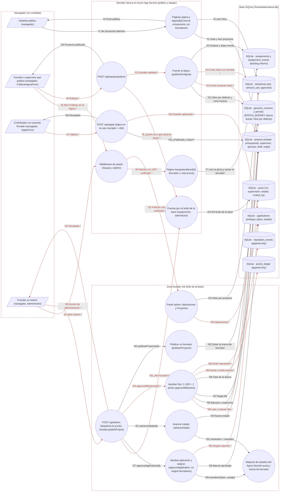

# Ficha: Ágora y hitos

Dueño: QA (por asignar) · Revisor: John · Fecha: 2026-10-21 · Commit de referencia: 0e07d8f · Actualizada al release `wp/32-release` (4032c7c): secciones 1, 2, 4, 5, 7, 8 y 9

## 1. Resumen

El Ágora es la vitrina pública de proyectos abiertos: cada proyecto dice si es para un cliente o para la comunidad, cuánto presupuesto tiene (en USD de la red de pruebas), cómo se reparte en hitos y cómo se va a evaluar. Es **el feature que toca dinero**: al aprobar un hito se emiten puntos ZWORK a quien lo ejecutó, a razón de **1 USD = 1 punto**, contra el presupuesto de la época.

Quién lo usa:

- **Visitante** (sin sesión): lista y ficha de proyectos en `/agora` y `/agora/[id]`.
- **Founder o supervisor**: publica una pieza del backlog interno como proyecto abierto (`/equipo/publicar/[id]`).
- **Contribuidor con el acuerdo firmado**: aplica con su enfoque y su plazo.
- **Founder** (solo el rol `founder` leído de la base): en `/admin` publica los borradores, aprueba o descarta aplicaciones, avanza el estado del proyecto y aprueba hitos.

Desde el release `wp/32-release` (2c049eb) un proyecto puede estar en **borrador** (`projects.draft = 1`): es una marca aparte del ciclo, no un estado. Los proyectos de ejemplo del seed nacen así (`origin = 'seed'`) y una base que ya los tenía los pasa a borrador al arrancar (`src/lib/agora-borradores.ts#marcarSembradosComoBorrador`). Un borrador no aparece en `/agora`, su ficha responde 404, no recibe aplicaciones y no se asigna, hasta que el founder lo publica desde `/admin` (acción `publishProject`). Lo que publica el puente del tablero nace publicado (`origin = 'agora'`).

Casos de uso:

1. Publicar desde el backlog: una pieza en `Backlog` y sin responsable se convierte en `projects` (estado `Open`) más sus `milestones` (por defecto, el reparto del genoma `AGORA_HITOS_DEFAULT`: 20/25/25/20/10). La pieza interna queda enlazada (`published_as_project_id`) y deja de pagarse por la aprobación interna.
2. Aplicar a un proyecto `Open` y publicado (una aplicación por persona y proyecto).
3. Asignar: aprobar una aplicación pasa el proyecto de `Open` a `Assigned` con su ejecutor.
4. Avanzar estado por la máquina única `Open → Assigned → Delivered → Scored → Distributed`.
5. Aprobar un hito: puntos = `amount_usd` del hito, en el bucket `ejecucion` de la época actual, más reputación en el eje Ejecución.
6. Publicar un borrador (founder, desde `/admin`): `draft` pasa de 1 a 0 y el proyecto sigue en el estado que tenía.

Lo que **no** hace: no mueve dinero real ni hace transacciones en Stellar al aprobar un hito (el "pago" dentro de la app son puntos); no hay transferencias de puntos.

## 2. Diagrama (DFD)

Archivo: [`docs/dfd/agora-y-hitos.tm7`](../dfd/agora-y-hitos.tm7), más la imagen exportada [`docs/dfd/agora-y-hitos.svg`](../dfd/agora-y-hitos.svg). Los dos se generan desde la fuente [`docs/dfd/agora-y-hitos.json`](../dfd/agora-y-hitos.json) con `python docs/dfd/generar_tm7.py docs/dfd/agora-y-hitos.json --estricto`, que pasa: cada `codigo` existe en el repo. La fuente tiene 26 elementos (4 actores, 14 procesos, 8 almacenes), 43 flujos (20 sensibles) y 4 fronteras de confianza.

Cambios del release `wp/32-release`: proceso nuevo "Publicar un borrador" (`publicarProyecto`) en la zona founder con sus flujos f42-f43; `projects` lleva `draft` y `origin`; las páginas públicas y `/api/apply` leen `draft` (f2, f18) y el puente escribe `origin = 'agora'` (f13).

Vista para GitHub (salida de `--mermaid`): `[/ /]` actor, `(( ))` proceso, `[( )]` almacén, cada `subgraph` es una frontera de confianza y los flujos con `*` y en rojo llevan datos sensibles.

## 3. Recorrido de una acción

Acción elegida: el founder aprueba el hito H1 (Anticipo, 20 %) de un proyecto ya asignado, que es el paso que emite puntos.

1. Pantalla o componente: `/admin`, sección "Proyectos" (`apps/web/app/admin/page.tsx:381-424`). Por cada proyecto con ejecutor (`p.assignee_wallet`, línea 412) pinta un botón por hito con `AdminAction` (`apps/web/src/components/AdminAction.tsx:7-63`): "Aprobar H1 ($200)", o "H1 ✓" deshabilitado si ya está aprobado (líneas 415-422). Para llegar a `/admin` el middleware exige sesión **con el acuerdo firmado en la cookie** (`apps/web/middleware.ts:24,41`) y la página exige rol founder leído de la base (`app/admin/page.tsx:33`).
2. Llamada al backend (endpoint y datos enviados): `fetch("/api/admin", { method: "POST", body: { action: "approveMilestone", milestoneId } })` con la cookie `zelena_session` (`AdminAction.tsx:28-32`). El middleware no intercepta `/api/*` (`middleware.ts:50-52`).
3. Ruta y controlador: `apps/web/app/api/admin/route.ts:19` (`POST`): `getSession()` (`src/lib/session.ts:11`) → `adminActor(session)` (`src/lib/authz.ts:80-84`, relee `users.role`; 403 si no es founder, línea 22) → `adminActionSchema` (`src/lib/validation.ts:78`) → `case "approveMilestone"` (`route.ts:65-69`) → `approveMilestone(milestoneId)` (`src/lib/admin.ts:58`). La ruta **no** pasa quién aprueba.
4. Lógica de negocio (validaciones, permisos, cálculos), en `src/lib/admin.ts`:
   - el hito existe y no está aprobado (59-63);
   - el proyecto tiene ejecutor (64-71); **no** se mira el estado del proyecto (se puede aprobar en `Assigned`, sin entrega);
   - regla B8: si el supervisor del proyecto no es `FOUNDER_WALLET`, no puede ser quien invitó al ejecutor (73-82, con `violatesB8` de `src/lib/rules.ts:7-10`);
   - puntos = `amount_usd` (84): **1 USD = 1 punto**;
   - tope: puntos de la época actual en bucket `ejecucion` + puntos ≤ `EPOCH_BUDGET` (88-93), con `currentEpoch` (`src/lib/genome.ts:218-221`), `puntosDeEpoca` (`src/lib/gamificacion.ts:75-80`) y `withinEpochBudget` (`rules.ts:13-15`). Tareas internas e hitos del Ágora comparten a propósito ese presupuesto (100.000 por defecto, `genome.ts:117`).
5. Base de datos (tablas o modelos leídos y escritos): lee `milestones`, `projects`, `users.invited_by`, `periods`, `genome_versions` y `SUM(points_ledger)`. Escribe en **una** transacción (`admin.ts:95-104`): `milestones.approved = 1`, una fila en `points_ledger` (wallet del ejecutor, puntos, `period_id`, bucket `ejecucion`, ref "título · hito") y una en `reputation_events` (eje `ejecucion`, delta `max(1, round(puntos / 10))`, ref "Hito aprobado: …").
6. Respuesta y qué hace la pantalla con ella: `200 { ok: true, points, wallet }` (`route.ts:67-68`). `AdminAction` hace `router.refresh()` (línea 38) y el botón pasa a "H1 ✓". El ejecutor ve el total en `/perfil` (`src/lib/repo.ts:51-68`, puntos derivados por `SUM`).
7. Casos de falla: 403 "Solo el founder puede administrar."; 400 "Entrada inválida." (esquema); 400 con el mensaje de la regla, que `AdminAction` muestra en rojo: "Hito no encontrado.", "El hito ya fue aprobado.", "El proyecto no tiene ejecutor asignado.", "Regla B8: un supervisor no puede evaluar a su invitado directo.", "Emisión rechazada: excede el presupuesto de época." (`route.ts:114-116`). Un founder que entró por la puerta corporativa sin firmar el acuerdo no llega a `/admin` (middleware), aunque la API sí le respondería.

## 4. Elementos del DFD en el código

| Elemento | Tipo | Archivo y función | Notas |
| --- | --- | --- | --- |
| Visitante público | Cliente externo | `apps/web/app/agora/page.tsx` · `AgoraPage` | Sin sesión. Filtros `?tipo=cliente\|comunidad` (acepta el `?type=` viejo) y `?state=`. |
| Founder o supervisor que publica | Cliente externo | `apps/web/src/components/PublicarAgoraForm.tsx` · `PublicarAgoraForm`, `publicar` | Valida con las mismas funciones puras que el servidor y obliga a "Ver cómo quedará" antes de publicar. |
| Contribuidor con acuerdo firmado | Cliente externo | `apps/web/src/components/ApplyForm.tsx` · `ApplyForm`, `submit` | Se pinta con cualquier sesión (`app/agora/[id]/page.tsx:143-144`); el acuerdo lo exige la API. |
| Founder en /admin | Cliente externo | `apps/web/src/components/AdminAction.tsx` · `AdminAction`, `run` | Botón genérico: manda `{ action, ...payload }`. |
| Páginas /agora y /agora/[id] | Proceso | `apps/web/app/agora/page.tsx` · `AgoraPage`; `apps/web/app/agora/[id]/page.tsx` · `ProjectDetail` (con `listProjects`, `getProject`, `getMilestones` de `src/lib/repo.ts`) | Muestra el supervisor abreviado con `shortWallet`. `listProjects` y `getProject` excluyen los borradores salvo `incluirBorradores` (solo /admin); el formulario de aplicar se pinta con `recibeAplicaciones`. |
| Middleware de sesión | Proceso | `apps/web/middleware.ts` · `middleware`, `PROTECTED_CLA`, `PROTECTED_SESSION` | `/admin` exige `claSigned` en la cookie; `/equipo` solo sesión. No cubre `/api`. |
| Página /equipo/publicar/[id] | Proceso | `apps/web/app/equipo/publicar/[id]/page.tsx` · `PublicarEnAgoraPage` (con `borradorPublicacion`, `piezaParaPublicar`) | Puerta propia; pieza de un cliente que no ve → 404. |
| POST /api/equipo/publicar | Proceso | `apps/web/app/api/equipo/publicar/route.ts` · `POST` | 401/403/429/400; traduce `TeamError` a su estado. |
| Puertas por rol | Proceso | `apps/web/src/lib/authz.ts` · `equipoActor` (120), `adminActor` (80) | Leen `users`, nunca la cookie. |
| Puente al Ágora | Proceso | `apps/web/src/lib/agora-publicar.ts` · `publicarEnAgora` (271-351), `validarHitos`, `montosDeHitos`, `motivoNoPublicable` | Una transacción; guarda de carrera en el `UPDATE` (327-333). |
| POST /api/apply | Proceso | `apps/web/app/api/apply/route.ts` · `POST` (con `applySchema`) | La lógica y el SQL viven en la ruta, no en `lib/`. Borrador → 404 "Proyecto no encontrado." (l. 28-30); no `Open` → 409 "Este proyecto ya no recibe aplicaciones." (l. 31-33). |
| Panel /admin | Proceso | `apps/web/app/admin/page.tsx` · `AdminPage` (secciones 348-424) | Lista aplicaciones (enfoque, plazo, wallet) con SQL propio (35-48); `getApplications` de `src/lib/repo.ts:154` no la usa nadie. |
| POST /api/admin | Proceso | `apps/web/app/api/admin/route.ts` · `POST` (con `adminActionSchema`) | Despacha 12 acciones; 4 son del Ágora (`publishProject` es nueva). |
| Publicar un borrador | Proceso | `apps/web/src/lib/agora-borradores.ts` · `publicarProyecto` | `UPDATE … SET draft = 0 WHERE id = ? AND draft = 1`. Ya publicado: `BorradorError(409)`, que la ruta devuelve como 400. |
| Aprobar aplicación y asignar | Proceso | `apps/web/src/lib/admin.ts` · `approveApplication` (9-36) | Usa `getDb()` interno (no recibe la base). No revisa el estado de la aplicación. Rechaza un borrador (l. 20). |
| Avanzar estado | Proceso | `apps/web/src/lib/admin.ts` · `advanceState` (40-51) | Usa `getDb()` interno. |
| Máquina de estados del Ágora | Proceso | `apps/web/src/lib/state-machine.ts` · `transition`, `nextAction`, `esBorrador`, `recibeAplicaciones` | Función pura, sin saltos. El borrador es una marca aparte del ciclo. |
| Aprobar hito | Proceso | `apps/web/src/lib/admin.ts` · `approveMilestone` (58-106), con `violatesB8`/`withinEpochBudget` (`src/lib/rules.ts`) y `puntosDeEpoca` (`src/lib/gamificacion.ts:75`) | Recibe `db` opcional (es la única de `admin.ts` que se puede probar con otra base). |
| projects | Almacén de datos | `apps/web/src/lib/schema.sql` · tabla `projects` | `type` guarda `SAS`/`DAO`; las etiquetas Cliente/Comunidad viven en `src/lib/agora-labels.ts`. `draft` (1 = borrador) y `origin` (`seed` o `agora`) desde el release. |
| milestones | Almacén de datos | `apps/web/src/lib/schema.sql` · tabla `milestones` (128-139) | `approved` es un 0/1 mutable. |
| applications | Almacén de datos | `apps/web/src/lib/schema.sql` · tabla `applications` (141-151) | `UNIQUE (project_id, wallet)` (150). |
| assignments + assignment_events | Almacén de datos | `apps/web/src/lib/schema.sql` · tablas `assignments` (499) y `assignment_events` (533) | Puente: `assignments.published_as_project_id`. |
| users | Almacén de datos | `apps/web/src/lib/schema.sql` · tabla `users` (18) | `role`, `is_supervisor`, `status`, `invited_by`. |
| genome_versions + periods | Almacén de datos | `apps/web/src/lib/genome.ts` · `getActiveGenome` (229), `currentEpoch` (218); `EPOCH_BUDGET` (117), `AGORA_HITOS_DEFAULT` (170) | La época actual es la última fila de `periods`. |
| points_ledger | Almacén de datos | `apps/web/src/lib/schema.sql` · tabla `points_ledger` (167) | Append-only; el saldo es `SUM()`. |
| reputation_events | Almacén de datos | `apps/web/src/lib/schema.sql` · tabla `reputation_events` (156) | Append-only. |

## 5. Flujos de datos

Los marcados **Sensible** llevan sesión, datos personales o dinero (puntos).

| Flujo | De → a | Protocolo | Datos que viajan |
| --- | --- | --- | --- |
| f1 | Visitante → Páginas /agora | HTTPS | `GET /agora?tipo=&state=`, `/agora/<id>` |
| f2 | Páginas /agora → projects | SQL | `SELECT` de proyectos publicados (`draft = 0`) |
| f3 | Páginas /agora → milestones | SQL | `SELECT` de hitos por proyecto |
| f4 | Páginas /agora → Visitante | HTTPS | HTML: título, presupuesto, hitos, criterio, supervisor abreviado |
| f5 | Publicador → Middleware | HTTPS | **Sensible:** `GET /equipo/publicar/<id>` + cookie `zelena_session` |
| f6 | Middleware → Página publicar | Llamada interna de Next.js | **Sensible:** ruta y cookie verificada |
| f7 | Página publicar → assignments | SQL | Título, descripción, criterio, estado, dueño y enlace de la pieza |
| f8 | Publicador → POST /api/equipo/publicar | HTTPS | **Sensible:** `publicarSchema` (tipo, presupuesto USD, semanas, textos públicos, hitos) + cookie |
| f9 | POST publicar → Puertas por rol | Llamada en proceso | **Sensible:** wallet de la sesión |
| f10 | Puertas por rol → users | SQL | `role`, `is_supervisor`, `status`, `cla_signed` |
| f11 | POST publicar → Puente al Ágora | Llamada en proceso | **Sensible:** actor + entrada validada (montos) |
| f12 | Puente → genome_versions | SQL | `AGORA_HITOS_DEFAULT`, `BUSINESS_TZ` |
| f13 | Puente → projects | SQL | **Sensible:** `INSERT` con `budget_usd`, `supervisor_wallet`, estado `Open`, `origin = 'agora'` (publicado) |
| f14 | Puente → milestones | SQL | **Sensible:** `INSERT` H1..Hn con `amount_usd` que suman el presupuesto |
| f15 | Puente → assignments | SQL | `UPDATE published_as_project_id` (con guarda) + evento `publicar` |
| f16 | POST publicar → Publicador | HTTPS | `{ ok, projectId }` o error 400/403/404/409/429 |
| f17 | Contribuidor → POST /api/apply | HTTPS | **Sensible:** `{ projectId, approach, timeline }` + cookie (wallet, `claSigned`) |
| f18 | POST apply → projects | SQL | `SELECT id, state, draft` |
| f19 | POST apply → applications | SQL | **Sensible:** `INSERT` (wallet, enfoque y plazo escritos por la persona) |
| f20 | POST apply → Contribuidor | HTTPS | `{ ok }` o 401/404/409/429 |
| f21 | Founder → Middleware | HTTPS | **Sensible:** `GET /admin` + cookie con `claSigned` |
| f22 | Middleware → Panel /admin | Llamada interna de Next.js | **Sensible:** ruta y cookie verificada |
| f23 | Panel /admin → applications | SQL | **Sensible:** wallet, enfoque, plazo y estado de cada aplicación |
| f24 | Panel /admin → milestones | SQL | Código, monto y estado de cada hito |
| f25 | Founder → POST /api/admin | HTTPS | **Sensible:** `{ action, applicationId \| projectId \| milestoneId }` + cookie (`publishProject` lleva `projectId`) |
| f26 | POST admin → Puertas por rol | Llamada en proceso | **Sensible:** wallet de la sesión |
| f27 | POST admin → approveApplication | Llamada en proceso | `applicationId` (sin el actor) |
| f28 | approveApplication → Máquina de estados | Llamada en proceso | `transition(Open, assign)` |
| f29 | approveApplication → applications | SQL | `UPDATE status = 'approved'` |
| f30 | approveApplication → projects | SQL | **Sensible:** `UPDATE state = 'Assigned', assignee_wallet` (quién cobra) |
| f31 | POST admin → advanceState | Llamada en proceso | `projectId` |
| f32 | advanceState → Máquina de estados | Llamada en proceso | `nextAction` + `transition` |
| f33 | advanceState → projects | SQL | `UPDATE state` |
| f34 | POST admin → approveMilestone | Llamada en proceso | **Sensible:** `milestoneId` (sin el actor) |
| f35 | approveMilestone → milestones | SQL | **Sensible:** lee el monto; `UPDATE approved = 1` |
| f36 | approveMilestone → projects | SQL | `supervisor_wallet`, `assignee_wallet`, `title` |
| f37 | approveMilestone → users | SQL | `invited_by` del ejecutor (B8) |
| f38 | approveMilestone → genome_versions + periods | SQL | Época actual y `EPOCH_BUDGET` |
| f39 | approveMilestone → points_ledger | SQL | **Sensible:** `SUM` de la época; `INSERT points = amount_usd` |
| f40 | approveMilestone → reputation_events | SQL | **Sensible:** `INSERT` eje `ejecucion` |
| f41 | POST admin → Founder | HTTPS | **Sensible:** `{ ok, points, wallet }`, `{ ok, state }` o `{ error }` |
| f42 | POST admin → publicarProyecto | Llamada en proceso | `projectId` (sin el actor) |
| f43 | publicarProyecto → projects | SQL | `UPDATE projects SET draft = 0` (el estado no cambia) |

## 6. Dependencias con otras features

- **Login y sesión**: `getSession` y la cookie `zelena_session`; `claSigned` de la cookie decide si se puede aplicar (`app/api/apply/route.ts:11`); el middleware protege `/admin` y `/equipo`.
- **Autorización por rol** (`src/lib/authz.ts`, `src/lib/roles.ts`): `adminActor` para `/admin` y `/api/admin`; `equipoActor` + `puedeVerTodoElEquipo` para publicar.
- **Módulo equipo / backlog** (`src/lib/team.ts`): `getAssignment`, `piezasVisiblesPara` (562) y la pieza que se publica; `PUBLICAR_DISPONIBLE` y `rutaPublicar` (`src/lib/menu.ts:46-52`) enlazan desde el tablero (`app/equipo/proyectos/[slug]/page.tsx:104-105`).
- **Gamificación y épocas**: `puntosDeEpoca`, `emitirPorAprobacion` (que devuelve `publicada_en_agora`, `src/lib/gamificacion.ts:146-149`) y el genoma (`EPOCH_BUDGET`, `AGORA_HITOS_DEFAULT`, `BUSINESS_TZ`). Los puntos y la reputación que emite un hito entran en la raíz Merkle del cierre de época.
- **Anclaje en Stellar** (`docs/features/anclaje-stellar.md`): el hito no se ancla por sí mismo; su fila de puntos queda en la hoja de la época que `cerrarYAbrirEpoca` encola en `anchor_queue`.
- **Clientes y grafo** (`docs/features/clientes-y-grafo.md`): el tipo por defecto al publicar es "cliente" si la pieza o su iniciativa tienen `client_id` (`agora-publicar.ts:246-253`), y `piezasVisiblesPara` aplica `client_members`.
- **Identidades** (`src/lib/identidades.ts`): el lado del equipo usa `reglaB8` con todas las identidades; el Ágora usa otra versión de B8 (ver §7).
- **Sitio público**: la landing cuenta `projects` abiertos y hitos aprobados de cuentas reales (`src/lib/prueba-en-vivo.ts:24-34`).
- **Perfil**: muestra los puntos y la reputación que deja un hito (`src/lib/repo.ts:22-68`).

Dependencias inversas anotadas al integrar (la otra ficha ya las tenía; la guía pide anotarlas en las dos):

- **Admin** ([admin.md](admin.md)): asignar (`approveApplication`), avanzar (`advanceState`) y aprobar hitos (`approveMilestone`) solo se hacen desde `/admin`, por `POST /api/admin` con la puerta `adminActor`.
- **Genoma y gobernanza** ([genoma-y-gobernanza.md](genoma-y-gobernanza.md)): `AGORA_HITOS_DEFAULT` sale del genoma, y el fitness de la época (`src/lib/epochs.ts`) cuenta los `milestones` aprobados como entregas.

## 7. Amenazas relevantes

| Amenaza | Categoría | Elemento | Estado | Justificación |
| --- | --- | --- | --- | --- |
| Alguien sin rol founder llama a `/api/admin` con una cookie que dice `founder` | Suplantación | POST /api/admin | Mitigada | La cookie es un JWT firmado (`src/lib/jwt.ts:48`) y, aun así, `adminActor` relee `users.role` (`src/lib/authz.ts:58-84`; `app/api/admin/route.ts:22`). Lo prueba `src/lib/caracterizacion/agora-y-hitos.test.ts` (supervisora → 403). |
| Un contribuidor sin rol de equipo publica proyectos o inventa montos | Elevación de privilegios | POST /api/equipo/publicar | Mitigada | `equipoActor` + `puedeVerTodoElEquipo` en la ruta (`app/api/equipo/publicar/route.ts:25-29`) y otra vez en la regla (`src/lib/agora-publicar.ts:277`). |
| Montos de hitos manipulados en el cliente (no suman el presupuesto, hitos de 0 USD) | Manipulación | Puente al Ágora | Mitigada | El servidor revalida con `publicarSchema` y `validarHitos` (`agora-publicar.ts:103-118,155-179,280-281`), calcula los montos él mismo (`montosDeHitos`, 128-134, 289-293) y rechaza montos < 1. |
| La misma pieza se cobra dos veces: por aprobación interna y por hitos | Manipulación | Puente al Ágora / assignments | Mitigada | Guarda de carrera en el enlace (`agora-publicar.ts:327-333`, 409 si ya está publicada) y `emitirPorAprobacion` devuelve `publicada_en_agora` sin filas (`src/lib/gamificacion.ts:146-149`). Lo cubre la prueba de caracterización. |
| Aprobar dos veces el mismo hito (doble emisión de puntos) | Manipulación | approveMilestone | Aceptada | Se comprueba `approved` antes de la transacción (`src/lib/admin.ts:63`); el `UPDATE` no lleva `AND approved = 0` (96), pero el driver es síncrono y la función no tiene `await`, así que en una sola instancia no hay intercalado. Si se escala a varias instancias, pasa a Pendiente. |
| Emisión que supera el presupuesto de la época | Manipulación | approveMilestone | Mitigada | `withinEpochBudget` contra `SUM` de la época actual y bucket `ejecucion` (`admin.ts:88-93`; prueba en `src/lib/points-ledger.test.ts:128-183`). |
| Un supervisor aprueba a su propio invitado usando otra de sus identidades (cuenta vinculada o `pending:<slug>`) | Elevación de privilegios | approveMilestone | Pendiente | B8 aquí compara cadenas crudas y exime por `FOUNDER_WALLET` (`admin.ts:77-82`), no usa `reglaB8` con identidades (`src/lib/identidades.ts:113-131`), que es "la regla ÚNICA" del lado equipo. |
| El founder se asigna su propia aplicación y se aprueba sus hitos | Elevación de privilegios | approveApplication / approveMilestone | Pendiente | Ni `approveApplication` (`admin.ts:9-34`) ni `approveMilestone` reciben al actor (`app/api/admin/route.ts:52-69`), así que no hay cuatro ojos en el Ágora (el equipo sí los tiene). |
| No queda rastro de quién aprobó una aplicación o un hito | Repudio | POST /api/admin | Pendiente | `applications`, `milestones`, `points_ledger` y `reputation_events` no guardan al aprobador (`admin.ts:20-30,95-104`). Publicar sí deja `actor_wallet` en `assignment_events` (`agora-publicar.ts:335-346`). |
| Proyecto en `Assigned` sin ejecutor por el botón "Avanzar" | Manipulación | advanceState | Pendiente | `nextAction("Open")` es `assign` y `advanceState` no exige ejecutor (`admin.ts:40-51`, `state-machine.ts:45-57`). El proyecto deja de recibir aplicaciones y nadie cobra hasta aprobar una vieja. Fijado en la prueba de caracterización. |
| Aprobar una segunda aplicación reasigna en silencio el proyecto a otra persona | Manipulación | approveApplication | Pendiente | Si el proyecto ya no está `Open`, se sobrescribe `assignee_wallet` (`admin.ts:31-33`) y las dos aplicaciones quedan `approved`; tampoco se revisa que la aplicación siga `pending`. |
| Hitos aprobados sin entrega (proyecto en `Assigned`) | Manipulación | approveMilestone | Aceptada | Es decisión de producto que el founder apruebe por hito (el anticipo se paga al empezar, `AGORA_HITOS_DEFAULT` en `src/lib/genome.ts:170`); la máquina de estados del proyecto y los hitos van por separado. |
| Lectura de enfoques y wallets de quienes aplican | Divulgación de información | Panel /admin | Mitigada | Solo founder por rol (`app/admin/page.tsx:33`); la ficha pública no lista aplicaciones. |
| La ficha pública muestra el principal del supervisor abreviado (p. ej. `pendi…<slug>`) | Divulgación de información | Páginas /agora | Aceptada | Son 9 caracteres (`src/components/ui.tsx:87-90`) del identificador interno; no es dato personal más allá del slug del roster. |
| Avalancha de aplicaciones | Denegación de servicio | POST /api/apply | Mitigada | 15 por minuto por wallet + IP (`app/api/apply/route.ts:14`) y `UNIQUE (project_id, wallet)` (`src/lib/schema.sql:150`). El límite es en memoria por instancia (`src/lib/rate-limit.ts:1-5`). |
| `/api/admin` sin límite de solicitudes | Denegación de servicio | POST /api/admin | Aceptada | Solo responde a un founder autenticado por rol (`route.ts:22`). |
| Proyectos de ejemplo del seed visibles o asignables en producción como si fueran reales | Divulgación de información / Manipulación | Páginas /agora, POST /api/apply, approveApplication | Mitigada | Release `wp/32-release` (2c049eb): el seed los crea con `draft = 1` y `origin = 'seed'` y `marcarSembradosComoBorrador` pasa a borrador los de una base existente (`src/lib/agora-borradores.ts:40-53`, llamada desde `src/lib/seed.ts#seedIfEmpty`). Un borrador no se lista ni se muestra (`src/lib/repo.ts#listProjects`, `#getProject`), da 404 al aplicar (`app/api/apply/route.ts:28-30`) y no se asigna (`src/lib/admin.ts:20`). Lo prueba el caso "borrador" de la caracterización. |

## 8. Prueba de caracterización

Archivo: `apps/web/src/lib/caracterizacion/agora-y-hitos.test.ts`. Correr con `cd apps/web && npx vitest run src/lib/caracterizacion/agora-y-hitos.test.ts` (5 casos, pasan con el release `wp/32-release`).

Llama a los **handlers reales** de `POST /api/equipo/publicar`, `POST /api/apply` y `POST /api/admin` contra una base SQLite temporal en memoria (`schema.sql` + `seedTeam` con la plantilla de roles, sin `ZELENA_TEAM_ROSTER`). La sesión se inyecta con un `vi.mock("@/lib/session")` y `globalThis.__zelenaDb` apunta a la base temporal, así `getDb()` nunca abre `data/zelena.db`. Las personas del roster son los slugs de la plantilla (`pending:founder`, `pending:operaciones`), nunca nombres.

- Flujo principal: publicar (proyecto `Open`, `draft = 0`, `origin = 'agora'`, hitos H1..H5 de 200/250/250/200/100 sobre 1.000 USD, enlace y evento `publicar`) → aplicar → aprobar la aplicación (`Assigned` con ejecutora) → aprobar H1 (`{ ok, points: 200 }`, una fila de 200 puntos en bucket `ejecucion`, reputación 20) → segunda aprobación del mismo hito = 400 → la pieza interna ya no emite (`publicada_en_agora`).
- Puertas: 401 sin sesión, 403 contribuidora sin alcance, supervisora sí publica, 409 al publicar dos veces, 401 sin acuerdo, 409 al aplicar dos veces ("Ya aplicaste a este proyecto."), 403 de `/api/admin` para una supervisora.
- B8 tal como está hoy (cadenas crudas): supervisora que invitó a la ejecutora → 400 y sin puntos.
- Borrador (nuevo): marcado como borrador, el proyecto no sale en `listProjects`, `getProject` no lo devuelve (sí con `incluirBorradores`), `/api/apply` responde 404 y, publicado por el founder con `publishProject`, vuelve a listarse y a recibir aplicaciones.
- Comportamiento discutible fijado a propósito: "Avanzar" deja el proyecto `Assigned` sin ejecutor; después, aplicar da 409 "Este proyecto ya no recibe aplicaciones.".

Qué cambió respecto de la versión escrita contra 0e07d8f, y por qué commit: los cuatro casos fallaban porque usaban `pending:<nombre>` de personas del roster, que ya no existe: el roster es una plantilla de roles (b97448a, hallazgo A8), así que la publicación respondía 403; ahora usan los slugs de rol. El texto del 409 al aplicar dos veces dejó de decir "bounty" y el proyecto publicado lleva `draft`/`origin` (2c049eb). Ninguno es una regresión.

Otras pruebas que ya cubren partes: `src/lib/agora-publicar.test.ts` (reglas del puente), `src/lib/agora-borradores.test.ts` (migración a borrador y publicación), `src/lib/points-ledger.test.ts` (anti-confiscación y tope de `approveMilestone`), `src/lib/state-machine.test.ts`, `src/lib/agora-labels.test.ts`, `src/lib/roster-plantilla.test.ts`.

## 9. Preguntas abiertas

- ¿Quién debe aprobar aplicaciones y hitos de un proyecto que publicó un **supervisor**? Hoy solo el founder puede (`rolPuedeAdministrar`, `src/lib/authz.ts:41-43`), aunque `ApplyForm` dice "El supervisor la revisará" (`src/components/ApplyForm.tsx:27`).
- ¿El "pago" de un hito debe seguir siendo solo puntos? La ficha pública dice "Pagos por hitos · Red de pruebas" (`app/agora/[id]/page.tsx:45-56`), pero la app no hace ninguna transacción en Stellar al aprobar.
- ¿Debe B8 del Ágora pasar a `reglaB8` (identidades y exención por rol, no por `FOUNDER_WALLET`)?
- ¿Qué pasa con la pieza interna cuando el proyecto del Ágora se asigna o se termina? Hoy se queda en `Backlog` sin responsable para siempre: el puente es de un solo sentido.
- ¿Hace falta guardar quién aprobó cada hito (columna o evento) para auditar la emisión de puntos?
- ~~¿Los proyectos demo del seed siguen visibles en el Ágora de producción?~~ Resuelta en el release (2c049eb): nacen en borrador y la migración del arranque oculta los de una base existente.
