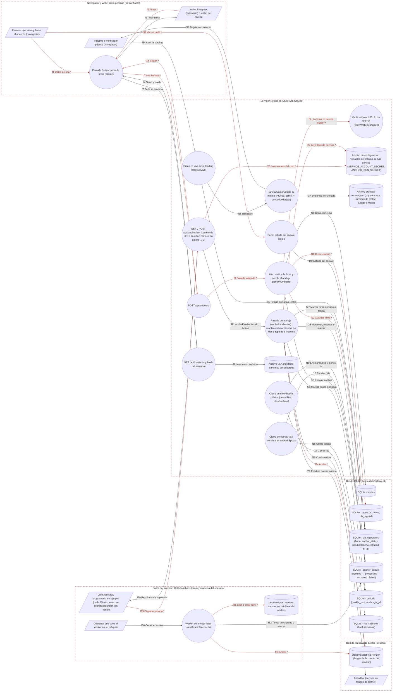

# Ficha: Anclaje en Stellar testnet

Dueño: QA (por asignar) · Revisor: John · Fecha: 2026-10-21 · Commit de referencia: 0e07d8f · Actualizada al release `wp/32-release` (4032c7c): secciones 1 a 5, 7, 8 y 9

## 1. Resumen

El anclaje deja una huella pública en la **red de pruebas de Stellar** de tres cosas que pasan dentro de la app: la firma del acuerdo de contribución (CLA), la raíz Merkle de cada época cerrada (puntos y reputación) y el cierre de cada rito. La app nunca escribe en la red en el mismo momento: cada hecho se **encola** en `anchor_queue` con estado `pending`, y una pasada posterior lo ancla con una operación clásica `manageData(nombre, valor)` firmada por una **cuenta de servicio** de testnet. El `tx_id` resultante se guarda en la cola y en la tabla de origen.

Quién lo usa:

- **Persona que entra**: firma el acuerdo en `/entrar` con Freighter (formato SEP-53) o con la wallet de prueba del navegador. Esa firma se verifica en el servidor y se encola.
- **Cron o founder**: dispara una pasada con `POST /api/anchor/run` (cabecera `x-anchor-secret` o sesión con rol founder). Desde el release `wp/32-release` el cron existe: el workflow programado `.github/workflows/anclaje.yml` llama a la ruta cada 15 minutos con `ANCHOR_RUN_SECRET` (76ed59e), que ahora exige 32 caracteres o más. No hay botón en `/admin`.
- **Operador local**: el worker `packages/scripts/anchor-worker.mjs` ya parsea y **no reimplementa nada**: carga `apps/web/src/lib/anchor.ts` con el type-stripping de Node y corre la misma pasada sobre la base local (3790881).
- **Visitante o verificador**: la landing muestra la tarjeta "Compruébalo tú mismo" con enlaces al explorador público; `/perfil` muestra el estado del anclaje propio y `/comunidad` el de cada rito.

Evidencia pública y contratos Harmony: `apps/web/src/data/pruebas-testnet.json` es un archivo **curado a mano** con 4 transacciones (contrato y pagos de prueba de 120 y 100 ZDT) y 3 contratos de Soroban en testnet ("Fábrica de organizaciones", "Organización de prueba", "Token de prueba ZDT"). El código de esos contratos **no está en este repo** y la app **nunca los llama**: solo enlaza a su página en el explorador. Si el JSON no trae transacciones, la tarjeta cae a la última firma del acuerdo anclada de verdad.

Lo que **no** hace: no ancla la firma en sí (ancla el hash del documento), no usa mainnet, no reintenta con espera. Desde 27a3044 la cola **sí** tiene estado terminal: una fila que falla `ANCLAJE_MAX_INTENTOS` (8) veces queda `failed` (y su firma también), y cada fila se **reserva** (`pending → processing`) antes de enviarse, así dos pasadas a la vez no la anclan dos veces.

## 2. Diagrama (DFD)

Archivo: [`docs/dfd/anclaje-stellar.tm7`](../dfd/anclaje-stellar.tm7), más la imagen exportada [`docs/dfd/anclaje-stellar.svg`](../dfd/anclaje-stellar.svg). Los dos se generan desde la fuente [`docs/dfd/anclaje-stellar.json`](../dfd/anclaje-stellar.json) con `python docs/dfd/generar_tm7.py docs/dfd/anclaje-stellar.json --estricto`, que pasa: cada `codigo` existe en el repo. La fuente tiene 30 elementos (6 actores, 13 procesos, 11 almacenes), 40 flujos (15 sensibles) y 5 fronteras de confianza.

Cambios del release `wp/32-release` (mismos elementos, otro contenido): el cron es el workflow `anclaje.yml`; la pasada (`anclarPendientes`) mantiene la cola, reserva filas y aplica el tope de intentos (f23, f27); el worker local reutiliza `lib/anchor.ts` (f32) y sus funciones viejas (`runPass`, `anchorOne`, `ensureServiceAccount`) ya no existen; `anchor_queue` tiene `processing`, `failed` y `claimed_at`.

Vista para GitHub (salida de `--mermaid`): `[/ /]` actor, `(( ))` proceso, `[( )]` almacén, cada `subgraph` es una frontera de confianza y los flujos con `*` y en rojo llevan datos sensibles.

## 3. Recorrido de una acción

Acción elegida: una persona firma el acuerdo con Freighter al darse de alta y, después, un cron ancla esa firma en testnet.

1. Pantalla o componente: `/entrar` (`apps/web/app/entrar/page.tsx`, componente cliente `Entrar`). Al cargar pide el texto y la huella del acuerdo (`fetch("/api/cla")`, línea 67 → `app/api/cla/route.ts:6-8`, que lee `CLA.md` con `readClaText` y calcula `sha256`). En el paso de firma, `signAndFinish` (284) arma el payload `zelena-cla-testnet-v1:<hash>` con `claSigningPayload` (`src/lib/cla-signing.ts:13-18`) y llama a `freighter.signMessage(payload, { address })` (298-311). Si la extensión no tiene `signMessage`, bloquea el alta (299-305): nunca manda un placeholder.
2. Llamada al backend (endpoint y datos enviados): `POST /api/onboard` con `{ code, wallet, name, claHash, signature }`. Desde 4291a2d el navegador ya no decide `isDemo`: el servidor lo deriva del código de invitación (`esCodigoDemo`).
3. Ruta y controlador: `app/api/onboard/route.ts:10-42`: límite de 10 por minuto por IP (12), `onboardSchema` (`src/lib/validation.ts:31-38`) y `performOnboard` (`src/lib/onboard.ts:70`).
4. Lógica de negocio (validaciones, permisos, cálculos):
   - el hash recibido debe ser el canónico (`onboard.ts:74-76`);
   - la firma se verifica **antes** de consumir la invitación (80-82) con `verifyWalletSignature` (`src/lib/crypto.ts:18-35`), que exige 64 bytes y acepta cuatro preimágenes del mismo payload, entre ellas SEP-53: `sha256("Stellar Signed Message:\n" + payload)` (51-79);
   - el rol nace `contributor` (salvo la escotilla de arranque, 92-93).
   - Más tarde, la pasada: el workflow `anclaje.yml` (cada 15 minutos) llama a `POST /api/anchor/run` (`app/api/anchor/run/route.ts:32-44`), que autoriza con `x-anchor-secret` contra `ANCHOR_RUN_SECRET` (`autorizarAnclaje`: sha256 de los dos valores comparados en tiempo constante, `src/lib/anchor.ts:62-70`; el secreto vale solo con 32 caracteres o más, `src/lib/config.ts:283-294`), o con una sesión de rol founder leído de la base (`route.ts:21-25`); acota `limite` a un entero de 1..20 (8 si no es entero, 36-37) y llama a `anclarPendientes` (`src/lib/anchor.ts:227-252`). Esta corre `mantenerCola` (93-120: agotadas → `failed`, reservas de más de 10 min → `pending`), exige `SERVICE_ACCOUNT_SECRET` y carga la cuenta en Horizon (la fondea con Friendbot si no existe, `envioTestnet`, 184-221), toma las `pending` con `attempts < 8` por intentos e `id` (`filasParaAnclar`, 123-130), **reserva** cada una con un `UPDATE … WHERE status = 'pending'` que suma el intento (`reservarFila`, 136-144; si otra pasada la tomó, la salta, 238) y por cada una firma y envía `manageData(data_key, payload_hash)`, recortados a 64 bytes (210-211).
5. Base de datos (tablas o modelos leídos y escritos): en una transacción del alta (`onboard.ts:100-144`): consume el cupo en `invites`, `INSERT users` (`cla_signed = 1`), `INSERT cla_signatures` (`anchor_status = 'pending'`) e `INSERT anchor_queue` (kind `cla`, `ref` = wallet, `data_key = 'cla:v1:' + wallet.slice(0, 12)`, `payload_hash` = hash del documento, 139-141). En la pasada: reserva `status = 'processing', claimed_at, attempts + 1`; si sale bien, `status = 'anchored', tx_id` y `UPDATE cla_signatures SET anchor_status = 'anchored', tx_id WHERE wallet = ?` (`registrarAnclada`, `anchor.ts:147-154`); para `merkle_root`, `UPDATE periods SET state = 'Anchored', anchor_tx_id`. Si falla: `last_error` y vuelve a `pending`, o queda `failed` (y la firma `failed`) al llegar a 8 intentos (`registrarFallo`, 160-172).
6. Respuesta y qué hace la pantalla con ella: el alta responde `200 { ok }` con la cookie `zelena_session` (`route.ts:30-41`) y la pantalla va a `/perfil` (`app/entrar/page.tsx:331`), que muestra "anclaje pendiente" (`app/perfil/page.tsx:233-237`). La pasada responde `{ pendientes, anclados, fallidos, cuenta, detalle }`. Después, `/perfil` muestra "anclado" con el enlace a `stellar.expert` (solo si el `tx_id` son 64 hex), y la landing cuenta la firma en `cifrasEnVivo` (`src/lib/prueba-en-vivo.ts:45-66`, solo cuentas con `is_demo = 0`).
7. Casos de falla: alta: 400 `cla_desactualizado` o `firma_invalida` (sin gastar la invitación), 409 `wallet_registrada`, `cupos_agotados` o `codigo_expirado`, 429. Pasada: 401 sin secreto (o con uno de menos de 32 caracteres) ni founder; 500 "SERVICE_ACCOUNT_SECRET no configurado…" si hay pendientes y no hay llave; `?limite=abc` ya no da 500: usa 8 (27a3044); si Horizon rechaza, la fila vuelve a `pending` con `last_error` y se reintenta en la siguiente pasada (sin espera) hasta 8 veces; después queda `failed` y `/perfil` muestra "falló".

## 4. Elementos del DFD en el código

| Elemento | Tipo | Archivo y función | Notas |
| --- | --- | --- | --- |
| Persona que firma el acuerdo | Cliente externo | `apps/web/app/entrar/page.tsx` · `Entrar` | Asistente de alta y reingreso. |
| Wallet Freighter o wallet de prueba | Cliente externo | `apps/web/app/entrar/page.tsx` · `connectFreighter` (201), `signAndFinish` (284) | Freighter firma con SEP-53; la wallet de prueba firma los bytes del payload. |
| Cron (workflow `anclaje.yml`) o founder | Cliente externo | `.github/workflows/anclaje.yml` (cada 15 min); `apps/web/app/api/anchor/run/route.ts` · `autorizado` (21-25) | `ANCHOR_RUN_SECRET` está en `.env.example` (c8280ec) y en los secrets del repo. |
| Operador del worker | Cliente externo | `packages/scripts/anchor-worker.mjs` · `pasada`, `WATCH` | `node packages/scripts/anchor-worker.mjs [--watch \| --pendientes]`; requiere Node 22.6 o más. |
| Visitante o verificador | Cliente externo | `apps/web/app/page.tsx` · `Landing` (27-66) | Abre los enlaces de `stellar.expert` por su cuenta. |
| Friendbot | Cliente externo | `apps/web/src/lib/anchor.ts` · `FRIENDBOT` (17) | Solo si la cuenta de servicio no existe. |
| Pantalla /entrar: firma | Proceso | `apps/web/app/entrar/page.tsx` · `signAndFinish`, `normalizarFirma` (269) | Corre en el navegador. |
| GET /api/cla | Proceso | `apps/web/app/api/cla/route.ts` · `GET` (con `readClaText` y `claCanonicalHash` de `src/lib/cla.ts:6-24`) | Si no encuentra `CLA.md`, devuelve un texto de reserva y su hash (cla.ts:18-19). |
| POST /api/onboard | Proceso | `apps/web/app/api/onboard/route.ts` · `POST` | Fija la cookie con `setSessionCookie`. |
| Alta y encolado | Proceso | `apps/web/src/lib/onboard.ts` · `performOnboard` (70-145), `consumirCupo` (55) | Firma antes que cupo; todo en una transacción. |
| Verificación ed25519 / SEP-53 | Proceso | `apps/web/src/lib/crypto.ts` · `verifyWalletSignature` (18), `preimagenesAceptadas` (70), `SEP53_PREFIX` (52) | Nunca lanza; `false` ante cualquier entrada inválida. |
| Cierre de época | Proceso | `apps/web/src/lib/epocas.ts` · `cerrarYAbrirEpoca` (204), `hojasDeEpoca` (120) | Encola `merkle_root` con `data_key = 'epoch:<n>'` (231-233). |
| Cierre de rito | Proceso | `apps/web/src/lib/ritos.ts` · `cerrarRito` (455), `txDeAnclaje` (704), `ritosPublicos` (716) | Encola `rite` (515-517); el `tx_id` se lee de la cola, no se copia a `rite_sessions`. |
| /api/anchor/run | Proceso | `apps/web/app/api/anchor/run/route.ts` · `GET` (27), `POST` (32), `autorizado` (21) | `?limite=` no entero → 8. El comentario ya nombra el workflow programado. |
| Pasada de anclaje | Proceso | `apps/web/src/lib/anchor.ts` · `anclarPendientes` (227-252), `mantenerCola` (93), `filasParaAnclar` (123), `reservarFila` (136), `registrarAnclada` (147), `registrarFallo` (160), `autorizarAnclaje` (62) | Tope `ANCLAJE_MAX_INTENTOS = 8` (34) y reserva abandonada a los `ANCLAJE_RESERVA_MS` = 10 min (36). El envío es inyectable (tests sin red). Única implementación: el worker la reutiliza. |
| Worker de anclaje | Proceso | `packages/scripts/anchor-worker.mjs` · `pasada`, `asegurarLlave` | Parsea (3790881) y carga `src/lib/anchor.ts` con `--experimental-strip-types`; abre la base local con un adaptador mínimo. |
| Cifras en vivo | Proceso | `apps/web/src/lib/prueba-en-vivo.ts` · `cifrasEnVivo` (23-67) | Excluye `is_demo = 1` y `tx_id` que no son 64 hex. |
| Tarjeta Compruébalo tú mismo | Proceso | `apps/web/src/components/PruebaTestnet.tsx` · `PruebaTestnet` (22), con `contenidoTarjeta` (`src/lib/pruebas-testnet.ts:58-71`) | Prioriza el JSON; la firma anclada es solo respaldo. |
| Perfil: estado del anclaje | Proceso | `apps/web/app/perfil/page.tsx` · `PerfilPage` | La rama `failed` ya se alcanza: la pasada marca la firma `failed` al agotar los intentos. |
| CLA.md | Almacén de datos | `apps/web/src/lib/cla.ts` · `readClaText` | Texto canónico; su sha256 es lo que se firma (no se toca). |
| Variables de entorno de App Service | Almacén de datos | `apps/web/src/lib/anchor.ts` · `SERVICE_ACCOUNT_SECRET`; `src/lib/config.ts` · `anchorRunSecret` (`ANCHOR_RUN_SECRET`, 32 o más) | Las dos están en `.env.example` (l. 130 y 132). |
| invites | Almacén de datos | `apps/web/src/lib/schema.sql` · tabla `invites` (74) | |
| users | Almacén de datos | `apps/web/src/lib/schema.sql` · tabla `users` | `is_demo` lo decide el servidor por el código de invitación (4291a2d), no el navegador. |
| cla_signatures | Almacén de datos | `apps/web/src/lib/schema.sql` · tabla `cla_signatures` (87-97) | `UNIQUE (wallet, cla_version)`. |
| anchor_queue | Almacén de datos | `apps/web/src/lib/schema.sql` · tabla `anchor_queue` (100-112) | `status`: `pending \| processing \| anchored \| failed`; `claimed_at` marca la reserva. El comentario de `kind` dice `cla \| merkle_root \| decision`: falta `rite` y `decision` no la encola nadie. |
| periods | Almacén de datos | `apps/web/src/lib/schema.sql` · tabla `periods` (177-186) | `Open → Closed → Anchored`. |
| rite_sessions | Almacén de datos | `apps/web/src/lib/schema.sql` · tabla `rite_sessions` (740) | |
| .service-account.secret | Almacén de datos | `packages/scripts/anchor-worker.mjs` · `asegurarLlave` | Solo si no hay `SERVICE_ACCOUNT_SECRET`; se crea con modo 0600. En `.gitignore`. |
| pruebas-testnet.json | Almacén de datos | `apps/web/src/data/pruebas-testnet.json` · `transacciones`, `contratos` | Se importa en el bundle; lo filtra `pruebasVisibles` (`pruebas-testnet.ts:38-46`). |
| Stellar testnet vía Horizon | Almacén de datos | `apps/web/src/lib/anchor.ts` · `HORIZON` (16), `manageData` y `submitTransaction` (84-89) | `Networks.TESTNET` fijo; la variable `STELLAR_NETWORK` de `.env.example:11` no la lee nadie. |

## 5. Flujos de datos

Los marcados **Sensible** llevan firmas, llaves, secretos o sesión.

| Flujo | De → a | Protocolo | Datos que viajan |
| --- | --- | --- | --- |
| f1 | Persona → Pantalla /entrar | HTTPS (UI) | **Sensible:** código de invitación, nombre visible, elección de wallet |
| f2 | Pantalla /entrar → GET /api/cla | HTTPS | `GET /api/cla` |
| f3 | GET /api/cla → CLA.md | Archivo (fs) | Texto canónico |
| f4 | GET /api/cla → Pantalla /entrar | HTTPS | `{ text, hash }` |
| f5 | Pantalla /entrar → Wallet | API de la extensión | Payload `zelena-cla-testnet-v1:<hash>` y dirección |
| f6 | Wallet → Pantalla /entrar | API de la extensión | **Sensible:** firma ed25519 (SEP-53) en base64 |
| f7 | Pantalla /entrar → POST /api/onboard | HTTPS | **Sensible:** `{ code, wallet, name, claHash, signature }` (`isDemo` se ignora) |
| f8 | POST /api/onboard → performOnboard | Llamada en proceso | **Sensible:** entrada validada |
| f9 | performOnboard → verifyWalletSignature | Llamada en proceso | **Sensible:** wallet, payload, firma |
| f10 | performOnboard → invites | SQL | Consumo del cupo |
| f11 | performOnboard → users | SQL | **Sensible:** wallet, nombre, `invited_by`, `is_demo` (según el código), rol |
| f12 | performOnboard → cla_signatures | SQL | **Sensible:** firma y hash, `pending` |
| f13 | performOnboard → anchor_queue | SQL | `cla`, wallet, `data_key`, `payload_hash` |
| f14 | POST /api/onboard → Pantalla /entrar | HTTPS | **Sensible:** `Set-Cookie zelena_session` + `{ ok }` |
| f15 | cerrarYAbrirEpoca → periods | SQL | `Closed` + `merkle_root` |
| f16 | cerrarYAbrirEpoca → anchor_queue | SQL | `merkle_root`, `epoch:<n>`, raíz |
| f17 | cerrarRito → rite_sessions | SQL | Hash del cierre |
| f18 | cerrarRito / ritosPublicos → anchor_queue | SQL | Encola `rite`; lee su `tx_id` para `/comunidad` |
| f19 | Cron (workflow cada 15 min) o founder → /api/anchor/run | HTTPS | **Sensible:** `x-anchor-secret` o cookie de founder; `?limite=` |
| f20 | /api/anchor/run → Variables de entorno | Variable de entorno | **Sensible:** `ANCHOR_RUN_SECRET` (32 o más; se compara su sha256 en tiempo constante) |
| f21 | /api/anchor/run → anclarPendientes | Llamada en proceso | Límite 1..20 |
| f22 | anclarPendientes → Variables de entorno | Variable de entorno | **Sensible:** `SERVICE_ACCOUNT_SECRET` (llave de testnet) |
| f23 | anclarPendientes → anchor_queue | SQL | `mantenerCola`; `SELECT pending` con `attempts < 8`; reserva `pending → processing` (+1 intento, `claimed_at`); después `anchored`, `pending` o `failed` con `last_error` |
| f24 | anclarPendientes → Stellar testnet | Stellar (HTTPS a Horizon) | **Sensible:** transacción `manageData` firmada con la llave de servicio |
| f25 | Stellar testnet → anclarPendientes | Stellar (HTTPS a Horizon) | Hash de la transacción o error |
| f26 | anclarPendientes → Friendbot | HTTPS | `GET ?addr=<cuenta pública>` |
| f27 | anclarPendientes → cla_signatures | SQL | `anchored` + `tx_id`, o `failed` al agotar intentos (WHERE wallet) |
| f28 | anclarPendientes → periods | SQL | `Anchored` + `anchor_tx_id` |
| f29 | /api/anchor/run → Cron o founder | HTTPS | `{ pendientes, anclados, fallidos, cuenta, detalle }` o error |
| f30 | Operador → Worker | CLI (node) | `node packages/scripts/anchor-worker.mjs [--watch]` |
| f31 | Worker → .service-account.secret | Archivo (fs) | **Sensible:** llave de testnet en texto plano |
| f32 | Worker → anchor_queue | SQL (SQLite local, con `lib/anchor.ts`) | Igual que f23, f27 y f28 (es la misma función) |
| f33 | Worker → Stellar testnet | Stellar (HTTPS a Horizon) | **Sensible:** `manageData` firmada con `SERVICE_ACCOUNT_SECRET` o la llave del archivo local |
| f34 | Visitante → cifrasEnVivo (landing) | HTTPS | `GET /` |
| f35 | cifrasEnVivo → cla_signatures | SQL | `tx_id`, `signed_at` de cuentas reales |
| f36 | cifrasEnVivo → Tarjeta | Llamada en proceso | `ultimaFirmaAnclada` |
| f37 | Tarjeta → pruebas-testnet.json | Import estático | Hashes de transacciones y ids de contratos |
| f38 | Tarjeta → Visitante | HTTPS | HTML con enlaces a `stellar.expert/explorer/testnet/` |
| f39 | Persona → Perfil | HTTPS | **Sensible:** `GET /perfil` + cookie |
| f40 | Perfil → cla_signatures | SQL | `anchor_status`, `tx_id`, `cla_hash` |

## 6. Dependencias con otras features

- **Login y sesión**: `/api/onboard` es la puerta de alta de la comunidad y fija la cookie; `/api/login` (reingreso) usa la **misma** verificación de firma (`performLogin`, `src/lib/onboard.ts:176-185`) pero no encola nada.
- **Invitaciones** (`src/lib/invites.ts:167`, `consumeInvite`): el cupo se consume en la misma transacción que la firma.
- **Autorización por rol**: `adminActor` decide si una sesión puede disparar la pasada.
- **Épocas y gamificación** (`src/lib/epocas.ts`): el cierre de época produce la raíz Merkle que se ancla; los puntos de los hitos del Ágora entran en esa raíz (`docs/features/agora-y-hitos.md`).
- **Ritos y comunidad** (`src/lib/ritos.ts`): encola la huella del cierre y muestra su `tx_id` en `/comunidad` (`app/comunidad/page.tsx:220`).
- **Sitio público**: la landing (`app/page.tsx:65-66`) pinta `PruebaEnVivo` y `PruebaTestnet`; `/acuerdo` muestra la huella del CLA (`app/acuerdo/page.tsx:30,73`).
- **Perfil**: estado del anclaje propio.
- **Despliegue**: el servidor necesita `SERVICE_ACCOUNT_SECRET` y, para el cron, `ANCHOR_RUN_SECRET` en App Settings.

Dependencias inversas anotadas al integrar (la otra ficha ya las tenía; la guía pide anotarlas en las dos):

- **Admin** ([admin.md](admin.md)): `/api/anchor/run` acepta una sesión con rol founder (`adminActor`), pero `/admin` no tiene botón que la llame; el cierre de época que se hace en `/admin` (`EpocaPanel`) es el que encola la raíz Merkle.
- **Genoma y gobernanza** ([genoma-y-gobernanza.md](genoma-y-gobernanza.md)): las actas del `decision_log` no se encolan para anclar; solo se anclan raíces de época, firmas del CLA y huellas de ritos.

## 7. Amenazas relevantes

| Amenaza | Categoría | Elemento | Estado | Justificación |
| --- | --- | --- | --- | --- |
| Alta con una firma falsa o con un placeholder ("freighter-no-signMessage") que luego se ancla | Suplantación | performOnboard / verifyWalletSignature | Mitigada | ed25519 real de 64 bytes contra la wallet declarada (`src/lib/crypto.ts:18-35`), verificada antes de gastar la invitación (`src/lib/onboard.ts:78-82`); el cliente bloquea en vez de degradar (`app/entrar/page.tsx:299-305`). Lo prueba `src/lib/onboard.test.ts` y la caracterización. |
| Cualquiera dispara pasadas de anclaje y gasta la cuenta de servicio | Suplantación | /api/anchor/run | Mitigada | Secreto de 32 caracteres o más (`src/lib/config.ts:283-294`) comparado por sha256 en tiempo constante (`src/lib/anchor.ts:62-70`) o rol founder leído de la base (`app/api/anchor/run/route.ts:21-25`). La caracterización prueba 401 sin secreto, con secreto equivocado, con un secreto corto y con cookie que dice founder. |
| Reusar una firma capturada en otra red o para otro fin | Manipulación | cla-signing | Aceptada | El separador de dominio ata la firma a "zelena-cla-testnet-v1" (`src/lib/cla-signing.ts:13-18`) y `UNIQUE (wallet, cla_version)` impide una segunda alta (`src/lib/schema.sql:96`). El payload no lleva wallet ni fecha; la v2 está propuesta en `docs/specs/WP30-integridad-anclaje.md`. |
| Dos claves de anclaje colisionan y `manageData` sobrescribe un valor ya anclado | Manipulación | anclarPendientes | Pendiente | `data_key` se recorta en silencio a 64 bytes (`src/lib/anchor.ts:210`) y la clave del CLA usa solo 12 caracteres de la wallet (`onboard.ts`); `manageData` con el mismo nombre reemplaza el valor. WP30 propone `anchorKey` sin recorte. |
| Lo anclado no prueba quién firmó: el valor es el hash del **documento** (igual para todos) y la firma no sale de la base | Repudio | anchor_queue / Stellar testnet | Pendiente | `payload_hash = claHash` (`onboard.ts:139-141`); un tercero ve en la red "cla:v1:<12 caracteres>" → hash del CLA, pero no puede verificar la firma sin pedirla a la base. |
| Quien tenga la llave de servicio ancla raíces de época falsas | Elevación de privilegios | Variables de entorno / anclarPendientes | Aceptada | Es testnet y no hay dinero real; una sola llave firma todo (`anchor.ts:50-62`). El multisig es una subtarea `needs_human` de WP30. |
| Fuga de `SERVICE_ACCOUNT_SECRET` o `ANCHOR_RUN_SECRET` | Divulgación de información | Variables de entorno | Aceptada | No se devuelven ni se registran (`anchor.ts:184-221`, `route.ts:21-25`); el workflow solo imprime los conteos (`.github/workflows/anclaje.yml`). Son de testnet. `.env.example` ya lista las dos (c8280ec). |
| Una fila que falla siempre bloquea la cola (cabeza de fila) | Denegación de servicio | anclarPendientes / anchor_queue | Mitigada | Release `wp/32-release` (27a3044, hallazgo M23): tope `ANCLAJE_MAX_INTENTOS = 8` (`src/lib/anchor.ts:34`); al agotarlo la fila queda `failed` y la firma también (`registrarFallo`, `:160-172`; `mantenerCola`, `:93-120`, para las que ya lo habían agotado); las candidatas salen por menos intentos primero (`filasParaAnclar`, `:123-130`). Riesgo residual: hasta 8 reintentos sin espera, uno por pasada (cada 15 min). Caso "ARREGLADO (M23): tras ANCLAJE_MAX_INTENTOS…" de la caracterización. |
| Dos pasadas simultáneas anclan la misma fila dos veces | Manipulación | anclarPendientes | Mitigada | Release `wp/32-release` (27a3044): antes de enviar, `reservarFila` pasa la fila de `pending` a `processing` con un `UPDATE … WHERE status = 'pending'` (`src/lib/anchor.ts:136-144`) y la pasada que no la reservó la salta (`:238`); una reserva abandonada se libera a los 10 min (`:36`, `:93-120`). El workflow además no se solapa (`concurrency: anclaje`). Caso "ARREGLADO (M23): dos pasadas a la vez…" de la caracterización. |
| Marcar como ancladas versiones del acuerdo que no se anclaron | Manipulación | cla_signatures | Pendiente | `UPDATE cla_signatures … WHERE wallet = ?` sin `cla_version` (`registrarAnclada`, `src/lib/anchor.ts:147-154`; el worker usa la misma función). Fijado en la caracterización. |
| Cifras públicas infladas con cuentas de prueba | Manipulación | cifrasEnVivo | Aceptada | Se excluyen `is_demo = 1` y los `tx_id` que no son hashes reales (`src/lib/prueba-en-vivo.ts`). Desde 4291a2d `is_demo` ya no lo declara el navegador: lo decide el código de invitación (`src/lib/onboard.ts:83`), así que una cuenta real con la wallet del navegador sí cuenta, y es real. |
| El JSON de evidencia enlaza transacciones que no son de Zelena | Manipulación | pruebas-testnet.json | Aceptada | Se edita a mano y solo se valida la forma (`src/lib/pruebas-testnet.ts:28-46`); el visitante comprueba en el explorador público. |
| Respuesta falsa de Horizon o Friendbot | Suplantación | Stellar testnet | Aceptada | HTTPS a hosts fijos (`anchor.ts:16-17`); es testnet. |

## 8. Prueba de caracterización

Archivo: `apps/web/src/lib/caracterizacion/anclaje-stellar.test.ts`. Correr con `cd apps/web && npx vitest run src/lib/caracterizacion/anclaje-stellar.test.ts` (9 casos, pasan con el release `wp/32-release`).

Llama a los **handlers reales** de `POST /api/onboard` y `GET`/`POST /api/anchor/run` contra una base SQLite temporal en memoria. La red no se toca: `vi.mock("@stellar/stellar-sdk")` reemplaza solo `Horizon.Server` por un doble que registra la transacción firmada y devuelve su hash real; `Keypair` y `TransactionBuilder` son los de verdad. La llave de servicio y el secreto del cron son valores de prueba generados en cada corrida. El alias `@/lib/config`, que la ruta importa desde el release, apunta al módulo real.

- Flujo principal: alta con firma SEP-53 → `cla_signatures` `pending` + fila `cla` en la cola (con `data_key = cla:v1:<12 caracteres>` y el hash del documento) → `GET` cuenta 1 pendiente → `POST` ancla con **una** operación `manageData` firmada por la cuenta de servicio → cola y firma `anchored` con el mismo `tx_id` → `cifrasEnVivo` la cuenta y `contenidoTarjeta` la usa solo si el JSON no trae transacciones → una segunda pasada no reenvía nada.
- Puerta: 401 sin secreto, con secreto equivocado y con una cookie de contribuidor que dice `founder`.
- **ARREGLADO** (76ed59e, 27a3044): un `ANCHOR_RUN_SECRET` de menos de 32 caracteres no abre la puerta, y `?limite=abc` ya no da 500 (usa 8).
- Sin `SERVICE_ACCOUNT_SECRET`: 500 con el motivo y nada cambia.
- Falla de red: la fila vuelve a `pending`, `attempts = 1`, `last_error` guardado; la siguiente pasada la ancla (`attempts = 2`, `claimed_at` vacío).
- **ARREGLADO (M23)** (27a3044): tras 8 fallos la fila queda `failed`, la firma `failed`, deja de contar como pendiente y no se reenvía aunque la red se recupere; y dos pasadas a la vez envían **una** sola transacción.
- Raíz Merkle (`merkle_root`): la época queda `Anchored` con su `anchor_tx_id`.
- Comportamiento discutible fijado a propósito: anclar la fila `cla` marca también una versión 2 del acuerdo de la misma wallet con el `tx_id` de la versión 1.

Qué cambió respecto de la versión escrita contra 0e07d8f: la suite no cargaba porque `/api/anchor/run` importa `@/lib/config` (se agregó el alias). Con eso los 6 casos originales pasaban, pero el de la falla de red afirmaba en su nombre "no existe estado `failed`", que el commit 27a3044 dejó de ser cierto: se renombró y se agregaron los tres casos **ARREGLADO**. No hay regresiones.

El worker `packages/scripts/anchor-worker.mjs` no tiene prueba propia: ya no tiene lógica (llama a `anclarPendientes`). Otras pruebas relacionadas: `src/lib/anclaje-programado.test.ts` (tope, reserva, filas viejas agotadas, reserva abandonada, secreto del workflow), `src/lib/ci-workflow.test.ts`, `src/lib/crypto.test.ts` (SEP-53), `src/lib/onboard.test.ts`, `src/lib/pruebas-testnet.test.ts`, `src/lib/prueba-en-vivo.test.ts`, `src/lib/epocas.test.ts`, `src/lib/ritos.test.ts`.

## 9. Preguntas abiertas

- ~~¿Cuál es hoy el camino real de anclaje en producción?~~ Resuelta en el release: el workflow `anclaje.yml` llama a `/api/anchor/run` cada 15 minutos (76ed59e). Queda por confirmar que `ANCHOR_RUN_SECRET` esté en los secrets del repo y en App Settings, y cuántas filas `pending` (o `failed`) hay en la base de producción.
- ~~¿Se arregla el worker o se borra?~~ Resuelta en el release (3790881): parsea y reutiliza `lib/anchor.ts`.
- ¿Dónde vive el código de los contratos Harmony de testnet y quién actualiza `pruebas-testnet.json`? Desde el repo no se puede verificar que esos contratos sean los de Zelena.
- ¿Debe anclarse algo que permita verificar la firma (por ejemplo, el hash de `wallet + versión + firma`) en lugar del hash del documento?
- ¿Se adopta el resto de WP30 (clave sin recorte, espera entre reintentos, payload v2, multisig)? El estado `failed` con tope ya llegó (27a3044).
- `seed()` siembra una fila `pending` de una cuenta demo en `anchor_queue` cuando la base está vacía, en cualquier entorno (`src/lib/seed.ts:200-214`): ¿puede llegar a anclarse en testnet como si fuera real?
- `docs/deploy.md` y `.env.example` describen la llave como "solo del worker" y no mencionan `ANCHOR_RUN_SECRET`: ¿quién actualiza el inventario de secretos del despliegue?
