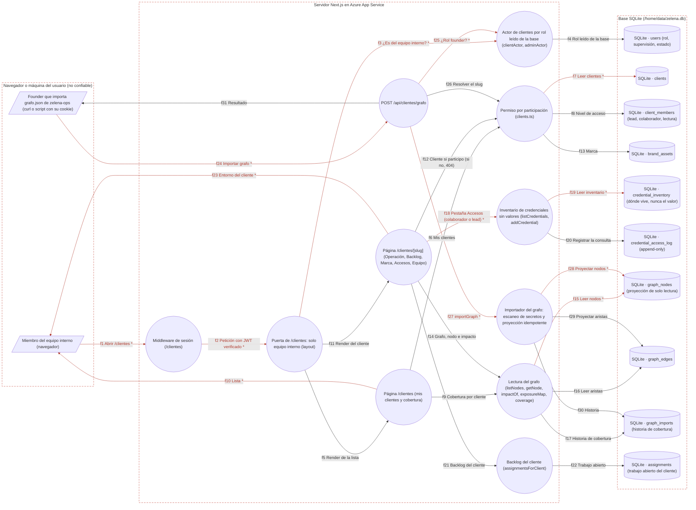

# Ficha: Clientes y grafo de operación

Dueño: QA (por asignar) · Revisor: John · Fecha: 2026-10-21 · Commit de referencia: 0e07d8f

## 1. Resumen

`/clientes` es el espacio interno de cada cliente (WP17) con su **grafo de operación** (WP20). Solo entra el equipo interno (founder, core y supervisión, por rol leído de la base) y, dentro, **la participación define el permiso**: cada cliente lo ve quien está en `client_members` (o el founder, que es `lead` en todos). Quien no participa recibe **404, nunca 403**, para no revelar que el cliente existe.

Pestañas de `/clientes/[slug]`:

- **Operación**: el grafo (procesos, variantes, sistemas, módulos, personas, credenciales…) con tres niveles de explicación por nodo, sus vecinos, la cobertura ("% verificado", preguntas abiertas, bus factor ≤ 1), la evolución por importación y el **mapa de exposición** (de quién depende cada pieza crítica).
- **Backlog**: el trabajo abierto o bloqueado del equipo para ese cliente.
- **Marca**: colores, logos y guías.
- **Accesos**: el **inventario de credenciales sin secretos**: dice dónde vive cada credencial y quién responde por ella, nunca su valor. Solo `colaborador` o `lead`; cada consulta queda en `credential_access_log`.
- **Equipo**: quién participa y con qué nivel (`lead`, `colaborador`, `lectura`).

El grafo es una **proyección de solo lectura**: la fuente de verdad es el repositorio privado `zelena-ops` (un nodo = un markdown revisado por PR), que genera `grafo.json` con `construir_grafo.py`. El founder lo importa con `POST /api/clientes/grafo`; la app nunca escribe de vuelta. El importador vuelve a escanear secretos, valida el vocabulario, reconstruye nodos y aristas de forma idempotente y guarda una fila de historia.

Lo que **no** existe hoy: ninguna pantalla ni ruta para crear clientes, sumar miembros, registrar marca o credenciales, ni para importar el grafo desde la UI. Todo eso solo se puede hacer con las funciones de `src/lib/clients.ts` (pruebas, scripts) o con un `POST` manual con la cookie del founder.

## 2. Diagrama (DFD)

Archivo: [`docs/dfd/clientes-y-grafo.tm7`](../dfd/clientes-y-grafo.tm7), más la imagen exportada [`docs/dfd/clientes-y-grafo.svg`](../dfd/clientes-y-grafo.svg). Los dos se generan desde la fuente [`docs/dfd/clientes-y-grafo.json`](../dfd/clientes-y-grafo.json) con `python docs/dfd/generar_tm7.py docs/dfd/clientes-y-grafo.json --estricto`, que pasa: cada `codigo` existe en el repo. La fuente tiene 23 elementos (2 actores, 11 procesos, 10 almacenes), 31 flujos (13 sensibles) y 3 fronteras de confianza.

Vista para GitHub (salida de `--mermaid`): `[/ /]` actor, `(( ))` proceso, `[( )]` almacén, cada `subgraph` es una frontera de confianza y los flujos con `*` y en rojo llevan datos sensibles.

## 3. Recorrido de una acción

Acción elegida: un miembro del equipo interno abre un cliente y consulta un nodo del grafo de operación.

1. Pantalla o componente: `/clientes` (`apps/web/app/clientes/page.tsx:19-73`) lista sus clientes con la cobertura de cada uno; al elegir uno va a `/clientes/<slug>?tab=operacion` y, al tocar un nodo, a `/clientes/<slug>?tab=operacion&nodo=<id>` (enlaces de `OperacionTab`, `app/clientes/[slug]/page.tsx:138-279`).
2. Llamada al backend (endpoint y datos enviados): no hay API JSON: es un `GET` de página (server component) con la cookie `zelena_session`, `slug` en la ruta y `tab`/`nodo` en la query.
3. Ruta y controlador: el middleware exige sesión para `/clientes` (`apps/web/middleware.ts:27,33-47`); el layout exige equipo interno con `equipoInternoActor` (`app/clientes/layout.tsx:14-19`, si no → `/perfil`); la página `ClientePage` (`[slug]/page.tsx:58`) vuelve a resolver el actor con `clientActor` (`src/lib/authz.ts:173-180`, si no → 404) y el cliente con `getClientForActor` (`src/lib/clients.ts:132-140`, si no participa → 404, línea 77).
4. Lógica de negocio (validaciones, permisos, cálculos): nivel con `accessLevelFor` (`clients.ts:116-122`; founder = `lead`); `puedeVerAccesos` = `colaborador` o más (`[slug]/page.tsx:80`); pestaña desconocida → `operacion` (81). En `OperacionTab`: `listNodes` (150), `getNode` con vecinos entrantes y salientes (161), `exposureMap` (164) y `coverageHistory` (165). Cada lectura del grafo vuelve a comprobar la membresía (`assertMember`, `src/lib/client-graph.ts:287-289`), salvo `coverage` y `coverageHistory`, que no reciben actor.
5. Base de datos (tablas o modelos leídos y escritos): lee `users` (rol), `clients`, `client_members`, `graph_nodes`, `graph_edges` y `graph_imports`. Solo lectura en esta acción; si abre **Accesos**, además lee `credential_inventory` y **escribe** una fila `list` en `credential_access_log` (`clients.ts:329-331`).
6. Respuesta y qué hace la pantalla con ella: HTML con la ficha del nodo: tipo, confianza (aviso si no está verificado, con su fuente), criticidad, bus factor, "Qué es", "Cómo funciona", "Reglas de negocio", "Detalle técnico", preguntas abiertas, vecinos y la ruta del nodo en `zelena-ops` (`[slug]/page.tsx:167-213`).
7. Casos de falla: sin sesión → `/entrar?next=/clientes/...`; sesión de alguien que no es del equipo interno → `/perfil` (layout) o 404 (página); cliente que no existe o en el que no participa → el mismo 404; `nodo` inexistente → se pinta la lista completa (`getNode` devuelve `null`); grafo vacío → "Sin grafo de operación todavía"; `?tab=accesos` con nivel `lectura` → la pestaña no se pinta (130) y, si se llamara, `listCredentials` lanza `ClientAccessError` (`clients.ts:326-328`).

Importación (la otra acción del feature): `POST /api/clientes/grafo` con `{ slug, grafo }` y la cookie del founder (`app/api/clientes/grafo/route.ts:17-43`): 401 sin sesión, 403 si no es founder por rol (20-23), 400 sin `slug` o `grafo` (25-28), 404 si el slug no existe (31-32), 422 si `importGraph` encuentra un posible secreto o un tipo o confianza desconocidos (37-40); cualquier otro error (por ejemplo, un nodo sin `nombre`) se relanza y termina en 500 (41).

## 4. Elementos del DFD en el código

| Elemento | Tipo | Archivo y función | Notas |
| --- | --- | --- | --- |
| Miembro del equipo interno | Cliente externo | `apps/web/app/clientes/page.tsx` · `ClientesPage` | Llega por el enlace "Clientes" del menú (`src/lib/menu.ts:60`), que solo se pinta al equipo interno. |
| Founder con grafo.json de zelena-ops | Cliente externo | `apps/web/src/lib/client-graph.ts` · `GraphJson` (63-95), `construir_grafo.py` (citado en el encabezado, 7) | No hay UI: importa con un `POST` y su cookie. |
| Middleware de sesión | Proceso | `apps/web/middleware.ts` · `middleware`, `PROTECTED_SESSION` (27) | Solo exige sesión; la puerta real es el layout. |
| Puerta de /clientes | Proceso | `apps/web/app/clientes/layout.tsx` · `ClientesLayout` (14-19) | `equipoInternoActor`, lee la base. |
| Actor de clientes por rol | Proceso | `apps/web/src/lib/authz.ts` · `clientActor` (173-180), `equipoInternoActor` (90-94), `adminActor` (80-84) | `isFounder` sale del rol, nunca de `FOUNDER_WALLET`. |
| Página /clientes | Proceso | `apps/web/app/clientes/page.tsx` · `ClientesPage` (con `listClientsFor` y `coverage`) | Segunda capa: vuelve a pedir `clientActor` (27). |
| Página /clientes/[slug] | Proceso | `apps/web/app/clientes/[slug]/page.tsx` · `ClientePage` (58), `OperacionTab` (138), `BacklogTab` (323), `MarcaTab` (345), `AccesosTab` (381), `EquipoTab` (414) | 404 en vez de 403 (72, 77). |
| Permiso por participación | Proceso | `apps/web/src/lib/clients.ts` · `listClientsFor` (101), `getClientForActor` (132), `accessLevelFor` (116), `hasAtLeast` (124), `listMembers` (164), `listBrandAssets` (218) | Compara solo `actor.wallet`; el módulo equipo usa todas las identidades (`src/lib/team.ts:1301-1306`). |
| Inventario sin valores | Proceso | `apps/web/src/lib/clients.ts` · `listCredentials` (323-349), `addCredential` (267-305), `findSecretLike` (246-250) | `addCredential` no tiene pantalla ni ruta. |
| Lectura del grafo | Proceso | `apps/web/src/lib/client-graph.ts` · `listNodes` (291), `getNode` (320), `impactOf` (354), `exposureMap` (440), `coverage` (391), `coverageHistory` (422), `assertMember` (287) | `impactOf` no lo usa ninguna pantalla todavía. |
| Backlog del cliente | Proceso | `apps/web/src/lib/team.ts` · `assignmentsForClient` (525-531) | Filtra por `assignments.client_id` y estados abiertos o bloqueados. |
| POST /api/clientes/grafo | Proceso | `apps/web/app/api/clientes/grafo/route.ts` · `POST` (17-43) | Sin límite de solicitudes ni de tamaño. |
| Importador del grafo | Proceso | `apps/web/src/lib/client-graph.ts` · `importGraph` (112-238), `GraphImportError`, `NODE_KINDS`, `EDGE_KINDS` | Transacción para nodos y aristas (145-203); la fila de historia va fuera (214-227). |
| users | Almacén de datos | `apps/web/src/lib/schema.sql` · tabla `users` (18) | |
| clients | Almacén de datos | `apps/web/src/lib/schema.sql` · tabla `clients` (338-346) | `slug` único. |
| client_members | Almacén de datos | `apps/web/src/lib/schema.sql` · tabla `client_members` (350-358) | `UNIQUE (client_id, wallet)`; la vinculación de identidades la mueve (`src/lib/talento.ts:433`). |
| brand_assets | Almacén de datos | `apps/web/src/lib/schema.sql` · tabla `brand_assets` (361) | `file_url` se pinta como enlace sin validar el esquema (`[slug]/page.tsx:369-370`). |
| credential_inventory | Almacén de datos | `apps/web/src/lib/schema.sql` · tabla `credential_inventory` (375-390) | Sin columna de secreto; `location` es una referencia. |
| credential_access_log | Almacén de datos | `apps/web/src/lib/schema.sql` · tabla `credential_access_log` (392) | Append-only; `credentialAccessLog` (`clients.ts:351`) no lo muestra ninguna pantalla. |
| graph_nodes | Almacén de datos | `apps/web/src/lib/schema.sql` · tabla `graph_nodes` (410-436) | Proyección; puede tener nombres de personas del cliente (`owner_client`, nodos `persona`). |
| graph_edges | Almacén de datos | `apps/web/src/lib/schema.sql` · tabla `graph_edges` (438) | Se reemplazan enteras en cada importación. |
| graph_imports | Almacén de datos | `apps/web/src/lib/schema.sql` · tabla `graph_imports` (450) | Historia de cobertura. |
| assignments | Almacén de datos | `apps/web/src/lib/schema.sql` · tabla `assignments` (499) | `client_id` heredado de la iniciativa. |

## 5. Flujos de datos

Los marcados **Sensible** llevan sesión, conocimiento comercial del cliente, datos personales o ubicaciones de credenciales.

| Flujo | De → a | Protocolo | Datos que viajan |
| --- | --- | --- | --- |
| f1 | Miembro → Middleware | HTTPS | **Sensible:** `GET /clientes…` + cookie `zelena_session` |
| f2 | Middleware → Puerta de /clientes | Llamada interna de Next.js | **Sensible:** ruta y cookie verificada |
| f3 | Puerta → Actor de clientes | Llamada en proceso | **Sensible:** wallet de la sesión |
| f4 | Actor de clientes → users | SQL | `role`, `is_supervisor`, `is_founder` |
| f5 | Puerta → Página /clientes | Llamada interna de Next.js | Sesión |
| f6 | Página /clientes → Permiso por participación | Llamada en proceso | `{ wallet, isFounder }` |
| f7 | Permiso → clients | SQL | **Sensible:** nombres, estado, industria y notas de los clientes |
| f8 | Permiso → client_members | SQL | `access_level` por cliente y wallet |
| f9 | Página /clientes → Lectura del grafo | Llamada en proceso | `clientId` (cobertura) |
| f10 | Página /clientes → Miembro | HTTPS | **Sensible:** lista de clientes con cobertura |
| f11 | Puerta → Página /clientes/[slug] | Llamada interna de Next.js | `slug`, `tab`, `nodo` |
| f12 | Página del cliente → Permiso | Llamada en proceso | `slug` + actor |
| f13 | Permiso → brand_assets | SQL | Colores, logos, `file_url` |
| f14 | Página del cliente → Lectura del grafo | Llamada en proceso | `clientId`, `nodeId`, actor |
| f15 | Lectura del grafo → graph_nodes | SQL | **Sensible:** explicación operativa, reglas, detalle técnico, dueños (personas) |
| f16 | Lectura del grafo → graph_edges | SQL | Vecinos e impacto transitivo |
| f17 | Lectura del grafo → graph_imports | SQL | Historia de cobertura |
| f18 | Página del cliente → Inventario | Llamada en proceso | **Sensible:** `clientId` + actor (solo `colaborador` o `lead`) |
| f19 | Inventario → credential_inventory | SQL | **Sensible:** nombre, tipo, **dónde vive**, dueño, alcance, vencimiento |
| f20 | Inventario → credential_access_log | SQL | `INSERT` (cliente, wallet, `list`) |
| f21 | Página del cliente → Backlog | Llamada en proceso | `clientId` |
| f22 | Backlog → assignments | SQL | Trabajo abierto o bloqueado del cliente |
| f23 | Página del cliente → Miembro | HTTPS | **Sensible:** grafo, mapa de exposición con nombres de personas, ubicaciones de credenciales, miembros |
| f24 | Founder → POST /api/clientes/grafo | HTTPS | **Sensible:** `{ slug, grafo }` (conocimiento del cliente) + cookie de founder |
| f25 | POST grafo → Actor de clientes | Llamada en proceso | **Sensible:** wallet de la sesión |
| f26 | POST grafo → Permiso | Llamada en proceso | `slug` |
| f27 | POST grafo → Importador | Llamada en proceso | **Sensible:** `clientId`, `GraphJson`, quién importa |
| f28 | Importador → graph_nodes | SQL | **Sensible:** `UPSERT` y `DELETE` de nodos |
| f29 | Importador → graph_edges | SQL | `DELETE` + `INSERT OR IGNORE` |
| f30 | Importador → graph_imports | SQL | Conteos, % verificado, `imported_by` |
| f31 | POST grafo → Founder | HTTPS | `{ ok, nodes, edges, removed, … }` o 400/401/403/404/422/500 |

## 6. Dependencias con otras features

- **Login y sesión**: middleware y cookie `zelena_session`.
- **Autorización por rol** (`src/lib/authz.ts`): `equipoInternoActor`, `clientActor`, `adminActor`.
- **Módulo equipo** (`src/lib/team.ts`): pestaña Backlog (`assignmentsForClient`); y a la inversa, las iniciativas con `client_id` solo las ve quien está en `client_members` o `project_members` (`team.ts:1291-1306`). Las asignaciones pueden apuntar a un nodo del grafo (`graph_node_id`).
- **Talento e identidades** (`src/lib/talento.ts:433`, `src/lib/identidades.ts`): al vincular una identidad se mueven sus filas de `client_members`.
- **Ágora y hitos** (`docs/features/agora-y-hitos.md`): al publicar una pieza de un cliente, el tipo por defecto es "cliente" y la página avisa "No incluyas nombres de clientes sin su permiso".
- **Menú** (`src/lib/menu.ts:60,99`): el enlace "Clientes" solo para el equipo interno.
- **Repositorio privado zelena-ops** (fuera de esta app): fuente de verdad del grafo.

Dependencias inversas anotadas al integrar (la otra ficha ya las tenía; la guía pide anotarlas en las dos):

- **Dashboard** ([dashboard.md](dashboard.md)): `client_members` decide qué piezas de cliente cuenta una supervisora en el dashboard.

## 7. Amenazas relevantes

| Amenaza | Categoría | Elemento | Estado | Justificación |
| --- | --- | --- | --- | --- |
| Un contribuidor externo con una cookie que dice `core` o `founder` entra a `/clientes` | Suplantación | Puerta de /clientes | Mitigada | El layout y la página releen el rol en `users` (`app/clientes/layout.tsx:17`, `src/lib/authz.ts:58-73,173-180`). La caracterización prueba que una contribuidora no es actor. |
| Alguien que no es founder importa o borra el grafo de un cliente | Elevación de privilegios | POST /api/clientes/grafo | Mitigada | `adminActor` por rol leído de la base (`app/api/clientes/grafo/route.ts:20-23`); la caracterización prueba 403 para una supervisora con cookie de founder. |
| Enumerar clientes probando slugs | Divulgación de información | Página /clientes/[slug] | Mitigada | Mismo 404 si no existe o si no participa (`src/lib/clients.ts:132-140`, `app/clientes/[slug]/page.tsx:72-77`). |
| Un miembro `lectura` ve dónde viven las credenciales | Divulgación de información | Inventario | Mitigada | Regla a nivel de datos (`clients.ts:323-328`) y pestaña oculta (`[slug]/page.tsx:80,112,130`). Lo prueban `src/lib/clients.test.ts` y la caracterización. |
| Un secreto real termina guardado en la base (inventario o grafo) | Divulgación de información | Inventario / Importador | Mitigada | `findSecretLike` rechaza la escritura (`clients.ts:236-250,273-286`) y la importación entera (`src/lib/client-graph.ts:115-127`); el esquema no tiene columnas de secreto y lo comprueba `auditSchemaForSecretColumns` en CI (`clients.ts:382-410`, `clients.test.ts`). |
| Un secreto en campos que el importador no escanea (`nombre`, `owner_*`, `tags`, `archivo`) | Divulgación de información | Importador | Pendiente | El escaneo solo mira `que_es`, `como_funciona`, `detalle`, `reglas`, `abiertas` y `fuente` (`client-graph.ts:117`). |
| No queda rastro de quién consultó el inventario | Repudio | Inventario | Mitigada | Cada listado escribe en `credential_access_log` (`clients.ts:329-331`), append-only. Nota: nadie lo lee (`credentialAccessLog`, `clients.ts:351-358`, no tiene pantalla) y la acción `view` no se usa. |
| Importar un JSON reducido borra nodos de la proyección | Manipulación | Importador | Aceptada | Es el comportamiento buscado (idempotente, sin basura, `client-graph.ts:107-111`); la fuente de verdad sigue en `zelena-ops` y `graph_imports` guarda la historia. |
| Un JSON mal formado (nodo sin `nombre`, `estado` o `id`) responde 500 sin mensaje útil | Denegación de servicio | POST /api/clientes/grafo | Pendiente | `importGraph` no valida los campos obligatorios (`client-graph.ts:112-138`) y la ruta relanza lo que no es `GraphImportError` (`route.ts:41`). La transacción revierte, pero el founder no sabe qué falló. Fijado en la caracterización. |
| Cuerpo enorme o importaciones repetidas | Denegación de servicio | POST /api/clientes/grafo | Aceptada | Solo responde a un founder autenticado por rol (`route.ts:20-23`); no hay límite de tamaño ni de solicitudes. |
| Nombres de personas del cliente (dueños, nodos `persona`) visibles a cualquier miembro, incluso `lectura` | Divulgación de información | Lectura del grafo | Aceptada | Solo equipo interno y miembro del cliente (`client-graph.ts:287-289,440-466`); la pantalla aclara que es riesgo organizacional, no evaluación de personas (`[slug]/page.tsx:260-262`). Revisar contra `/privacidad` si el grafo crece. |
| Un `file_url` de marca con esquema `javascript:` | Elevación de privilegios | Página /clientes/[slug] | Aceptada | Se pinta como `href` sin validar (`[slug]/page.tsx:369-370`), pero hoy nada escribe `brand_assets` desde la app (solo `addBrandAsset`, sin ruta). Pasa a Pendiente el día que exista un formulario. |
| Datos de cliente en el repositorio público | Divulgación de información | Pruebas y esquema | Pendiente | `src/lib/client-graph.test.ts:19-54` y el comentario de `src/lib/schema.sql:413` contienen el nombre de un cliente real y de una persona (no se repiten aquí), aunque el fixture sí se excluyó. |

## 8. Prueba de caracterización

Archivo: `apps/web/src/lib/caracterizacion/clientes-y-grafo.test.ts`. Correr con `cd apps/web && npx vitest run src/lib/caracterizacion/clientes-y-grafo.test.ts` (5 casos, pasan en 0e07d8f).

Llama al **handler real** de `POST /api/clientes/grafo` y a las funciones que usan las páginas, contra una base SQLite temporal en memoria (`schema.sql` + `seedTeam`). El grafo es **sintético** (cliente, procesos y personas ficticios): `src/lib/client-graph.test.ts` depende de un fixture real que no viaja en el repo y por eso sus 13 casos **se saltan** en CI y en este worktree.

- Flujo principal: el founder importa (3 nodos, 2 aristas válidas de 4, 33,3 % verificado, 3 preguntas, 2 con bus factor ≤ 1) → `clientActor` de una core miembro → `listClientsFor` y `getClientForActor` → `listNodes`, `getNode` (vecinos), `impactOf`, `exposureMap`, `coverage` → un core que no es miembro no ve el cliente (null, la página da 404) y una contribuidora no es actor → reimportar es idempotente → un nodo que desaparece se borra.
- Puertas de la importación: 401, 403 (supervisora con cookie de founder), 400, 404.
- Un secreto en un nodo: 422 y no se escribe nada.
- Comportamiento discutible fijado a propósito: un nodo sin `nombre` revienta con una excepción (500) y la transacción revierte.
- Inventario: `lectura` → `ClientAccessError`; `colaborador` lista y queda en el log; solo `lead` registra; un valor que parece secreto se rechaza.

## 9. Preguntas abiertas

- ¿Cómo se dan de alta hoy los clientes, sus miembros, su marca y sus credenciales en producción, si no hay pantalla ni ruta? ¿Directo en la base?
- ¿Hace falta una pantalla para importar el grafo (hoy es un `POST` manual con la cookie del founder) y para ver `credential_access_log`?
- ¿`accessLevelFor` debe usar todas las identidades de la persona, como `participaEnCliente` en `src/lib/team.ts:1301-1306`?
- ¿El mapa de exposición con nombres de personas del cliente está cubierto por la política de `/privacidad`?
- ¿Se limpian del repo público el nombre de cliente y de persona que quedan en `client-graph.test.ts` y en el comentario de `schema.sql:413`? ¿Y se reemplaza esa suite por un fixture sintético para que corra en CI?
- ¿`importGraph` debe validar los campos obligatorios y responder 422 en vez de 500?
