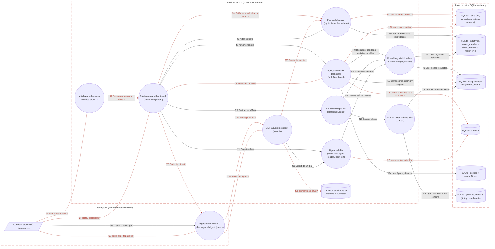

# Ficha: Dashboard

Dueño: QA (por asignar) · Revisor: John · Fecha: 2026-10-21 · Commit de referencia: 0e07d8f

## 1. Resumen

`/equipo/dashboard` es la vista de seguimiento del founder y de quienes supervisan. Junta datos de varios módulos para responder tres preguntas en 30 segundos, en este orden:

1. **¿Qué está bloqueado?** Cada bloqueo con su motivo, su responsable y los días que lleva bloqueado (salen del último evento `bloquear` del historial, no de una columna). Justo debajo van los **plazos**: lo que pasó su plazo y lo que está por vencer, con el semáforo en horas hábiles del genoma (`plazosDelEquipo`).
2. **¿Qué me necesita a mí?** La bandeja de gates: piezas marcadas `needs_founder` que no están en `Hecha`.
3. **¿Qué avanza?** Una barra de estados por proyecto (iniciativa) y la carga por persona. La carga va en orden alfabético y existe para repartir trabajo, nunca para rankear (doc 16).

Después vienen la salud del rito de check-in (check-ins escritos ÷ personas × días transcurridos), la época (último periodo y último fitness, solo lectura) y el **digest del día**: un texto plano con lo hecho, lo que está en curso y lo bloqueado, que se copia al portapapeles o se descarga como `.txt` desde `GET /api/equipo/digest`. No se envía a nadie.

- **Quién lo usa:** solo el founder y la supervisión (`puedeVerTodoElEquipo`). Una persona `core` sin supervisión ve una explicación "403 · Sin acceso" y un enlace a su día. Quien no entra a `/equipo` (alumni, contributor sin acuerdo o sin membresía) va a `/perfil`.
- **Casos de uso:** destrabar bloqueos (del más viejo al más nuevo), decidir los gates, repartir trabajo sin dueño o sobrecargado, ver si el rito está vivo y pegar el digest donde haga falta.
- **Solo lee.** La página y la ruta del digest no escriben nada en la base.
- **Visibilidad (spec WP31 §4.A.12):** todo lo que se cuenta pasa por `piezasVisiblesPara`. Un proyecto de cliente solo cuenta para el founder y para quien participa en ese cliente o proyecto, aunque supervise.
- El bot de Telegram reutiliza las mismas funciones para responder "consultar estado" (`bot-tools.ts:566-633`).
- **Ojo:** no hay ningún enlace a `/equipo/dashboard` en el menú ni en otra página; hoy solo se llega escribiendo la URL (ver §9).

## 2. Diagrama (DFD)

Archivo: [`docs/dfd/dashboard.tm7`](../dfd/dashboard.tm7), más la imagen exportada [`docs/dfd/dashboard.svg`](../dfd/dashboard.svg). Los dos se generan desde la fuente [`docs/dfd/dashboard.json`](../dfd/dashboard.json) con `python docs/dfd/generar_tm7.py docs/dfd/dashboard.json --estricto`, que pasa: cada `codigo` existe en el repo. La fuente tiene 18 elementos (1 actores, 10 procesos, 7 almacenes), 32 flujos (15 sensibles) y 3 fronteras de confianza.

Leyenda: `[/ /]` actor, `(( ))` proceso, `[( )]` almacén y `subgraph` frontera de confianza. Un `*` y la flecha en rojo marcan un flujo con datos sensibles (sesión o datos personales). Las fronteras van punteadas. El bloque sale de `python docs/dfd/generar_tm7.py docs/dfd/dashboard.json --mermaid`.

## 3. Recorrido de una acción

Acción elegida: el founder o una supervisora abre `/equipo/dashboard` para ver qué está bloqueado y descarga el digest del día.

1. **Pantalla o componente:** `app/equipo/dashboard/page.tsx#EquipoDashboardPage` (server component, `dynamic = "force-dynamic"` en la línea 40). No hay enlace en el menú (`src/lib/menu.ts:55-56` solo tiene "Mi día" y "Proyectos"): se llega escribiendo la URL. El único componente de cliente es `DigestPanel` (botones "Copiar el digest" y "Descargar .txt").
2. **Llamada al backend (endpoint y datos enviados):** `GET /equipo/dashboard` con la cookie `zelena_session` (JWT HS256 de 24 h, `httpOnly`, `SameSite=Lax`: `session.ts:19-25`). No hay `fetch`: el servidor arma la página entera en el render. La descarga es `GET /api/equipo/digest?dia=AAAA-MM-DD`, que arma `DigestPanel.tsx:36-42`.
3. **Ruta y controlador:**
   - `middleware.ts:33-48`: `/equipo` está en `PROTECTED_SESSION` (línea 27). Verifica la firma del JWT (`jwt.ts:48-55`) y, si falta o no es válido, redirige a `/entrar?next=/equipo/dashboard`. El matcher (línea 51) no cubre `/api/**`: cada ruta tiene su propia puerta.
   - `app/equipo/layout.tsx` llama a `equipoActor` como atajo de UX, no como puerta.
   - `page.tsx:96-129` es la puerta propia: `getSession` (97-98), luego `equipoActor` (102-104, `null` → `/perfil`) y luego `puedeVerTodoElEquipo` (105, si no → `<AccessDenied/>`). Después llama a `buildDashboard` (107-114), `plazosDelEquipo` (117) y `buildDailyDigest` + `renderDigestText` con el día `today()` (126-129).
   - Descarga: `app/api/equipo/digest/route.ts#GET` (24-59). Responde 401 sin sesión (25-28), aplica el límite de 30 solicitudes por minuto (29-31), valida `dia` con `DAY_RE` (33-37), corre la puerta `equipoActor` (41-45) y llama a `dailyDigestFor` (47).
4. **Lógica de negocio (validaciones, permisos, cálculos):**
   - `buildDashboard` (`dashboard.ts:575-589`) repite la puerta: si no hay supervisión lanza `TeamError(403)` (576-578).
   - `blockedWithAge` (107-132) usa `listBlocked(actor)`. La fecha del bloqueo sale del último evento `bloquear` (`lastBlockDayByAssignment`, 87-97) y, si no hay evento, de `blocked_at`. Nunca inventa una fecha. Ordena del bloqueo más viejo al más nuevo.
   - `founderInbox` (210-212) es un alias de `listNeedsFounder` (`team.ts:603-608`).
   - `initiativeBars` (273-294) usa `assignmentsByInitiative(actor)` y cuenta las piezas cerradas desde el `created_at` del último periodo.
   - `loadByPerson` (372-446) hace un `COUNT` agrupado por responsable, estado, proyecto y cliente, y lo filtra con `piezasVisiblesPara`. Las filas de personas salen de `listTeamMembers`: founder y core activos, no demo. Lo que no tiene responsable y lo que es de alguien fuera del roster se cuenta aparte.
   - `riteHealth` (473-498) calcula check-ins desde el lunes ÷ (miembros × días transcurridos). No se filtra por actor.
   - `epochSnapshot` (514-547) toma el último periodo, en cualquier estado, y el último fitness.
   - `plazosDelEquipo` (176-199) toma `visibleAssignments` sin las piezas `Bloqueada` ni `Hecha` y llama a `slaDeAsignaciones` (`sla-db.ts:110-132`). Con eso separa vencidas, por vencer, a tiempo y sin plazo, con los parámetros `SLA_*` y `BUSINESS_*` del genoma.
   - Digest: `buildDailyDigest` (`digest.ts:87-129`) junta los check-ins del día (`checkinsOfDay`, **sin filtro por actor**) y los eventos del día visibles (`assignmentEventsOfDay(day, actor)`). `renderDigestText` (161-213) es determinista: sin markdown y sin emoji.
5. **Base de datos (tablas o modelos leídos y escritos):** solo lectura de `users`, `roster_links`, `project_members`, `client_members`, `initiatives`, `assignments`, `assignment_events`, `checkins`, `periods`, `epoch_fitness` y `genome_versions`. No escribe nada.
6. **Respuesta y qué hace la pantalla con ella:** HTML con las secciones en el orden de §1. Cada vacío se dice ("No hay nada bloqueado", "sin registro de cuándo se bloqueó") y nunca se rellena. `DigestPanel` recibe el texto como prop. "Copiar" usa `navigator.clipboard.writeText` y "Descargar" devuelve `text/plain` con `Content-Disposition: attachment; filename="digest-equipo-<día>.txt"` y `Cache-Control: no-store` (`route.ts:50-54`).
7. **Casos de falla:**
   - Sin cookie o con un JWT inválido o vencido: redirección a `/entrar?next=…` (`middleware.ts:41-46`).
   - Sin fila en `users`, alumni, o contributor sin acuerdo o sin membresía: redirección a `/perfil` (`page.tsx:104`).
   - `core` sin supervisión: vista "403 · Sin acceso" (`page.tsx:105` y `112`). **La respuesta HTTP es 200**, no 403.
   - Error de base: la excepción sube y Next muestra su página de error (500).
   - Ruta del digest: 401, 429 (más de 30 por minuto), 400 (`dia` sin formato `AAAA-MM-DD`), 403 (no entra a `/equipo` o no supervisa) o 500.
   - El navegador no deja copiar: mensaje "Selecciona el texto y cópialo a mano" (`DigestPanel.tsx:26`).
   - Después de las 19:00 de Bogotá (00:00 UTC), `today()` ya devuelve el día siguiente. El encabezado, "Digest de hoy" y los días bloqueados se corren un día (ver §9).

## 4. Elementos del DFD en el código

| Elemento | Tipo | Archivo y función | Notas |
| --- | --- | --- | --- |
| `u` Founder o supervisión (navegador) | Actor | `apps/web/src/lib/roles.ts#puedeVerTodoElEquipo` (171-173) | El actor lo define la regla: rol `founder` o `is_supervisor = 1` leídos de la base. |
| `panel` DigestPanel | Proceso (cliente) | `apps/web/src/components/DigestPanel.tsx#DigestPanel` (15-53) | `"use client"`. Copia al portapapeles y enlaza la descarga. No arma el texto. |
| `mw` Middleware de sesión | Proceso | `apps/web/middleware.ts#middleware` (33-48), `PROTECTED_SESSION` (27) | Segunda capa: solo exige un JWT válido y no mira el rol. |
| `pg` Página `/equipo/dashboard` | Proceso | `apps/web/app/equipo/dashboard/page.tsx#EquipoDashboardPage` (96-521), `AccessDenied` (50-69) | Puerta propia (102-105), la vigila `authz.test.ts:341` y `:362`. |
| `gate` Puerta de `/equipo` | Proceso | `apps/web/src/lib/authz.ts#equipoActor` (120-154) | Lee la base, nunca la cookie. `status = 'active'` (136); alcance `equipo` o `proyectos` (146-152). |
| `dash` Agregaciones | Proceso | `apps/web/src/lib/dashboard.ts#buildDashboard` (575-589), `blockedWithAge` (107), `initiativeBars` (273), `loadByPerson` (372), `riteHealth` (473), `epochSnapshot` (514) | Puerta repetida (576-578). Cero tablas propias. |
| `team` Consultas y visibilidad | Proceso | `apps/web/src/lib/team.ts#piezasVisiblesPara` (562-592), `listBlocked` (595), `listNeedsFounder` (603), `assignmentsByInitiative` (633), `assignmentEventsOfDay` (945), `listTeamMembers` (1153) | Es el WP14 que el dashboard reutiliza. La regla de cliente vive aquí. |
| `plazos` Semáforo | Proceso | `apps/web/src/lib/dashboard.ts#plazosDelEquipo` (176-199) | Excluye `Bloqueada` y `Hecha`. Ordena piezas por vencimiento, nunca personas. |
| `sla` SLA en horas hábiles | Proceso | `apps/web/src/lib/sla-db.ts#slaDeAsignaciones` (110-132), `slaConfig` (24-26); lógica pura en `sla.ts#evaluarSla` (341) | Consulta en tandas de 400 ids por el límite de parámetros de SQL Server. |
| `dig` Digest del día | Proceso | `apps/web/src/lib/digest.ts#buildDailyDigest` (87-129), `dailyDigestFor` (141-146), `renderDigestText` (161-213), `digestFilename` (216) | Los check-ins no se filtran por actor (88). |
| `api` `GET /api/equipo/digest` | Proceso | `apps/web/app/api/equipo/digest/route.ts#GET` (24-59), `DAY_RE` (22) | Descarga, no envío. `no-store`. |
| `rl` Límite de solicitudes | Almacén (memoria) | `apps/web/src/lib/rate-limit.ts#rateLimit` (10-20), `clientIp` (22-26) | Un `Map` por proceso. La IP sale del primer valor de `X-Forwarded-For`. |
| `db_users` users | Almacén | `apps/web/src/lib/schema.sql#users` (18) | Rol, supervisión, estado, acuerdo y nombre visible. |
| `db_proy` Visibilidad | Almacén | `schema.sql#initiatives` (480), `project_members` (577), `client_members` (350), `roster_links` (592) | Deciden qué piezas ve cada actor. |
| `db_trabajo` Trabajo | Almacén | `schema.sql#assignments` (499), `assignment_events` (533) | `assignment_events` es append-only por convención (no hay trigger). |
| `db_checkins` Check-ins | Almacén | `schema.sql#checkins` (548) | `UNIQUE(wallet, day)`. |
| `db_epoca` Épocas | Almacén | `schema.sql#periods` (177), `epoch_fitness` (200) | Solo lectura desde aquí. Se calculan y firman en `/admin`. |
| `db_genoma` Genoma | Almacén | `schema.sql#genome_versions` (251) | `SLA_*`, `BUSINESS_TZ` y horario hábil. Sin versión guardada se usan `GENOME_DEFAULTS`. |

## 5. Flujos de datos

| Flujo | De → a | Protocolo | Datos que viajan |
| --- | --- | --- | --- |
| f1 | u → mw | HTTPS | **Sensible (sesión).** `GET /equipo/dashboard` con la cookie `zelena_session`. |
| f2 | mw → pg | En proceso (Next.js) | **Sensible (sesión).** Petición con el JWT ya verificado. |
| f3 | pg → gate | Llamada de función | **Sensible (sesión).** Wallet de la sesión. |
| f4 | gate → db_users | SQL | **Sensible (datos personales).** `display_name`, `role`, `is_supervisor`, `status`, `cla_signed` por wallet. |
| f5 | gate → db_proy | SQL | Membresías de todas las identidades del actor. |
| f6 | gate → pg | Llamada de función | `EquipoActor` (rol, supervisión, alcance, proyectos) o `null`. |
| f7 | pg → dash | Llamada de función | Actor e instante. 403 si no supervisa. |
| f8 | dash → team | Llamada de función | Bloqueos, bandeja e iniciativas filtrados con el actor. |
| f9 | team → db_trabajo | SQL | Títulos, estados, motivos de bloqueo, responsables y eventos. |
| f10 | team → db_proy | SQL | `client_id` del proyecto, `project_members` y `client_members` del actor. |
| f11 | dash → db_trabajo | SQL | `COUNT` por responsable y estado, último `bloquear` por pieza y piezas cerradas desde la época. |
| f12 | dash → db_users | SQL | **Sensible (datos personales).** Nombres y rol del roster activo. |
| f13 | dash → db_checkins | SQL | **Sensible (datos personales).** Check-ins por persona en la semana. |
| f14 | dash → db_epoca | SQL | Último periodo y último fitness. |
| f15 | dash → pg | Llamada de función | **Sensible (datos personales).** `DashboardData`, con la carga por persona. |
| f16 | pg → plazos | Llamada de función | Actor e instante. |
| f17 | plazos → team | Llamada de función | `visibleAssignments(actor)`. |
| f18 | plazos → sla | Llamada de función | Ids de las piezas e instante. |
| f19 | sla → db_trabajo | SQL | `priority`, `status`, `due_date`, `created_at`, `blocked_at` y eventos. |
| f20 | sla → db_genoma | SQL | Parámetros `SLA_*` y `BUSINESS_*`. |
| f21 | pg → dig | Llamada de función | Día de `today()` (reloj del servidor) y actor. |
| f22 | dig → db_checkins | SQL | **Sensible (datos personales).** Hecho, haciendo y bloqueado de cada persona con su nombre. |
| f23 | dig → team | Llamada de función | Eventos del día visibles para el actor. |
| f24 | pg → u | HTTPS | **Sensible (datos personales).** HTML con bloqueos, carga por persona, rito y digest. |
| f25 | pg → panel | HTTPS (props del RSC) | **Sensible (datos personales).** Texto del digest. |
| f26 | u → panel | Interacción | Clic en "Copiar" o "Descargar". |
| f27 | panel → u | `navigator.clipboard` | **Sensible (datos personales).** Texto del digest en el portapapeles. |
| f28 | panel → api | HTTPS | **Sensible (sesión).** `GET /api/equipo/digest?dia=` con la cookie. |
| f29 | api → rl | En memoria | **Sensible (datos personales).** Clave `equipo:digest:<wallet>:<ip>`. |
| f30 | api → gate | Llamada de función | **Sensible (sesión).** Wallet de la sesión. |
| f31 | api → dig | Llamada de función | `dailyDigestFor(actor, día)`. |
| f32 | api → panel | HTTPS | **Sensible (datos personales).** `.txt` adjunto, `no-store`. |

## 6. Dependencias con otras features

- **Login y sesión:** `getSession`, `middleware.ts`, `jwt.ts` y la cookie `zelena_session`. Sin sesión no hay dashboard.
- **Actividades:** es su fuente de datos. Bloqueos, bandeja, carga y digest salen de `assignments`, `assignment_events` y `checkins`, que escribe Actividades (`aplicarAccionAsignacion`, `createAssignmentAs`, `upsertCheckin`). Un bloqueo aplicado en `/equipo/hoy` aparece en el siguiente render.
- **Proyectos y membresías:** la regla de visibilidad (`piezasVisiblesPara`, `veIniciativa`) y las barras por proyecto.
- **SLA, recordatorios y avisos:** `slaDeAsignaciones`, `slaConfig` y `SlaBadge`, con los mismos parámetros del genoma que los recordatorios.
- **Gamificación y épocas:** `periods` y `latestEpochFitness` (`epochs.ts:182`), solo lectura.
- **Clientes y grafo:** `client_members` decide qué piezas de cliente cuenta una supervisora.
- **Talento e importador:** `listTeamMembers` (roster) y `vincularPrincipal`, que mueve la wallet en `checkins` y `assignment_events` al vincular.
- **Telegram:** el bot consume `blockedWithAge`, `founderInbox`, `initiativeBars`, `loadByPerson`, `epochSnapshot`, `riteHealth` y `buildTodayDigest` (`bot-tools.ts:566-633`). Un cambio aquí cambia sus respuestas.
- **Menú y navegación:** no hay entrada para el dashboard (`menu.ts:55-58`, `menuPara` 84-102).

Dependencias inversas anotadas al integrar (la otra ficha ya las tenía; la guía pide anotarlas en las dos):

- **Ritos y comunidad** ([ritos-y-comunidad.md](ritos-y-comunidad.md)): `riteHealth` (`src/lib/dashboard.ts:473`) se presenta como «salud de ritos», pero cuenta check-ins diarios y no asistencia a ritos; la ficha de ritos lo anota como hallazgo.

## 7. Amenazas relevantes

| Amenaza | Categoría | Elemento | Estado | Justificación |
| --- | --- | --- | --- | --- |
| Cookie de sesión falsificada o alterada para entrar al tablero | Suplantación (S) | f1, mw | Mitigada | JWT HS256 verificado en `jwt.ts:48-55` con `SESSION_SECRET` de 32 caracteres o más (en producción no arranca sin él: `jwt.ts:9-13`). `middleware.ts:39-46` redirige si no verifica. |
| Una cookie que se declara `founder` o `isSupervisor` ve todo el equipo | Elevación de privilegios (E) | gate, pg | Mitigada | `equipoActor` lee rol y supervisión de `users` y no de la cookie (`authz.ts:122-143`). La página aplica `puedeVerTodoElEquipo` (`page.tsx:105`) y `buildDashboard` lo repite (`dashboard.ts:576-578`). Test: `authz.test.ts:276`. |
| Un `core` descarga el digest del equipo por la API | Elevación de privilegios (E) | api | Mitigada | `route.ts:41-45` (`equipoActor`) y `digest.ts:141-145` (`dailyDigestFor` → 403). Test: `caracterizacion/dashboard.test.ts`, "la puerta". |
| Una supervisora ve bloqueos, gates o eventos de un proyecto de cliente donde no participa | Divulgación de información (I) | dash, team, dig | Mitigada | `piezasVisiblesPara` (`team.ts:562-592`) se aplica en `listBlocked` (599), `listNeedsFounder` (607), `assignmentEventsOfDay` (969), `loadByPerson` (`dashboard.ts:388`) y `epochSnapshot` (520). Test: `caracterizacion/dashboard.test.ts`, "proyecto de cliente". |
| El texto de los check-ins del día (que puede hablar de un cliente) llega a toda supervisión | Divulgación de información (I) | dig, f22 | Pendiente | `buildDailyDigest` llama a `checkinsOfDay(db, day)` sin actor (`digest.ts:88`, `team.ts:1019-1027`). Un check-in no está ligado a un proyecto, así que no hay cómo filtrarlo hoy. Decisión de producto (§9). |
| Alguien de otra organización enumera días del digest | Divulgación de información (I) | api | Mitigada | Hace falta sesión y supervisión (`route.ts:25-28`, `41-45`). `dia` se valida con `DAY_RE` (`route.ts:22`, `33-37`) y la consulta usa parámetros (`team.ts:952`). |
| Un proxy o el navegador guardan en caché el digest o el tablero | Divulgación de información (I) | api, pg | Mitigada | `Cache-Control: no-store` en la descarga (`route.ts:53`). La página es `force-dynamic` (`page.tsx:40`). |
| Inyección en la cabecera `Content-Disposition` por el parámetro `dia` | Manipulación (T) | api | Mitigada | El nombre del archivo solo se arma con un `dia` que pasó `^\d{4}-\d{2}-\d{2}$` (`route.ts:22`, `34`, `52`). |
| XSS con el título o el motivo de una pieza pintados en el tablero o en el digest | Manipulación (T) | pg, panel | Mitigada | React escapa el texto. El digest se pinta en `<pre>{text}</pre>` (`DigestPanel.tsx:48-50`) y ninguno de estos archivos usa `dangerouslySetInnerHTML`. |
| Muchas peticiones al tablero (consultas completas de `assignments` en cada render) | Denegación de servicio (D) | pg, team | Aceptada | La página no tiene límite de solicitudes y `assignmentsByInitiative` lee todas las piezas (`team.ts:638`). Se acepta por volumen: es un equipo pequeño y solo entra quien supervisa (`page.tsx:105`). Revisar si el equipo crece. |
| Saltarse el límite de 30 por minuto del digest cambiando `X-Forwarded-For` | Denegación de servicio (D) | rl, api | Pendiente | `clientIp` toma el primer valor de `X-Forwarded-For`, que manda el cliente (`rate-limit.ts:22-24`). La clave incluye la wallet, así que hace falta sesión. Con cabeceras distintas se abren cubetas nuevas. El `Map` además es por proceso (`rate-limit.ts:7-8`). |
| Nadie registra quién vio o descargó el digest | Repudio (R) | api, pg | Aceptada | Es solo lectura y no cambia estado, y v1 no tiene bitácora de lecturas. El contenido sale de eventos que sí tienen autor (`assignment_events.actor_wallet`). |
| Una sesión robada sigue sirviendo 24 h después del logout | Suplantación (S) | f1 | Aceptada | No hay revocación del JWT en el servidor (`jwt.ts:44`). Cada render relee rol y estado de la base (`authz.ts:136`), así que pasar a alumni o perder la supervisión corta el acceso al instante. |

## 8. Prueba de caracterización

Archivo: `apps/web/src/lib/caracterizacion/dashboard.test.ts`. Se corre con `cd apps/web && npx vitest run src/lib/caracterizacion/dashboard.test.ts` y el resultado es **7 de 7 pasan**.

Usa una base SQLite en memoria con `schema.sql` y `seedTeam`. Crea un proyecto y tres piezas con las funciones reales: una se bloquea con motivo, otra espera al founder con la fecha vencida y otra queda sin responsable. También escribe un check-in. Con eso fija:

- las seis secciones de `buildDashboard`: el bloqueo con su motivo, desde el 5 de octubre y 3 días bloqueado; la bandeja; la barra por estado; la carga en orden alfabético con lo que no tiene dueño; el rito, que da 1 de 24 (4 %); y la época sin periodo;
- en `plazosDelEquipo`: la pieza vencida en fase `entrega`; lo bloqueado y lo que no tiene plazo quedan fuera;
- el digest del día (6 eventos y 1 check-in), su texto exportable y el aviso "Sin check-ins" de un día vacío;
- la puerta: founder sí; `core` → 403 en `buildDashboard` y en `dailyDigestFor`;
- §4.A.12: el bloqueo de un proyecto de cliente cuenta para el founder y no para una supervisora que no participa;
- dos comportamientos actuales señalados como hallazgo: la persona externa con trabajo no tiene fila en la carga, y `today()` usa el reloj del servidor.

Ya hay pruebas que cubren más casos y que esta no reemplaza: `src/lib/dashboard.test.ts` (24 casos) y `src/lib/digest.test.ts` (11).

## 9. Preguntas abiertas

1. **¿Dónde va el enlace al dashboard?** No aparece en el menú (`menu.ts:55-58`) ni en `/equipo/hoy` ni en `/equipo/proyectos`. La búsqueda `grep "equipo/dashboard"` solo encuentra la propia página. Propuesta: agregarlo en `menuPara` cuando `puedeVerTodo` sea verdadero, igual que "Talento".
2. **¿El día del equipo es el del servidor o el del negocio?** La página, el digest, el check-in y los días bloqueada usan `today()` (`team.ts:105-110`, reloj del servidor en UTC en Azure). Mientras tanto, `zona-horaria.ts:5-8` dice que el código nuevo nunca debe usarlo y el tablero de proyecto sí usa `BUSINESS_TZ`. Entre las 19:00 y las 24:00 de Bogotá todo aparece como del día siguiente.
3. **¿Toda supervisión debe leer todos los check-ins?** El digest no filtra los check-ins por actor (`digest.ts:88`). Si alguien escribe sobre un cliente, el texto le llega a supervisión que no participa en ese cliente.
4. **¿Las personas externas con rol en proyectos deben tener fila en la carga?** Hoy la carga solo lista founder y core (`team.ts:1157`), y el trabajo de las personas externas cae en "fuera del roster" sin nombre (`dashboard.ts:415-421`). Con WP31 (talento por proyectos) esto se queda corto para repartir trabajo.
5. **¿"La época" es la abierta o la última?** `epochSnapshot` y `epochStartDay` toman el último periodo sin filtrar `state` (`dashboard.ts:247` y `516`), aunque el comentario dice "último periodo abierto" (244). Con la época cerrada y sin una nueva, la pantalla dice "abierta desde … · estado Closed".
6. **¿Debe la vista "403" responder con HTTP 403?** Hoy es un 200 con texto de 403 (`page.tsx:105`).
7. Limpieza menor (insumo de la auditoría): `realTeamMembers` repite el filtro `is_demo` que ya aplica `listTeamMembers` (`dashboard.ts:323-330` y `team.ts:1157`). `founderInbox` es un alias. `epochStartDay` y `closedThisEpochByInitiative` repiten consultas de `epochSnapshot`. `OPEN_LIST` está duplicada (`dashboard.ts:365` y `team.ts:506`). El comentario de `buildDashboard` menciona un "endpoint de exportación" del dashboard que no existe (`dashboard.ts:569-570`). En `buildDashboard(db = getDb(), actor, …)` el valor por defecto va antes de un parámetro obligatorio, así que no sirve de nada.
