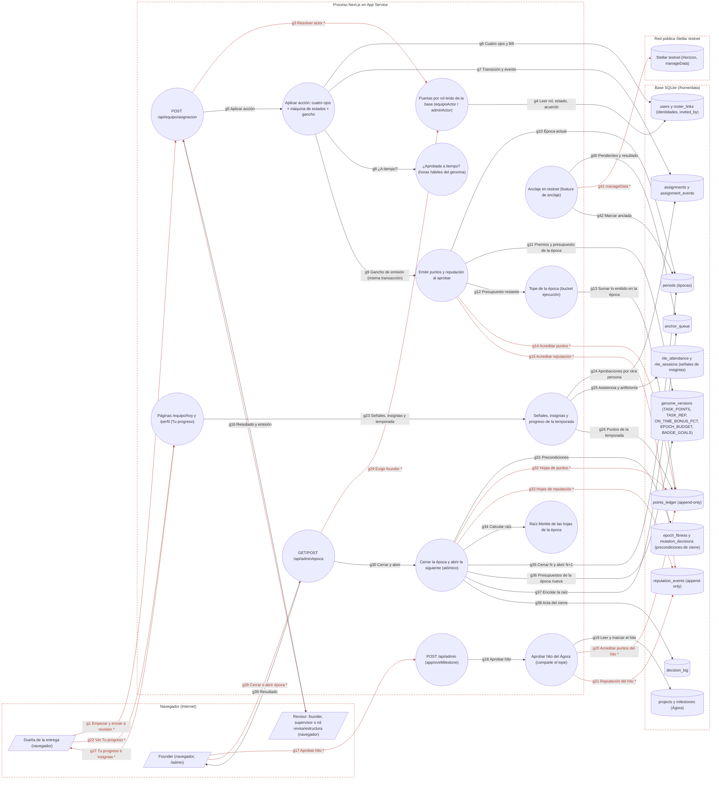

# Ficha: Gamificación y épocas

Dueño: QA (por asignar) · Revisor: John · Fecha: 2026-10-21 · Commit de referencia: 0e07d8f · Revisada contra wp/32-release (`4032c7c`) el 2026-10-24: §8 (lo marcado «en `4032c7c`» cita líneas de ese commit)

## 1. Resumen

Qué hace: convierte el trabajo aprobado en **puntos ZWORK** (no transferibles) y **reputación**, con un tope por época, y cierra cada época dejando una huella verificable.

- **Emisión al aprobar**: cuando OTRA persona aprueba una entrega del tablero, en la misma transacción se acreditan puntos según el tamaño (`TASK_POINTS` S/M/L; sin tamaño cuenta como S), un bono de `ON_TIME_BONUS_PCT` % si se aprobó antes del vencimiento, y reputación de ejecución (`TASK_REP`). Nunca se resta nada: los ledgers son solo INSERT.
- **Tope por época**: los puntos de ejecución de una época no pasan de `EPOCH_BUDGET`; si no alcanza, se emite el remanente y la reputación va completa. Tareas e hitos del Ágora comparten ese presupuesto; la Academia tiene el suyo.
- **Insignias y «Tu progreso»**: en `/equipo/hoy` y `/perfil` cada persona ve sus puntos, reputación y entregas de la temporada y sus insignias («Diez entregas · 4 de 10»), calculadas sumando todas sus identidades. No hay rankings ni comparaciones con otras personas.
- **Épocas**: el founder cierra la época actual y abre la siguiente en UNA operación desde `/admin`, solo si el fitness de la época está firmado y la mutación de la siguiente está decidida. El cierre calcula la **raíz Merkle** de todo lo emitido en la época, la encola para anclarla en Stellar testnet y escribe el acta en el decision log.

Quién lo usa: la persona que entrega (recibe), quien revisa (founder, supervisor o rol revisa/estructura del proyecto), el founder (hitos del Ágora y épocas).

Casos de uso: premiar una entrega aprobada; explicar por qué una aprobación dio menos puntos (presupuesto completado) o ninguno (pieza del Ágora, ya emitida); ver el propio progreso; cerrar la temporada con su huella.

## 2. Diagrama (DFD)

Archivo: [`docs/dfd/gamificacion-y-epocas.tm7`](../dfd/gamificacion-y-epocas.tm7), más la imagen exportada [`docs/dfd/gamificacion-y-epocas.svg`](../dfd/gamificacion-y-epocas.svg). Los dos se generan desde la fuente [`docs/dfd/gamificacion-y-epocas.json`](../dfd/gamificacion-y-epocas.json) con `python docs/dfd/generar_tm7.py docs/dfd/gamificacion-y-epocas.json --estricto`, que pasa: cada `codigo` existe en el repo. La fuente tiene 29 elementos (3 actores, 14 procesos, 12 almacenes), 42 flujos (15 sensibles) y 4 fronteras de confianza.

Leyenda: los flujos con `*` y en rojo llevan datos sensibles (sesión, puntos, reputación, datos personales o firma con la llave de servicio); cada `subgraph` es una frontera de confianza.

Lectura: la aprobación entra por `/api/equipo/asignacion`, pasa por los cuatro ojos y la máquina de estados (`aplicarAccionAsignacion`) y, si la pieza queda `Hecha`, llama al gancho `emitirPorAprobacion`, que consulta el genoma y el tope y escribe en los dos ledgers. Los hitos del Ágora escriben en los mismos ledgers por otro camino (`approveMilestone`). El cierre de época lee los ledgers de la época, calcula la raíz y la deja en la cola de anclaje, que procesa otra feature.

## 3. Recorrido de una acción

Acción elegida: **la revisora aprueba una entrega que está «En revisión» y se emiten puntos y reputación**.

1. Pantalla o componente: la tarjeta de la pieza en el tablero (`app/equipo/proyectos/[slug]/page.tsx`, que calcula `accionesPermitidas` en la línea 111) o en `/equipo/hoy`; el botón «Aprobar entrega» lo pinta `src/components/TeamAssignmentActions.tsx` (`TeamAssignmentActions`) solo si el servidor lo permite.
2. Llamada al backend (endpoint y datos enviados): `POST /api/equipo/asignacion` con `{ "assignmentId": <id>, "action": "aprobar" }` (`send`, líneas 55-80) y la cookie de sesión.
3. Ruta y controlador: `app/api/equipo/asignacion/route.ts` → `POST` (38-81): `getSession` (401), `equipoActor` (403; lee rol, estado, acuerdo y membresías de la base), `rateLimit` 60/min (429), `assignmentActionSchema` (400) y `aplicarAccionAsignacion`.
4. Lógica de negocio (validaciones, permisos, cálculos): `src/lib/team.ts` → `aplicarAccionAsignacion` (721-803). Carga la pieza (404). `flagsDeTransicion` + `puedeTransicionar` (`roles.ts:371-392`) frenan con 403, en este orden: quien es dueño (con cualquiera de sus identidades), quien la envió a revisión, relación de invitación (B8, `reglaB8`), quien le dio la pieza o sumó al dueño al proyecto (salvo founder), dueño `pending:` sin vincular (solo founder o supervisor) y falta de permiso `revisar`. La máquina pura (`teamTransition`) pasa de «En revisión» a «Hecha». En UNA transacción (757-795): UPDATE de la pieza (`closed_at`), INSERT del evento `aprobar` (con `day = today(now)`, línea 749) y el gancho (783-793): `aprobadaATiempo` (`sla.ts:332-338`, con la configuración SLA del genoma) y `emitirPorAprobacion` (`gamificacion.ts:124-178`): época actual (`currentEpoch`), descarta sin responsable, autoaprobación, B8, pieza publicada en el Ágora y `ref` ya emitida; si no, premio = `TASK_POINTS[tamaño]` + `round(base × ON_TIME_BONUS_PCT / 100)` si a tiempo, recortado a `EPOCH_BUDGET` − lo emitido en la época (bucket `ejecucion`); reputación `TASK_REP[tamaño]` completa.
5. Base de datos (tablas o modelos leídos y escritos): lee `assignments`, `assignment_events`, `users`, `roster_links`, `project_members`, `periods`, `genome_versions`, `points_ledger`, `reputation_events`. Escribe `assignments`, `assignment_events`, `points_ledger` (si hay puntos) y `reputation_events` (siempre; marca la emisión), ambos con `period_id` explícito y `ref = assignment:<id>`.
6. Respuesta y qué hace la pantalla con ella: `200 { ok, status: "Hecha", blockedReason, emision: { emitido, motivo, puntos, reputacion, bono }, textoEmision }`. Si hay `textoEmision` («Esta temporada el presupuesto de puntos se completó: tu reputación quedó entera.» o «Esta pieza se paga por sus hitos en el Ágora.»), la tarjeta muestra «Entrega aprobada.» con esa nota y un botón «Entendido»; si no, refresca. La dueña ve sus puntos e insignias en `/equipo/hoy` y `/perfil`.
7. Casos de falla: 401 sin sesión; 403 sin acceso a `/equipo` o con el motivo de los cuatro ojos («Quien entrega no aprueba su propia entrega.», etc.); 404 pieza inexistente; 409 transición inválida; 429; 500 «No se pudo actualizar la asignación.» si falla la base: la transacción se revierte ENTERA (el gancho no tiene try/catch), así nadie queda aprobado sin lo suyo. Que la emisión diga `ya_emitido` o `presupuesto_agotado` no es un error.

Acción complementaria: **el founder cierra la época N y abre la N+1** (`EpocaPanel` → `POST /api/admin/epoca` `{ action: "cerrar", justificacion, nombreSiguiente? }` → `adminActor` (403), `rateLimit` 10/min → `cerrarYAbrirEpoca` (`epocas.ts:204-244`)). Exige época `Open`, fitness firmado, mutación de N+1 decidida y justificación de 10 caracteres o más (si falta algo: 409 con `faltantes`, o 400 si solo falta la justificación). En una transacción relee la época (no cierra dos veces), calcula `merkleRoot(hojasDeEpoca(N))`, marca N `Closed` con la raíz, encola `merkle_root` / `epoch:N` en `anchor_queue`, escribe el acta y abre N+1 con los presupuestos de su genoma. Responde `{ cerrada, abierta, merkleRoot, anchorQueueId, decisionLogId }`.

## 4. Elementos del DFD en el código

| Elemento | Tipo | Archivo y función | Notas |
| --- | --- | --- | --- |
| `duena` Dueña de la entrega (navegador) | Cliente externo | `apps/web/src/components/Insignias.tsx` → `Insignias` | Ve sus insignias en /equipo/hoy y /perfil; empieza y envía a revisión desde la tarjeta (`TeamAssignmentActions`). |
| `revisor` Revisor: founder, supervisor o rol revisa/estructura (navegador) | Cliente externo | `apps/web/src/components/TeamAssignmentActions.tsx` → `TeamAssignmentActions` | La UI solo pinta las acciones que `accionesPermitidas` deja; si la respuesta trae `textoEmision`, lo muestra antes de refrescar (líneas 55-80). |
| `fundador` Founder (navegador, /admin) | Cliente externo | `apps/web/src/components/EpocaPanel.tsx` → `EpocaPanel` | `EpocaPanel` pide confirmación (`window.confirm`) y justificación ≥ 10 caracteres antes de cerrar. |
| `api_asignacion` POST /api/equipo/asignacion | Proceso | `apps/web/app/api/equipo/asignacion/route.ts` → `POST` | Líneas 38-81: puerta `equipoActor` (44), límite 60/min (46), `assignmentActionSchema` (51), devuelve `emision` sin wallets ni nombres (63-77). |
| `authz` Puertas por rol leído de la base (equipoActor / adminActor) | Proceso | `apps/web/src/lib/authz.ts` → `equipoActor`, `adminActor` | `equipoActor` (authz.ts:120-154) exige fila activa y, para contributor, acuerdo firmado y membresía; `adminActor` (80-84) exige rol founder. |
| `aplicar` Aplicar acción: cuatro ojos + máquina de estados + gancho | Proceso | `apps/web/src/lib/team.ts` → `aplicarAccionAsignacion` | team.ts:721-803. Cuatro ojos con `flagsDeTransicion` (863-922) + `puedeTransicionar` (roles.ts:371-392); transición pura; UPDATE + evento + gancho en UNA transacción (757-795), sin try/catch. |
| `a_tiempo` ¿Aprobada a tiempo? (horas hábiles del genoma) | Proceso | `apps/web/src/lib/sla.ts` → `aprobadaATiempo` | sla.ts:332-338: compara el último evento `aprobar` con el fin del día de `due_date` (o la ventana SLA del genoma). |
| `emitir` Emitir puntos y reputación al aprobar | Proceso | `apps/web/src/lib/gamificacion.ts` → `emitirPorAprobacion` | gamificacion.ts:124-178. Orden: sin responsable → autoaprobación → B8 → pieza del Ágora → `ya_emitido` → premio recortado al presupuesto. Reputación siempre completa. |
| `tope` Tope de la época (bucket ejecución) | Proceso | `apps/web/src/lib/gamificacion.ts` → `presupuestoEjecucionRestante` | gamificacion.ts:87-90: `EPOCH_BUDGET` − SUM de la época en bucket `ejecucion` (tareas e hitos lo comparten; la Academia tiene el suyo). |
| `api_admin` POST /api/admin (approveMilestone) | Proceso | `apps/web/app/api/admin/route.ts` → `POST` | app/api/admin/route.ts:19-117. Sin límite de tasa; cualquier excepción vuelve como 400 con su mensaje (114-115). |
| `hito` Aprobar hito del Ágora (comparte el tope) | Proceso | `apps/web/src/lib/admin.ts` → `approveMilestone` | admin.ts:58-106. B8 propio (`violatesB8` + comparación con `FOUNDER_WALLET`, 76-82); si excede el tope RECHAZA (91-93) en vez de recortar; `1 USD = 1 punto` y reputación `points/10` en código. |
| `pag_progreso` Páginas /equipo/hoy y /perfil (Tu progreso) | Proceso | `apps/web/app/equipo/hoy/page.tsx` → `EquipoHoyPage` | /equipo/hoy (líneas 189-193) y /perfil (74-79) llaman a `progresoDeTareas`, `senalesProgreso` e `insignias` con `BADGE_GOALS` de la época. |
| `progreso` Señales, insignias y progreso de la temporada | Proceso | `apps/web/src/lib/gamificacion.ts` → `senalesProgreso`, `insignias`, `progresoDeTareas` | gamificacion.ts:248-370. Suma todas las identidades (`identidadesDe`); solo cuenta aprobaciones hechas por OTRA persona. |
| `api_epoca` GET/POST /api/admin/epoca | Proceso | `apps/web/app/api/admin/epoca/route.ts` → `POST` | Líneas 48-83: GET y POST con `adminActor`; POST con límite 10/min (59); traduce `EpocaError` a {error, faltantes} (79). |
| `epocas` Cerrar la época y abrir la siguiente (atómico) | Proceso | `apps/web/src/lib/epocas.ts` → `cerrarYAbrirEpoca` | epocas.ts:204-244. Precondiciones con `estadoCierreEpoca` (86-105); relee dentro de la transacción (225-226) para no cerrar dos veces. |
| `merkle` Raíz Merkle de las hojas de la época | Proceso | `apps/web/src/lib/crypto.ts` → `merkleRoot` | crypto.ts:90-103: sha256 de cada hoja, pares ordenados, el último se duplica si es impar. Hojas: `hojasDeEpoca` (epocas.ts:120-157). |
| `anclaje` Anclaje en testnet (feature de anclaje) | Proceso | `apps/web/src/lib/anchor.ts` → `anclarPendientes` | Fuera de este feature: lo dispara `POST /api/anchor/run` (o `anchor-worker.mjs`) y marca la época `Anchored` (anchor.ts:100-104). |
| `t_trabajo` assignments y assignment_events | Almacén de datos | `apps/web/src/lib/schema.sql` → `assignments`, `assignment_events` | `assignment_events.day` se escribe con `today()` (hora del servidor). |
| `t_identidades` users y roster_links (identidades, invited_by) | Almacén de datos | `apps/web/src/lib/schema.sql` → `users`, `roster_links` | `identidadesDe` y `reglaB8` (identidades.ts:65-141) leen `roster_links`, filas con rol founder e `invited_by`. |
| `t_points` points_ledger (append-only) | Almacén de datos | `apps/web/src/lib/schema.sql` → `points_ledger` | Append-only, sin FK. `ref = assignment:<id>` para tareas; texto libre para hitos. |
| `t_rep` reputation_events (append-only) | Almacén de datos | `apps/web/src/lib/schema.sql` → `reputation_events` | Append-only; `period_id` tiene DEFAULT 1, por eso todo INSERT nuevo lo pasa explícito. |
| `t_genoma` genome_versions (TASK_POINTS, TASK_REP, ON_TIME_BONUS_PCT, EPOCH_BUDGET, BADGE_GOALS) | Almacén de datos | `apps/web/src/lib/schema.sql` → `genome_versions` | Leído con `getActiveGenome(db, epoca)` (genome.ts:229-248), mezclado con `GENOME_DEFAULTS`. |
| `t_periods` periods (épocas) | Almacén de datos | `apps/web/src/lib/schema.sql` → `periods` | `currentEpoch` = id más reciente, sin mirar `state` (genome.ts:218-221). |
| `t_cierre` epoch_fitness y mutation_decisions (precondiciones de cierre) | Almacén de datos | `apps/web/src/lib/schema.sql` → `epoch_fitness`, `mutation_decisions` | `epoch_fitness.signed` y `mutation_decisions.epoch` (UNIQUE). |
| `t_decision` decision_log | Almacén de datos | `apps/web/src/lib/schema.sql` → `decision_log` | Acta del cierre con fecha en `BUSINESS_TZ` (epocas.ts:175-189). |
| `t_anchor` anchor_queue | Almacén de datos | `apps/web/src/lib/schema.sql` → `anchor_queue` | kind `merkle_root`, data_key `epoch:N`, status `pending` hasta que el anclaje la procese. |
| `t_hitos` projects y milestones (Ágora) | Almacén de datos | `apps/web/src/lib/schema.sql` → `projects`, `milestones` | Tablas del Ágora (feature Ágora). |
| `t_ritos` rite_attendance y rite_sessions (señales de insignias) | Almacén de datos | `apps/web/src/lib/schema.sql` → `rite_attendance`, `rite_sessions` | Tablas de ritos (feature ritos-y-comunidad). |
| `stellar` Stellar testnet (Horizon, manageData) | Almacén de datos | `apps/web/src/lib/anchor.ts` → `HORIZON` | Red de pruebas pública; `manageData` con nombre y valor de hasta 64 bytes. |

## 5. Flujos de datos

| Flujo | De → a | Protocolo | Datos que viajan |
| --- | --- | --- | --- |
| g1 Empezar y enviar a revisión | `duena` → `api_asignacion` | HTTPS | **[sensible]** POST JSON {assignmentId, action}; cookie de sesión |
| g2 Aprobar entrega | `revisor` → `api_asignacion` | HTTPS | **[sensible]** POST JSON {assignmentId, action: 'aprobar'}; cookie de sesión |
| g3 Resolver actor | `api_asignacion` → `authz` | Llamada en proceso | **[sensible]** wallet de la sesión |
| g4 Leer rol, estado, acuerdo | `authz` → `t_identidades` | SQL | role, is_supervisor, status, cla_signed; membresías |
| g5 Aplicar acción | `api_asignacion` → `aplicar` | Llamada en proceso | assignmentId, acción, motivo, actor |
| g6 Cuatro ojos y B8 | `aplicar` → `t_identidades` | SQL | identidades (roster_links, filas founder), invited_by |
| g7 Transición y evento | `aplicar` → `t_trabajo` | SQL | UPDATE assignments (status, owner, closed_at); INSERT assignment_events (day = today()) |
| g8 ¿A tiempo? | `aplicar` → `a_tiempo` | Llamada en proceso | pieza con sus eventos, configuración SLA del genoma, now |
| g9 Gancho de emisión (misma transacción) | `aplicar` → `emitir` | Llamada en proceso | assignmentId, dueño, aprobador, tamaño, aTiempo |
| g10 Época actual | `emitir` → `t_periods` | SQL | id del periodo más reciente (sin mirar su estado) |
| g11 Premios y presupuesto de la época | `emitir` → `t_genoma` | SQL | TASK_POINTS, TASK_REP, ON_TIME_BONUS_PCT, EPOCH_BUDGET |
| g12 Presupuesto restante | `emitir` → `tope` | Llamada en proceso | periodo y genoma |
| g13 Sumar lo emitido en la época | `tope` → `t_points` | SQL | SUM(points) WHERE period_id AND bucket = 'ejecucion' |
| g14 Acreditar puntos | `emitir` → `t_points` | SQL | **[sensible]** INSERT wallet, points, period_id, 'ejecucion', ref assignment:id |
| g15 Acreditar reputación | `emitir` → `t_rep` | SQL | **[sensible]** INSERT wallet, 'ejecucion', delta, ref, period_id |
| g16 Resultado y emisión | `api_asignacion` → `revisor` | HTTPS | JSON {status, emision {emitido, motivo, puntos, reputacion, bono}, textoEmision} |
| g17 Aprobar hito | `fundador` → `api_admin` | HTTPS | **[sensible]** POST JSON {action: 'approveMilestone', milestoneId}; cookie de sesión |
| g18 Aprobar hito | `api_admin` → `hito` | Llamada en proceso | milestoneId |
| g19 Leer y marcar el hito | `hito` → `t_hitos` | SQL | amount_usd, supervisor, ejecutor; UPDATE milestones SET approved = 1 |
| g20 Acreditar puntos del hito | `hito` → `t_points` | SQL | **[sensible]** INSERT points = amount_usd (1 USD = 1 punto), period_id actual |
| g21 Reputación del hito | `hito` → `t_rep` | SQL | **[sensible]** INSERT delta = max(1, round(points / 10)) |
| g22 Ver Tu progreso | `duena` → `pag_progreso` | HTTPS | **[sensible]** GET /equipo/hoy o /perfil; cookie de sesión |
| g23 Señales, insignias y temporada | `pag_progreso` → `progreso` | Llamada en proceso | wallet, época actual, BADGE_GOALS |
| g24 Aprobaciones por otra persona | `progreso` → `t_trabajo` | SQL | eventos aprobar, tamaño, plazos |
| g25 Asistencia y anfitrionía | `progreso` → `t_ritos` | SQL | asistencias de capa 1; ritos cerrados como anfitrión o relator |
| g26 Puntos de la temporada | `progreso` → `t_points` | SQL | SUM(points) con ref assignment:% de la época (más reputation_events) |
| g27 Tu progreso e insignias | `pag_progreso` → `duena` | HTTPS | **[sensible]** HTML: puntos, reputación y entregas de la temporada; insignias «4 de 10» |
| g28 Cerrar o abrir época | `fundador` → `api_epoca` | HTTPS | **[sensible]** POST JSON {action: 'cerrar' \| 'abrir', justificacion, nombreSiguiente?}; cookie de sesión |
| g29 Exigir founder | `api_epoca` → `authz` | Llamada en proceso | **[sensible]** wallet de la sesión |
| g30 Cerrar y abrir | `api_epoca` → `epocas` | Llamada en proceso | actor, justificación, nombre de la siguiente |
| g31 Precondiciones | `epocas` → `t_cierre` | SQL | fitness firmado de N; mutation_decisions de N+1 |
| g32 Hojas de puntos | `epocas` → `t_points` | SQL | **[sensible]** filas de points_ledger con period_id = N (wallet, puntos, ref) |
| g33 Hojas de reputación | `epocas` → `t_rep` | SQL | **[sensible]** filas de reputation_events con period_id = N |
| g34 Calcular raíz | `epocas` → `merkle` | Llamada en proceso | hojas en JSON canónico |
| g35 Cerrar N y abrir N+1 | `epocas` → `t_periods` | SQL | UPDATE state = 'Closed', merkle_root; INSERT periodo con presupuestos del genoma de N+1 |
| g36 Presupuestos de la época nueva | `epocas` → `t_genoma` | SQL | EPOCH_BUDGET y ACADEMIA_BUDGET del genoma de N+1; BUSINESS_TZ para la fecha |
| g37 Encolar la raíz | `epocas` → `t_anchor` | SQL | INSERT kind merkle_root, ref N, data_key epoch:N, payload_hash |
| g38 Acta del cierre | `epocas` → `t_decision` | SQL | INSERT título, razón con raíz y justificación, sha256(título\|razón) |
| g39 Resultado | `api_epoca` → `fundador` | HTTPS | JSON {cerrada, abierta, merkleRoot, anchorQueueId, decisionLogId} o {error, faltantes} |
| g40 Pendientes y resultado | `anclaje` → `t_anchor` | SQL | data_key, payload_hash; UPDATE status, tx_id |
| g41 manageData | `anclaje` → `stellar` | HTTPS (Stellar Horizon) | **[sensible]** transacción firmada con la llave de servicio: nombre epoch:N, valor = raíz |
| g42 Marcar anclada | `anclaje` → `t_periods` | SQL | UPDATE state = 'Anchored', anchor_tx_id |

## 6. Dependencias con otras features

- **[proyectos-y-membresias](proyectos-y-membresias.md)**: la emisión es un gancho dentro de `aplicarAccionAsignacion` (`src/lib/team.ts:783-793`); los cuatro ojos dependen de `project_members` (quién sumó a quién), de los permisos por rol de proyecto y de los eventos de la pieza.
- **[login-y-sesion](login-y-sesion.md)**: `equipoActor` y `adminActor` (`src/lib/authz.ts`); `identidadesDe`, `mismaPersona` y `reglaB8` (`src/lib/identidades.ts`) deciden la autoaprobación y B8 con `roster_links`, las filas con rol founder e `invited_by`.
- **[talento-e-importador](talento-e-importador.md)**: `vincularPrincipal` mueve los ledgers de épocas abiertas y respeta lo sellado; las piezas importadas abren con un evento `crear` que cuenta como «le dio la pieza».
- **[sla-recordatorios-y-avisos](sla-recordatorios-y-avisos.md)**: el bono usa `aprobadaATiempo` y `slaConfig` (`src/lib/sla.ts`, `src/lib/sla-db.ts`).
- **[genoma-y-gobernanza](genoma-y-gobernanza.md)**: `TASK_POINTS`, `TASK_REP`, `ON_TIME_BONUS_PCT`, `EPOCH_BUDGET` y `BADGE_GOALS` salen de `getActiveGenome`; cerrar exige fitness firmado (`epoch_fitness`) y mutación decidida (`mutation_decisions`); el acta va al `decision_log` que publica `/gobernanza`.
- **[agora-y-hitos](agora-y-hitos.md)**: `approveMilestone` (`src/lib/admin.ts`) comparte el tope de ejecución; una pieza publicada en el Ágora no emite al aprobarse (se paga por hitos).
- **[academia](academia.md)**: bucket `academia` con su propio presupuesto; también escribe con `currentEpoch` y entra en la raíz de la época.
- **[ritos-y-comunidad](ritos-y-comunidad.md)**: las insignias «Presente» y «Anfitrión» leen `rite_attendance` y `rite_sessions`; la reputación de ritos va a los mismos ledgers y a la misma raíz.
- **[anclaje-stellar](anclaje-stellar.md)**: procesa la fila `merkle_root` de `anchor_queue` (`POST /api/anchor/run` o `packages/scripts/anchor-worker.mjs`) y marca la época `Anchored`.
- **[admin](admin.md)**: `EpocaPanel` y la aprobación de hitos viven en `/admin`.
- **[dashboard](dashboard.md)**: muestra la época, el fitness y lo cerrado por `closed_at` y `assignment_events.day`.

Dependencias inversas anotadas al integrar (la otra ficha ya las tenía; la guía pide anotarlas en las dos):

- **[actividades](actividades.md)**: aprobar una entrega en `/api/equipo/asignacion` (`aplicarAccionAsignacion`) es lo que dispara `emitirPorAprobacion`; `progresoDeTareas`, `senalesProgreso` e insignias se muestran en `/equipo/hoy`.
- **[sitio-publico-y-formularios](sitio-publico-y-formularios.md)**: `MutationBanner`, en el layout de todo el sitio, anuncia la mutación pendiente para la siguiente época (`pendingMutation`, `src/lib/mutation.ts`).

## 7. Amenazas relevantes

| Amenaza | Categoría | Elemento | Estado | Justificación |
| --- | --- | --- | --- | --- |
| Aprobar en nombre de otra persona con una cookie robada o forjada | Suplantación | `api_asignacion`, g2 | Mitigada | JWT firmado (`apps/web/src/lib/jwt.ts:7-15`, 48-50), cookie httpOnly/SameSite=Lax (`apps/web/src/lib/session.ts:19-25`) y actor leído de la base, no de la cookie (`apps/web/src/lib/authz.ts:120-154`). |
| Aprobarse a uno mismo con otra identidad (fila `pending:`, cuenta vinculada o una segunda fila founder) | Elevación de privilegios | `aplicar` | Mitigada | `mismaPersona`/`identidadesDe` en la puerta (`apps/web/src/lib/team.ts:871-872`) y otra vez en la emisión (`apps/web/src/lib/gamificacion.ts:141`); tampoco aprueba quien la envió (`team.ts:877-884`). |
| Dos personas se invitan y se aprueban entre sí para acuñar puntos | Elevación de privilegios | `aplicar`, `emitir` | Mitigada | B8 con la regla única `reglaB8` sobre todas las identidades (`apps/web/src/lib/identidades.ts:131-141`) en la puerta (`team.ts:889-893`) y en la emisión (`gamificacion.ts:144`); además quien le dio la pieza o sumó al dueño al proyecto no aprueba (`team.ts:924-943`). |
| El founder aprueba entregas de personas que invitó | Elevación de privilegios | `emitir` | Aceptada | Exención explícita del founder en B8 (`identidades.ts:116-139`): invitó a casi todo el equipo y, si no, nadie revisaría. Su autoaprobación sigue bloqueada. |
| B8 de los hitos del Ágora con otra regla: compara con `FOUNDER_WALLET` y solo mira la invitación directa de una wallet | Elevación de privilegios | `hito`, g20 | Pendiente | `apps/web/src/lib/admin.ts:76-82` usa `violatesB8` (`apps/web/src/lib/rules.ts:120-123`) y no `reglaB8`; un supervisor puede evaluar a su invitado si este cobra con otra identidad. El test estático de gates por persona no mira `src/lib` (`apps/web/src/lib/sin-gates-por-persona.test.ts:42`). |
| Doble emisión por reaprobar o por dos peticiones a la vez | Manipulación | `emitir` → `t_points` | Mitigada | Solo se emite al pasar a `Hecha` desde otro estado (`team.ts:783`), `refYaEmitido` mira las dos tablas sin filtrar wallet (`gamificacion.ts:105-111`, 152) y todo va en una transacción (la conexión SQLite serializa escrituras). |
| Quitar puntos ya ganados (delta negativo, UPDATE o DELETE en un ledger) | Manipulación | `t_points`, `t_rep` | Mitigada | Solo INSERT y nunca negativos (`gamificacion.ts:49-52`, 158-166); test estático B12 (`apps/web/src/lib/gamificacion.test.ts:575`). La única excepción autorizada es mover filas de épocas abiertas al vincular (feature talento). |
| Una emisión cae en una época ya cerrada (o anclada) y cambia su raíz | Manipulación | `emitir`, g10 | Pendiente | `currentEpoch` devuelve el periodo más reciente sin mirar su estado (`apps/web/src/lib/genome.ts:218-221`); `cerrarYAbrirEpoca` siempre abre la siguiente, pero existe el estado «sin época abierta» (por eso `abrirEpoca`, `apps/web/src/lib/epocas.ts:251-260`) y en ese estado la emisión, los votos y la Academia escriben en la cerrada. |
| Agotar el presupuesto de la época con piezas infladas | Denegación de servicio | `tope` | Aceptada | El tamaño solo lo fija quien planifica (`team.ts`, `createAssignmentAs` y `editarAsignacion`), aprobar exige otra persona sin vínculo, y si se agota la reputación sigue completa (`gamificacion.ts:156-176`). Riesgo residual: colusión entre quien planifica y quien entrega. |
| Cerrar dos veces la misma época (doble clic o dos pestañas) | Manipulación | `epocas` | Mitigada | Relectura dentro de la transacción y `UPDATE … WHERE state = 'Open'` (`apps/web/src/lib/epocas.ts:225-230`). |
| Alguien que no es founder cierra o abre una época | Elevación de privilegios | `api_epoca`, g28 | Mitigada | `adminActor` en la ruta (`apps/web/app/api/admin/epoca/route.ts:64-65`) y `exigirFounder` en la lógica (`epocas.ts:159-161`). |
| Una fila con rol founder pero dada de baja (`alumni`) sigue cerrando épocas o aprobando hitos | Elevación de privilegios | `authz` | Pendiente | `actorEstricto` no mira `status` (`authz.ts:58-73`); las rutas de admin no añaden `cuentaActiva` (`apps/web/app/api/admin/epoca/route.ts:64`, `apps/web/app/api/admin/route.ts:22`), a diferencia de las de talento. |
| Negar haber aprobado una entrega | Repudio | `aplicar` → `t_trabajo` | Mitigada | Evento append-only con actor y `created_at` en la misma transacción (`team.ts:773-776`). |
| La raíz pública revela quién cobró qué | Divulgación de información | `anclaje` → `stellar`, g41 | Mitigada | A la red solo va el hash (`manageData` con `payload_hash`, `apps/web/src/lib/anchor.ts:80-85`); las hojas con wallets se quedan en la base. |
| Uso indebido de la llave de servicio que firma el anclaje | Suplantación | `anclaje`, g41 | Aceptada | Red de pruebas sin fondos reales; la llave vive solo en el entorno (`SERVICE_ACCOUNT_SECRET`, `anchor.ts:50-56`). La gestiona la feature de anclaje. |
| Ráfaga de cierres o aperturas | Denegación de servicio | `api_epoca` | Mitigada | 10 por minuto por wallet e IP (`apps/web/app/api/admin/epoca/route.ts:59`). |

## 8. Prueba de caracterización

Archivo: [`apps/web/src/lib/caracterizacion/gamificacion-y-epocas.test.ts`](../../apps/web/src/lib/caracterizacion/gamificacion-y-epocas.test.ts). Se corre con `cd apps/web && npx vitest run src/lib/caracterizacion/gamificacion-y-epocas.test.ts` y **pasa (8 de 8)** contra `4032c7c` (wp/32-release), sin cambios: ninguna corrección de la release toca este flujo ni el hallazgo que fija (el `day` del evento sigue saliendo de `today()`). Ninguna amenaza de §7 cambió de estado.

Qué flujo cubre, llamando a las **rutas reales** (`POST /api/equipo/asignacion`, `GET` y `POST /api/admin/epoca`) contra una base SQLite temporal en memoria con `schema.sql` + `seedIfEmpty` (igual que `epocas.test.ts`):

1. La dueña empieza y envía a revisión; intentar aprobar lo suyo → 403 con el motivo de cuatro ojos.
2. La supervisora aprueba: respuesta exacta `{ status: "Hecha", emision: { puntos: 38, reputacion: 3, bono: 8 } }` para una pieza M a tiempo; una fila en cada ledger con `period_id = 1` y `ref = assignment:<id>`. Fija también que el `day` del evento sale de `today()` (UTC), no de la zona del genoma (hallazgo).
3. `emitirPorAprobacion` es idempotente (`ya_emitido`) y no paga autoaprobaciones.
4. Tope: con 5 puntos de presupuesto, una pieza L emite 5 puntos y 8 de reputación con `presupuesto_agotado` y su copy.
5. Insignias y progreso: «Primera entrega · conseguida», «Pieza grande · conseguida», «Diez entregas · 2 de 10»; progreso 43 puntos, 11 de reputación, 2 entregas; la revisora suma 2 revisiones.
6. Épocas: sin fitness ni mutación → 409 con `faltantes`; una supervisora → 403; con todo firmado, el cierre devuelve la raíz igual a `merkleRoot(hojasDeEpoca(1))`, cierra la 1, abre la 2 con el presupuesto de su genoma, encola `epoch:1` y escribe el acta; abrir otra con una abierta → 409. Lo aprobado después cae en la época 2 y la raíz de la 1 no cambia.

Cómo se arma: sesión simulada con `vi.mock` de `@/lib/session`, alias `@/lib/*` resueltos a los módulos reales y base temporal vía `globalThis.__zelenaDb`. Las reglas finas tienen sus pruebas: `gamificacion.test.ts` (27), `epocas.test.ts` (10), `points-ledger.test.ts` (7) y `flujo-freelancer.test.ts`.

## 9. Preguntas abiertas

- **¿Qué pasa si no hay época abierta?** Hoy las emisiones escriben en la última, aunque esté cerrada o anclada (sección 7, Pendiente). ¿Se bloquean (409) o `currentEpoch` debe devolver solo la `Open`?
- **Dos políticas de tope y dos reglas B8.** Las tareas recortan al remanente (`gamificacion.ts:156`); los hitos se rechazan enteros si exceden (`admin.ts:91-93`, `rules.ts:126-128`), con la comprobación fuera de la transacción. Los hitos usan `violatesB8` + `FOUNDER_WALLET` en lugar de `reglaB8`, y fijan en código `1 USD = 1 punto` y la reputación `max(1, round(points/10))` (`admin.ts:84`, 102), fuera del genoma. ¿Se unifican con `emitirPorAprobacion`?
- **El `day` de los eventos se calcula con la hora del servidor.** `today()` (`apps/web/src/lib/team.ts:105-110`) se usa al aprobar (749), al crear desde la web (431), en el check-in (987) y al editar (2025); el importador usa `diaLocal(now, BUSINESS_TZ)` (`team-import.ts:488`). En Azure (UTC), lo aprobado después de las 19:00 de Bogotá queda con el día siguiente. El spec WP31 §3.1 pide `diaLocal` en código nuevo. ¿Se corrige y con qué migración de los días ya escritos?
- **La insignia «A tiempo» se recalcula con la configuración SLA del genoma de HOY** (`senalesProgreso` usa `slaConfig(db)`, `gamificacion.ts:297-303`), no con la de cuando se aprobó: una mutación del SLA cambiaría insignias pasadas. ¿Se guarda «a tiempo» en el evento o en la emisión?
- **Dos módulos para épocas**: `src/lib/epochs.ts` (fitness y firma, WP07) y `src/lib/epocas.ts` (cerrar y abrir, WP31). La firma del fitness escribe un acta titulada «Cierre de época N: …» ANTES del cierre real, y el cierre escribe otra («Cierre de la época N y apertura de la N+1»). ¿Se fusionan o se renombra la primera acta?
- **La raíz anclada no se puede verificar desde fuera**: no hay endpoint ni archivo que publique las hojas de `hojasDeEpoca`, y el árbol no separa hojas de nodos internos (`apps/web/src/lib/crypto.ts:90-103`). ¿Se publican las hojas (sin datos personales más allá de la wallet) junto a «Compruébalo tú mismo»?
- **`insertarPeriodo` lee el genoma de `n + 1` pero el id lo da el AUTOINCREMENT** (`epocas.ts:191-197`, 241): si la secuencia tuviera huecos, la época nueva tomaría presupuestos de otra. Hoy no pasa (no se borran periodos); ¿se inserta con id explícito?
