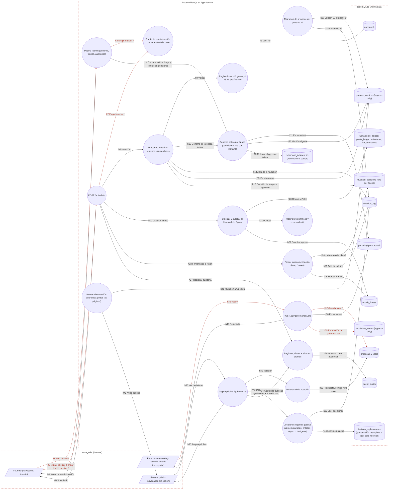

# Ficha: Genoma y gobernanza

Dueño: QA (por asignar) · Revisor: John · Fecha: 2026-10-21 · Commit de referencia: 0e07d8f · Actualizada al release `wp/32-release` (4032c7c): secciones 1, 2, 4, 5, 6, 7 y 8

## 1. Resumen

Qué hace: guarda las **reglas del sistema como datos versionados** y deja a la vista cada decisión sobre ellas.

- **Genoma versionado** (`genome_versions`, append-only): los parámetros (presupuesto de época y de Academia, topes, pesos del fitness, puntos por tamaño, SLA, recordatorios, ritos, insignias…) se leen siempre con `getActiveGenome(db, época)`: la versión con mayor `effective_from_epoch` que no pase de esa época, **mezclada sobre los valores por defecto del código** (`GENOME_DEFAULTS`). Nada aplica a mitad de época ni hacia atrás.
- **Mutaciones**: cada época debe decidir la de la siguiente: proponer (máximo 2 genes numéricos, cambio de 15 % como mucho, justificación obligatoria), revertir a una versión previa o registrar «sin cambios». Cada decisión crea su acta en el **decision log** y anuncia el cambio en un banner público.
- **Fitness de la época**: el algoritmo mide retención, calidad, participación en ritos y ausencia de disputas con los pesos del genoma y recomienda mantener o revertir; **el founder firma** la recomendación (acta). Es precondición para cerrar la época (feature gamificación y épocas).
- **Auditorías latentes**: registro de «qué produce esta regla que no buscábamos, a quién le sirve y a quién no», enlazable a una decisión.
- **Votos**: una votación abierta con umbral; una persona con sesión y acuerdo firmado vota una vez y suma +2 de reputación en gobernanza.
- **`/gobernanza`** (pública): votación en vivo, auditorías y las decisiones **vigentes** con su huella (sha256), de la más reciente a la más vieja, sin las actas de ritos (esas van a Comunidad). Desde el release `wp/32-release` (ca8c0e0) una decisión reemplazada no se muestra en público: queda intacta en `decision_log`, el vínculo se registra aparte en `decision_replacements` (solo inserción) y el original solo lo ve el founder en `/admin`; la vigente dice de qué fecha es lo que reemplaza.

Quién lo usa: el founder (`/admin`: mutar, fitness, auditorías), las personas con acuerdo firmado (votar) y cualquier visitante (leer `/gobernanza`). En el sitio público, el enlace de documento de referencia es el manifiesto (el founder decidió que `/whitepaper` redirija a `/manifiesto`); esta feature no depende de esa página.

Casos de uso: subir o bajar un presupuesto para la próxima temporada con su justificación; dejar constancia de que no se cambia nada; firmar el cierre de una época con su fitness; publicar una disfunción observada; votar una propuesta; revisar desde fuera por qué se decidió algo.

## 2. Diagrama (DFD)

Archivo: [`docs/dfd/genoma-y-gobernanza.tm7`](../dfd/genoma-y-gobernanza.tm7), más la imagen exportada [`docs/dfd/genoma-y-gobernanza.svg`](../dfd/genoma-y-gobernanza.svg). Los dos se generan desde la fuente [`docs/dfd/genoma-y-gobernanza.json`](../dfd/genoma-y-gobernanza.json) con `python docs/dfd/generar_tm7.py docs/dfd/genoma-y-gobernanza.json --estricto`, que pasa: cada `codigo` existe en el repo. La fuente tiene 31 elementos (3 actores, 16 procesos, 12 almacenes), 44 flujos (7 sensibles) y 3 fronteras de confianza.

Cambios del release `wp/32-release`: `repo.listDecisions` ya no existe. Las decisiones públicas salen del proceso nuevo `decis` (`src/lib/decisiones.ts#decisionesVigentes`, `vigenteDe`), que lee `decision_log` (h32) y el almacén nuevo `decision_replacements` (h44); `/gobernanza` lo llama en h43 y `repo` queda solo para la votación (h31).

Leyenda: los flujos con `*` y en rojo llevan datos sensibles (sesión, voto, reputación); cada `subgraph` es una frontera de confianza.

Lectura: todo lo que cambia reglas entra por `POST /api/admin` con la puerta de founder y termina en tres tablas a la vez (`decision_log`, `genome_versions`, `mutation_decisions`). La lectura del genoma pasa siempre por `getActiveGenome`, que completa con los valores del código lo que la versión guardada no trae. La parte pública (`/gobernanza` y el banner) solo lee; el voto es la única escritura de una persona que no es founder.

## 3. Recorrido de una acción

Acción elegida: **el founder propone una mutación del genoma (por ejemplo `EPOCH_BUDGET` de 100 000 a 110 000) desde `/admin`**.

1. Pantalla o componente: `app/admin/page.tsx` (`AdminPage`, puerta `adminActor` en la línea 33; el middleware además exige sesión con acuerdo firmado para `/admin`) pinta `src/components/GenomeMutationPanel.tsx` (`GenomeMutationPanel`) con el genoma activo de la época. La persona elige el gen de una lista local de 4 (línea 5), escribe el valor y la justificación; el panel calcula el % y avisa si pasa de 15 %. Pulsa «Proponer para época N+1» (línea 93).
2. Llamada al backend (endpoint y datos enviados): `POST /api/admin` (`post`, línea 30) con `{ "action": "proposeMutation", "genes": [{ "key": "EPOCH_BUDGET", "value": 110000 }], "justification": "…" }` y la cookie de sesión.
3. Ruta y controlador: `app/api/admin/route.ts` → `POST` (19-117): `adminActor(session)` (403 «Solo el founder puede administrar.», línea 22), `adminActionSchema` (400 «Entrada inválida.», línea 26) y, en el `switch`, `proposeMutation(getDb(), genes, justification)` (84-88).
4. Lógica de negocio (validaciones, permisos, cálculos): `src/lib/mutation.ts` → `proposeMutation` (86-118). Época actual (`currentEpoch`) → destino = actual + 1. `validateMutation` (49-72): justificación de 10 caracteres o más; 1 o 2 genes; solo `NUMERIC_GENES` (los 4 genes v1, línea 22); sin repetidos; valor finito y positivo; `|nuevo − actual| / actual ≤ 15 %`. `assertUndecided` (80-83): una sola decisión por época. Los parámetros nuevos son el genoma actual completo (ya mezclado con los defaults) con los cambios aplicados. En UNA transacción (101-115): acta en `decision_log` con `date('now')` y `hash = sha256(título|razón)`, versión nueva en `genome_versions` con `effective_from_epoch` = destino, y la decisión en `mutation_decisions`. Al final limpia la caché del genoma (`clearGenomeCache`).
5. Base de datos (tablas o modelos leídos y escritos): lee `periods`, `genome_versions`, `mutation_decisions`; escribe `decision_log`, `genome_versions`, `mutation_decisions`.
6. Respuesta y qué hace la pantalla con ella: `200 { ok: true, mutation: { version, targetEpoch, decisionLogId } }`. El panel muestra «Decisión registrada. Se anuncia a la cohorte y aplica desde la época siguiente.» y refresca. Desde ese momento `MutationBanner` muestra en todas las páginas «Cambio anunciado: la temporada N+1 usará…», `/gobernanza` lista el acta y, al cerrar la época, la N+1 nace con el presupuesto nuevo.
7. Casos de falla: 403 si no es founder (por rol en la base); 400 «Entrada inválida.» si la forma no cuadra; 400 con el mensaje de `MutationError` («La justificación es obligatoria…», «Gen no mutable: …», «Gen repetido…», «Valor inválido…», «El cambio de X es N % y excede el máximo permitido (15 %).», «Ya hay una decisión de genoma para la época N.»); cualquier otro error, incluido uno de la base, también vuelve como 400 con su mensaje (línea 114-115), no como 500.

Acción complementaria: **una persona vota** (`VoteForm` → `POST /api/governance/vote` `{ proposalId, choice }`, `app/api/governance/vote/route.ts:10-45`). La puerta es `session.claSigned` de la cookie (401, línea 12) y un límite de 20/min (15). Si la propuesta no existe → 404; si está cerrada → 409. Inserta en `votes` (UNIQUE por propuesta y wallet; cualquier error del INSERT se responde «Ya votaste en esta propuesta.», 409) y luego, fuera de transacción, `reputation_events` (`gobernanza`, +2, `period_id` = época actual). La página refresca y muestra el conteo en vivo.

## 4. Elementos del DFD en el código

| Elemento | Tipo | Archivo y función | Notas |
| --- | --- | --- | --- |
| `fundador` Founder (navegador, /admin) | Cliente externo | `apps/web/src/components/GenomeMutationPanel.tsx` → `GenomeMutationPanel` | Usa `GenomeMutationPanel` (proponer, revertir, «sin cambios»), `AdminAction` (calcular y firmar fitness) y `LatentAuditForm`; todos llaman a `POST /api/admin`. |
| `votante` Persona con sesión y acuerdo firmado (navegador) | Cliente externo | `apps/web/src/components/VoteForm.tsx` → `VoteForm` | `VoteForm` envía `{proposalId, choice}`; si ya votó, solo muestra su voto. |
| `visitante` Visitante público (navegador, sin sesión) | Cliente externo | `apps/web/middleware.ts` → `config` | El `matcher` del middleware no incluye /gobernanza: la página es pública. El banner de mutación sale en todas las páginas desde `app/layout.tsx`. |
| `pag_admin` Página /admin (genoma, fitness, auditorías) | Proceso | `apps/web/app/admin/page.tsx` → `AdminPage` | app/admin/page.tsx:26-230. Puerta `adminActor` (33); el middleware además exige sesión con acuerdo firmado para /admin. Lista propia de genes numéricos en la línea 57. |
| `api_admin` POST /api/admin | Proceso | `apps/web/app/api/admin/route.ts` → `POST` | app/api/admin/route.ts:19-117. `adminActor(session)` sin `db` (22, usa `getDb()`), `adminActionSchema` (26), `switch` por acción (51-112), 400 con el mensaje de cualquier excepción (114-115). |
| `authz` Puerta de administración por rol leído de la base | Proceso | `apps/web/src/lib/authz.ts` → `adminActor` | authz.ts:80-84 sobre `actorEstricto` (58-73): rol de la base, no de la cookie; no mira `status`. |
| `mutar` Proponer, revertir o registrar «sin cambios» | Proceso | `apps/web/src/lib/mutation.ts` → `proposeMutation`, `revertToVersion`, `recordNoMutation` | mutation.ts:86-175. Versión nueva efectiva desde la época SIGUIENTE; acta + versión + decisión en una transacción; `clearGenomeCache` al final. |
| `validar` Reglas duras: ≤ 2 genes, ≤ 15 %, justificación | Proceso | `apps/web/src/lib/mutation.ts` → `validateMutation` | mutation.ts:49-72: solo `NUMERIC_GENES` (22: 4 genes v1), ≤ 2 genes, ≤ 15 %, justificación ≥ 10. |
| `genoma` Genoma activo por época (caché y mezcla con defaults) | Proceso | `apps/web/src/lib/genome.ts` → `getActiveGenome`, `currentEpoch` | genome.ts:218-248. Caché por base y por época (WeakMap); `{ ...GENOME_DEFAULTS, ...guardado }`. |
| `seed_v2` Migración de arranque del genoma v2 | Proceso | `apps/web/src/lib/genome.ts` → `seedGenomeV2` | genome.ts:290-333. Corre en cada arranque desde `seedIfEmpty` (seed.ts:89) dentro de try/catch; idempotente. |
| `fitness` Calcular y guardar el fitness de la época | Proceso | `apps/web/src/lib/epochs.ts` → `computeAndStoreEpochFitness`, `gatherEpochData` | epochs.ts:39-120. `gatherEpochData` no filtra por época salvo los ritos; calidad siempre sin datos. |
| `motor` Motor puro de fitness y recomendación | Proceso | `apps/web/src/lib/fitness.ts` → `computeFitness`, `recommend` | fitness.ts:63-113. Puro; renormaliza por los pesos con datos; `recommend` = keep si no hay época anterior. |
| `firmar` Firmar la recomendación (keep / revert) | Proceso | `apps/web/src/lib/epochs.ts` → `signEpochDecision` | epochs.ts:123-153. Exige la mutación de N+1 decidida (132); escribe acta y marca firmado. «revert» no revierte el genoma. |
| `auditar` Registrar y listar auditorías latentes | Proceso | `apps/web/src/lib/audits.ts` → `createLatentAudit`, `listLatentAudits` | audits.ts:45-117. Valida longitud mínima de 3; no restringe la mecánica a `AUDIT_MECHANISMS`. |
| `pag_gob` Página pública /gobernanza | Proceso | `apps/web/app/gobernanza/page.tsx` → `GobernanzaPage` | Solo decisiones vigentes (`decisionesVigentes`); filtra actas de ritos (`esActaDeRito`), invierte el orden y muestra la huella corta. Una auditoría enlazada a una decisión reemplazada lleva a la vigente (`vigenteDe`). |
| `repo` Lecturas de la votación | Proceso | `apps/web/src/lib/repo.ts` → `getOpenProposal`, `voteTally`, `userVote` | Usan `getDb()` global. `listDecisions` se quitó en el release (ca8c0e0). |
| `decis` Decisiones vigentes | Proceso | `apps/web/src/lib/decisiones.ts` → `decisionesVigentes`, `vigenteDe` | Oculta las reemplazadas (tabla `decision_replacements` y, si la migración no corrió, la histórica de las etiquetas viejas). `decisionesReemplazadas` las lista completas para /admin. La migración `vincularReemplazosConocidos` corre en cada arranque (`seedIfEmpty`). |
| `api_voto` POST /api/governance/vote | Proceso | `apps/web/app/api/governance/vote/route.ts` → `POST` | app/api/governance/vote/route.ts:10-45. Puerta por `session.claSigned` de la cookie (12), límite 20/min (15), voto + reputación sin transacción (30-43). |
| `banner` Banner de mutación anunciada (todas las páginas) | Proceso | `apps/web/src/components/MutationBanner.tsx` → `MutationBanner` | MutationBanner.tsx: `pendingMutation(getDb())` en cada página; nombres humanos de los 4 genes en su propia tabla (12-17). |
| `defaults` GENOME_DEFAULTS (valores en el código) | Almacén de datos | `apps/web/src/lib/genome.ts` → `GENOME_DEFAULTS` | genome.ts:116-189: `GENOME_V1` + `GENOME_V2_NUEVAS`. Valores en código que rigen para toda clave ausente de la versión guardada. |
| `t_users` users (rol) | Almacén de datos | `apps/web/src/lib/schema.sql` → `users` | Rol y supervisión. |
| `t_genoma` genome_versions (append-only) | Almacén de datos | `apps/web/src/lib/schema.sql` → `genome_versions` | `version` UNIQUE; `effective_from_epoch` decide desde cuándo rige. |
| `t_mutaciones` mutation_decisions (una por época) | Almacén de datos | `apps/web/src/lib/schema.sql` → `mutation_decisions` | UNIQUE (epoch): una sola decisión por época. |
| `t_decision` decision_log | Almacén de datos | `apps/web/src/lib/schema.sql` → `decision_log` | `hash` = sha256(título\|razón) en código nuevo; el seed usa fecha\|título\|razón. |
| `t_reemplazos` decision_replacements | Almacén de datos | `apps/web/src/lib/schema.sql` → `decision_replacements` | Solo inserción: `decision_id` → `replaced_by_id`. Nada se reescribe en `decision_log`. |
| `t_fitness` epoch_fitness | Almacén de datos | `apps/web/src/lib/schema.sql` → `epoch_fitness` | Append-only: cada cálculo es una fila nueva. |
| `t_senales` Señales del fitness: points_ledger, milestones, rite_attendance | Almacén de datos | `apps/web/src/lib/schema.sql` → `points_ledger`, `milestones`, `rite_attendance` | Tablas de otros features (ledgers, Ágora, ritos) leídas en agregado. |
| `t_rep` reputation_events (append-only) | Almacén de datos | `apps/web/src/lib/schema.sql` → `reputation_events` | El voto suma +2 en el eje gobernanza con `period_id` explícito. |
| `t_periods` periods (época actual) | Almacén de datos | `apps/web/src/lib/schema.sql` → `periods` | `currentEpoch` = id más reciente. |
| `t_auditorias` latent_audits | Almacén de datos | `apps/web/src/lib/schema.sql` → `latent_audits` | Registro público en /gobernanza. |
| `t_votos` proposals y votes | Almacén de datos | `apps/web/src/lib/schema.sql` → `proposals`, `votes` | Solo el seed crea propuestas; nada las cierra ni aplica el umbral. |

## 5. Flujos de datos

| Flujo | De → a | Protocolo | Datos que viajan |
| --- | --- | --- | --- |
| h1 Abrir /admin | `fundador` → `pag_admin` | HTTPS | **[sensible]** GET /admin; cookie de sesión (el middleware exige acuerdo firmado) |
| h2 Exigir founder | `pag_admin` → `authz` | Llamada en proceso | **[sensible]** wallet de la sesión |
| h3 Leer rol | `authz` → `t_users` | SQL | role, is_supervisor, is_founder (no mira status) |
| h4 Genoma activo, linaje y mutación pendiente | `pag_admin` → `genoma` | Llamada en proceso | época actual |
| h5 Panel de administración | `pag_admin` → `fundador` | HTTPS | HTML: genes numéricos, linaje, fitness, formulario de auditoría |
| h6 Mutar, calcular o firmar fitness, auditar | `fundador` → `api_admin` | HTTPS | **[sensible]** POST JSON {action, genes[], justification, targetVersion, epoch, epochFitnessId, decision, campos de auditoría}; cookie de sesión |
| h7 Exigir founder | `api_admin` → `authz` | Llamada en proceso | **[sensible]** wallet de la sesión |
| h8 Mutación | `api_admin` → `mutar` | Llamada en proceso | genes {key, value}, justificación, versión destino, época |
| h9 Validar | `mutar` → `validar` | Llamada en proceso | genoma actual, cambios, justificación |
| h10 Genoma de la época actual | `mutar` → `genoma` | Llamada en proceso | época actual |
| h11 Época actual | `genoma` → `t_periods` | SQL | id del periodo más reciente |
| h12 Versión vigente | `genoma` → `t_genoma` | SQL | params de la versión con mayor effective_from_epoch ≤ época |
| h13 Rellenar claves que faltan | `genoma` → `defaults` | Lectura en memoria | GENOME_V1 + GENOME_V2_NUEVAS |
| h14 Acta de la mutación | `mutar` → `t_decision` | SQL | INSERT date('now'), título, razón, sha256(título\|razón) |
| h15 Versión nueva | `mutar` → `t_genoma` | SQL | INSERT version, params completos, effective_from_epoch = actual + 1 |
| h16 Decisión de la época siguiente | `mutar` → `t_mutaciones` | SQL | INSERT epoch, kind mutation \| no_change, genome_version |
| h17 Versión v2 al arrancar | `seed_v2` → `t_genoma` | SQL | INSERT si ninguna versión trae TASK_POINTS (efectiva desde la época siguiente) |
| h18 Acta de la v2 | `seed_v2` → `t_decision` | SQL | INSERT con fecha en BUSINESS_TZ y sha256 en JS puro |
| h19 Calcular fitness | `api_admin` → `fitness` | Llamada en proceso | época |
| h20 Reunir señales | `fitness` → `t_senales` | SQL | wallets activas y retenidas (14 días), hitos aprobados, asistencia a ritos cerrados |
| h21 Puntuar | `fitness` → `motor` | Llamada en proceso | EpochData y FITNESS_WEIGHTS del genoma |
| h22 Guardar reporte | `fitness` → `t_fitness` | SQL | INSERT score, components JSON, recommendation, prev_score, genome_version |
| h23 Firmar keep o revert | `api_admin` → `firmar` | Llamada en proceso | epochFitnessId, decisión |
| h24 ¿Mutación decidida? | `firmar` → `t_mutaciones` | SQL | SELECT de la época N+1 |
| h25 Acta de la firma | `firmar` → `t_decision` | SQL | INSERT «Cierre de época N: mantener \| revertir genoma» |
| h26 Marcar firmado | `firmar` → `t_fitness` | SQL | UPDATE signed, signed_decision, decision_log_id |
| h27 Registrar auditoría | `api_admin` → `auditar` | Llamada en proceso | mecánica, periodo, funciones manifiesta y latente, para quién, acción, decisión enlazada |
| h28 Guardar o leer auditorías | `auditar` → `t_auditorias` | SQL | INSERT latent_audits; SELECT con el título de la decisión enlazada |
| h29 Resultado | `api_admin` → `fundador` | HTTPS | JSON {ok, mutation \| report} o {error} (400 con el mensaje de la excepción) |
| h30 Ver decisiones | `visitante` → `pag_gob` | HTTPS | GET /gobernanza (pública; cookie opcional) |
| h31 Votación | `pag_gob` → `repo` | Llamada en proceso | id de la propuesta abierta; wallet de la sesión si existe |
| h32 Leer decisiones | `decis` → `t_decision` | SQL | SELECT id, date, title, reason, hash FROM decision_log ORDER BY id |
| h33 Propuesta, conteo y mi voto | `repo` → `t_votos` | SQL | proposals open; COUNT por choice; voto de la wallet |
| h34 Auditorías públicas | `pag_gob` → `auditar` | Llamada en proceso | listLatentAudits |
| h35 Página pública | `pag_gob` → `visitante` | HTTPS | HTML: decisiones con huella, votación en vivo y auditorías |
| h36 Votar | `votante` → `api_voto` | HTTPS | **[sensible]** POST JSON {proposalId, choice}; cookie de sesión con claSigned |
| h37 Guardar voto | `api_voto` → `t_votos` | SQL | **[sensible]** INSERT proposal_id, wallet, choice (UNIQUE por propuesta y wallet) |
| h38 Época actual | `api_voto` → `t_periods` | SQL | currentEpoch |
| h39 Reputación de gobernanza | `api_voto` → `t_rep` | SQL | **[sensible]** INSERT wallet, 'gobernanza', 2, 'Voto en propuesta', period_id |
| h40 Resultado | `api_voto` → `votante` | HTTPS | JSON {ok} o {error} |
| h41 Mutación anunciada | `banner` → `t_genoma` | SQL | versiones con effective_from_epoch = actual + 1 y su razón |
| h42 Aviso público | `banner` → `visitante` | HTTPS | «Cambio anunciado»: parámetro, valor nuevo y anterior |
| h43 Decisiones vigentes y vigente de cada auditoría | `pag_gob` → `decis` | Llamada en proceso | base; `decisionLogId` de cada auditoría |
| h44 Leer reemplazos | `decis` → `t_reemplazos` | SQL | SELECT decision_id, replaced_by_id FROM decision_replacements |

## 6. Dependencias con otras features

- **[login-y-sesion](login-y-sesion.md)**: `adminActor` (`src/lib/authz.ts`) para todo lo de `/admin`; la cookie con `claSigned` para votar; el middleware exige acuerdo firmado en la página `/admin` pero no en `/api/admin` (su `matcher` no cubre `/api`).
- **[gamificacion-y-epocas](gamificacion-y-epocas.md)**: lee del genoma `TASK_POINTS`, `TASK_REP`, `ON_TIME_BONUS_PCT`, `EPOCH_BUDGET` y `BADGE_GOALS`; cerrar una época exige el fitness firmado y la mutación de la siguiente decidida; el acta del cierre va al mismo `decision_log`. El voto escribe en `reputation_events`, que entra en la raíz Merkle de la época.
- **[admin](admin.md)**: `/admin` monta `GenomeMutationPanel`, `AdminAction` (fitness) y `LatentAuditForm`; `POST /api/admin` también atiende acciones del Ágora y la Academia.
- **[sla-recordatorios-y-avisos](sla-recordatorios-y-avisos.md)**: `BUSINESS_TZ`, horas hábiles, `SLA_*` y `REMINDER_*` salen de `getActiveGenome`.
- **[ritos-y-comunidad](ritos-y-comunidad.md)**: `RITES_CADENCE` y la reputación de ritos salen del genoma; `participacionRitos` alimenta el fitness; las actas de ritos se filtran de `/gobernanza` (`esActaDeRito`).
- **[academia](academia.md)**: `ACADEMIA_BUDGET`, `ACADEMIA_DAILY_CAP` y `ACADEMIA_VOTE_WEIGHT` (tres de los cuatro genes mutables); el banner los nombra.
- **[telegram](telegram.md)**: `DAILY_FOCUS_HOUR` (`dailyFocusHour`).
- **[agora-y-hitos](agora-y-hitos.md)**: `AGORA_HITOS_DEFAULT`; el fitness cuenta `milestones` aprobados como entregas.
- **[anclaje-stellar](anclaje-stellar.md)**: las actas del decision log NO se encolan para anclar (solo raíces de época, CLA y ritos).
- **[sitio-publico-y-formularios](sitio-publico-y-formularios.md)**: `/gobernanza` y el banner del layout son públicos; la marca de la decisión histórica de las etiquetas viejas (`esDecisionReemplazada`, `REEMPLAZO_DECISION`) vive en `src/lib/agora-labels.ts` y los reemplazos en `src/lib/decisiones.ts`. **[ritos-y-comunidad](ritos-y-comunidad.md)**: `/comunidad` también muestra solo las vigentes.
- **[00-esqueleto](00-esqueleto.md)** (arranque): `src/lib/seed.ts` siembra el genoma v1, las decisiones históricas y la votación de ejemplo; `seedGenomeV2` corre en cada arranque (`seed.ts:89`).

## 7. Amenazas relevantes

| Amenaza | Categoría | Elemento | Estado | Justificación |
| --- | --- | --- | --- | --- |
| Suplantar al founder para mutar el genoma o firmar un cierre | Suplantación | `api_admin`, h6 | Mitigada | JWT firmado (`apps/web/src/lib/jwt.ts:7-15`, 48-50), cookie httpOnly/SameSite=Lax (`apps/web/src/lib/session.ts:19-25`) y rol leído de `users` (`apps/web/src/lib/authz.ts:58-84`). |
| Una fila con rol founder dada de baja (`alumni`) sigue administrando | Elevación de privilegios | `authz` | Pendiente | `actorEstricto` no mira `status` (`authz.ts:58-73`) y `/api/admin` no añade `cuentaActiva` (`apps/web/app/api/admin/route.ts:22`), a diferencia de las rutas de talento. |
| Una mutación fuera de límites (más de 2 genes, más de 15 %, sin justificación) o aplicada a la época en curso o a una pasada | Manipulación | `mutar`, `validar` | Mitigada | `validateMutation` (`apps/web/src/lib/mutation.ts:49-72`); siempre `effective_from_epoch = actual + 1` (87-88, 108-110); una decisión por época (`assertUndecided`, 80-83, y `UNIQUE (epoch)` en `apps/web/src/lib/schema.sql:243`). |
| Cambiar parámetros vivos sin pasar por gobernanza, editando los defaults del código | Manipulación | `genoma`, `defaults` | Pendiente | Las claves de WP31 no son mutables (`NUMERIC_GENES`, `mutation.ts:22`) y la v1 guardada no las trae: rigen los valores de `GENOME_V2_NUEVAS` (`apps/web/src/lib/genome.ts:131-189`) por la mezcla (207-209). Un cambio de código cambia la época en curso y la lectura de épocas pasadas sin acta. |
| Reescribir una decisión ya publicada (título, razón y hash juntos) sin dejar rastro | Manipulación | `t_decision` | Pendiente | El hash es `sha256(título\|razón)` (`mutation.ts:102-106`, `epochs.ts:144-145`), sin encadenar con la anterior y sin anclar: solo se encolan raíces de época, CLA y ritos (`epocas.ts:232`, `onboard.ts:140`, `ritos.ts:516`). |
| Mostrar en público una decisión que ya fue reemplazada, como si siguiera vigente | Manipulación / Repudio | `pag_gob`, `decis` | Mitigada | Release `wp/32-release` (ca8c0e0): `/gobernanza` lista `decisionesVigentes` (`apps/web/src/lib/decisiones.ts:103-114`), que excluye las de `decision_replacements` (`:96-100`); el original no se toca y solo lo lista `/admin` (`decisionesReemplazadas`, `:137-148`). El vínculo es de solo inserción (`registrarReemplazo`, `:54-70`). Caso 8 de la caracterización. |
| El founder niega haber decidido una mutación o una firma | Repudio | `mutar`, `firmar` | Mitigada | Acta, versión y decisión se escriben en la misma transacción (`mutation.ts:101-115`; `epochs.ts:138-152`) y se publican en `/gobernanza`. El riesgo de edición directa de la base queda en la fila anterior (Pendiente). |
| Votar con una sesión de una cuenta dada de baja o sin fila en `users` | Elevación de privilegios | `api_voto`, h36 | Pendiente | La ruta solo mira `session.claSigned` de la cookie (`apps/web/app/api/governance/vote/route.ts:12`), no `users.status`; la prueba de caracterización lo fija (`genoma-y-gobernanza.test.ts`, paso 6). La cookie dura 24 h (`session.ts:24`). |
| Votar dos veces con la misma wallet | Manipulación | `api_voto` → `t_votos`, h37 | Mitigada | `UNIQUE (proposal_id, wallet)` (`apps/web/src/lib/schema.sql:277`) y 409 (`vote/route.ts:30-38`). |
| Revelar quién votó qué | Divulgación de información | `repo`, `pag_gob` | Mitigada | La página pública solo muestra conteos (`voteTally`, `apps/web/src/lib/repo.ts:184-191`) y el voto propio de la sesión (`userVote`, 193-197). |
| Inyectar HTML en `/gobernanza` con el texto de una auditoría o una decisión | Manipulación | `auditar`, `pag_gob` | Mitigada | React escapa el texto (`apps/web/app/gobernanza/page.tsx:111-112`, 133-145, 171-174); no hay `dangerouslySetInnerHTML` en la página. |
| Mensajes internos de error (incluidos los de la base) llegan al cliente | Divulgación de información | `api_admin`, h29 | Aceptada | Solo los ve el founder autenticado; `apps/web/app/api/admin/route.ts:114-115` devuelve `e.message` con 400. Conviene separar errores de reglas (400) de errores internos (500). |
| Ráfaga de votos o de acciones de admin | Denegación de servicio | `api_voto`, `api_admin` | Mitigada | Voto: 20 por minuto por wallet e IP (`vote/route.ts:15`). `/api/admin` no tiene límite, pero exige founder (riesgo aceptado). |
| El arranque publica una versión del genoma sin decisión humana | Elevación de privilegios | `seed_v2`, h17 | Aceptada | `seedGenomeV2` solo añade claves sin cambiar valores, efectiva desde la época siguiente y con su acta (`apps/web/src/lib/genome.ts:290-333`); idempotente. |
| Firmar «revertir» deja creer que el genoma se revirtió | Repudio | `firmar`, h25 | Pendiente | `signEpochDecision` solo escribe el acta y marca la firma (`apps/web/src/lib/epochs.ts:123-153`); el genoma no cambia (lo fija la prueba de caracterización, paso 4). El botón dice «Firmar: revertir genoma» (`apps/web/app/admin/page.tsx:153-158`). |

## 8. Prueba de caracterización

Archivo: [`apps/web/src/lib/caracterizacion/genoma-y-gobernanza.test.ts`](../../apps/web/src/lib/caracterizacion/genoma-y-gobernanza.test.ts). Se corre con `cd apps/web && npx vitest run src/lib/caracterizacion/genoma-y-gobernanza.test.ts` y **pasa (8 de 8)**.

Qué flujo cubre, llamando a las **rutas reales** (`POST /api/admin` y `POST /api/governance/vote`) y a las lecturas de `/gobernanza` contra una base SQLite temporal en memoria con `schema.sql` + `seedIfEmpty`:

1. Linaje sembrado (v1 desde la época 1, v2 desde la 2); la época 1 lee `TASK_POINTS` de los defaults del código (hallazgo); la v2 no se anuncia como mutación.
2. Proponer `EPOCH_BUDGET` +10 %: versión 3 efectiva en la época 2, la época 1 no cambia, acta con título, razón y `hash = sha256(título|razón)`, decisión de la época 2 y mutación pendiente para el banner.
3. Reglas duras: segunda decisión para la misma época, cambio de 80 %, gen no mutable (`TASK_POINTS`), justificación corta → 400 con su mensaje; una supervisora → 403.
4. Fitness: reporte de la época 1 con sus 4 componentes y «mantener» (sin época anterior); firmar «revertir» escribe el acta y **no** revierte el genoma (hallazgo); firmar dos veces → 400.
5. Auditoría latente enlazada a la decisión; campo obligatorio corto → 400.
6. Voto: 200, conteo +1, +2 de reputación en gobernanza con `period_id = 1`; segundo voto → 409; sin acuerdo en la cookie → 401; propuesta inexistente → 404; **una cuenta `alumni` con sesión vigente vota** (hallazgo).
7. `/gobernanza`: decisiones **vigentes** (`decisionesVigentes`) sin actas de ritos, de la más reciente a la más vieja, todas con hash hex de 64.
8. **ARREGLADO** (ca8c0e0): una base nueva no tiene reemplazos; con la decisión histórica de las etiquetas viejas (como la de producción), el arranque (`aplicarContenidoPublico` + `vincularReemplazosConocidos`, idempotente) registra un vínculo en `decision_replacements`; el original sigue igual en `decision_log` (título, razón y huella), no sale entre las vigentes, la decisión nueva dice qué fecha reemplaza y `vigenteDe` lleva un enlace viejo a la vigente.

Qué cambió respecto de la versión escrita contra 0e07d8f: el caso 7 importaba `repo.listDecisions`, que el commit ca8c0e0 quitó (error de `tsc` y de carga); ahora usa `decisionesVigentes`, que es lo que lee la página. El caso 8 es nuevo y fija el arreglo. No hay regresiones.

Cómo se arma: sesión simulada con `vi.mock` de `@/lib/session`, alias `@/lib/*` resueltos a los módulos reales (incluido `@/lib/agora-borradores`, que `/api/admin` importa desde el release), y la base temporal llega a las rutas y a `lib/repo.ts` por `globalThis.__zelenaDb`. Las reglas finas tienen sus pruebas: `genome.test.ts`, `mutation.test.ts`, `epochs.test.ts`, `fitness.test.ts`, `audits.test.ts` y `decisiones.test.ts`.

## 9. Preguntas abiertas

- **¿Las claves de WP31 deben poder mutarse por gobernanza?** Hoy `TASK_POINTS`, `TASK_REP`, `ON_TIME_BONUS_PCT`, `SLA_*`, `REMINDER_*`, `RITES_CADENCE`, `BADGE_GOALS`… solo cambian editando `GENOME_V2_NUEVAS`, y en la época 1 rigen por la mezcla con los defaults aunque la v2 diga «efectiva desde la época 2» (`genome.ts:131-189`, 207-209, 309-312). ¿Se amplía `NUMERIC_GENES` o se congela una versión completa guardada?
- **¿Qué debe hacer «Firmar: revertir genoma»?** ¿Encadenar `revertToVersion` o cambiar el texto del botón y del acta?
- **¿Sigue la votación?** Solo el seed crea propuestas (`apps/web/src/lib/seed.ts:415-421`); nada las cierra ni aplica el umbral del 66 % (`repo.ts:178-182`), y cada voto suma +2 de reputación fija en código (`vote/route.ts:41-43`), no en el genoma. ¿Se completa (crear, cerrar, resolver) o se retira?
- **El fitness no mide la época**: `gatherEpochData` cuenta usuarios de todos los tiempos, la retención «últimos 14 días desde hoy» y los hitos del Ágora aprobados de siempre; ignora las entregas del tablero, que es el flujo principal, y la calidad siempre queda sin datos (`apps/web/src/lib/epochs.ts:39-76`). ¿Qué señales debe usar?
- **Huellas y fechas con dos convenciones**: el seed hashea `fecha|título|razón` (`seed.ts:402`), el código nuevo `título|razón`; `mutation.ts` y `epochs.ts` fechan con `date('now')` (UTC) y `epocas.ts` / `seedGenomeV2` con `BUSINESS_TZ`. ¿Una sola regla, y se anclan las actas?
- **Cuatro copias de la lista de genes mutables**: `NUMERIC_GENES` (`mutation.ts:22`), `numericGenes` (`app/admin/page.tsx:57`), `GENES` (`src/components/GenomeMutationPanel.tsx:5`) y `NOMBRE_PARAMETRO` (`src/components/MutationBanner.tsx:12-17`); también `MECHANISMS` del formulario (`LatentAuditForm.tsx:5`) duplica `AUDIT_MECHANISMS` (`audits.ts:10-17`), que el servidor no hace cumplir, y `DEFAULT_FITNESS_WEIGHTS` (`fitness.ts:21-26`) repite `GENOME_V1.FITNESS_WEIGHTS` (`genome.ts:123`).
- **Recalcular el fitness después de firmar** crea una fila nueva sin firmar (`epochs.ts:88-120`) y el panel vuelve a ofrecer firmar: ¿se bloquea el recálculo de una época firmada?
- **El panel dice «1 gen» y la regla permite 2** (`GenomeMutationPanel.tsx:71`, «Proponer mutación (1 gen, ±15% máx.)» frente a `MAX_GENES_PER_MUTATION = 2`).
- **`/gobernanza` muestra el formulario de voto a cualquier sesión** (`app/gobernanza/page.tsx:79-83`) aunque la ruta pide acuerdo firmado (401).
