# Ficha: Login y sesión

Dueño: QA (por asignar) · Revisor: John · Fecha: 2026-10-21 · Commit de referencia: 0e07d8f · Actualizada al release `wp/32-release` (4032c7c): secciones 2 a 9

> **Pregunta del founder: "¿por qué me pide wallet? ¿puedo entrar con Freighter o con mi correo?"**
>
> **Por qué pide wallet.** En la puerta de comunidad la wallet *es* la cuenta: `users.wallet` es la llave primaria del registro (`src/lib/schema.sql`, tabla `users`) y la única prueba de identidad es la firma ed25519 del acuerdo de contribución (CLA) hecha con esa wallet (`src/lib/onboard.ts#performOnboard` y `#performLogin`, verificada en `src/lib/crypto.ts#verifyWalletSignature`). No hay contraseñas ni códigos por correo: sin una llave que firme, la app no tiene con qué reconocerte.
>
> **Caminos que existen hoy (en el código del commit 0e07d8f):**
>
> | Camino | ¿Existe? | Cómo se entra | Qué pide | Dónde está |
> | --- | --- | --- | --- | --- |
> | **Freighter** (tu wallet de Stellar) | **Sí** | `/entrar` → "Conectar mi wallet" → firmar el acuerdo. Si tu wallet ya está registrada: "Ya estoy registrado — entrar con mi wallet" (no pide código). | Freighter instalado y desbloqueado, con `signMessage`. Código de invitación solo la primera vez. | `app/entrar/page.tsx#connectFreighter` (l. 201) y `#signAndFinish` (l. 297-318); el servidor acepta el formato SEP-53 que usa Freighter (`src/lib/crypto.ts`, l. 52 y 70-79). |
> | Wallet de prueba del navegador | Sí | `/entrar` → "Crear wallet de prueba". | Código de invitación. La llave secreta queda en `localStorage`. | `app/entrar/page.tsx#crearWalletDemo` (l. 132-166). Queda `is_demo = 1`: no cuenta en cifras públicas ni se puede vincular al equipo. **No sirve para el founder.** |
> | **Correo corporativo de Microsoft (Entra ID)** | **Solo si se enciende** | `/entrar` → "Continuar con Microsoft". Sin código y sin wallet. | `AUTH_ENTRA_ENABLED=1` + `AZURE_AD_CLIENT_ID`, `AZURE_AD_CLIENT_SECRET`, `AZURE_AD_TENANT_ID`, `NEXTAUTH_SECRET` en App Settings. Cuenta del tenant y del dominio corporativo (no invitados B2B). | `src/components/EntraSignInButton.tsx` (l. 66: si la puerta no está disponible el botón **no se dibuja**), `app/api/auth/[...nextauth]/route.ts` (503 con el flag apagado), `src/lib/entra.ts#validateEntraToken`. |
> | **Correo personal** (Gmail u otro) | **No** | — | — | No hay ruta, ni enlace mágico, ni contraseña. El "segundo correo" (`user_emails.kind = 'recovery'`) se guarda pero ningún login lo lee. |
>
> **Lo que confunde hoy:**
> 1. Con el flag apagado (estado por defecto, y el que describe `docs/DESPLIEGUE-V1.md` §"Acceso del founder" para la fusión del 2026-09-30) el botón de Microsoft no aparece, así que la única puerta visible es la wallet.
> 2. Entrar por Microsoft deja la sesión con `claSigned = false` (`app/api/auth/entra/exchange/route.ts`, l. 79-88): llegas a `/equipo/hoy`, pero el middleware te devuelve a `/entrar` si abres `/perfil` o `/admin` (`middleware.ts`, l. 24 y 41). Para el founder eso significa que **por Microsoft no se abre la página `/admin`** mientras su fila del roster (`pending:<slug>`, sembrada con `cla_signed = 0` en `src/lib/team.ts#seedTeamRoster`) no esté vinculada a su wallet con `vincularPrincipal` (`/equipo/talento`). Después de vincularla, Entra lo resuelve por correo a la fila de la wallet, que sí tiene el CLA firmado.
> 3. Tres textos prometen un login con correo personal que no existe: `src/lib/entra.ts` l. 545-546, `src/components/EntraSignInButton.tsx` l. 22-23 y el comentario de `user_emails` en `src/lib/schema.sql` l. 53.
> 4. Para entrar como founder con Freighter: la llave pública de tu Freighter debe estar en `FOUNDER_WALLET` (cada arranque la promueve a `founder`, `src/lib/db.ts#backfillFounder`, l. 580) o usar una sola vez el código `FOUNDER_BOOTSTRAP_CODE` (`src/lib/onboard.ts`, l. 92-93 y 113-125).
>
> **Si se quiere un login con correo personal**, hace falta enviar correos (enlace mágico o código de un solo uso), y el envío de correos está fuera del alcance de v1 según `CLAUDE.md` ("sin envío de correos/Teams"). Es una decisión de John, no un arreglo.
>
> **Actualización del release `wp/32-release` (4032c7c):** la wallet creada en el navegador ya es una cuenta **real** si se entra con una invitación que no sea `GENESIS-000x` (4291a2d); el reingreso firma un reto de un solo uso que nombra el sitio, no el CLA (7f7882c, ca0d63e); los tres textos que prometían entrar con correo personal se quitaron y un test estático lo vigila (0c236a8, `src/lib/sin-promesas-de-login.test.ts`); Entra ya no vincula filas del roster por parecido de nombre o correo (74e9321). La tabla de arriba describe el commit 0e07d8f.

## 1. Resumen

Qué hace: decide **quién es** cada petición y **qué puede hacer**. Tiene dos puertas que terminan en la misma cookie de sesión:

- **Puerta de comunidad (la única encendida por defecto):** código de invitación (personal de un solo uso, código de cohorte multiuso o escotilla del founder) + wallet Stellar (Freighter o wallet de prueba del navegador) + firma ed25519 del CLA. El alta (`/api/onboard`) consume el cupo, crea la fila en `users` como `contributor`, guarda la firma y la encola para anclarla en la red de pruebas. El reingreso (`/api/login`) vuelve a verificar la firma y no escribe nada.
- **Puerta corporativa (Entra ID, detrás de `AUTH_ENTRA_ENABLED`):** NextAuth hace el baile OIDC con el tenant; `/api/auth/entra/exchange` valida tenant y dominio, vincula la identidad a la fila del roster (`pending:<slug>`) o crea `entra:<oid>` como `core`, y emite la misma cookie con `claSigned = false`.

La sesión es un JWT HS256 en la cookie `zelena_session` (httpOnly, SameSite=lax, 24 h). La cookie es una **pista**: las puertas reales (`adminActor`, `equipoActor`, `equipoInternoActor`, `clientActor` en `src/lib/authz.ts`) releen el rol en la tabla `users`. El `middleware.ts` es una segunda capa: exige sesión en `/equipo` y `/clientes`, y sesión **con CLA firmado** en `/perfil` y `/admin`. `/api/logout` borra la cookie.

Quién lo usa: cualquier persona invitada (comunidad, cohortes de clase), el equipo interno (por Entra cuando se encienda) y el founder (por firma de wallet o por la escotilla de arranque).

Casos de uso:

1. Alta con código de invitación personal o de cohorte (`/entrar?code=...` lo prellena desde un QR).
2. Reingreso de una wallet ya registrada, sin código.
3. Primera entrada del founder en un despliegue nuevo con `FOUNDER_BOOTSTRAP_CODE` (nace o se promueve a `founder`).
4. Entrada del equipo con su cuenta corporativa de Microsoft (si el flag está encendido) y registro del segundo correo.
5. Emisión de invitaciones personales desde `/perfil` (tope por tier del genoma).
6. Cerrar sesión (y, si era una wallet de prueba, borrarla del navegador).
7. Autorizar cada página y ruta por rol leído de la base.

Nota sobre el sitio público: el comentario de `middleware.ts` (l. 5-6) lista `/whitepaper` entre las páginas públicas. Esta ficha asume que `/whitepaper` redirige a `/manifiesto` (decisión del founder, en curso en otra rama); el middleware no la cubre en ningún caso.

## 2. Diagrama (DFD)

Archivo: [`docs/dfd/login-y-sesion.tm7`](../dfd/login-y-sesion.tm7), más la imagen exportada [`docs/dfd/login-y-sesion.svg`](../dfd/login-y-sesion.svg). Los dos se generan desde la fuente [`docs/dfd/login-y-sesion.json`](../dfd/login-y-sesion.json) con `python docs/dfd/generar_tm7.py docs/dfd/login-y-sesion.json --estricto`, que pasa: cada `codigo` existe en el repo. La fuente tiene 36 elementos (3 actores, 22 procesos, 11 almacenes), 53 flujos (40 sensibles) y 6 fronteras de confianza.

Cambios del release `wp/32-release`: el reingreso ya no firma el CLA sino un reto de un solo uso (proceso nuevo `POST /api/login/reto`, almacén nuevo "Retos de entrada en memoria" y flujos f48-f51); `/api/logout` lee `users.is_demo` antes de cerrar (f52) y el botón Salir solo borra la llave del navegador si esa respuesta confirma una cuenta demo; el límite de `/api/login` aparece como flujo propio (f53) y su IP ya no es el primer valor de `X-Forwarded-For`; `entraLogin` resuelve solo por oid o correo exacto.

Vista para GitHub (salida de `--mermaid`): `[/ /]` actor, `(( ))` proceso, `[( )]` almacén, cada `subgraph` es una frontera de confianza y los flujos con `*` y en rojo llevan datos sensibles.

```mermaid
flowchart LR
  subgraph F1["Navegador de la persona (no confiable)"]
    u[/"Persona (navegador)"/]
    wiz(("Asistente /entrar: valida código, crea/conecta wallet, firma el CLA (alta) o el reto (reingreso)"))
    btn(("Botón 'Continuar con Microsoft' (solo si la puerta está disponible)"))
    salir(("Botón Salir (borra la llave del navegador solo si /api/logout confirma una cuenta demo)"))
    ls[("localStorage: llave secreta de la wallet del navegador")]
    cookie[("Cookie zelena_session (JWT HS256, 24 h)")]
  end
  subgraph F2["Extensión Freighter (custodia la llave privada)"]
    fr[/"Extensión Freighter (llave privada de la persona)"/]
  end
  subgraph F3["Servidor Next.js en Azure App Service"]
    mw(("Middleware: exige sesión (y CLA en /perfil y /admin)"))
    verify(("POST /api/invite/verify (valida sin consumir)"))
    gen(("POST /api/invite/generate (invitación personal desde /perfil)"))
    cla(("GET /api/cla (texto y hash canónicos)"))
    onb(("POST /api/onboard (alta)"))
    onbl(("performOnboard: hash, firma, cupo y alta en una transacción"))
    login(("POST /api/login (reingreso por reto firmado)"))
    loginl(("performLogin: consume el reto, verifica la firma y lee el rol de la base"))
    firma(("Verificación ed25519 (plano, sha256, SEP-53)"))
    inv(("Invitaciones: consumo atómico, cohorte y topes por tier"))
    ses(("Sesión: firma/verifica el JWT y escribe la cookie"))
    logout(("POST /api/logout (dice si la cuenta es demo según la base)"))
    estado(("GET /api/auth/entra/status (¿se ofrece la puerta?)"))
    na(("NextAuth: baile OIDC con Entra (503 con el flag apagado)"))
    exch(("GET /api/auth/entra/exchange: sesión de Entra → cookie interna"))
    entral(("entraLogin: tenant, dominio y vinculación solo por oid o correo exacto"))
    authz(("Puertas por rol leído de la base (adminActor, equipoActor, equipoInternoActor)"))
    arr(("Arranque: retira demos, siembra escotilla/cohorte y promueve FOUNDER_WALLET"))
    rl[("Contadores de intentos en memoria del proceso (IP: último X-Forwarded-For o X-Azure-ClientIP de nuestro Front Door)")]
    clamd[("CLA.md (texto canónico del acuerdo)")]
    reto(("POST /api/login/reto (emite un reto de un solo uso que nombra el sitio)"))
    retos[("Retos de entrada en memoria del proceso (solo sha256, 5 min, un uso)")]
  end
  subgraph F4["Configuración del App Service (App Settings)"]
    env[("App Settings (SESSION_SECRET, FOUNDER_WALLET, FOUNDER_BOOTSTRAP_CODE, AUTH_ENTRA_ENABLED, AZURE_AD_*, NEXTAUTH_SECRET)")]
  end
  subgraph F5["Base SQLite persistente (/home/data)"]
    users[("users (wallet, nombre, rol, supervisión, cla_signed, status, entra_oid)")]
    invites[("invites (código, emisor, used_by, max_uses, uses, expires_at)")]
    clas[("cla_signatures (hash, firma, estado de anclaje)")]
    aq[("anchor_queue (huellas pendientes de anclar en testnet)")]
    mails[("user_emails (correo corporativo y segundo correo)")]
  end
  subgraph F6["Tenant de Microsoft Entra ID"]
    ms[/"Microsoft Entra ID (proveedor OIDC del tenant)"/]
  end
  u -->|"f1 Escribe código, nombre visible y elige wallet *"| wiz
  wiz -->|"f2 Validar código *"| verify
  verify -->|"f3 Consultar cupo y vencimiento *"| invites
  wiz -->|"f4 Pedir el acuerdo"| cla
  cla -->|"f5 Leer CLA.md del paquete"| clamd
  wiz -->|"f6 Crear o reutilizar la wallet del navegador *"| ls
  wiz -->|"f7 Pedir acceso y firma *"| fr
  fr -->|"f8 Dirección y firma *"| wiz
  wiz -->|"f9 Alta *"| onb
  onb -->|"f10 Contar intento por IP *"| rl
  onb -->|"f11 Entrada validada con zod *"| onbl
  onbl -->|"f12 ¿La firma es de esa wallet? *"| firma
  onbl -->|"f13 Consumir cupo (después de la firma) *"| inv
  inv -->|"f14 UPDATE condicional (used_by o uses+1) *"| invites
  onbl -->|"f15 INSERT del registro (o promoción por escotilla) *"| users
  onbl -->|"f16 Guardar la firma del CLA *"| clas
  onbl -->|"f17 Encolar huella para anclar"| aq
  onb -->|"f18 Firmar la sesión *"| ses
  env -->|"f19 Leer SESSION_SECRET *"| ses
  ses -->|"f20 Set-Cookie zelena_session *"| cookie
  wiz -->|"f21 Reingreso ('Ya estoy registrado' o 409 wallet_registrada) con el reto firmado *"| login
  login -->|"f22 Entrada validada con zod *"| loginl
  loginl -->|"f23 ¿La firma es de esa wallet? *"| firma
  loginl -->|"f24 Leer la fila (solo lectura)"| users
  login -->|"f25 Firmar la sesión *"| ses
  cookie -->|"f26 Cookie en cada petición a /perfil, /admin, /equipo, /clientes *"| mw
  mw -->|"f27 Pasar o redirigir a /entrar?next=…"| u
  authz -->|"f28 Resolver el rol contra la base"| users
  u -->|"f29 Generar invitación personal *"| gen
  gen -->|"f30 INSERT de invitación con tope por tier *"| invites
  salir -->|"f31 Borrar la llave del navegador (solo cuenta demo confirmada y misma wallet) *"| ls
  salir -->|"f32 Cerrar sesión"| logout
  logout -->|"f33 Borrar la cookie (sin revocar el JWT) y responder { ok, esDemo, wallet } *"| cookie
  btn -->|"f34 ¿Dibujar el botón?"| estado
  btn -->|"f35 signIn(microsoft-entra-id)"| na
  na -->|"f36 Autorización OIDC (openid profile email) *"| ms
  na -->|"f37 JWT efímero de NextAuth con los claims puenteados *"| exch
  exch -->|"f38 Validar y resolver identidad *"| entral
  entral -->|"f39 Vincular entra_oid (oid o correo exacto ya vinculado) o crear entra:‹oid› core *"| users
  entral -->|"f40 Correo corporativo como primary *"| mails
  exch -->|"f41 Set-Cookie zelena_session (claSigned=false) y borrar cookies de NextAuth *"| cookie
  env -->|"f42 Variables de arranque *"| arr
  arr -->|"f43 Sembrar escotilla/cohorte y vencer GENESIS demo *"| invites
  arr -->|"f44 Promover FOUNDER_WALLET a founder (nunca degrada)"| users
  ses -->|"f45 Claims verificados (desde cada página y ruta protegida) *"| authz
  u -->|"f46 Clic en Continuar con Microsoft"| btn
  u -->|"f47 Clic en Salir"| salir
  wiz -->|"f48 Pedir un reto de entrada *"| reto
  reto -->|"f49 Guardar la huella del reto con su caducidad *"| retos
  reto -->|"f50 Contar pedido de reto por IP *"| rl
  loginl -->|"f51 Consumir el reto (un solo intento, salga bien o mal) *"| retos
  logout -->|"f52 ¿La cuenta que sale es demo? (solo lectura)"| users
  login -->|"f53 Contar intento de login por IP *"| rl
  linkStyle 0,1,2,5,6,7,8,9,10,11,12,13,14,15,17,18,19,20,21,22,24,25,28,29,30,32,35,36,37,38,39,40,41,42,44,47,48,49,50,52 stroke:#b03a2e,color:#b03a2e
  style F1 fill:none,stroke:#c0392b,stroke-dasharray:6 4
  style F2 fill:none,stroke:#c0392b,stroke-dasharray:6 4
  style F3 fill:none,stroke:#c0392b,stroke-dasharray:6 4
  style F4 fill:none,stroke:#c0392b,stroke-dasharray:6 4
  style F5 fill:none,stroke:#c0392b,stroke-dasharray:6 4
  style F6 fill:none,stroke:#c0392b,stroke-dasharray:6 4
```



## 3. Recorrido de una acción

Acción elegida: **una persona nueva entra con un código de invitación y su wallet de Freighter, y firma el acuerdo de contribución.**

1. **Pantalla o componente:** `app/entrar/page.tsx#Entrar`, asistente de 4 pasos (`STEPS`, l. 23). Paso 1: escribe el código (o llega prellenado por `?code=`, l. 80-95) y `verifyCode` (l. 97-118) llama a `POST /api/invite/verify`, que solo consulta (`src/lib/invites.ts#checkInvite`, l. 111-140) y nunca consume. Paso 2: "Conectar mi wallet" → `connectFreighter` (l. 201-253) pide permiso con `requestAccess`/`getAddress`; escribe su nombre visible. Paso 3: carga el acuerdo con `GET /api/cla` (l. 65-75) y calcula en el navegador el SHA-256 del texto; "Firmar y entrar" → `signAndFinish` (l. 284-359) pide a Freighter `signMessage(payload)` con `payload = "zelena-cla-testnet-v1:" + hash` (`src/lib/cla-signing.ts#claSigningPayload`, l. 13-17).
2. **Llamada al backend:** `POST /api/onboard` con `{ code, wallet, name, claHash, signature }` (page.tsx l. 405-410; desde el release ya no manda `isDemo`: lo decide el servidor por el código). Si responde 409 con `reason: "wallet_registrada"`, el asistente entra por reto (`entrarConReto`, l. 357-387): pide `POST /api/login/reto` con `{ wallet }`, recibe `{ nonce, sitio, mensaje, expiraEn }`, Freighter firma `zelena-login-testnet-v1:<sitio>:<reto>` (`src/lib/login-signing.ts#loginSigningPayload`, l. 50-51) y manda `POST /api/login` con `{ wallet, nonce, signature }`. La firma del acuerdo ya no sirve para entrar.
3. **Ruta y controlador:** `app/api/onboard/route.ts#POST`: límite de 10 intentos por minuto por IP (`rateLimit("onboard:<ip>")`, l. 12), validación con `onboardSchema` (l. 16; `src/lib/validation.ts` l. 31-38: wallet `[A-Z0-9]{10,80}`, nombre de 2 a 40 letras sin palabras reservadas como "founder" o "admin", hash de 64 caracteres) y llamada a `performOnboard` (l. 23). El handler no tiene lógica propia.
4. **Lógica de negocio:** `src/lib/onboard.ts#performOnboard` (l. 70-145), en este orden:
   - el hash recibido debe ser el del `CLA.md` del servidor (l. 74-76; `src/lib/cla.ts#claCanonicalHash`);
   - la firma debe ser de esa wallet (l. 80-82): `src/lib/crypto.ts#verifyWalletSignature` valida la llave `G…` con checksum, exige 64 bytes y prueba cuatro preimágenes del mismo payload (texto plano, su SHA-256, SEP-53 de Freighter y SEP-53 sin hash; l. 18-35 y 70-79). Esto pasa **antes** de tocar la invitación;
   - rol: `founder` si el código es la escotilla `FOUNDER_BOOTSTRAP_CODE` (`src/lib/config.ts#isBootstrapCode`), si no `contributor`;
   - cuenta demo o real: la decide el **código**, no el navegador (`const isDemo = esCodigoDemo(code)`, `src/lib/onboard.ts:83`; `src/lib/config.ts#esCodigoDemo`): solo `GENESIS-0001..0006` dan `is_demo = 1`. Quien entra con una invitación personal o de cohorte y la wallet de su navegador tiene una cuenta real (commit 4291a2d);
   - en una sola transacción (l. 100-144): si la wallet ya existe, 409 (salvo escotilla sobre una fila con CLA, que la promueve, l. 113-125); consumo atómico del cupo (`src/lib/invites.ts#consumeInvite`, l. 167-213: `uses + 1` con guarda `uses < max_uses` en cohortes, `used_by` en invitaciones personales); alta en `users`, `cla_signatures` y `anchor_queue` (l. 132-141).
5. **Base de datos:** lee `invites` y `users`; escribe `invites` (`used_by` o `uses`), `users` (`role = 'contributor'`, `tier = 'Bronze'`, `cla_signed = 1`, `invited_by` = emisor del código), `cla_signatures` (hash, firma, `anchor_status = 'pending'`) y `anchor_queue` (`kind = 'cla'`, `data_key = cla:v1:<12 primeros de la wallet>`). El worker de anclaje (otra feature) marca después la firma como anclada.
6. **Respuesta y qué hace la pantalla:** 200 `{ ok: true }` y `Set-Cookie: zelena_session=<JWT>` (`src/lib/session.ts#setSessionCookie`, l. 17-26: httpOnly, SameSite=lax, `secure` solo en producción, 24 h; firma HS256 con `SESSION_SECRET` en `src/lib/jwt.ts`, l. 7-17 y 40-46). Claims: `wallet, name, tier, role, isSupervisor, isFounder, claSigned: true, isDemo`. La pantalla navega con `irTrasEntrar` (l. 50-52): a la ruta de `?next=` si es del propio sitio, si no a `/perfil` (`destinoTrasEntrar`, l. 31-42; commit b3a404e). En `/perfil`, el middleware verifica el JWT y que `claSigned` sea verdadero (`middleware.ts`, l. 33-48) y la página lee la sesión con `getSession`.
7. **Casos de falla:**

   | Situación | Respuesta | Qué hace la pantalla |
   | --- | --- | --- |
   | Más de 10 intentos en un minuto desde la misma IP | 429 "Demasiados intentos." | Muestra el error. |
   | Cuerpo inválido (nombre reservado, wallet mal escrita) | 400 "Entrada inválida." (sin detalle) | Muestra el error genérico. |
   | El acuerdo cambió mientras firmaba | 400 `cla_desactualizado` | Muestra el error. |
   | Firma que no corresponde a la wallet | 400 `firma_invalida` (401 en `/api/login`) | Muestra el error; el código **no** se gasta. |
   | Wallet ya registrada | 409 `wallet_registrada` | Entra por reto: `/api/login/reto` y `/api/login`. |
   | Reto caducado (5 min), ya usado o pedido para otra wallet | 401 `reto_invalido` en `/api/login` | Muestra el error; hay que pedir otro reto. |
   | Cuerpo de login con la forma vieja (`claHash`) | 400 "Entrada inválida." (`loginSchema` es `.strict()`) | Muestra el error genérico. |
   | Cupos agotados, código vencido o inexistente | 409 `cupos_agotados` / `codigo_expirado` / `codigo_invalido` | Muestra el mensaje y no reintenta. |
   | Wallet sin registro en `/api/login` | 404 `no_registrada` | "Usa un código de invitación." |
   | Freighter sin `signMessage` | No llama al servidor | Pide usar la wallet de prueba (l. 299-306). |
   | Navegador sin almacenamiento (modo privado) | — | La wallet de prueba vive solo en memoria; avisa no cerrar la pestaña (l. 145-149, 578-584). |
   | Falla al escribir en medio del alta | Se revierte todo, incluido el cupo | 400 "No se pudo completar el registro." |

## 4. Elementos del DFD en el código

| Elemento | Tipo | Archivo y función | Notas |
| --- | --- | --- | --- |
| Persona (navegador) | Cliente externo | `app/entrar/page.tsx#Entrar` | Llega desde el botón "Entrar" del menú (`src/components/Nav.tsx#Nav`) o desde un QR con `?code=`. |
| Extensión Freighter | Cliente externo | `app/entrar/page.tsx#connectFreighter` | Se carga con `import("@stellar/freighter-api")`; custodia la llave privada. |
| Microsoft Entra ID | Cliente externo | `app/api/auth/entra-options.ts#entraAuthOptions` | Provider `azure-ad` de NextAuth v4 con id `microsoft-entra-id`; solo scopes OIDC, sin Graph (l. 74). |
| Asistente /entrar | Proceso | `app/entrar/page.tsx#signAndFinish` | También `verifyCode`, `crearWalletNavegador`, `elegirWalletNavegador`, `usarGuardada`, `descartarGuardada` y `entrarConReto`. Alta: firma el CLA y llama a `/api/onboard`; reingreso: pide un reto y llama a `/api/login` (l. 389-433). |
| Botón "Continuar con Microsoft" | Proceso | `src/components/EntraSignInButton.tsx#EntraSignInButton` | No se dibuja si `/api/auth/entra/status` no dice `available: true` (l. 66). |
| Botón Salir | Proceso | `src/components/SalirButton.tsx#SalirButton` | Ofrece borrar la llave del navegador solo a una cuenta demo (Nav lo decide leyendo la base) y solo la borra si `/api/logout` lo confirma para esa misma wallet (`src/lib/salir.ts#puedeBorrarLlave`). |
| Middleware | Proceso | `middleware.ts#middleware` | Matcher: `/perfil`, `/admin`, `/equipo`, `/clientes` (l. 50-52). Ninguna ruta `/api` pasa por él. |
| POST /api/invite/verify | Proceso | `app/api/invite/verify/route.ts#POST` | 20 por minuto por IP; responde 200 incluso si el código no vale. |
| POST /api/invite/generate | Proceso | `app/api/invite/generate/route.ts#POST` | Usado por `src/components/InviteGenerator.tsx` en `/perfil`; autoriza con `session.claSigned` de la cookie. |
| GET /api/cla | Proceso | `app/api/cla/route.ts#GET` | Devuelve `{ text, hash }`. |
| POST /api/onboard | Proceso | `app/api/onboard/route.ts#POST` | Solo valida forma, limita y llama a `performOnboard`. |
| performOnboard | Proceso | `src/lib/onboard.ts#performOnboard` | Núcleo del alta; sin HTTP ni cookies. |
| POST /api/login | Proceso | `app/api/login/route.ts#POST` | Solo valida forma (`loginSchema` `.strict()`: `{ wallet, nonce, signature }`), limita y llama a `performLogin`. |
| POST /api/login/reto | Proceso | `app/api/login/reto/route.ts#POST` | También `GET`. 20 por minuto por IP; responde `{ nonce, sitio, mensaje, expiraEn }` con `Cache-Control: no-store`. No toca la base. |
| performLogin | Proceso | `src/lib/onboard.ts#performLogin` | Consume el reto (l. 217-223) y después verifica la firma de `zelena-login-testnet-v1:<sitio>:<reto>` (l. 224). No escribe en la base; rol desde la base. No mira `status`. |
| Verificación de firma | Proceso | `src/lib/crypto.ts#verifyWalletSignature` | Nunca lanza; acepta 4 preimágenes (`preimagenesAceptadas`). |
| Invitaciones | Proceso | `src/lib/invites.ts#consumeInvite` | También `checkInvite`, `generateInvite` (tope por tier, l. 49-62) y `createCohortInvite`. |
| Sesión | Proceso | `src/lib/session.ts#setSessionCookie` | Con `getSession` y `clearSessionCookie`; el JWT puro vive en `src/lib/jwt.ts#signSession` / `#verifySession` (usable en el middleware). |
| POST /api/logout | Proceso | `app/api/logout/route.ts#POST` | Lee `users.is_demo` de la sesión (`src/lib/salir.ts#esDemoSegunBase`), borra la cookie y responde `{ ok, esDemo, wallet }` (l. 18-30). No revoca el JWT. |
| GET /api/auth/entra/status | Proceso | `app/api/auth/entra/status/route.ts#GET` | Público; fuera de producción lista los nombres de variables faltantes. |
| NextAuth | Proceso | `app/api/auth/[...nextauth]/route.ts#handler` | 503 si `entraAuthOptions()` devuelve null (flag apagado o sin configurar). |
| Intercambio Entra → cookie | Proceso | `app/api/auth/entra/exchange/route.ts#GET` | Firma la misma cookie con `claSigned` de la fila y borra las de NextAuth (l. 98-105). |
| entraLogin | Proceso | `src/lib/entra.ts#entraLogin` | `validateEntraToken` (pura) + `resolveEntraLogin` (3 caminos: oid ya vinculado, correo exacto ya vinculado, alta `entra:<oid>` como `core`; l. 447-487). El camino "roster por parecido" se quitó en el release (74e9321). |
| Puertas por rol | Proceso | `src/lib/authz.ts#adminActor` | Con `equipoActor`, `equipoInternoActor`, `clientActor`, `accesoEquipo`. Leen `users`; la cookie no concede nada. |
| Arranque | Proceso | `src/lib/db.ts#prepararSqlite` | Llama a `seedIfEmpty` (`src/lib/seed.ts`: `retirarInvitacionesDemo`, `seedBootstrapInvite`, `seedCohortInvite`) y a `backfillFounder`. |
| localStorage (wallet del navegador) | Almacén de datos | `app/entrar/page.tsx#crearWalletNavegador` | Clave `zelena_demo_wallet` con la llave pública y la **secreta**. Desde 4291a2d es la cuenta real de quien entra con una invitación no demo: si borra el navegador, pierde el acceso (`src/components/AvisoLlaveNavegador.tsx`). |
| Cookie zelena_session | Almacén de datos | `src/lib/jwt.ts#SESSION_COOKIE` | JWT HS256, 24 h, httpOnly, SameSite=lax. |
| Contadores de intentos | Almacén de datos | `src/lib/rate-limit.ts#rateLimit` | `Map` en `globalThis`; por instancia, con poda de vencidos. IP: `X-Azure-ClientIP` solo si `X-Azure-FDID` es `AZURE_FRONT_DOOR_ID`; si no, el **último** valor de `X-Forwarded-For` (`clientIp`, l. 78-93). |
| Retos de entrada | Almacén de datos | `src/lib/login-reto.ts#AlmacenRetos` | `Map` en `globalThis` con el sha256 del reto (nunca en claro), la wallet y la caducidad (5 min); tope de 20 000. Una sola instancia de App Service (ver el comentario de cabecera del módulo). |
| App Settings | Almacén de datos | `src/lib/config.ts#bootstrapInviteCode` | También `isEntraEnabled`, `entraSettings`, `FOUNDER_WALLET` (config.ts) y `SESSION_SECRET` (jwt.ts). |
| CLA.md | Almacén de datos | `src/lib/cla.ts#readClaText` | Si no encuentra el archivo devuelve un **texto de reserva** (l. 19). |
| users | Almacén de datos | `src/lib/schema.sql#users` | `role` y `is_supervisor` son ejes independientes; `status` = active/alumni. |
| invites | Almacén de datos | `src/lib/schema.sql#invites` | `max_uses` NULL = un solo uso; no NULL = cohorte. |
| cla_signatures | Almacén de datos | `src/lib/schema.sql#cla_signatures` | Guarda la firma tal cual (ver amenaza 1 de la sección 7). |
| anchor_queue | Almacén de datos | `src/lib/schema.sql#anchor_queue` | La consume el anclaje (otra feature). |
| user_emails | Almacén de datos | `src/lib/schema.sql#user_emails` | Correo corporativo (`primary`) y segundo correo (`recovery`); `UNIQUE(email)`. |

## 5. Flujos de datos

Los flujos con **[sensible]** llevan credenciales, firmas, sesión o datos personales.

| Flujo | De → a | Protocolo | Datos que viajan |
| --- | --- | --- | --- |
| f1 | Persona → Asistente /entrar | UI del navegador | **[sensible]** código de invitación, nombre visible |
| f2 | Asistente → POST /api/invite/verify | HTTPS (JSON) | **[sensible]** `{ code }` (la escotilla también es un código) |
| f3 | /api/invite/verify → invites | SQL | **[sensible]** code → used_by, uses, max_uses, expires_at |
| f4 | Asistente → GET /api/cla | HTTPS (JSON) | texto del CLA y su SHA-256 |
| f5 | /api/cla → CLA.md | Sistema de archivos | texto canónico (o texto de reserva si falta) |
| f6 | Asistente → localStorage | Web Storage | **[sensible]** llave pública y **secreta** de la wallet del navegador |
| f7 | Asistente → Freighter | API de la extensión | **[sensible]** `requestAccess`, `getAddress`, `signMessage` del CLA (alta) o del reto `zelena-login-testnet-v1:<sitio>:<reto>` (reingreso) |
| f8 | Freighter → Asistente | API de la extensión | **[sensible]** llave pública `G…` y firma ed25519 en base64 |
| f9 | Asistente → POST /api/onboard | HTTPS (JSON) | **[sensible]** `{ code, wallet, name, claHash, signature }` (`isDemo` se acepta y se ignora) |
| f10 | /api/onboard → contadores | Memoria del proceso | **[sensible]** `onboard:<IP>` (IP = dato personal; último `X-Forwarded-For` o `X-Azure-ClientIP` de nuestro Front Door) |
| f11 | /api/onboard → performOnboard | Llamada en proceso | **[sensible]** entrada validada con zod |
| f12 | performOnboard → verifyWalletSignature | Llamada en proceso | **[sensible]** wallet, payload, firma |
| f13 | performOnboard → consumeInvite | Llamada en proceso | **[sensible]** code, wallet |
| f14 | consumeInvite → invites | SQL | **[sensible]** UPDATE condicional; devuelve `issuer_wallet` |
| f15 | performOnboard → users | SQL | **[sensible]** wallet, nombre, invitado por, rol, `cla_signed = 1` |
| f16 | performOnboard → cla_signatures | SQL | **[sensible]** wallet, versión, hash, firma |
| f17 | performOnboard → anchor_queue | SQL | `kind = cla`, wallet, `data_key`, hash del CLA |
| f18 | /api/onboard → sesión | Llamada en proceso | **[sensible]** claims de la sesión |
| f19 | App Settings → sesión | Variables de entorno | **[sensible]** `SESSION_SECRET` |
| f20 | Sesión → cookie | HTTPS (Set-Cookie) | **[sensible]** JWT firmado (httpOnly, SameSite=lax, `secure` en producción) |
| f21 | Asistente → POST /api/login | HTTPS (JSON) | **[sensible]** `{ wallet, nonce, signature }` (firma del reto) |
| f22 | /api/login → performLogin | Llamada en proceso | **[sensible]** entrada validada |
| f23 | performLogin → verifyWalletSignature | Llamada en proceso | **[sensible]** wallet, mensaje del reto, firma |
| f24 | performLogin → users | SQL | role, is_supervisor, is_founder, cla_signed, tier, is_demo (solo lectura) |
| f25 | /api/login → sesión | Llamada en proceso | **[sensible]** claims leídos de la base, `claSigned: true` |
| f26 | Cookie → middleware | HTTPS (Cookie) | **[sensible]** JWT en cada petición a /perfil, /admin, /equipo, /clientes |
| f27 | Middleware → Persona | HTTPS (307) | redirección a `/entrar?next=<ruta>` o paso |
| f28 | Puertas por rol → users | SQL | role, is_supervisor, is_founder, status, cla_signed |
| f29 | Persona → POST /api/invite/generate | HTTPS (Cookie) | **[sensible]** cookie de sesión |
| f30 | /api/invite/generate → invites | SQL | **[sensible]** nuevo código `GENESIS-<10 hex>`, emisor, vence a 30 días |
| f31 | Botón Salir → localStorage | Web Storage | **[sensible]** borra `zelena_demo_wallet` solo si la respuesta de `/api/logout` dice `esDemo: true` para esa misma wallet |
| f32 | Botón Salir → POST /api/logout | HTTPS | POST sin cuerpo |
| f33 | /api/logout → cookie | HTTPS (Set-Cookie) | **[sensible]** borra `zelena_session` (no revoca el JWT); responde `{ ok, esDemo, wallet }` |
| f34 | Botón Microsoft → /api/auth/entra/status | HTTPS (JSON) | `available`, `enabled`, `configured` |
| f35 | Botón Microsoft → NextAuth | HTTPS (redirección) | `signIn` con `callbackUrl=/api/auth/entra/exchange` |
| f36 | NextAuth ↔ Entra ID | HTTPS (OIDC) | **[sensible]** code, `id_token` con tid, oid, correo y nombre |
| f37 | NextAuth → intercambio | HTTPS (cookie de NextAuth) | **[sensible]** tid, oid, correo, nombre (sin access_token) |
| f38 | Intercambio → entraLogin | Llamada en proceso | **[sensible]** claims + tenant y dominio esperados |
| f39 | entraLogin → users | SQL | **[sensible]** entra_oid (por oid o correo exacto ya vinculado), auth_provider, role (`core` en el alta, nunca founder), is_supervisor, nombre |
| f40 | entraLogin → user_emails | SQL | **[sensible]** correo corporativo como `primary` |
| f41 | Intercambio → cookie | HTTPS (Set-Cookie) | **[sensible]** JWT con `claSigned: false`; borra cookies de NextAuth |
| f42 | App Settings → arranque | Variables de entorno | **[sensible]** FOUNDER_WALLET, FOUNDER_BOOTSTRAP_CODE, SEED_COHORT, SEED_DEMO |
| f43 | Arranque → invites | SQL | **[sensible]** siembra la escotilla (7 días, un uso) y la cohorte; vence GENESIS-0001..0006 en producción |
| f44 | Arranque → users | SQL | `role = 'founder'`, `is_supervisor = 1` para `FOUNDER_WALLET` (nunca degrada) |
| f45 | Sesión → puertas por rol | Llamada en proceso | **[sensible]** claims verificados que cada página o ruta protegida pasa a `adminActor`/`equipoActor`/`equipoInternoActor` |
| f46 | Persona → botón Microsoft | UI del navegador | clic (sin datos) |
| f47 | Persona → botón Salir | UI del navegador | si borrar o no la llave del navegador (solo se ofrece a una cuenta demo) |
| f48 | Asistente → POST /api/login/reto | HTTPS (JSON) | **[sensible]** `{ wallet }` → `{ nonce, sitio, mensaje, expiraEn }` (`no-store`) |
| f49 | /api/login/reto → retos | Memoria del proceso | **[sensible]** sha256 del reto, wallet, caducidad (+5 min) |
| f50 | /api/login/reto → contadores | Memoria del proceso | **[sensible]** `login-reto:<IP>` (20 por minuto) |
| f51 | performLogin → retos | Memoria del proceso | **[sensible]** consumir el reto: se borra en el primer intento, salga bien o mal |
| f52 | /api/logout → users | SQL | `is_demo` de la wallet de la sesión (solo lectura) |
| f53 | /api/login → contadores | Memoria del proceso | **[sensible]** `login:<IP>` (10 por minuto) |

## 6. Dependencias con otras features

Casi todo depende de esta feature; estas son las dependencias concretas encontradas en el código:

- **Admin** (`docs/features/admin.md`): `/admin` está en `PROTECTED_CLA` del middleware y su puerta es `adminActor`. Un founder que entra por Entra (sin CLA) no abre la página pero sí puede llamar a `/api/admin` (ver hallazgos).
- **Equipo** ([dashboard](dashboard.md), [actividades](actividades.md), [proyectos-y-membresias](proyectos-y-membresias.md); `/equipo/**`, `/api/equipo/**`) y **Telegram** ([telegram](telegram.md); `/api/telegram/vincular`, `/equipo/telegram`): cada página y ruta llama a `equipoActor` o `equipoInternoActor`; `src/components/Nav.tsx` usa `accesoEquipo` para dibujar "Mi día" y "Proyectos".
- **Clientes** (`/clientes/**`, `/api/clientes/grafo`): `clientActor` y `adminActor`.
- **Talento y vinculación del roster** (`src/lib/talento.ts#vincularPrincipal`): mueve `user_emails` y el trabajo de una fila `pending:<slug>` a la wallet real; es el único camino para que alguien que entró por Entra quede con CLA firmado. Las filas `entra:<oid>` (fuera del roster) no tienen ese camino.
- **Anclaje en Stellar** (`src/lib/anchor.ts`, `packages/scripts/anchor-worker.mjs`, `/api/anchor/run`): consume las filas `kind = 'cla'` de `anchor_queue` y actualiza `cla_signatures.anchor_status`. `/api/anchor/run` también usa `adminActor`.
- **Ágora, Academia y gobernanza** (`/api/apply`, `/api/academia/*`, `/api/governance/vote`): autorizan con `session.claSigned` de la cookie, no con la base.
- **Perfil** (`app/perfil/page.tsx`): exige CLA (middleware), muestra las invitaciones emitidas y monta `InviteGenerator`.
- **Ritos** (`src/lib/ritos.ts`): exige `users.cla_signed` para registrar asistencia.
- **Arranque y base de datos** (`src/lib/db.ts`, `src/lib/seed.ts`): siembra y vence invitaciones, siembra el roster `pending:<slug>` (`seedTeam`) y promueve `FOUNDER_WALLET`.
- **Sitio público**: el botón "Entrar" del menú, `/acuerdo` (texto del CLA) y `/privacidad` (enlazado desde el paso 2).

Dependencias inversas anotadas al integrar (la otra ficha ya las tenía; la guía pide anotarlas en las dos):

- **Gamificación y épocas** ([gamificacion-y-epocas.md](gamificacion-y-epocas.md)): la aprobación y la regla B8 usan `equipoActor` y `adminActor` (`src/lib/authz.ts`) e `identidadesDe`, `mismaPersona` y `reglaB8` (`src/lib/identidades.ts`), que leen `roster_links`, el rol founder e `invited_by` de `users`.
- **SLA, recordatorios y avisos** ([sla-recordatorios-y-avisos.md](sla-recordatorios-y-avisos.md)): `/api/avisos` lee la sesión con `getSession` y `/equipo/avisos` usa `equipoActor` como puerta.

## 7. Amenazas relevantes

| Amenaza | Categoría | Elemento | Estado | Justificación |
| --- | --- | --- | --- | --- |
| 1. Reproducir la firma de otra persona para entrar como ella | Suplantación | POST /api/login, performLogin | Mitigada | Release `wp/32-release` (7f7882c y ca0d63e): el reingreso es reto-respuesta. `performLogin` consume el reto **antes** de mirar la firma y lo exige vigente y de esa wallet (`src/lib/onboard.ts:217-223`; `src/lib/login-reto.ts:84-93`: se borra en el primer intento, caduca a los 5 min, `:29`, y un reto pedido para otra wallet no sirve); la firma tiene que ser sobre `zelena-login-testnet-v1:<sitio>:<reto>` (`src/lib/onboard.ts:224`, `src/lib/login-signing.ts:22` y `:50-51`), así que la firma del CLA guardada en `cla_signatures` no abre sesión por su separador de dominio; `loginSchema` es `.strict()` y rechaza el cuerpo viejo con `claHash` (`src/lib/validation.ts:50-56`). El almacén guarda solo el sha256 del reto (`src/lib/login-reto.ts:53-56`). Pasos 8 y 9 de la caracterización. Riesgo residual: los retos viven en memoria de una sola instancia (comentario de cabecera de `src/lib/login-reto.ts`). |
| 2. Firma falsa, alterada o hecha con otra llave | Suplantación | Verificación de firma | Mitigada | `src/lib/crypto.ts:18-35`: valida la llave `G…` con checksum, exige 64 bytes (`:26`) y verifica ed25519 contra la llave declarada; llamada en `src/lib/onboard.ts:92` (alta) y `:224` (reingreso). Cubierto por `src/lib/crypto.ts` tests y el paso 10 de la caracterización. |
| 3. Reusar la firma del CLA en otra red u otro contrato | Suplantación | Verificación de firma | Mitigada | Separador de dominio `zelena-cla-testnet-v1` en el payload (`src/lib/cla-signing.ts:13-17`); test "firma del hash SIN domain separator" en `src/lib/onboard.test.ts`. |
| 4. Alterar la cookie para subir de rol | Manipulación / Elevación | Cookie zelena_session, puertas por rol | Mitigada | JWT HS256 verificado en cada lectura (`src/lib/jwt.ts:48-55`); además `adminActor`/`equipoActor` releen `users.role` y no la cookie (`src/lib/authz.ts:58-84`, `:120-154`). Paso 6 de la caracterización: una cookie firmada que se declara founder sigue sin administrar. |
| 5. Secreto de sesión débil o el de desarrollo en un despliegue | Elevación | App Settings, sesión | Mitigada | Con `NODE_ENV=production` la app no arranca sin `SESSION_SECRET` de ≥ 32 caracteres (`src/lib/jwt.ts:9-13`). Riesgo residual aceptado: un entorno que corra sin `NODE_ENV=production` usa el secreto público de `src/lib/jwt.ts:14`. |
| 6. Robo de la cookie (XSS) o equipo compartido | Suplantación | Cookie zelena_session | Pendiente | `httpOnly` y `secure` en producción (`src/lib/session.ts:20-22`) evitan leerla desde JavaScript, pero el JWT no se puede revocar: `/api/logout` solo borra la cookie del navegador (`app/api/logout/route.ts:29`) y una copia vale hasta 24 h (`src/lib/jwt.ts:44`). Paso 7 de la caracterización. |
| 7. Fuerza bruta de códigos o abuso del alta y del login | Denegación / Suplantación | Contadores de intentos | Mitigada | Límite por IP en `app/api/login/route.ts:19`, `app/api/onboard/route.ts:12`, `app/api/invite/verify/route.ts:11` y `app/api/login/reto/route.ts:25`. Release `wp/32-release` (05a2f4e y 642e412): `clientIp` ya no toma el primer valor de `X-Forwarded-For` sino el **último**, el que agrega el proxy de App Service (`src/lib/rate-limit.ts:84-92`), y solo cree `X-Azure-ClientIP` si `X-Azure-FDID` es el de `AZURE_FRONT_DOOR_ID` (`:46-62` y `:79-82`). Paso 12 de la caracterización: anteponer otra IP o mandar un `X-Azure-ClientIP` con otro Front Door no reinicia el límite. Riesgo residual aceptado: el contador vive en memoria de la instancia (`:7-8`), y la app corre en una sola. |
| 8. Adivinar una invitación personal | Elevación | Invitaciones | Mitigada | 40 bits aleatorios por código (`src/lib/invites.ts:45-47`), un solo uso con consumo atómico (`:195-200`) y vencimiento a 30 días. |
| 9. Código de cohorte público con cientos de cupos | Elevación | Invitaciones, arranque | Aceptada | El código de cohorte (`COHORT_CODE`) está en el repo público (`src/lib/seed.ts:140`) con 400 cupos (`:146`) y solo se siembra con `SEED_COHORT=1` (`:150-152`), decisión registrada del líder (comentario `:134-139`). Solo da `contributor` sin acceso al equipo interno. Ojo: cada reinicio con la variable lleva el vencimiento a hoy + 45 días (`src/lib/invites.ts:96-101`), así que no vence mientras la variable siga puesta. |
| 10. Códigos demo GENESIS publicados en el README | Elevación | Invitaciones, arranque | Mitigada | En producción no se siembran (`src/lib/seed.ts:31-34`) y los que existan sin usar se vencen en cada arranque (`:59-72`). |
| 11. Filtración del código de arranque del founder | Elevación | App Settings, performOnboard | Aceptada | Por diseño es la "llave de root" (`src/lib/onboard.ts:84-93`): vive solo en App Settings, exige 16-40 caracteres (`src/lib/config.ts:220-228`), es de un solo uso y vence a los 7 días (`src/lib/seed.ts:111-128`). Quien lo tenga y una wallet propia se vuelve founder. |
| 12. Sesión de alguien dado de baja (alumni) | Elevación | Puertas por rol, performLogin | Pendiente | `equipoActor` rechaza `status <> 'active'` (`src/lib/authz.ts:136`), pero `adminActor` y `equipoInternoActor` no leen `status` (`:58-73`, `:80-94`; lo admite el comentario de `src/lib/talento.ts:95-99`) y `/api/login` deja entrar a una wallet alumni (`src/lib/onboard.ts:185-203` no lee `status`). |
| 13. Autorizar con un claim viejo de la cookie | Elevación | /api/apply, /api/invite/generate, /api/academia/*, /api/governance/vote | Pendiente | Seis rutas (siete handlers) deciden con `session.claSigned` de la cookie (p. ej. `app/api/invite/generate/route.ts:12`) en vez de releer `users`, contra la regla de `src/lib/jwt.ts:33-34` ("la cookie es una PISTA"). Hoy `cla_signed` no se revierte, por eso el impacto es bajo. |
| 14. Cuenta de otro tenant, invitado B2B o dominio ajeno por Entra | Suplantación | entraLogin, NextAuth | Mitigada | Se compara el `tid` firmado (`src/lib/entra.ts:170-184`), se rechaza `#EXT#` (`:203-213`) y el dominio (`:215-227`); el callback `signIn` corta antes de emitir sesión (`app/api/auth/entra-options.ts:92-100`). Cubierto por `src/lib/entra.test.ts`. |
| 15. Quedarse con la fila del roster de otra persona por coincidencia de nombre | Suplantación | entraLogin | Mitigada | Release `wp/32-release` (74e9321): se quitó `rosterMemberForIdentity`. `resolveEntraLogin` solo resuelve por oid ya vinculado o por correo **exacto** ya vinculado en `user_emails` (sin cambiar el rol), con guarda `oid_conflict` si la fila ya es de otra cuenta de Microsoft; si no, alta propia `entra:<oid>` como `core`, nunca founder (`src/lib/entra.ts:447-487`). Caso "ARREGLADO" de la caracterización: un correo `founder@…` con nombre "Founder" no hereda la fila `pending:founder`. |
| 16. Redirección abierta después del login | Manipulación | NextAuth, asistente | Mitigada | El callback `redirect` solo permite la propia app (`app/api/auth/entra-options.ts:116-118`); el asistente siempre va a `/perfil` (`app/entrar/page.tsx:331`, `:352`). |
| 17. Robo de la llave secreta de la wallet del navegador | Divulgación | localStorage | Aceptada | Desde 4291a2d la wallet del navegador es una cuenta **real** si entró con una invitación no demo (`src/lib/onboard.ts:83`), así que su llave en `localStorage` vale más que antes. Se acepta con avisos: `/entrar` y `/perfil` explican que la llave vive solo en ese navegador y recomiendan Freighter (`src/components/AvisoLlaveNavegador.tsx`), y Salir solo ofrece borrarla a una cuenta demo confirmada por la base (`src/lib/salir.ts#puedeBorrarLlave`). Un XSS en el mismo origen la expondría. |
| 18. Firmar un texto de reserva si falta CLA.md | Manipulación / Repudio | CLA.md, /api/cla | Mitigada | `src/lib/cla.ts:19` devuelve un texto de reserva en vez de fallar (ya pasó el 2026-09-04, según `apps/web/scripts/verificar-paquete.mjs:11`). Se mitiga en el despliegue: el ensayo del paquete exige `CLA.md` con el sha256 firmado (`verificar-paquete.mjs:189-200`). En tiempo de ejecución sigue sin fallar cerrado. |
| 19. Repudio del acuerdo firmado | Repudio | cla_signatures, anchor_queue | Mitigada | Se guarda hash y firma (`src/lib/onboard.ts:136-138`) y se encola la huella para la red de pruebas en la misma transacción (`:139-141`). |
| 20. Sin rastro de quién entró y cuándo | Repudio | performLogin | Pendiente | `performLogin` no escribe en la base por diseño (`src/lib/onboard.ts:209-258`); no hay registro de accesos ni de fallos más allá del contador en memoria y de los retos consumidos, que tampoco se registran. |
| 21. Cupo quemado sin alta | Denegación | performOnboard, invites | Mitigada | La firma se verifica antes de consumir (`src/lib/onboard.ts:78-82`) y cupo + alta van en una transacción (`:95-144`); test "si el alta falla DESPUÉS de consumir, el cupo se devuelve" en `src/lib/onboard.test.ts`. |
| 22. Peticiones cruzadas con la cookie del usuario (CSRF) | Manipulación | Cookie zelena_session | Mitigada | `SameSite=lax` (`src/lib/session.ts:21`, exchange `:98-104`): un POST desde otro sitio no lleva la cookie. |

## 8. Prueba de caracterización

Archivo: `apps/web/src/lib/caracterizacion/login-y-sesion.test.ts` (17 casos, pasa). Se corre con:

```bash
cd apps/web && npx vitest run src/lib/caracterizacion/login-y-sesion.test.ts
```

Qué cubre: el flujo principal de punta a punta llamando a los **handlers reales** (`/api/invite/verify`, `/api/cla`, `/api/onboard`, `/api/login/reto`, `/api/login`, `/api/logout`, `/api/admin`, `/api/auth/entra/status`) y al `middleware.ts`, contra una base SQLite **temporal en disco** arrancada con `prepararSqlite` (la misma secuencia que producción: schema, migraciones y seed). `next/headers` se reemplaza por un tarro de cookies en memoria y los alias `@/lib/*` apuntan a los módulos reales (incluidos `salir`, `login-reto`, `login-signing` y `agora-borradores`, que el release sumó a las rutas); no se toca código de la app. `SITE_URL` y `AZURE_FRONT_DOOR_ID` se fijan vacíos.

Pasos: (1) validar `GENESIS-0001` sin consumirlo; (2) leer el CLA y recalcular su hash; (3) alta con firma de la wallet del navegador: fila `contributor`, cupo consumido, firma y huella encoladas, cookie httpOnly/lax/24 h con sus claims; (4) misma wallet con otro código → 409 sin gastar el código; (5) middleware sin cookie, con cookie y con token alterado; (6) las puertas leen la base: el contribuidor no administra aunque su cookie diga founder, y `/api/admin` responde 403; (7) logout borra la cookie, responde `{ ok, esDemo, wallet }` leyendo `users.is_demo`, y el JWT sigue verificando; (8) reingreso por reto: `/api/login/reto` da un reto de 43 caracteres, `sitio = www.zelena.tech` y `mensaje = zelena-login-testnet-v1:www.zelena.tech:<reto>` con `no-store`, y `/api/login` abre sesión sin escribir en la base; (9) **ARREGLADO** (amenaza 1): la firma del CLA guardada ya no entra (cuerpo viejo 400, firma del CLA sobre un reto 401 `firma_invalida`), un reto se gasta en el primer intento (401 `reto_invalido`), un reto de otra wallet no sirve y la firma de un reto no vale para otro; (10) fallas: firma ajena 401, wallet sin registro 404, reto que el servidor nunca emitió 401, cuerpo inválido 400; (11) alta y reingreso con firma SEP-53 (Freighter); `is_demo` lo decide el código: `GENESIS-0003` da demo aunque el navegador diga `isDemo: false`, y una invitación personal da cuenta real aunque diga `isDemo: true`; (12) **ARREGLADO** (amenaza 7): límite de 10 por minuto por IP que ya no se reinicia anteponiendo otra IP en `X-Forwarded-For` ni con un `X-Azure-ClientIP` de otro Front Door. Caminos alternos: escotilla del founder (nace founder + supervisor y pasa `/api/admin`), Entra apagado (no se ofrece, no escribe), encendido (`entra:<oid>` core sin CLA: entra a `/equipo`, no a `/perfil`), **ARREGLADO** (amenaza 15): un correo o nombre parecido a la fila `pending:founder` no la hereda, y el matcher del middleware.

El caso 7 sigue fijando un **hallazgo** (amenaza 6: el JWT no se revoca al salir): si alguien lo corrige, la prueba fallará a propósito y esta ficha se actualiza en el mismo cambio. Los casos marcados **ARREGLADO** fijan los arreglos del release para que el comportamiento viejo no vuelva.

Qué cambió respecto de la versión escrita contra 0e07d8f, y por qué commit:

| Caso | Antes | Ahora | Commit |
| --- | --- | --- | --- |
| 7 | `/api/logout` respondía `{ ok: true }` | `{ ok, esDemo, wallet }`, con `esDemo` leído de la base | 41c8ba8 |
| 8 | Reingreso con `{ wallet, claHash, signature }` (firma del CLA) | Reto de `/api/login/reto` firmado y `{ wallet, nonce, signature }` | 7f7882c, ca0d63e |
| 9 | HALLAZGO: la firma del alta entraba siempre | ARREGLADO: no entra; reto de un solo uso y por wallet | 7f7882c, ca0d63e |
| 10 | "CLA viejo" → 400 `cla_desactualizado` en el login | El login ya no lleva hash del CLA; en su lugar, reto inventado → 401 `reto_invalido` | 7f7882c |
| 11 | `isDemo: false` del navegador daba `is_demo = 0` con `GENESIS-0003` | `is_demo` sale del código: `GENESIS-000x` → 1, invitación personal → 0 | 4291a2d |
| 12 | HALLAZGO: cambiar el primer valor de `X-Forwarded-For` reiniciaba el límite | ARREGLADO: cuenta el último valor; `X-Azure-ClientIP` solo con nuestro Front Door | 05a2f4e, 642e412 |
| Entra (nuevo) | — | ARREGLADO: sin vinculación por parecido de nombre o correo | 74e9321 |

Pruebas existentes que cubren piezas del feature: `src/lib/onboard.test.ts` (orden firma → cupo, escotilla, atomicidad), `src/lib/login-reto.test.ts` (reto de un solo uso, caducidad, otra wallet, sin guardar en claro), `src/lib/salir.test.ts` (cuándo se borra la llave), `src/lib/rate-limit.test.ts` (`clientIp` con y sin Front Door), `src/lib/cuentas-reales.test.ts` (migración a cuentas reales), `src/lib/crypto.test.ts` (ed25519, sha256, SEP-53), `src/lib/invites.test.ts` (topes, cohorte, doble uso), `src/lib/entra.test.ts` (tenant, oid o correo exacto, segundo correo), `src/lib/authz.test.ts` (puertas y tests estáticos por página), `src/lib/sin-gates-por-persona.test.ts` (ningún gate compara `FOUNDER_WALLET` en `app/`), `src/lib/sin-promesas-de-login.test.ts` (ningún texto promete entrar con correo personal).

## 9. Preguntas abiertas

1. ¿Está encendido `AUTH_ENTRA_ENABLED` en producción hoy, y existe el app registration? `docs/DESPLIEGUE-V1.md` lo daba por apagado en la fusión del 2026-09-30. Sin eso, el "entrar con mi correo" no existe para nadie.
2. ¿El founder debe poder abrir `/admin` entrando por Microsoft? Hoy el middleware se lo impide por no tener CLA, aunque `adminActor` sí lo deja pasar y `src/lib/authz.test.ts` (D3-01) da por hecho que "el founder que entra por Entra SÍ administra".
3. ¿Cómo firma el CLA alguien que entró por Entra y no está en el roster (`entra:<oid>`)? El botón dice "El CLA se firma después, cuando llegue tu primer bounty" (`src/components/EntraSignInButton.tsx:87`), pero no hay pantalla para hacerlo y la vinculación del roster solo acepta filas `pending:<slug>`.
4. ¿Se quiere un login con correo personal? Requiere enviar correos (fuera de alcance en v1 según `CLAUDE.md`) y cambiar los tres textos que hoy lo prometen.
5. ~~¿Se reemplaza la firma fija del login por un reto con nonce de un solo uso?~~ Resuelta en el release (7f7882c, ca0d63e): amenaza 1 mitigada.
6. ~~¿Azure App Service garantiza que el primer valor de `X-Forwarded-For` es la IP real?~~ Resuelta en el release (05a2f4e, 642e412): se usa el último valor, o `X-Azure-ClientIP` solo con nuestro Front Door. Queda por confirmar que `AZURE_FRONT_DOOR_ID` esté configurada en producción.
7. ¿Qué debe pasar con una cuenta `alumni` que entra por `/api/login`? Hoy entra; solo `equipoActor` la frena.
8. ~~¿Para qué es el parámetro `?next=` que agrega el middleware?~~ Resuelta en el release (b3a404e): `/entrar` lo lee y vuelve a esa ruta si es del propio sitio.
