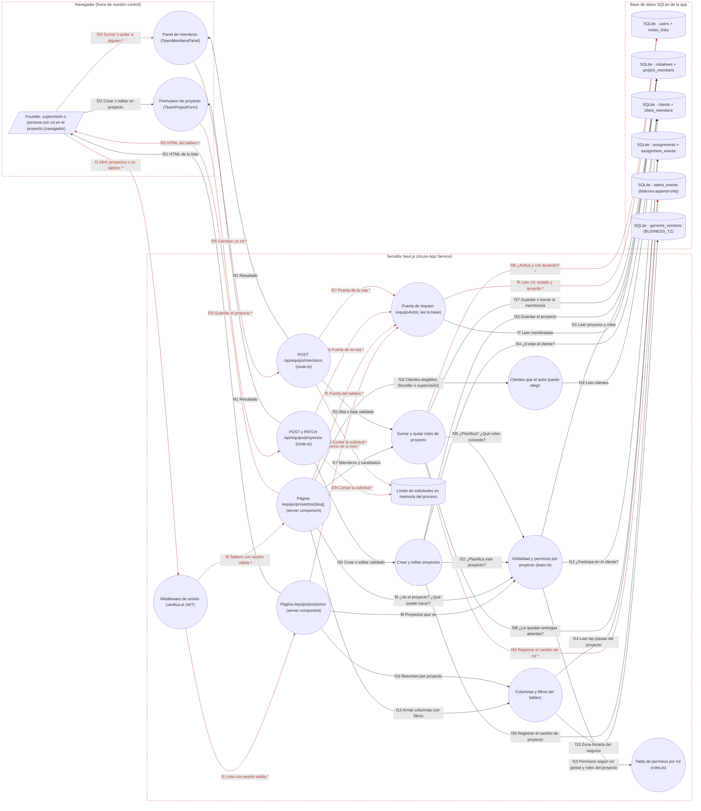

# Ficha: Proyectos y membresías

Dueño: QA (por asignar) · Revisor: John · Fecha: 2026-10-21 · Commit de referencia: 0e07d8f · Revisada contra wp/32-release (`4032c7c`) el 2026-10-24: §3, §7 y §8 (lo marcado «en `4032c7c`» cita líneas de ese commit)

## 1. Resumen

Un **proyecto es una iniciativa**: no existe tabla `proyectos`. `initiatives` es el proyecto, `notes` es su descripción y `slug` su dirección, que no cambia después de crearse. La **membresía** (`project_members`) dice qué ve y qué puede hacer cada persona dentro de un proyecto.

- **Roles de proyecto:** `estructura`, `ejecuta`, `revisa` y `vende`. El **vínculo** es `interno` o `externo`; por defecto es `externo` si la persona es `contributor`. Una persona puede tener varios roles en el mismo proyecto.
- **Permisos por proyecto** (`permisosEnProyecto`): el OR de lo que da cada fila que aplica (`ver`, `crear`, `planificar`, `revisar`, `tomar`).
  - founder o supervisión: todo;
  - `core` sin rol: ver, crear y tomar;
  - `contributor` sin rol: nada;
  - `estructura`: todo;
  - `ejecuta`: ver, crear y tomar;
  - `revisa`: ver y revisar;
  - `vende`: ver.
- **Sin acuerdo de contribución no hay primer trabajo.** Sumar a un `contributor`, o a alguien con vínculo `externo`, exige `cla_signed = 1`. Un `contributor` con acuerdo y al menos una membresía entra a `/equipo` con alcance `proyectos`: ve y actúa solo en sus proyectos.
- **Quién gestiona:** el founder o la supervisión crean proyectos y conceden los cuatro roles. Quien tiene `estructura` edita nombre, horizonte y descripción y concede solo `ejecuta` y `vende`. Nadie cambia sus propios roles. El cliente asociado solo lo cambian el founder o la supervisión.
- **Proyectos de cliente** (spec WP31 §4.A.12): con `client_id`, solo los ven el founder y quien participa (`client_members` del cliente o `project_members` del proyecto). Supervisar no basta.
- **Pantallas:**
  - `/equipo/proyectos`: una tarjeta por proyecto visible, con abiertas, bloqueadas, cerradas en la semana, piezas sin responsable para tomar y plazos. Ahí el founder y la supervisión tienen "Nuevo proyecto" y el enlace a "Importar CSV".
  - `/equipo/proyectos/[slug]`: el tablero. Columnas Backlog, Asignada, En curso, En revisión, Bloqueada y Hecha (últimos 14 días). Filtros por query string (responsable, prioridad, tamaño, horizonte, vencimiento y texto), alta y edición de entregas y panel de miembros. Si la persona no ve el proyecto, responde **404**.
- Cada alta o baja de rol, y cada creación o edición de proyecto, deja una línea en `talent_events` (append-only).

## 2. Diagrama (DFD)

Archivo: [`docs/dfd/proyectos-y-membresias.tm7`](../dfd/proyectos-y-membresias.tm7), más la imagen exportada [`docs/dfd/proyectos-y-membresias.svg`](../dfd/proyectos-y-membresias.svg). Los dos se generan desde la fuente [`docs/dfd/proyectos-y-membresias.json`](../dfd/proyectos-y-membresias.json) con `python docs/dfd/generar_tm7.py docs/dfd/proyectos-y-membresias.json --estricto`, que pasa: cada `codigo` existe en el repo. La fuente tiene 22 elementos (1 actores, 14 procesos, 7 almacenes), 42 flujos (16 sensibles) y 3 fronteras de confianza.

Leyenda: `[/ /]` actor, `(( ))` proceso, `[( )]` almacén y `subgraph` frontera de confianza. Un `*` y la flecha en rojo marcan un flujo con datos sensibles (sesión o datos personales). Las fronteras van punteadas. El bloque sale de `python docs/dfd/generar_tm7.py docs/dfd/proyectos-y-membresias.json --mermaid`.

## 3. Recorrido de una acción

Acción elegida: desde el tablero de un proyecto, una supervisora suma a una persona externa (contributor con el acuerdo firmado) con el rol **Ejecuta**.

1. **Pantalla o componente:** `/equipo/proyectos/<slug>` (`app/equipo/proyectos/[slug]/page.tsx#TableroProyectoPage`, 58-), panel "Quiénes están en este proyecto" (`TeamMembersPanel`). El formulario para sumar solo aparece si `puedeGestionar = permisos.planificar` (`page.tsx:228`). Los candidatos salen de `candidatosParaProyecto` (`page.tsx:93`): equipo interno activo y, para el founder o la supervisión, externos con acuerdo. Los roles que se ofrecen salen de `rolesQuePuedeConceder` (`page.tsx:77`). También se puede pegar una wallet exacta.
2. **Llamada al backend (endpoint y datos enviados):** `TeamMembersPanel.tsx:84-93` (`sumar`) y `60-82` (`enviar`) hacen `fetch("/api/equipo/miembros", { method: "POST", body: { initiativeId, action: "agregar", wallet, rol: "ejecuta" } })` con la cookie `zelena_session`.
3. **Ruta y controlador:** `app/api/equipo/miembros/route.ts#POST` (20-48). Pasos: `getSession` (21-22, 401), `equipoActor` (23-25, 403), límite de 30 solicitudes por minuto por `wallet:ip` (26-28, 429) y `miembroSchema` de zod (30-34, `team.ts:2093-2099`, 400). Después llama a `agregarMiembro` (38-40).
4. **Lógica de negocio (validaciones, permisos, cálculos):** `team.ts#agregarMiembro` (1392-1433).
   - `autorizarCambioDeRol` (1374-1386) revisa, en orden:
     - que el proyecto exista (404);
     - que el rol sea válido (400);
     - `permisosDe(actor, proyecto).planificar` (403): `veIniciativa` (1291-1299) + `permisosEnProyecto` (`roles.ts:306-317`);
     - que la wallet no venga vacía (400);
     - que no sea sobre sí misma, con `mismaPersona` (403);
     - que el rol esté en `rolesQuePuedeConceder` (`roles.ts:400-407`, 403).
   - Valida el vínculo (1399-1401, 400) y que la persona esté activa y no sea demo (1402-1405, 400). Desde `6b3b7d3` lo hace `exigirCuentaReal` (`team.ts:1424-1427` en `4032c7c`), que separa los dos casos: una cuenta de baja o inexistente sigue con «no está activa» y una de demostración recibe su propio motivo (`COPY_CUENTA_DE_PRUEBA`, `team.ts:1418-1419`).
   - Fija el vínculo por defecto: `externo` para un `contributor` (1406).
   - Sin acuerdo de contribución → 409 (1408-1410).
   - En una transacción: si la persona ya tiene ese rol → 409 (1414-1417). Si no, `INSERT project_members` con `added_by = actor` (1418-1422) y `registrarTalento('miembro_alta', { rol, vinculo })` (1424-1429).
5. **Base de datos (tablas o modelos leídos y escritos):**
   - Lee `initiatives`, `project_members` (roles del actor y de la persona), `users` (rol, estado, `is_demo`, `cla_signed`), `roster_links` y filas founder (`identidadesDe`), y `client_members` (si el proyecto es de cliente).
   - Escribe `project_members` y `talent_events`.
6. **Respuesta y qué hace la pantalla con ella:** `{ ok: true, id }`. El panel hace `router.refresh()` y el tablero se vuelve a renderizar con la persona en la lista, con su vínculo `externo`. Desde ese momento `equipoActor` le da a esa persona alcance `proyectos` (`authz.ts:150-152`), y en `/equipo/hoy` ve "Tus proyectos" con este proyecto y las piezas sin responsable que puede tomar.
7. **Casos de falla:**
   - 401 sin sesión. 403 si quien llama no entra a `/equipo`.
   - 429 por el límite de solicitudes. 400 si el JSON no cumple el esquema.
   - 404 si el proyecto no existe.
   - 403 por cualquiera de estos motivos:
     - "Solo quien planifica el proyecto suma o quita personas."
     - "Tus propios roles los cambia otra persona."
     - "Puedes sumar a quien ejecuta o vende…" (cuando `estructura` intenta dar `revisa` o `estructura`).
   - 400 "Esa persona no está activa en el registro." (no existe o alumni).
   - 400 "Esa es una cuenta de demostración (entró con un código de demostración): para trabajar en un proyecto necesita una invitación real." (desde `6b3b7d3`; antes recibía el mensaje anterior). Desde `4291a2d`, quien entró con una invitación válida y la wallet del navegador ya no es demo.
   - 409 "Primero tiene que firmar el acuerdo de contribución.".
   - 409 "Esa persona ya tiene ese rol en este proyecto.".
   - 500 si falla la base: se revierte la transacción.
   - "Error de red." si el `fetch` falla.
   - Para quitar un rol (`quitarMiembro`, 1439-1480): 404 si la persona no tiene ese rol, y 409 "Primero reasigna sus entregas abiertas…" si era su último rol en el proyecto y le quedan piezas abiertas o bloqueadas.

## 4. Elementos del DFD en el código

| Elemento | Tipo | Archivo y función | Notas |
| --- | --- | --- | --- |
| `u` Persona con acceso a `/equipo` | Actor | `apps/web/src/lib/roles.ts#ROLES_PROYECTO` (214), `esGlobalProyecto` (287-289) | Lo que puede hacer depende de su rol global y de sus roles en el proyecto. |
| `ui_proj` Formulario de proyecto | Proceso (cliente) | `apps/web/src/components/TeamProjectForm.tsx#TeamProjectForm` (29-), `enviar` (51-) | Crea (`POST`) o edita (`PATCH`). Solo el founder o la supervisión ven el select de cliente. |
| `ui_mem` Panel de miembros | Proceso (cliente) | `apps/web/src/components/TeamMembersPanel.tsx#TeamMembersPanel` (38-), `enviar` (60-82), `sumar` (84-93) | La wallet de cada miembro solo llega si quien mira planifica (`[slug]/page.tsx:138`). |
| `mw` Middleware | Proceso | `apps/web/middleware.ts#middleware` (33-48) | No cubre `/api/**`. |
| `lista` `/equipo/proyectos` | Proceso | `apps/web/app/equipo/proyectos/page.tsx#EquipoProyectosPage` (46-254) | Puerta propia (51-57). Usa `proyectosVisibles` (59), `assignmentsByInitiative(actor)` (68) y `listClientsFor` (106-111). |
| `tablero` `/equipo/proyectos/[slug]` | Proceso | `apps/web/app/equipo/proyectos/[slug]/page.tsx#TableroProyectoPage` (58-) | Puerta propia (65-72): `notFound()` si no existe o no lo ve. |
| `api_proj` Proyectos | Proceso | `apps/web/app/api/equipo/proyectos/route.ts#POST` (39-52), `PATCH` (54-67), `puerta` (21-33) | Solo valida e invoca. |
| `api_mem` Miembros | Proceso | `apps/web/app/api/equipo/miembros/route.ts#POST` (20-48) | `action: agregar \| quitar`. |
| `gate` Puerta | Proceso | `apps/web/src/lib/authz.ts#equipoActor` (120-154) | Alcance `proyectos` = contributor + acuerdo + al menos una membresía (150-152). |
| `vis` Visibilidad y permisos | Proceso | `apps/web/src/lib/team.ts#puedeVerProyecto` (1309-1312), `permisosDe` (1320-1325), `proyectosVisibles` (1598-1600), `rolesEnProyecto` (1244-1253), `membresiasDe` (1256-1275) | `veIniciativa` (1291-1299) y `participaEnCliente` (1302-1307) son privadas. |
| `perm` Tabla de permisos | Proceso | `apps/web/src/lib/roles.ts#permisosEnProyecto` (306-317), `rolesQuePuedeConceder` (400-407), `PERMISOS_POR_ROL` (266-271) | Módulo puro. `PERMISOS_CORE` (274). |
| `proj` Crear y editar | Proceso | `apps/web/src/lib/team.ts#crearProyecto` (1508-1540), `editarProyecto` (1546-1591), `getProyectoPorSlug` (1593-1595) | `validarCliente` (1500-1505) solo comprueba que el cliente exista. |
| `mem` Sumar y quitar | Proceso | `apps/web/src/lib/team.ts#agregarMiembro` (1392-1433), `quitarMiembro` (1439-1480), `autorizarCambioDeRol` (1374-1386), `candidatosParaProyecto` (1609-1640) | `registrarTalento` (1229-1237). |
| `board` Tablero | Proceso | `apps/web/src/lib/team.ts#tableroDeProyecto` (1725-1763), `parseFiltrosTablero` (1689-1709), `assignmentsByInitiative` (633-649) | No autoriza: la página comprueba `puedeVerProyecto` antes. Las fechas usan `BUSINESS_TZ`. |
| `cli` Clientes elegibles | Proceso | `apps/web/src/lib/clients.ts#listClientsFor` (101-) | El founder ve todos; el resto, los suyos por `client_members`. |
| `rl` Límite de solicitudes | Almacén (memoria) | `apps/web/src/lib/rate-limit.ts#rateLimit` (10-20), `clientIp` (22-26) | 30 por minuto en proyectos y en miembros. |
| `db_users` users | Almacén | `schema.sql#users` (18), `roster_links` (592) | `cla_signed`, `status`, `is_demo` y `role`. |
| `db_proy` Proyectos | Almacén | `schema.sql#initiatives` (480), `project_members` (577) | `UNIQUE(initiative_id, wallet, rol_proyecto)` y `added_by`. |
| `db_cli` Clientes | Almacén | `schema.sql#clients` (338), `client_members` (350) | La participación da el permiso. |
| `db_trabajo` Trabajo | Almacén | `schema.sql#assignments` (499), `assignment_events` (533) | El tablero lee; `quitarMiembro` cuenta las piezas abiertas. |
| `db_talento` Bitácora de talento | Almacén | `schema.sql#talent_events` (603) | Append-only, sin FK a `users`. |
| `db_genoma` Genoma | Almacén | `schema.sql#genome_versions` (251) | `BUSINESS_TZ` para "vencidas" y "esta semana". |

## 5. Flujos de datos

| Flujo | De → a | Protocolo | Datos que viajan |
| --- | --- | --- | --- |
| f1 | u → mw | HTTPS | **Sensible (sesión).** `GET /equipo/proyectos` o `/equipo/proyectos/<slug>?filtros` con la cookie. |
| f2 | mw → lista | En proceso (Next.js) | **Sensible (sesión).** Petición con el JWT verificado. |
| f3 | mw → tablero | En proceso (Next.js) | **Sensible (sesión).** JWT verificado, `slug` y filtros. |
| f4 | lista → gate | Llamada de función | **Sensible (sesión).** Wallet de la sesión. |
| f5 | tablero → gate | Llamada de función | **Sensible (sesión).** Wallet de la sesión. |
| f6 | gate → db_users | SQL | **Sensible (datos personales).** Rol, supervisión, estado y acuerdo. |
| f7 | gate → db_proy | SQL | Membresías de todas las identidades. |
| f8 | lista → vis | Llamada de función | `proyectosVisibles`, `permisosDe(null)` y `membresiasDe`. |
| f9 | tablero → vis | Llamada de función | `puedeVerProyecto` (404 si no), `permisosDe` y `rolesEnProyecto`. |
| f10 | vis → perm | Llamada de función | Rol, supervisión y roles → `{ ver, crear, planificar, revisar, tomar }`. |
| f11 | vis → db_proy | SQL | `initiatives.client_id` y `project_members` del actor. |
| f12 | vis → db_cli | SQL | `client_members` del cliente del proyecto. |
| f13 | tablero → board | Llamada de función | Id del proyecto, filtros validados e instante. |
| f14 | board → db_trabajo | SQL | Piezas del proyecto con el nombre del responsable. |
| f15 | board → db_genoma | SQL | `BUSINESS_TZ`. |
| f16 | lista → board | Llamada de función | `assignmentsByInitiative(horizonte, actor)`. |
| f17 | tablero → mem | Llamada de función | `miembrosDeProyecto` y `candidatosParaProyecto`. |
| f18 | tablero → cli | Llamada de función | `listClientsFor` (founder o supervisión). |
| f19 | cli → db_cli | SQL | Clientes del actor. |
| f20 | tablero → u | HTTPS | **Sensible (datos personales).** Columnas, responsables, miembros y vínculo. Wallets de los responsables en el filtro; wallets de los miembros solo para quien planifica. |
| f21 | lista → u | HTTPS | Tarjetas por proyecto con conteos y plazos. |
| f22 | u → ui_proj | Interacción | Nombre, horizonte, descripción y cliente. |
| f23 | ui_proj → api_proj | HTTPS | **Sensible (sesión).** `POST` o `PATCH` con JSON y la cookie. |
| f24 | u → ui_mem | Interacción | **Sensible (datos personales).** Persona elegida o wallet pegada, y rol. |
| f25 | ui_mem → api_mem | HTTPS | **Sensible (sesión).** `POST { action, initiativeId, wallet, rol, vinculo? }` con la cookie. |
| f26 | api_proj → gate | Llamada de función | **Sensible (sesión).** Wallet de la sesión. |
| f27 | api_mem → gate | Llamada de función | **Sensible (sesión).** Wallet de la sesión. |
| f28 | api_proj → rl | En memoria | **Sensible (datos personales).** Clave `equipo:proyectos:<wallet>:<ip>`. |
| f29 | api_mem → rl | En memoria | **Sensible (datos personales).** Clave `equipo:miembros:<wallet>:<ip>`. |
| f30 | api_proj → proj | Llamada de función | `crearProyectoSchema` o `editarProyectoSchema`. |
| f31 | api_mem → mem | Llamada de función | `miembroSchema`. |
| f32 | proj → vis | Llamada de función | `permisosDe(...).planificar` y `esGlobalProyecto`. |
| f33 | proj → db_proy | SQL (transacción) | `INSERT` o `UPDATE initiatives`. |
| f34 | proj → db_cli | SQL | `SELECT id FROM clients WHERE id = ?`. |
| f35 | mem → vis | Llamada de función | `planificar`, `rolesQuePuedeConceder` y `mismaPersona`. |
| f36 | mem → db_users | SQL | **Sensible (datos personales).** Estado, demo, rol y acuerdo de la persona destino. |
| f37 | mem → db_proy | SQL (transacción) | `INSERT` o `DELETE project_members`. |
| f38 | mem → db_trabajo | SQL | `COUNT` de las piezas abiertas de la persona en el proyecto. |
| f39 | proj → db_talento | SQL (misma transacción) | `proyecto_crear` o `proyecto_editar` con los campos. |
| f40 | mem → db_talento | SQL (misma transacción) | **Sensible (datos personales).** `miembro_alta` o `miembro_baja` con actor, persona, rol y vínculo. |
| f41 | api_proj → ui_proj | HTTPS | `{ ok, id, slug }` o `{ error }`. |
| f42 | api_mem → ui_mem | HTTPS | `{ ok, id? }` o `{ error }`. |

## 6. Dependencias con otras features

- **Login y sesión:** `getSession`, la cookie y `equipoActor`, que usa `membresiasDe` para dar el alcance `proyectos`. Sin membresía, un contributor no entra.
- **Actividades:** las entregas viven en los proyectos. `createAssignmentAs`, `aplicarAccionAsignacion` y `editarAsignacion` deciden con `permisosDe` y con los roles del proyecto (`revisa` y `estructura` revisan; `added_by` alimenta el vínculo de asignación de los cuatro ojos). El tablero monta `TeamNewAssignment`, `TeamAssignmentActions` y `TeamEditAssignment`.
- **Dashboard:** `initiativeBars` y `piezasVisiblesPara` usan `veIniciativa`.
- **Clientes y grafo:** `initiatives.client_id`, `client_members` y `listClientsFor`. Un proyecto de cliente sigue la misma regla que `/clientes`.
- **Talento e importador:** `/equipo/talento` muestra membresías y carga. `vincularPrincipal` mueve `project_members.wallet` y `added_by` (`talento.ts:426-432`). El importador comprueba la membresía con su propia consulta (`team-import.ts:388-398`).
- **SLA, recordatorios y avisos:** `SlaBadge` en el tablero y conteos de plazos en la lista. `supervisoresDeProyecto` (`team.ts:1346`) y `recordatorios-db.ts:291` leen `project_members` (rol `estructura`) para escalar.
- **Ágora e hitos:** "Publicar en el Ágora" desde el tablero (`[slug]/page.tsx:104-106`, `PUBLICAR_DISPONIBLE`).
- **Telegram:** el bot usa `proyectosVisibles` (`bot-agent.ts:26`).

Dependencias inversas anotadas al integrar (la otra ficha ya las tenía; la guía pide anotarlas en las dos):

- **Gamificación y épocas** ([gamificacion-y-epocas.md](gamificacion-y-epocas.md)): los cuatro ojos de la emisión dependen de `project_members` (quién sumó a quién, `added_by`) y de los roles del proyecto; el gancho `emitirPorAprobacion` corre dentro de `aplicarAccionAsignacion` (`src/lib/team.ts:783-793`).
- **Sitio público y formularios** ([sitio-publico-y-formularios.md](sitio-publico-y-formularios.md)): `Nav` dibuja «Mi día» y «Proyectos» con `accesoEquipo` (`src/lib/authz.ts:157`), que para un contributor depende de tener membresías.

## 7. Amenazas relevantes

| Amenaza | Categoría | Elemento | Estado | Justificación |
| --- | --- | --- | --- | --- |
| Un contributor sin acuerdo entra a `/equipo` porque lo sumaron a un proyecto | Elevación de privilegios (E) | mem, gate | Mitigada | `agregarMiembro` exige `cla_signed = 1` (`team.ts:1408-1410`). `equipoActor` lo vuelve a exigir (`authz.ts:150`). Tests: `authz.test.ts:258` y `caracterizacion/proyectos-y-membresias.test.ts`. |
| Alguien se da a sí mismo `revisa` o `estructura` para aprobar lo suyo o planificar | Elevación de privilegios (E) | mem, perm | Mitigada | Nunca sobre sí (`team.ts:1381`, con `mismaPersona`). `estructura` solo concede `ejecuta` y `vende` (`roles.ts:400-407`, `team.ts:1382-1384`). |
| Quien estructura cambia el cliente del proyecto para sacarlo o meterlo en otro cliente | Elevación de privilegios (E) | proj | Mitigada | `editarProyecto` exige `esGlobalProyecto` para tocar `client_id` (`team.ts:1572-1574`). Test: `caracterizacion/proyectos-y-membresias.test.ts`. |
| Una supervisora asocia un proyecto a un cliente donde no participa, o le quita el cliente a uno de cliente (cambia quién lo ve) | Elevación de privilegios (E) / Divulgación (I) | proj | Pendiente | `crearProyecto` y `editarProyecto` solo validan que el cliente exista (`validarCliente`, `team.ts:1500-1505`, 1521 y 1575). No miran `client_members`, al contrario que `clienteDeLaPieza` para una pieza (`team.ts:483-485`). Probado en `caracterizacion/proyectos-y-membresias.test.ts`. |
| Ver el tablero de un proyecto ajeno (de otro cliente) adivinando su slug | Divulgación de información (I) | tablero, vis | Mitigada | `getProyectoPorSlug` + `puedeVerProyecto` → `notFound()` (`[slug]/page.tsx:71-72`): el mismo 404 que para un slug que no existe. Test estático: `authz.test.ts:373`. |
| Una pieza etiquetada con un cliente dentro de un proyecto interno la ve todo el equipo interno | Divulgación de información (I) | vis, board | Pendiente | Para una pieza con proyecto manda la regla del proyecto (`piezasVisiblesPara`, `team.ts:573-581`), y `tableroDeProyecto` no filtra por `client_id`. Es así por diseño (comentario `team.ts:555-558`), pero no está escrito en la spec. Probado en `caracterizacion/proyectos-y-membresias.test.ts`. |
| Quien estructura usa "pegar wallet" para saber si una wallet está registrada y si firmó el acuerdo | Divulgación de información (I) | mem | Aceptada | Las respuestas distinguen 400 "no activa" de 409 "acuerdo" (`team.ts:1402-1410`). Se acepta: hace falta planificar el proyecto, las wallets son claves públicas de Stellar y el límite es de 30 por minuto (`miembros/route.ts:26`). |
| Wallets del equipo en el HTML del tablero y en la URL del filtro | Divulgación de información (I) | tablero, f20 | Aceptada | El filtro "Responsable" pone las wallets como `value` para cualquiera que vea el tablero (`TeamBoard.tsx:212`, datos de `[slug]/page.tsx:86-90`), aunque el comentario de `page.tsx:127` dice que la wallet solo viaja a quien gestiona. Se acepta porque son claves públicas o `pending:<slug>`; conviene alinear el comentario o usar un id opaco. |
| CSRF: otro sitio crea un proyecto o suma a alguien con la cookie | Manipulación (T) | api_proj, api_mem | Mitigada | La cookie es `SameSite=Lax` y `httpOnly` (`session.ts:19-25`). Las rutas esperan JSON. |
| Cambiar el slug de un proyecto rompe enlaces o suplanta otro proyecto | Manipulación (T) | proj | Mitigada | El slug nace del nombre, es `UNIQUE` (`schema.sql:482`) y `editarProyecto` nunca lo cambia (`team.ts:1546-1591`). Un nombre que choca da 409 (`team.ts:1525-1527`). |
| Nadie sabe quién sumó o quitó a alguien | Repudio (R) | mem, proj | Mitigada | `talent_events` con `actor_wallet`, `target_wallet`, acción y detalle, en la misma transacción (`team.ts:1424-1429`, 1472-1477 y 1532-1536). `project_members.added_by` (1420-1422). |
| Quitar a alguien que tiene trabajo abierto (pierde acceso a sus piezas) | Denegación de servicio (D) | mem | Mitigada | Si era su último rol y le quedan piezas abiertas o bloqueadas → 409 (`team.ts:1458-1470`). Test: `caracterizacion/proyectos-y-membresias.test.ts`. |
| Saltarse el límite de 30 por minuto rotando `X-Forwarded-For` | Denegación de servicio (D) | rl | Mitigada | Desde `05a2f4e` y `642e412`: `clientIp` ya no toma el primer valor de `X-Forwarded-For` (lo manda el cliente) sino el último, que agrega el frontal de App Service, y solo cree `X-Azure-ClientIP` si `X-Azure-FDID` es el de nuestro Front Door (`apps/web/src/lib/rate-limit.ts:46-62` y `78-93` en `4032c7c`); el mapa se poda de cubetas vencidas (10-19). Tests: `rate-limit.test.ts`. Queda que el `Map` es por proceso. |

## 8. Prueba de caracterización

Archivo: `apps/web/src/lib/caracterizacion/proyectos-y-membresias.test.ts`. Se corre con `cd apps/web && npx vitest run src/lib/caracterizacion/proyectos-y-membresias.test.ts` y el resultado es **8 de 8 pasan** contra `4032c7c` (wp/32-release).

Usa una base SQLite en memoria con `schema.sql` y `seedTeam`, más tres contributors ficticios (uno de ellos sin acuerdo); el caso de sumar añade una cuenta de demostración y una de baja, también ficticias. Las personas del equipo son los slugs de la plantilla de roles (`b97448a`, hallazgo A8: `founder`, `operaciones`, `plataforma`, `producto`). La prueba deja `ZELENA_TEAM_ROSTER` vacío (`vi.stubEnv`) para no depender del entorno. Fija:

- **crear:** `crearProyectoSchema` + `crearProyecto` por la supervisión. El slug sale del nombre. Queda `proyecto_crear` en `talent_events`. Un nombre que choca da 409 y un `core` recibe 403. Cambiar el nombre no cambia el slug.
- **sumar:** con `miembroSchema` + `agregarMiembro`, el vínculo `externo` es el de defecto y `added_by` queda guardado, con `miembro_alta`. Sin acuerdo → 409. Una cuenta de demostración → 400 con `COPY_CUENTA_DE_PRUEBA` y una de baja → 400 «no está activa» (nuevo, desde `6b3b7d3`). Duplicado → 409. Sobre sí → 403. Un `core` sin planificar → 403.
- **puerta:** sin membresía, `equipoActor` da `null`. Con membresía, el alcance es `proyectos` y solo ve su proyecto. Permisos de `ejecuta` y de un `core` sin rol.
- **estructura:** concede `vende` pero no `revisa` (403 con su texto). Edita la descripción y no el cliente (403). Candidatos según quién pregunta.
- **tablero:** columnas por estado. `Hecha` muestra 14 días por defecto (30 con `hechas=30`). `parseFiltrosTablero` ignora lo inválido. Filtros `responsable=sin`, `vence=vencidas` y `q`. `quitarMiembro` da 409 con trabajo abierto y funciona después de reasignar (`miembro_baja`); sin membresías la persona ya no entra a `/equipo`.
- **§4.A.12:** un proyecto de cliente lo ven el founder y quien participa, no la supervisión.
- **dos comportamientos actuales señalados como hallazgo:** una pieza con cliente dentro de un proyecto interno la ve todo el equipo interno, y la supervisión puede asociar un proyecto a un cliente ajeno.

Ya hay pruebas que cubren más casos: `team-proyectos.test.ts` (61) y `authz.test.ts` (A1, A9, A10 y A11).

## 9. Preguntas abiertas

1. **¿Debe la supervisión poder asociar un proyecto a un cliente donde no participa, o quitarle el cliente a uno de cliente?** La spec dice "el cliente asociado, solo founder o supervisor" (§4.A.6). Pero para una pieza, elegir cliente es del founder o de quien participa en ese cliente (`clienteDeLaPieza`, `team.ts:483-485`). Hoy quitarle el `client_id` a un proyecto de cliente lo deja visible para todo el equipo interno.
2. **¿Una pieza con `client_id` dentro de un proyecto interno debe seguir la regla del cliente?** Hoy manda la regla del proyecto (`team.ts:573-581`).
3. **¿Se unifica la comprobación de membresía?** `esMiembroDe` usa todas las identidades (`team.ts:1277-1282`), mientras que el importador consulta `project_members` con la wallet exacta (`team-import.ts:388-398`). `agregarMiembro` detecta un duplicado por wallet exacta (`team.ts:1414-1417`), así que la misma persona podría tener el mismo rol con su fila `pending:` y con su cuenta.
4. **¿El filtro "Responsable" del tablero debe usar un id opaco en lugar de la wallet?** Hoy la wallet viaja en el HTML y en la URL (`?responsable=<wallet>`) para cualquiera que vea el tablero (`TeamBoard.tsx:212`). El comentario de `[slug]/page.tsx:127` dice lo contrario.
5. **¿"Tus proyectos" y las tarjetas de la lista hacen una consulta por proyecto?** `piezasSinResponsable` se llama una vez por proyecto (`proyectos/page.tsx:96`, `hoy/page.tsx:170`). No es un problema con pocos proyectos, pero es un N+1.
6. **¿Quién tiene `estructura` debe poder asignar a otra persona desde `/equipo/hoy`?** El servidor se lo permite en su proyecto, pero la UI de "hoy" solo lo ofrece al founder y a la supervisión (`hoy/page.tsx:260-261`). En el tablero sí aparece (`[slug]/page.tsx:94-96`).
