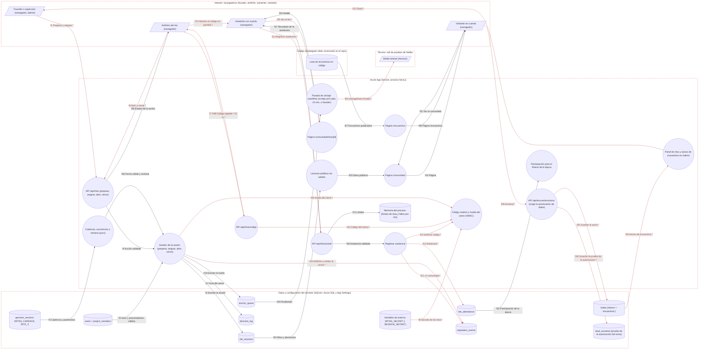

# Ficha: Ritos y comunidad

Dueño: QA (por asignar) · Revisor: John · Fecha: 2026-10-21 · Commit de referencia: 0e07d8f · Actualizada al release `wp/32-release` (4032c7c): secciones 1 a 5, 7, 8 y 9

## 1. Resumen

Los **ritos** son las reuniones fijas de Zelena: el **sync semanal** (lunes 09:00, 30 min, del equipo y de quien trabaja en un proyecto), la **demo quincenal** (viernes 16:00, 60 min, abierta a la comunidad) y la **retro mensual** (primer lunes 10:00, 60 min, de la comunidad). La cadencia vive en el genoma (`RITES_CADENCE`); las próximas fechas se **calculan** y solo se guarda en la base la ocurrencia que alguien prepara.

Flujo de vida de un rito: el founder o un supervisor lo **prepara** en `/admin` (lugar y enlace de conexión opcionales) y asigna **anfitrión** y **relator**; el anfitrión lo **abre** dentro de su ventana (desde 30 min antes hasta 30 min después del final) y muestra un **código de 6 dígitos que rota cada 90 s** (HMAC con un secreto del servidor); quien asiste lo escribe en `/comunidad/ritos/[id]` y queda registrada su **asistencia** (+2 de reputación de comunidad, una vez); el anfitrión lo **cierra**: se calcula una **huella** del cierre (que incluye la lista de asistentes, cifrada con el secreto), se deja un **acta** en `decision_log`, se encola la huella para **anclarla en Stellar testnet** y anfitrión y relator reciben +5 cada uno. Faltar no resta nada.

La comunidad lo ve en **`/comunidad`** (pública): ritos con su cadencia, próximos de comunidad, pasados con su **conteo** y su huella (nunca la lista de personas), encuentros, Academia, las 3 decisiones más recientes y, con sesión, «Has estado en N ritos». La asistencia alimenta también el **fitness de la época** (participación).

**Encuentros y su aviso**: `/encuentros` anuncia jornadas abiertas que se publican **en código** (`ENCUENTROS`, hoy vacía); mientras no hay fecha, un formulario «Avísame» guarda nombre, correo y ciudad en `leads` (`interes = 'encuentros'`), que el founder ve en `/admin`. Desde el release `wp/32-release` (dab355c, hallazgo A3) la casilla de autorización viaja y la API la exige: sin ella, 400 y nada guardado; con ella, la prueba (versión y huella del aviso de privacidad, fecha UTC) queda en `lead_consents` junto al aviso. La landing anuncia «Lo próximo» (el encuentro o la próxima demo/retro, lo que llegue antes).

Quién lo usa: founder y supervisores (gestionan), cualquier persona con cuenta activa y acuerdo firmado (presenta, relata o asiste; el sync solo el equipo), visitantes sin cuenta (leen `/comunidad` y dejan su correo).

## 2. Diagrama (DFD)

Archivo: [`docs/dfd/ritos-y-comunidad.tm7`](../dfd/ritos-y-comunidad.tm7), más la imagen exportada [`docs/dfd/ritos-y-comunidad.svg`](../dfd/ritos-y-comunidad.svg). Los dos se generan desde la fuente [`docs/dfd/ritos-y-comunidad.json`](../dfd/ritos-y-comunidad.json) con `python docs/dfd/generar_tm7.py docs/dfd/ritos-y-comunidad.json --estricto`, que pasa: cada `codigo` existe en el repo. La fuente tiene 32 elementos (5 actores, 15 procesos, 12 almacenes), 40 flujos (20 sensibles) y 5 fronteras de confianza.

Cambios del release `wp/32-release`: almacén nuevo `lead_consents` (`d_consents`) y flujo f40 (prueba de la autorización del aviso); f28 lleva la casilla; la pasada de anclaje la dispara el workflow `anclaje.yml` cada 15 minutos.

Vista para GitHub (salida de `--mermaid`): `[/ /]` actor, `(( ))` proceso, `[( )]` almacén, cada `subgraph` es una frontera de confianza y los flujos con `*` y en rojo llevan datos sensibles.

Lectura: arriba, la gestión (founder → `/api/ritos`), la presentación (anfitrión → abrir, código, cerrar) y la asistencia (asistente → `/api/ritos/asistir`); todas leen el actor de la base y la cadencia del genoma. Al cerrar, la huella va a la cola de anclaje, que solo sale a Stellar cuando alguien dispara `/api/anchor/run`. Abajo, la parte pública: `/comunidad` y `/comunidad/ritos/[id]` leen sin wallets, y `/encuentros` guarda el aviso en `leads`.

Nota: `f10` une dos actores (el anfitrión muestra el código y el asistente lo lee) porque ocurre fuera del sistema, en pantalla o en persona. Microsoft Threat Modeling Tool no genera amenazas para ese flujo; la sección 7 lo analiza a mano ("Registrar asistencia sin estar").

## 3. Recorrido de una acción

Acción elegida: **una persona registra su asistencia a la demo quincenal del viernes con el código que muestra el anfitrión** (con lo que pasa antes y después: abrir y cerrar). Es el flujo que recorre la prueba de la sección 8.

1. **Pantalla o componente:** `/comunidad/ritos/[id]` (`app/comunidad/ritos/[id]/page.tsx#RitoPage`). Quien presenta ve `RitoAnfitrionAcciones` («Abrir el rito», luego cerrar con resumen y enlace al acta) y `RitoCodigo` (el código grande, «cambia en N s», el conteo «N personas registradas»; refresca cada 15 s). Quien asiste ve `src/components/RitoAsistenciaForm.tsx#RitoAsistenciaForm` («Escribe el código que ves en pantalla.», botón «Registrar mi asistencia»).
2. **Llamada al backend:** el anfitrión: `POST /api/ritos { action: "abrir", sessionId }` y `GET /api/ritos/codigo?sesion=<id>`. Quien asiste: `POST /api/ritos/asistir { sessionId, codigo }` (el código ya normalizado a 6 dígitos en el navegador). Todo con la cookie `zelena_session`.
3. **Ruta y controlador:**
   - `app/api/ritos/asistir/route.ts#POST`: `getSession` (401) → límite 10 intentos/min por wallet (429) → zod `{ sessionId: entero > 0, codigo ≤ 32 }` (400) → `demasiadosFallos(sesión, wallet)` (429 tras 20 códigos fallidos) → `registrarAsistencia(getDb(), session.wallet, …)`; si el motivo del error es `codigo`, `anotarFallo`.
   - `app/api/ritos/codigo/route.ts#GET`: `getSession` → 30/min por wallet → `actorDeRitos` (fila activa en `users`) → `codigoActual`; `Cache-Control: no-store`.
   - `app/api/ritos/route.ts#POST`: `getSession` → 30/min por wallet+IP → `actorDeRitos` → zod (unión por `action`) → `prepararRito` / `asignarRolesRito` / `abrirRito` / `cerrarRito`; responde solo `{ ok, id, state }`.
4. **Lógica de negocio** (`src/lib/ritos.ts`):
   - `comprobarPersona`: no `pending:`, con cuenta, activa, no demo y con `cla_signed = 1`.
   - `puertaDeAsistencia`: la sesión existe, está `Open` y `ahora` está dentro de `ventanaRito(inicio, duración, RITE_WINDOW_MIN)`; si el rito es `sync`, además `equipoActor` (audiencia equipo).
   - Si cualquiera de las identidades de la persona (`identidadesDe`) ya está registrada → `yaEstaba` sin mirar el código.
   - `verificarCodigo` (`src/lib/ritos-codigo.ts`): `HMAC(secreto, "<sesión>:<tramo>")` → 6 dígitos; acepta el tramo actual y el anterior (90 s cada uno), comparación en tiempo constante. Secreto: `RITES_SECRET` (≥ 16) o derivado de `SESSION_SECRET` (≥ 32); en producción sin ninguno, lanza.
   - En una transacción: `INSERT rite_attendance (layer = 1)` y `emitirComunidad` (+`RITE_ATTEND_REP` = 2, `ref = rito:<id>:asistencia`, `period_id = currentEpoch`, una vez por persona).
   - Abrir: founder, supervisor o anfitrión de esa sesión; solo desde `Planned` y dentro de la ventana. Cerrar: solo desde `Open`; huella `hashCierre` (HMAC-SHA256 de un JSON canónico con tipo, fecha, asistentes ordenados, anfitrión, relator y resumen); `decision_log` («Rito demo quincenal del … cerrado · N asistentes», razón con resumen y huella); `anchor_queue (kind 'rite')`; +5 a anfitrión y +5 a relator (si siguen siendo válidos y no son la misma persona).
5. **Base de datos:** lee `users`, `project_members` (sync), `rite_sessions`, `rite_attendance`, `reputation_events`, `points_ledger` (idempotencia por `ref`), `genome_versions`, `periods`; escribe `rite_attendance` y `reputation_events`. Al abrir/cerrar: `rite_sessions` (UPDATE), `decision_log`, `anchor_queue`, `reputation_events` (INSERT).
6. **Respuesta y qué hace la pantalla con ella:** `200 { ok: true, registrada: true, yaEstaba: false, reputacion: 2, mensaje: "Listo. Quedó registrada tu asistencia." }`; el formulario se reemplaza por el mensaje y «Estar es suficiente. Faltar no resta nada.». Una segunda vez: `registrada: false, yaEstaba: true`, «Ya estabas registrado.». El anfitrión ve subir el conteo en el siguiente refresco del código. Tras cerrar, `/comunidad` lista el rito en «pasados» con «1 persona registrada», el resumen, la huella corta y, cuando se ancle, el enlace a la transacción.
7. **Casos de falla:** `401` «Entra para registrar tu asistencia.»; `429` «Demasiados intentos con este rito. Pide ayuda a quien presenta.»; `400` «Entrada inválida.» o «Ese código ya cambió. Pide el actual a quien presenta.»; `403` fila `pending:`, cuenta inactiva, «Las cuentas de demostración no registran asistencia.» (texto del release, 4291a2d: una cuenta con la wallet del navegador y una invitación real ya no es de demostración), «Para registrar asistencia primero firma el acuerdo de contribución.», o «Este rito es del equipo…» (sync); `404` rito inexistente; `409` «Este rito no está abierto ahora.» (cerrado, sin abrir o fuera de la ventana); `500` genérico (el detalle va a `console.error`). En el navegador sin red: «Sin conexión. Revisa tu red e intenta de nuevo.».

## 4. Elementos del DFD en el código

| Elemento | Tipo | Archivo y función | Notas |
| --- | --- | --- | --- |
| Founder o supervisor (navegador) | Cliente externo | `apps/web/src/components/RitosAdminPanel.tsx#RitosAdminPanel` | Panel de ritos en `/admin`: preparar, asignar, abrir, cerrar; solo conteos. |
| Anfitrión (navegador) | Cliente externo | `apps/web/src/components/RitoAnfitrionAcciones.tsx#RitoAnfitrionAcciones` | Y `src/components/RitoCodigo.tsx#RitoCodigo` (refresco cada 15 s). |
| Asistente con cuenta (navegador) | Cliente externo | `apps/web/src/components/RitoAsistenciaForm.tsx#RitoAsistenciaForm` | Normaliza el código con `normalizarCodigo` antes de enviarlo. |
| Visitante sin cuenta (navegador) | Cliente externo | `apps/web/src/components/AvisoEncuentrosForm.tsx#AvisoEncuentrosForm` | Casilla de autorización `required` solo en el HTML. |
| Stellar testnet | Cliente externo | `apps/web/src/lib/anchor.ts#anclarPendientes` | `manageData` con nombre `rite:<id>` y valor = huella. |
| API /api/ritos | Proceso | `apps/web/app/api/ritos/route.ts#POST` | Zod con topes propios (ver hallazgos). |
| API /api/ritos/codigo | Proceso | `apps/web/app/api/ritos/codigo/route.ts#GET` | `no-store`. |
| API /api/ritos/asistir | Proceso | `apps/web/app/api/ritos/asistir/route.ts#POST` | Límites de §5.D de la spec. |
| Gestión de la sesión | Proceso | `apps/web/src/lib/ritos.ts#cerrarRito` | Y `prepararRito`, `asignarRolesRito`, `abrirRito`, `codigoActual`, `actorDeRitos`. |
| Registrar asistencia | Proceso | `apps/web/src/lib/ritos.ts#registrarAsistencia` | Y `estadoAsistencia`, `puertaDeAsistencia`, `emitirComunidad`. |
| Código rotativo y huella | Proceso | `apps/web/src/lib/ritos-codigo.ts#verificarCodigo` | Y `codigoRito`, `bucketDe`, `expiraEnS`, `hashCierre`, `ritesSecret`. Solo servidor. |
| Cadencia y ventana | Proceso | `apps/web/src/lib/ritos-labels.ts#proximasOcurrencias` | Y `esOcurrenciaValida`, `ventanaRito`, `dentroDeVentana`, `RITE_LABEL`. Puro, apto para cliente. |
| Página /comunidad/ritos/[id] | Proceso | `apps/web/app/comunidad/ritos/[id]/page.tsx#RitoPage` | Usa `detalleRito`, `estadoAsistencia`, `puedePresentarRito`. |
| Página /comunidad | Proceso | `apps/web/app/comunidad/page.tsx#ComunidadPage` | Pública; enlace de conexión solo con cuenta activa de la audiencia. |
| Lecturas públicas | Proceso | `apps/web/src/lib/ritos.ts#ritosPublicos` | Y `decisionesPublicas`, `detalleRito`, `asistenciaPropia`, `proximoRitoDeComunidad`. |
| Panel en /admin | Proceso | `apps/web/app/admin/page.tsx#AdminPage` | `panelRitosAdmin(db)` y la sección «Avisos de encuentros» (de `leads`). |
| Página /encuentros | Proceso | `apps/web/app/encuentros/page.tsx#Encuentros` | `revalidate = 3600`. |
| API /api/encuentros/aviso | Proceso | `apps/web/app/api/encuentros/aviso/route.ts#POST` | Pública; campo trampa `sitio`; exige `acepto: true` (400 sin la casilla, 409 si el aviso cambió) y guarda con `guardarSolicitudConAutorizacion`. |
| Pasada de anclaje | Proceso | `apps/web/app/api/anchor/run/route.ts#POST` | Founder por sesión o `x-anchor-secret`; la llama el workflow `.github/workflows/anclaje.yml` cada 15 minutos (76ed59e). |
| Participación de la época | Proceso | `apps/web/src/lib/ritos.ts#participacionRitos` | La consume `src/lib/epochs.ts:69` (`gatherEpochData`). |
| rite_sessions | Almacén | `apps/web/src/lib/schema.sql#rite_sessions` | `UNIQUE (kind, scheduled_for)`; `join_url` solo se entrega con sesión. |
| rite_attendance | Almacén | `apps/web/src/lib/schema.sql#rite_attendance` | `UNIQUE (session_id, wallet, layer)`. |
| reputation_events | Almacén | `apps/web/src/lib/schema.sql#reputation_events` | Eje `comunidad`; `ref` `rito:<id>:<papel>`. |
| decision_log | Almacén | `apps/web/src/lib/schema.sql#decision_log` | Las actas «Rito …» se excluyen de las listas públicas de decisiones. |
| anchor_queue | Almacén | `apps/web/src/lib/schema.sql#anchor_queue` | `kind = 'rite'`, `data_key = 'rite:<id>'`. |
| users + project_members | Almacén | `apps/web/src/lib/schema.sql#users` | Estado, demo, acuerdo, rol; membresías para la audiencia del sync. |
| genome_versions | Almacén | `apps/web/src/lib/genome.ts#getActiveGenome` | `RITES_CADENCE`, `RITE_WINDOW_MIN` 30, `RITE_CODE_ROTATION_S` 90, `RITE_ATTEND_REP` 2, `RITE_HOST_REP` 5, `RITE_RECORDER_REP` 5. |
| leads | Almacén | `apps/web/src/lib/schema.sql#leads` | Compartida con `/empresas/contacto`; los avisos llevan `interes = 'encuentros'`. |
| lead_consents | Almacén | `apps/web/src/lib/schema.sql#lead_consents` | Prueba de la autorización de cada aviso (`formulario = 'encuentros'`): versión, huella del aviso y fecha UTC. Solo inserción, sin IP. |
| Lista de encuentros | Almacén | `apps/web/src/lib/encuentros.ts#ENCUENTROS` | Constante en código (hoy `[]`): publicar una fecha es un despliegue. |
| Memoria del proceso | Almacén | `apps/web/src/lib/ritos.ts#anotarFallo` | `globalThis.__zelenaFallosRitos` y el mapa de `rate-limit.ts`; se pierden al reiniciar. |
| Variables de entorno | Almacén | `apps/web/src/lib/ritos-codigo.ts#ritesSecret` | `RITES_SECRET` o `SESSION_SECRET`. |

## 5. Flujos de datos

Los marcados **(S)** llevan datos sensibles (credencial, sesión, firma o dato personal).

| Flujo | De → a | Protocolo | Datos que viajan |
| --- | --- | --- | --- |
| f1 **(S)** | Founder/supervisor → API /api/ritos | HTTPS | `preparar` (kind, fecha, lugar, enlace) y `asignar` (wallets de anfitrión y relator) + cookie |
| f2 | users → Gestión | SQL | estado, rol, supervisión, demo, acuerdo |
| f3 | genome_versions → Cadencia | SQL | `RITES_CADENCE`, `RITE_*`, `BUSINESS_TZ` |
| f4 | API /api/ritos → Gestión | llamada en proceso | actor leído de la base + entrada validada |
| f5 | Gestión → rite_sessions | SQL | INSERT `Planned`; UPDATE anfitrión/relator, `Open`, `Closed` (hash, resumen, acta) |
| f6 **(S)** | Anfitrión → API /api/ritos | HTTPS | `abrir` / `cerrar` (resumen, enlace al acta) + cookie |
| f7 **(S)** | Anfitrión → API código | HTTPS | `GET ?sesion=<id>` + cookie |
| f8 **(S)** | Variables de entorno → Código y huella | process.env | `RITES_SECRET` o `SESSION_SECRET` |
| f9 **(S)** | API código → Anfitrión | HTTPS | `{ codigo, expiraEnS, asistentes }`, `no-store` |
| f10 **(S)** | Anfitrión → Asistente | fuera de banda | el código en pantalla o en persona |
| f11 **(S)** | Asistente → API asistir | HTTPS | `{ sessionId, codigo }` + cookie |
| f12 | API asistir → Memoria | memoria | contadores de intentos y fallos |
| f13 **(S)** | Registrar asistencia → Código | llamada en proceso | código, tramo actual y anterior |
| f14 **(S)** | Registrar asistencia → rite_attendance | SQL | `(session_id, wallet, layer, created_at)`: presencia de una persona |
| f15 **(S)** | Registrar asistencia → reputation_events | SQL | +2 comunidad, `ref`, `period_id` |
| f16 **(S)** | Gestión → reputation_events | SQL | +5 anfitrión, +5 relator |
| f17 | Gestión → decision_log | SQL | acta: título con conteo, razón con resumen y huella |
| f18 | Gestión → anchor_queue | SQL | `('rite', <id>, 'rite:<id>', huella, 'pending')` |
| f19 | anchor_queue → Pasada de anclaje | SQL | filas pendientes |
| f20 **(S)** | Pasada de anclaje → Stellar | Stellar (HTTPS a Horizon) | transacción firmada con la clave de servicio (`manageData`) |
| f21 | Visitante → /comunidad | HTTPS | `GET` (cookie opcional) |
| f22 | rite_sessions (+ asistencia, decisiones, anclaje) → Lecturas públicas | SQL | sesiones, conteos, decisiones, `tx_id` |
| f23 | Lecturas públicas → /comunidad | llamada en proceso | próximos, pasados, decisiones, asistencia propia |
| f24 | /comunidad → Visitante | HTTPS | HTML sin wallets ni lista de personas |
| f25 **(S)** | Asistente → /comunidad/ritos/[id] | HTTPS | `GET` + cookie |
| f26 | Página del rito → Asistente | HTTPS | estado, lugar, enlace (si corresponde), formulario |
| f27 | Lista de encuentros → /encuentros | import de módulo | `ENCUENTROS` y `FORMATOS` |
| f28 **(S)** | Visitante → API aviso | HTTPS | nombre, correo, ciudad (datos personales), campo trampa, `acepto: true` y versión del aviso |
| f29 **(S)** | API aviso → leads | SQL | `INSERT (nombre, email, interes 'encuentros', 'Ciudad: …')` en la misma transacción que f40 |
| f30 **(S)** | leads → /admin | SQL | últimos 100 leads |
| f31 **(S)** | /admin → Founder | HTTPS | sesiones con conteo, candidatos a presentar, correos de avisos |
| f32 | rite_attendance → Participación | SQL | asistencias de ritos cerrados y personas activas |
| f33 | API asistir → Registrar asistencia | llamada en proceso | wallet de la sesión, sesión, código |
| f34 **(S)** | API código → Código | llamada en proceso | HMAC del tramo |
| f35 **(S)** | Gestión → Código y huella | llamada en proceso | lista nominal de asistentes para la huella |
| f36 | Cadencia → Gestión | llamada en proceso | fecha válida, ventana |
| f37 | API asistir → Asistente | HTTPS | `{ ok, registrada, yaEstaba, reputacion, mensaje }` o error |
| f38 | API /api/ritos → Anfitrión | HTTPS | `{ ok, id, state }` |
| f39 | /encuentros → Visitante | HTTPS | página con el formulario «Avísame» |
| f40 **(S)** | API aviso → lead_consents | SQL | `INSERT (lead_id, 'encuentros', aviso_version, aviso_sha256, accepted_at)`; sin IP |

## 6. Dependencias con otras features

- **Login y sesión**: `getSession` en las tres rutas; el actor se relee de `users` (`actorDeRitos`); `equipoActor` decide la audiencia del sync.
- **Talento / identidades**: `identidadesDe` y `mismaPersona` (`src/lib/identidades.ts`) para "una vez por persona" y para que anfitrión y relator no sean la misma.
- **Gamificación y épocas**: `reputation_events` con `period_id = currentEpoch`; `participacionRitos` entra en el fitness (`src/lib/epochs.ts:69`); `asistenciaPropia` usa `periods`.
- **Gobernanza (sitio público)**: `decision_log`; `esActaDeRito` y `esDecisionReemplazada` de `src/lib/agora-labels.ts` filtran las decisiones públicas.
- **Anclaje en Stellar testnet**: `anchor_queue`, `/api/anchor/run`, `anclarPendientes`; `txVerificable` (`src/lib/pruebas-testnet.ts`) decide si se muestra la transacción.
- **Genoma**: cadencia y parámetros.
- **Sitio público y formularios**: landing (`ProximoEncuentro`), menú (`RUTA_COMUNIDAD`), `/privacidad`; `leads` es la misma tabla de `/empresas/contacto` (su ficha también caracteriza el aviso de encuentros).
- **Academia**: `/comunidad` lista sus primeros 3 módulos (`listAcademia`).
- **Admin**: panel de ritos y avisos de encuentros; `EpocaPanel` usa `zonaRitos`.
- **Dashboard / Telegram**: `riteHealth` (salud de ritos del dashboard) cuenta **check-ins**, no asistencia a ritos (ver hallazgos).

## 7. Amenazas relevantes

| Amenaza | Categoría | Elemento | Estado | Justificación |
| --- | --- | --- | --- | --- |
| Registrar asistencia sin estar (el código se comparte por chat) | Suplantación | Registrar asistencia (f10, f11) | Aceptada | Es la capa 1 decidida en la spec WP31 §3.3 («Capa 1 = código rotativo»): el código rota cada 90 s y exige sesión, cuenta activa y acuerdo firmado (`src/lib/ritos.ts:281-290`). El premio es pequeño (+2 una vez). |
| Adivinar el código por fuerza bruta | Suplantación | API asistir (f11) | Mitigada | 10 intentos/min por wallet (`app/api/ritos/asistir/route.ts:39`) y 20 fallos por rito y persona durante 24 h (`src/lib/ritos.ts:650-677`): 20 × 2/10⁶ de acierto. Los contadores viven en memoria y se pierden al reiniciar (aceptado). |
| Predecir el código siguiente | Suplantación | Código rotativo (f8, f13, f34) | Mitigada | HMAC con secreto del servidor y comparación en tiempo constante (`src/lib/ritos-codigo.ts:62-89`); en producción sin secreto, la app lanza (`:31-42`). |
| Exponer quién asistió (medir presencia de personas) | Divulgación de información | Lecturas públicas, API código, /admin (f9, f22-f24) | Mitigada | Solo conteos (`src/lib/ritos.ts:771-783` `sinWallets`; `codigoActual` devuelve el número, `:530-552`); la lista nominal solo existe dentro de una huella con HMAC (`ritos-codigo.ts:91-130`). Probado: ninguna wallet en `ritosPublicos` ni en el acta. |
| El enlace de conexión llega a quien no es de la audiencia | Divulgación de información | Página del rito, /comunidad (f24, f26) | Mitigada | `veEnlace` exige sesión, cuenta activa y, en el sync, `equipoActor` (`src/lib/ritos.ts:790-799`). |
| Un contributor prepara, abre o cierra ritos | Elevación de privilegios | Gestión (f1, f6) | Mitigada | `gestiona` (founder o supervisor) y `presenta` (además el anfitrión de esa sesión) en `src/lib/ritos.ts:236-244`; el actor sale de la base (`:223-233`). Probado: 403. |
| Reputación duplicada por doble envío o dos identidades | Manipulación | Registrar asistencia → reputation_events (f15, f16) | Mitigada | `asistio` por todas las identidades (`src/lib/ritos.ts:557-563`), `yaEmitido` por `ref` en los dos ledgers (`:318-330`), `UNIQUE (session_id, wallet, layer)` en `schema.sql`. |
| El anfitrión publica texto o enlace arbitrario, permanente, en el sitio | Manipulación | Gestión → decision_log (f6, f17) | Pendiente | Cualquier anfitrión con acuerdo firmado (también de la comunidad) cierra con `summary` (≤ 1000) y `notesUrl` https (`src/lib/ritos.ts:455-470`), que van a `/comunidad` y a la razón del acta con su hash (`:495-505`), sin revisión previa ni forma de corregir. |
| Nadie fuera del servidor puede verificar la huella anclada | Repudio | Código y huella → anchor_queue (f18, f20) | Aceptada | Decisión de privacidad documentada: la huella lleva secreto para que no se pueda enumerar la lista (`src/lib/ritos-codigo.ts:91-109`); al rotar el secreto el servidor deja de poder recalcularlas (`:106-108`). El texto del acta dice que se ancla «en la red de pruebas», lo que es cierto solo cuando corre el anclaje (fila siguiente). |
| La huella queda en cola y nunca se ancla | Repudio | Pasada de anclaje (f19, f20) | Mitigada | Release `wp/32-release` (76ed59e): el workflow `.github/workflows/anclaje.yml` llama a `/api/anchor/run` cada 15 minutos con `ANCHOR_RUN_SECRET`; y desde 27a3044 una fila que falla 8 veces queda `failed` en vez de reintentarse para siempre (`src/lib/anchor.ts:34`, `:160-172`). `cerrarRito` sigue solo encolando (`src/lib/ritos.ts`). Riesgo residual: depende de que el secret esté configurado en el repo y en App Settings. |
| Nombre y correo guardados sin constancia de la autorización | Divulgación de información | API aviso → leads, lead_consents (f28, f29, f40) | Mitigada | Release `wp/32-release` (dab355c, hallazgo A3): la casilla viaja (`src/components/AvisoEncuentrosForm.tsx`, `acepto` y `aviso`), `avisoEncuentrosSchema` exige `acepto: true` (`src/lib/validation.ts:134-137` y `:160-166`; 400 si falta) y el aviso se guarda con su prueba en una transacción (`app/api/encuentros/aviso/route.ts:40-44`; `src/lib/consentimiento.ts:72-101`). Caso "ARREGLADO (A3)" de la caracterización. |
| Bots llenan `leads` con correos | Denegación de servicio | API aviso (f28) | Mitigada | Campo trampa (`aviso/route.ts:34`) y 5 envíos por IP cada 10 min (`:14`); desde el release (05a2f4e) la IP es el último valor de `X-Forwarded-For` o `X-Azure-ClientIP` de nuestro Front Door, que el cliente no elige (`src/lib/rate-limit.ts:78-93`). Residual: contador en memoria de una instancia. |
| Correos de la comunidad expuestos | Divulgación de información | /admin (f30, f31) | Mitigada | `/admin` exige rol founder leído de la base (`app/admin/page.tsx:33`) y el middleware exige sesión con acuerdo firmado (`apps/web/middleware.ts:24`, `:41`). |
| Producción arranca sin secreto de ritos | Divulgación de información | Variables de entorno (f8) | Mitigada | `ritesSecret` lanza en producción si no hay `RITES_SECRET` ni `SESSION_SECRET` (`src/lib/ritos-codigo.ts:36-40`). |

## 8. Prueba de caracterización

Archivo: `apps/web/src/lib/caracterizacion/ritos-y-comunidad.test.ts` (8 casos, pasan con el release `wp/32-release`). Se corre con `cd apps/web && npx vitest run src/lib/caracterizacion/ritos-y-comunidad.test.ts`.

Qué cubre, por las rutas reales y contra una base SQLite en memoria con `schema.sql` + `seedIfEmpty`:

- gestión: el founder prepara (fecha normalizada, duración del genoma) y asigna; sin sesión 401; un contributor 403; una fecha fuera de la cadencia 400; abrir antes de la ventana 409 y dentro 200;
- **flujo principal**: abrir → el anfitrión ve el código (`no-store`, solo `codigo`, `expiraEnS`, `asistentes`) → quien asiste no lo ve (403) → código equivocado 400 → código bueno con espacio registra (+2) → segunda vez `yaEstaba` → el conteo sube → cerrar: huella de 64 hex, `rite_attendance`, reputación de asistente, anfitrión y relator con `period_id`, fila `rite` pendiente en `anchor_queue`, acta «Rito demo quincenal del … cerrado · 1 asistente» con resumen y huella → `/comunidad`: pasados con conteo y huella, sin wallets, sin el acta en las decisiones, `detalleRito` sin enlace para quien no tiene sesión, `asistenciaPropia`;
- fuera de la ventana no se registra (409);
- aviso de `/encuentros` con la casilla (`acepto: true` y la versión del aviso): guarda en `leads` con `interes = 'encuentros'` y `Ciudad: …`; la lista de encuentros está vacía;
- **ARREGLADO (A3)**: sin la casilla el aviso responde 400 con el mensaje de la autorización y no guarda nada; con ella, `lead_consents` tiene la prueba (formulario `encuentros`, versión, huella vigente y la misma fecha que el aviso) y ninguna columna de IP o navegador;
- dos HALLAZGOS que siguen fijados: la ruta y la lógica validan `lugar` con topes distintos (200 y 120); la participación esperada cuenta a quien no puede asistir.

Qué cambió respecto de la versión escrita contra 0e07d8f: la suite no cargaba porque la ruta del aviso importa `@/lib/consentimiento` (se agregó el alias). Después fallaban 2 casos: el aviso ahora exige la casilla (dab355c), así que se le agregó `acepto: true`, y el HALLAZGO "se acepta sin constancia de autorización" pasó a **ARREGLADO (A3)**. No hay regresiones.

Dobles: reloj (`vi.useFakeTimers({ toFake: ["Date"] })`) y sesión (`@/lib/session`). Las reglas finas ya las cubren `ritos.test.ts`, `ritos-codigo.test.ts`, `ritos-labels.test.ts` (incluida `llamadaParticipar`, la llamada «ven a una demo» de 4aa788d), `encuentros.test.ts` y `consentimiento.test.ts`; el formulario de encuentros también está en `caracterizacion/sitio-publico-y-formularios.test.ts`.

## 9. Preguntas abiertas

- ~~¿Quién dispara el anclaje en producción?~~ Resuelta en el release (76ed59e): el workflow `anclaje.yml`, cada 15 minutos.
- ¿Debe el resumen del anfitrión pasar por revisión antes de quedar en el acta pública e inmutable?
- ~~¿Se guarda la constancia de la autorización de datos del aviso de encuentros?~~ Resuelta en el release (dab355c): `lead_consents`. Sigue abierto cuánto tiempo se conservan esos correos y cómo se borran.
- Encuentros (en código) y ritos de comunidad (en base) describen casi lo mismo («Demo abierta» y «Retro pública» están en `FORMATOS` y en `RITES_CADENCE`). ¿Se unifican, o los encuentros pasan a ser datos editables desde `/admin`?
- ¿La participación esperada del fitness debe contar solo a quien puede asistir (acuerdo firmado y, en el sync, equipo)?
- El dashboard llama «salud de ritos» (`riteHealth`) a los check-ins diarios, no a la asistencia a ritos. ¿Se renombra o se cambia la fuente?
- `src/lib/encuentros.ts:22` dice que los formatos «salen del calendario ritual del whitepaper». Con el whitepaper fuera del sitio (`/whitepaper` → `/manifiesto`), ¿la referencia pasa al manifiesto?
- `/privacidad` dice que en Stellar «solo queda la huella del acuerdo que firmaste»; también se anclan las huellas de cierre de los ritos (que incluyen, cifrada, la lista de asistentes). ¿Se actualiza el aviso?
