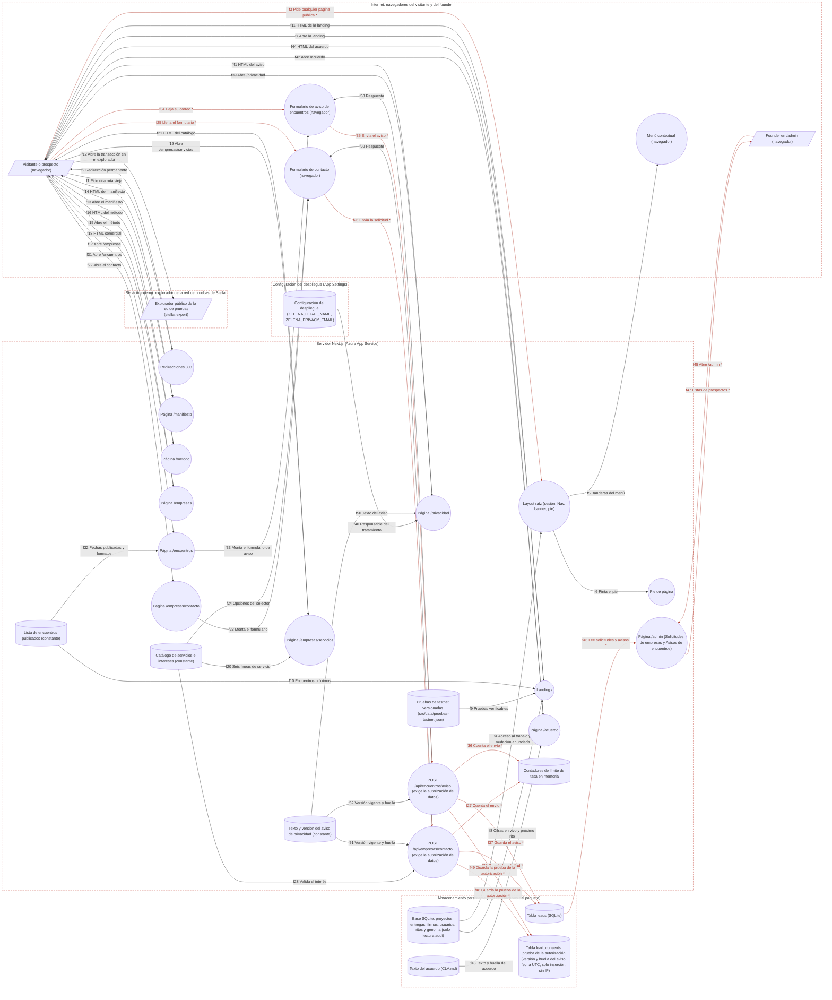

# Ficha: Sitio público y formularios

Dueño: QA (por asignar) · Revisor: John · Fecha: 2026-10-21 · Commit de referencia: 0e07d8f · Actualizada al release `wp/32-release` (4032c7c): secciones 1 a 5, 7, 8 y 9

## 1. Resumen

Es la cara pública de Zelena: lo que ve quien llega sin cuenta. Lo usan tres tipos de persona:

- **Visitante** (sin sesión): lee la landing `/`, el `/manifiesto`, el `/metodo`, `/encuentros`, `/privacidad` y `/acuerdo`, y navega con el menú y el pie.
- **Prospecto** (una empresa): lee `/empresas` y `/empresas/servicios` y pide una demostración en `/empresas/contacto`.
- **Founder**: lee en `/admin` lo que dejaron los formularios.

Casos de uso que cubre:

| Caso | Dónde | Qué escribe |
| --- | --- | --- |
| CU1. Un prospecto pide una demostración o una propuesta | `/empresas/contacto` → `POST /api/empresas/contacto` | una fila en `leads` y la prueba de su autorización en `lead_consents` |
| CU2. Alguien deja su correo para enterarse del próximo encuentro | `/encuentros` → `POST /api/encuentros/aviso` | una fila en `leads` con `interes = 'encuentros'` y su fila en `lead_consents` |
| CU3. Un visitante entiende qué es Zelena (landing, manifiesto, método, empresas, servicios) | páginas de servidor | nada (solo lectura) |
| CU4. Un visitante comprueba que hay actividad real (cifras en vivo y transacción en la red de pruebas) | landing, `PruebaEnVivo` y `PruebaTestnet` | nada (lee la base y un JSON versionado) |
| CU5. Un visitante lee el aviso de privacidad y el acuerdo que se firma al entrar | `/privacidad`, `/acuerdo` | nada |
| CU6. Un enlace viejo sigue funcionando | redirecciones 308 de `next.config.mjs` | nada |
| CU7. El founder revisa prospectos y avisos | `/admin` (secciones "Solicitudes de empresas" y "Avisos de encuentros") | nada (lee `leads`) |

**Whitepaper retirado.** Por decisión del founder, el sitio deja solo el manifiesto. En el commit de referencia todavía existían `app/whitepaper/page.tsx`, el enlace "Whitepaper" del pie y el de `/metodo`; el release `wp/32-release` (67a78df) los quitó: `/whitepaper` es una redirección 308 a `/manifiesto` y el pie enlaza el manifiesto.

**Autorización de datos (Ley 1581, hallazgo A3).** Desde el release (dab355c) la casilla de los dos formularios **viaja** (`acepto: true` y la versión del aviso), la API la **exige** (sin ella, 400 y no se guarda nada) y la **prueba** queda en `lead_consents` junto a la solicitud, en la misma transacción: versión del aviso, su huella (sha256 del texto canónico de `src/lib/aviso-privacidad.ts`) y la fecha en UTC, sin IP ni datos del navegador.

Fuera de esta ficha (tienen la suya): `/comunidad` y ritos, `/agora`, `/gobernanza`, `/academia`, `/entrar` (login) y el resto de `/admin`.

## 2. Diagrama (DFD)

Archivo: [`docs/dfd/sitio-publico-y-formularios.tm7`](../dfd/sitio-publico-y-formularios.tm7), más la imagen exportada [`docs/dfd/sitio-publico-y-formularios.svg`](../dfd/sitio-publico-y-formularios.svg). Los dos se generan desde la fuente [`docs/dfd/sitio-publico-y-formularios.json`](../dfd/sitio-publico-y-formularios.json) con `python docs/dfd/generar_tm7.py docs/dfd/sitio-publico-y-formularios.json --estricto`, que pasa: cada `codigo` existe en el repo. La fuente tiene 31 elementos (3 actores, 18 procesos, 10 almacenes), 52 flujos (14 sensibles) y 5 fronteras de confianza.

Cambios del release `wp/32-release`: almacenes nuevos `lead_consents` (`s_consents`, prueba de la autorización) y el texto versionado del aviso (`s_aviso`), con los flujos f48-f52; los formularios mandan la casilla (f26, f35); las APIs responden 409 si el aviso cambió (f30, f38); el límite usa el último valor de `X-Forwarded-For` (f27, f36); la landing solo cuenta proyectos publicados (f8); las redirecciones suman `/whitepaper` y `/equipo/seguimiento` (f1, f2).

Se lee de izquierda a derecha. El visitante pide páginas al servidor Next.js; casi todas son texto fijo. Solo tres cosas tocan datos: el layout y la landing **leen** la base (sesión, menú, cifras), los dos formularios **escriben** en `leads` a través de su ruta de API, y `/admin` **lee** `leads`. Los formularios y el menú corren en el navegador (frontera "Internet"). Los flujos con `*` y en rojo llevan datos personales o la cookie de sesión.

Notas de lectura:

- Las rutas públicas **no pasan por el middleware**: su `matcher` solo cubre `/perfil`, `/admin`, `/equipo` y `/clientes` (`apps/web/middleware.ts:51`). Por eso no hay un proceso "middleware" en el diagrama, salvo como puerta de `/admin` (flujo f45).
- `f3` se repite en todas las páginas: el layout raíz lee la cookie (`getSession`) en cada petición, así que todo el sitio se pinta por petición.
- `f12` no pasa por nuestro servidor: es un enlace que abre el navegador del visitante.

## 3. Recorrido de una acción

Acción elegida: **un prospecto pide una propuesta de WMS desde el catálogo de servicios.**

1. **Pantalla o componente.** En `/empresas/servicios` (`app/empresas/servicios/page.tsx#Servicios`) cada línea del catálogo `SERVICIOS` tiene "Solicitar propuesta", que enlaza a `/empresas/contacto?interes=wms` (línea 52). La página `app/empresas/contacto/page.tsx#Contacto` pasa `searchParams.interes` al formulario de cliente `src/components/ContactoForm.tsx#ContactoForm`, que lo usa solo si es un slug de `INTERESES` (`ContactoForm.tsx:9`); si no, preselecciona "harmony". El formulario pide nombre, correo, empresa (opcional), interés, mensaje (opcional), un campo trampa oculto `sitio` y la casilla de autorización de datos, obligatoria y sin marcar (`name="acepto"`, línea 153).
2. **Llamada al backend.** `fetch("/api/empresas/contacto", { method: "POST" })` con JSON `{ nombre, email, empresa, interes, mensaje, sitio, acepto, aviso }` (`ContactoForm.tsx:24-32`). Desde dab355c **la casilla viaja**: `acepto` es su estado y `aviso` la versión del aviso de privacidad que enlaza la página (`AVISO_PRIVACIDAD_VERSION`).
3. **Ruta y controlador.** `apps/web/app/api/empresas/contacto/route.ts#POST`. Es pública: no hay sesión ni middleware.
4. **Lógica de negocio.**
   - Límite de tasa: `rateLimit("lead:" + clientIp(req.headers), 5, 10 min)` (`route.ts:17`). La IP es el **último** valor de `X-Forwarded-For` (el que agrega el proxy de App Service) o `X-Azure-ClientIP` si `X-Azure-FDID` es el de nuestro Front Door (`src/lib/rate-limit.ts:78-93`). Si se pasa, 429.
   - Cuerpo: `req.json()`; si no es un objeto, 400 "Revisa los datos del formulario." (`route.ts:19-22`).
   - Validación: `leadSchema.safeParse` (`src/lib/validation.ts:145-153`): nombre de 2 a 80 caracteres con `trim`, correo válido de hasta 120, empresa hasta 120, `interes` dentro de `SLUGS_INTERES` (`src/lib/servicios.ts`: harmony, las seis líneas del catálogo y "otro"), mensaje hasta 2000, `sitio` hasta 500 y, al final, `acepto: true` obligatorio con `aviso` opcional (`autorizacionDeDatos`, `validation.ts:134-137`). Si falla, 400 con el primer mensaje de zod en español ("Escribe tu nombre.", "Revisa el correo.", "Elige qué te interesa." o, si falta la casilla, "Para enviar, marca la casilla y acepta el tratamiento de tus datos según el aviso de privacidad.").
   - Campo trampa: si `sitio` trae algo, responde 200 `{ ok: true }` **sin guardar** (`route.ts:41`), para no avisarle al bot.
   - Versión del aviso: si `aviso` llega y no es la vigente, 409 "El aviso de privacidad cambió desde que abriste esta página…" (`route.ts:44-46`; `src/lib/consentimiento.ts#versionAceptadaEsVigente`). Sin `aviso` se toma la vigente.
5. **Base de datos.** `guardarSolicitudConAutorizacion` (`src/lib/consentimiento.ts:72-101`) hace, en **una** transacción, `INSERT INTO leads (nombre, email, empresa, interes, mensaje, created_at)` con parámetros (empresa y mensaje vacíos como `NULL`, `created_at` en UTC con `instanteDb`) e `INSERT INTO lead_consents (lead_id, formulario, aviso_version, aviso_sha256, accepted_at)` (`src/lib/schema.sql:769-777`). `leads` pone `estado = 'nuevo'` (`schema.sql:750-759`). `lead_consents` es de solo inserción y no guarda IP. No hay relación con `users`: el prospecto no tiene cuenta.
6. **Respuesta y qué hace la pantalla.** 200 `{ ok: true }`. El formulario se reemplaza por `"Gracias, <primer nombre>. Te escribimos a <correo> para coordinar la conversación."` (`ContactoForm.tsx:42-54`). Nadie recibe un aviso: la solicitud aparece cuando el founder abre `/admin`, sección "Solicitudes de empresas" (`app/admin/page.tsx:63-76` y `294-322`), que lee las 100 filas más recientes de `leads` y separa las de `interes = 'encuentros'`.
7. **Casos de falla.**
   - 400 con el mensaje de zod (también si la casilla no llega marcada): la pantalla lo muestra tal cual.
   - 409 si la página se cargó con otra versión del aviso: pide recargar.
   - 429 tras 5 envíos en 10 minutos desde la misma "IP"; el contador vive en la memoria del proceso y se pierde al reiniciar.
   - Sin red: "Sin conexión. Revisa tu red e intenta de nuevo." (línea 38).
   - Si la base falla, la ruta lanza y Next responde 500 sin JSON; la pantalla cae al mensaje genérico "No pudimos enviar tu mensaje. Intenta de nuevo."
   - Un bot que llena `sitio` recibe 200 y no deja nada.

Las otras acciones del feature, en corto:

- **Aviso de encuentros** (`/encuentros` → `AvisoEncuentrosForm` → `app/api/encuentros/aviso/route.ts#POST`): mismo patrón y mismos errores, con `avisoEncuentrosSchema` (`validation.ts:160-166`, también con la casilla obligatoria), contador propio `aviso:<IP>` (`route.ts:14`) y la fila `interes = 'encuentros'`, `empresa = NULL`, `mensaje = 'Ciudad: …'`, guardada con su prueba (`formulario = 'encuentros'`, `route.ts:40-44`).
- **Landing** (`app/page.tsx#Landing`): `cifrasEnVivo(getDb())` (`src/lib/prueba-en-vivo.ts`) cuenta proyectos abiertos y **publicados** (`draft = 0`, desde 2c049eb), entregas aprobadas de cuentas no demo y firmas con un hash de Stellar real; `PruebaTestnet` muestra la última transacción de `src/data/pruebas-testnet.json` (o, si no hay, la última firma anclada); `ProximoEncuentro` anuncia el próximo encuentro de `ENCUENTROS` (hoy vacío) o el próximo rito de comunidad. El cierre ofrece "Entrar" y, como no hay encuentros publicados, "Ven a la próxima demo" (`app/page.tsx:82-90`).
- **Menú** (`src/components/Nav.tsx#Nav` en el servidor, `NavContextual` en el navegador): `menuPara` (`src/lib/menu.ts:84`) da las cuatro puertas sin sesión, el menú de empresas en `/empresas*` y, con sesión, el trabajo según el acceso que Nav resuelve **contra la base** (`Nav.tsx:20-28`). "Admin" sale solo con el rol de founder en los claims; la puerta real está en el servidor.
- **Pie** (`src/components/Footer.tsx#Footer`): grupos de `FOOTER_GRUPOS` (`menu.ts:112`) y el aviso de red de pruebas `AVISO_LEGAL` (`menu.ts:140`).
- **Redirecciones** (`next.config.mjs#redirects`): `/ecosistema` → `/metodo`, `/academia/por-que-sas-dao` → `/academia/construir-sin-riesgo`, `/whitepaper` → `/manifiesto` (67a78df) y `/equipo/seguimiento` → `/equipo/dashboard` (4032c7c), todas 308.

## 4. Elementos del DFD en el código

| Elemento | Tipo | Archivo y función | Notas |
| --- | --- | --- | --- |
| Visitante o prospecto (`u`) | Actor | `apps/web/app/layout.tsx#RootLayout` | Entra por el layout raíz en cada página; puede traer la cookie `zelena_session`. |
| Founder en /admin (`founder`) | Actor | `apps/web/app/admin/page.tsx#AdminPage` | Rol leído de la base con `adminActor` (`admin/page.tsx:33`). |
| Explorador de la red de pruebas (`explorador`) | Actor | `apps/web/src/lib/pruebas-testnet.ts#EXPLORADOR_TX` | stellar.expert, testnet. Solo recibe clics del navegador. |
| Redirecciones 308 (`p_redir`) | Proceso | `apps/web/next.config.mjs#redirects` | Cuatro: `/ecosistema`, `/academia/por-que-sas-dao`, `/whitepaper` y `/equipo/seguimiento`. |
| Layout raíz (`p_layout`) | Proceso | `apps/web/app/layout.tsx#RootLayout` | `getSession()` (línea 51), `Nav` (61), `MutationBanner` (62), `Footer` (64). `Nav.tsx#Nav` resuelve el acceso con `authz.accesoEquipo`. |
| Menú contextual (`p_menu`) | Proceso | `apps/web/src/components/NavContextual.tsx#NavContextual` | Componente de cliente; arma enlaces con `src/lib/menu.ts#menuPara`. Solo dibuja. |
| Pie (`p_pie`) | Proceso | `apps/web/src/components/Footer.tsx#Footer` | `FOOTER_GRUPOS`, `AVISO_LEGAL`, `esEnlaceExterno`. |
| Landing (`p_landing`) | Proceso | `apps/web/app/page.tsx#Landing` | `force-dynamic`. Usa `PruebaEnVivo`, `PruebaTestnet`, `ProximoEncuentro`. |
| Manifiesto (`p_manifiesto`) | Proceso | `apps/web/app/manifiesto/page.tsx#Manifiesto` | Texto en constantes `ORIGEN` y `GRUPOS` (nueve principios). Reemplaza al whitepaper. |
| Método (`p_metodo`) | Proceso | `apps/web/app/metodo/page.tsx#Metodo` | `PASOS_METODO` de `src/lib/metodo.ts`; también los usa `IntroEcosistema` en `/entrar`. |
| Empresas (`p_empresas`) | Proceso | `apps/web/app/empresas/page.tsx#Empresas` | Constantes `ESTADO`, `FASES`, `PASOS`, `STELLAR`; anclas `#productos` y `#como-funciona`. |
| Servicios (`p_servicios`) | Proceso | `apps/web/app/empresas/servicios/page.tsx#Servicios` | Lee `SERVICIOS`; cada línea enlaza a contacto con `?interes=<slug>`. |
| Contacto (`p_contacto`) | Proceso | `apps/web/app/empresas/contacto/page.tsx#Contacto` | Pasa `searchParams.interes` al formulario. |
| Encuentros (`p_encuentros`) | Proceso | `apps/web/app/encuentros/page.tsx#Encuentros` | `proximosEncuentros()`, `FORMATOS`; `revalidate = 3600` (sin efecto, ver sección 9). |
| Privacidad (`p_privacidad`) | Proceso | `apps/web/app/privacidad/page.tsx#Privacidad` | `force-dynamic`; responsable con `src/lib/legal.ts#responsableTratamiento`. |
| Acuerdo (`p_acuerdo`) | Proceso | `apps/web/app/acuerdo/page.tsx#Acuerdo` | `readClaText()` y `claCanonicalHash()` (líneas 29-30): el mismo texto que firma `/entrar`. |
| Formulario de contacto (`p_form_contacto`) | Proceso | `apps/web/src/components/ContactoForm.tsx#ContactoForm` | Cliente. Campo trampa; la casilla de autorización viaja como `acepto` con la versión del aviso. |
| Formulario de aviso (`p_form_aviso`) | Proceso | `apps/web/src/components/AvisoEncuentrosForm.tsx#AvisoEncuentrosForm` | Cliente. Mismo patrón, con la casilla. |
| API de contacto (`p_api_contacto`) | Proceso | `apps/web/app/api/empresas/contacto/route.ts#POST` | Límite, zod (`leadSchema`, con `acepto` obligatorio), trampa, versión del aviso (409) y `guardarSolicitudConAutorizacion`. |
| API de aviso (`p_api_aviso`) | Proceso | `apps/web/app/api/encuentros/aviso/route.ts#POST` | Límite, zod (`avisoEncuentrosSchema`, con `acepto` obligatorio), trampa, versión del aviso (409) y `guardarSolicitudConAutorizacion`. |
| /admin (`p_admin`) | Proceso | `apps/web/app/admin/page.tsx#AdminPage` | `SELECT * FROM leads ORDER BY id DESC LIMIT 100` (línea 64); separa por `INTERES_ENCUENTROS` (75-76). |
| Tabla leads (`s_leads`) | Almacén | `apps/web/src/lib/schema.sql#leads` | Columnas: nombre, email, empresa, interes, mensaje, estado, created_at (UTC). |
| Tabla lead_consents (`s_consents`) | Almacén | `apps/web/src/lib/schema.sql#lead_consents` | Prueba de la autorización: `lead_id`, `formulario`, `aviso_version`, `aviso_sha256`, `accepted_at`. Solo inserción (lo vigila `consentimiento.test.ts`), sin IP. `pruebaDeAutorizacion` la lee. |
| Base SQLite de lectura (`s_db`) | Almacén | `apps/web/src/lib/db.ts#getDb` | Tablas `projects`, `milestones`, `assignments`, `assignment_events`, `users`, `cla_signatures`, `rite_sessions`, `genome_versions`. |
| Contadores de límite (`s_rl`) | Almacén | `apps/web/src/lib/rate-limit.ts#rateLimit` | `Map` en `globalThis.__zelenaRL`, por proceso; con más de 10 000 claves poda las vencidas antes de añadir otra (`PODAR_DESDE`, 05a2f4e). |
| Catálogo (`s_catalogo`) | Almacén | `apps/web/src/lib/servicios.ts#INTERESES` | `SERVICIOS` (línea 15), `INTERESES` (87), `SLUGS_INTERES` (93), `INTERES_ENCUENTROS` (97). Una fuente para página, formulario y validación. |
| Encuentros publicados (`s_encuentros`) | Almacén | `apps/web/src/lib/encuentros.ts#ENCUENTROS` | Arreglo en el código (línea 20), hoy vacío. Publicar una fecha es editar el código. |
| Pruebas de testnet (`s_pruebas`) | Almacén | `apps/web/src/lib/pruebas-testnet.ts#PRUEBAS_TESTNET` | Importa `src/data/pruebas-testnet.json`; `contenidoTarjeta` filtra lo que no es verificable. |
| Texto del acuerdo (`s_cla`) | Almacén | `apps/web/src/lib/cla.ts#readClaText` | Lee `CLA.md` del disco; si no lo encuentra, usa un texto de reserva (línea 18). |
| Configuración del despliegue (`s_env`) | Almacén | `apps/web/src/lib/legal.ts#responsableTratamiento` | `ZELENA_LEGAL_NAME`, `ZELENA_PRIVACY_EMAIL`; sin ellas, "Zelena" y el formulario de contacto. Entran en la huella del aviso. |
| Aviso de privacidad versionado (`s_aviso`) | Almacén | `apps/web/src/lib/aviso-privacidad.ts#AVISO_PRIVACIDAD` | Texto de `/privacidad`, `AVISO_PRIVACIDAD_VERSION` y `textoCanonicoAviso` (lo que resume la huella). Cambiar una letra obliga a subir la versión. |

## 5. Flujos de datos

Los marcados **[sensible]** llevan datos personales, la cookie de sesión o la IP del visitante.

| Flujo | De → a | Protocolo | Datos que viajan |
| --- | --- | --- | --- |
| f1 | Visitante → Redirecciones | HTTPS | GET `/ecosistema`, `/academia/por-que-sas-dao`, `/whitepaper` o `/equipo/seguimiento` |
| f2 | Redirecciones → Visitante | HTTPS | 308 con `Location` `/metodo`, `/academia/construir-sin-riesgo`, `/manifiesto` o `/equipo/dashboard` |
| f3 | Visitante → Layout | HTTPS | **[sensible: sesión]** GET de la página y cookie `zelena_session` (JWT) si hay sesión |
| f4 | Base SQLite → Layout | SQL | `users` y membresías de la wallet de la sesión (`accesoEquipo`); `genome_versions` (`pendingMutation`) |
| f5 | Layout → Menú | HTTPS | banderas `conSesion`, `accesoEquipo`, `esInterno`, `puedeVerTodo`, `isFounder`; botón de perfil con nombre visible |
| f6 | Layout → Pie | Llamada en proceso | `FOOTER_GRUPOS`, `AVISO_LEGAL` |
| f7 | Visitante → Landing | HTTPS | GET `/` |
| f8 | Base SQLite → Landing | SQL | conteos de `projects` abiertos y publicados (`draft = 0`), `milestones` aprobados de proyectos publicados y `assignment_events` 'aprobar' de cuentas no demo; `tx_id` de `cla_signatures`; próximo rito de comunidad |
| f9 | Pruebas de testnet → Landing | Import de módulo | hashes de transacción e ids de contrato públicos |
| f10 | Encuentros → Landing | Import de módulo | `ENCUENTROS` (vacía) |
| f11 | Landing → Visitante | HTTPS | HTML: frase, puertas, cifras, tarjeta de pruebas, lo próximo, CTA |
| f12 | Visitante → Explorador | HTTPS | hash de transacción o id de contrato (públicos) |
| f13 | Visitante → Manifiesto | HTTPS | GET `/manifiesto` |
| f14 | Manifiesto → Visitante | HTTPS | HTML con el origen y los nueve principios |
| f15 | Visitante → Método | HTTPS | GET `/metodo` |
| f16 | Método → Visitante | HTTPS | HTML con `PASOS_METODO` y el reparto 20/70/10 |
| f17 | Visitante → Empresas | HTTPS | GET `/empresas` |
| f18 | Empresas → Visitante | HTTPS | HTML comercial |
| f19 | Visitante → Servicios | HTTPS | GET `/empresas/servicios` |
| f20 | Catálogo → Servicios | Import de módulo | `SERVICIOS` |
| f21 | Servicios → Visitante | HTTPS | HTML con enlaces `/empresas/contacto?interes=<slug>` |
| f22 | Visitante → Contacto | HTTPS | GET `/empresas/contacto?interes=<slug>` |
| f23 | Contacto → Formulario de contacto | HTTPS | `interesInicial` |
| f24 | Catálogo → Formulario de contacto | Import de módulo | `INTERESES` (opciones del selector) |
| f25 | Visitante → Formulario de contacto | Interacción de usuario | **[sensible: datos personales]** nombre, correo, empresa, interés, mensaje y casilla de autorización |
| f26 | Formulario de contacto → API de contacto | HTTPS | **[sensible: datos personales]** POST JSON `{nombre, email, empresa, interes, mensaje, sitio, acepto, aviso}`; la casilla viaja |
| f27 | API de contacto → Contadores | Memoria del proceso | **[sensible: IP]** clave `lead:<IP>` (último `X-Forwarded-For` o `X-Azure-ClientIP` de nuestro Front Door) |
| f28 | Catálogo → API de contacto | Import de módulo | `SLUGS_INTERES` para el enum de `leadSchema` |
| f29 | API de contacto → leads | SQL | **[sensible: datos personales]** `INSERT` nombre, email, empresa, interes, mensaje, `created_at` UTC, en la transacción de f48 |
| f30 | API de contacto → Formulario de contacto | HTTPS | 200 `{ok:true}`, 400 (también sin casilla), 409 (el aviso cambió) o 429 `{error}` |
| f31 | Visitante → Encuentros | HTTPS | GET `/encuentros` |
| f32 | Encuentros publicados → Encuentros | Import de módulo | `ENCUENTROS`, `FORMATOS` |
| f33 | Encuentros → Formulario de aviso | HTTPS | HTML con `AvisoEncuentrosForm` |
| f34 | Visitante → Formulario de aviso | Interacción de usuario | **[sensible: datos personales]** nombre, correo, ciudad, casilla |
| f35 | Formulario de aviso → API de aviso | HTTPS | **[sensible: datos personales]** POST JSON `{nombre, email, ciudad, sitio, acepto, aviso}`; la casilla viaja |
| f36 | API de aviso → Contadores | Memoria del proceso | **[sensible: IP]** clave `aviso:<IP>` (misma regla de IP) |
| f37 | API de aviso → leads | SQL | **[sensible: datos personales]** `INSERT` con `interes = 'encuentros'`, `mensaje = 'Ciudad: …'`, en la transacción de f49 |
| f38 | API de aviso → Formulario de aviso | HTTPS | 200 `{ok:true}`, 400 (también sin casilla), 409 (el aviso cambió) o 429 `{error}` |
| f39 | Visitante → Privacidad | HTTPS | GET `/privacidad` |
| f40 | Configuración → Privacidad | Variables de entorno | `ZELENA_LEGAL_NAME`, `ZELENA_PRIVACY_EMAIL` |
| f41 | Privacidad → Visitante | HTTPS | HTML del aviso (Ley 1581), con cómo se prueba la autorización, su versión y su huella |
| f42 | Visitante → Acuerdo | HTTPS | GET `/acuerdo` |
| f43 | CLA.md → Acuerdo | Archivo (fs) | texto del acuerdo y su SHA-256 |
| f44 | Acuerdo → Visitante | HTTPS | resumen, texto completo y huella |
| f45 | Founder → /admin | HTTPS | **[sensible: sesión]** GET `/admin` con la cookie de sesión |
| f46 | leads → /admin | SQL | **[sensible: datos personales]** `SELECT * FROM leads ORDER BY id DESC LIMIT 100` |
| f47 | /admin → Founder | HTTPS | **[sensible: datos personales]** nombre, correo (`mailto:`), empresa, interés, mensaje o ciudad, fecha |
| f48 | API de contacto → lead_consents | SQL | **[sensible: datos personales]** `INSERT` `lead_id`, `formulario = 'empresas/contacto'`, `aviso_version`, `aviso_sha256`, `accepted_at` (UTC); sin IP |
| f49 | API de aviso → lead_consents | SQL | **[sensible: datos personales]** lo mismo con `formulario = 'encuentros'` |
| f50 | Aviso versionado → Privacidad | Import de módulo | `AVISO_PRIVACIDAD` y `AVISO_PRIVACIDAD_VERSION` |
| f51 | Aviso versionado → API de contacto | Import de módulo | versión vigente y sha256 del texto canónico |
| f52 | Aviso versionado → API de aviso | Import de módulo | versión vigente y sha256 del texto canónico |

## 6. Dependencias con otras features

- **Login y sesión**: el layout lee la cookie con `getSession` (`src/lib/session.ts:11`) y `verifySession` (`src/lib/jwt.ts:48`); el menú cambia con sesión y el botón "Entrar" lleva a `/entrar`. `/acuerdo` comparte `src/lib/cla.ts` con `/api/cla` y el alta.
- **Admin**: `/admin` es el único lector de `leads`; su puerta es `adminActor` (`src/lib/authz.ts:80`).
- **Talento, proyectos y membresías**: `Nav` decide "Mi día" y "Proyectos" con `authz.accesoEquipo` y `roles.ts` (`esEquipoInterno`, `puedeVerTodoElEquipo`).
- **Comunidad y ritos**: `ProximoEncuentro` usa `proximoRitoDeComunidad` y `zonaRitos` (`src/lib/ritos.ts`) y `RUTA_COMUNIDAD`; la puerta "Comunidad" de la landing y del menú apunta a `/comunidad`.
- **Ágora e hitos, Actividades**: las cifras en vivo cuentan `projects`, `milestones` y `assignment_events` (`prueba-en-vivo.ts:23-59`).
- **Anclaje en Stellar**: la tarjeta de pruebas usa `cla_signatures.tx_id` como respaldo y el JSON versionado de la corrida de testnet.
- **Gamificación, épocas y genoma**: `MutationBanner` (en el layout) lee `pendingMutation`.
- **Academia**: enlaces del menú y del pie; redirección del slug viejo `/academia/por-que-sas-dao`.
- **Retiro del whitepaper**: hecho en el release `wp/32-release` (67a78df y fd09a5f): sin `app/whitepaper/page.tsx`, con la redirección 308 a `/manifiesto`, el pie enlaza el manifiesto y `docs/whitepaper.md` ya no va en `ARCHIVOS_DE_RUNTIME` ni lo exige el ensayo del paquete; el documento queda en el repo como interno.

Dependencias inversas anotadas al integrar (la otra ficha ya las tenía; la guía pide anotarlas en las dos):

- **Clientes y grafo** ([clientes-y-grafo.md](clientes-y-grafo.md)): el enlace «Clientes» del menú solo aparece para el equipo interno (`src/lib/menu.ts:60` y `:99`).
- **Dashboard** ([dashboard.md](dashboard.md)): desde el release (184a606) `menuPara` muestra "Seguimiento" (`/equipo/dashboard`) al founder y a los supervisores; "Clientes" solo sale si hay algún cliente que la sesión pueda ver (`conClientes`).
- **SLA, recordatorios y avisos** ([sla-recordatorios-y-avisos.md](sla-recordatorios-y-avisos.md)): el enlace «Avisos» del menú (`AVISOS_EN_MENU`, `src/lib/menu.ts:45` y `:97`).
- **Telegram** ([telegram.md](telegram.md)): `/privacidad` declara que se guarda el id de chat de Telegram; la ficha de Telegram pide nombrar además a Telegram y Anthropic como destinos de datos.

## 7. Amenazas relevantes

| Amenaza | Categoría | Elemento | Estado | Justificación |
| --- | --- | --- | --- | --- |
| Evadir el límite por IP mandando un `X-Forwarded-For` inventado | Suplantación (S) | Contadores, API de contacto, API de aviso | Mitigada | Release `wp/32-release` (05a2f4e, 642e412): `clientIp` toma el **último** valor de `X-Forwarded-For`, el que agrega el proxy de App Service, y solo cree `X-Azure-ClientIP` con el `X-Azure-FDID` de `AZURE_FRONT_DOOR_ID` (`src/lib/rate-limit.ts:46-62` y `:78-93`). Caso "ARREGLADO: la IP del límite es el ÚLTIMO valor…" de la caracterización. Falta confirmar que `AZURE_FRONT_DOOR_ID` esté configurada en producción. |
| Llenar `leads` con envíos automáticos desde una misma IP | Denegación de servicio (D) | API de contacto, API de aviso, leads | Mitigada | 5 envíos por 10 min por IP (`app/api/empresas/contacto/route.ts:17`, `app/api/encuentros/aviso/route.ts:14`), campo trampa que descarta sin avisar (`contacto/route.ts:41`, `aviso/route.ts:34`), longitudes máximas (`validation.ts:145-166`) y, desde el release, IP que el cliente no elige (fila anterior). |
| Agotar memoria con claves nuevas del límite (una por "IP" inventada) | Denegación de servicio (D) | Contadores | Mitigada | Release `wp/32-release` (05a2f4e): con 10 000 claves o más, `rateLimit` poda las vencidas antes de añadir otra (`src/lib/rate-limit.ts:11` y `:17-19`); además la IP ya no la inventa el cliente. |
| Inyección SQL con los campos del formulario | Manipulación (T) | leads, lead_consents | Mitigada | `INSERT` con parámetros (`src/lib/consentimiento.ts:83-100`) y tipos de zod antes. |
| Guardar HTML o JS en nombre o mensaje para que se ejecute al abrir `/admin` | Elevación de privilegios (E) | /admin | Mitigada | React escapa el texto (`app/admin/page.tsx:308,316,337-339`); el `mailto:` solo recibe correos que pasaron `z.string().email()` (`validation.ts:124`), así que no entra un `javascript:`. |
| Leer los prospectos sin ser founder | Divulgación de información (I) | leads, /admin | Mitigada | `middleware.ts:24,51` exige sesión con acuerdo firmado y la página exige el rol de la base (`app/admin/page.tsx:28,33`; `src/lib/authz.ts:80-84`). |
| No poder probar que la persona autorizó el tratamiento de sus datos | Repudio (R) | Formularios, APIs, leads, lead_consents | Mitigada | Release `wp/32-release` (dab355c, hallazgo A3): la casilla viaja (`ContactoForm.tsx:24-32`), el esquema exige `acepto: true` (`validation.ts:134-137`, 400 si falta), y la solicitud y su prueba se guardan juntas en una transacción (`consentimiento.ts:72-101`; `lead_consents`, `schema.sql:769-777`): versión del aviso, huella del texto vigente y fecha UTC. `pruebaDeAutorizacion` la lee para quien la pida. Casos "ARREGLADO (A3)" de la caracterización. |
| Conservar datos personales sin plazo y sin forma de suprimirlos | Divulgación de información (I) | leads | Pendiente | No hay `DELETE` ni `UPDATE` sobre `leads` en todo el repo; `estado` nunca sale de 'nuevo'. `/privacidad` ofrece suprimir los datos. |
| Falsificar la cookie para ver el menú del equipo o "Admin" | Suplantación (S) | Layout, Menú | Mitigada | JWT HS256 verificado (`jwt.ts:48-55`) con `SESSION_SECRET` de al menos 32 caracteres obligatorio en producción (`jwt.ts:8-15`). Además el menú solo dibuja: las puertas reales están en `middleware.ts:51` y en cada página. |
| Ver herramientas internas desde el menú sin tener acceso | Elevación de privilegios (E) | Menú | Mitigada | `menuPara` sin sesión devuelve `MENU_PUBLICO` (`menu.ts:84-102`); el acceso al trabajo se calcula contra la base (`Nav.tsx:20-28`). Lo cubren `menu.test.ts` y esta prueba. |
| Mostrar en `/acuerdo` un texto distinto del que se firma | Manipulación (T) | CLA.md, /acuerdo | Mitigada | Mismo lector que `/api/cla` (`cla.ts:6-24`); `CLA.md` va en `outputFileTracingIncludes` (`next.config.mjs:41-48,60-62`) y `scripts/verificar-paquete.mjs` lo exige antes de desplegar. El texto de reserva de `cla.ts:18` sigue como último recurso. |
| Meter el sitio en un iframe ajeno para engañar al que llena el formulario | Manipulación (T) | Formularios | Mitigada | `X-Frame-Options: DENY` y `frame-ancestors 'none'` (`next.config.mjs:17,70`); `form-action 'self'` (línea 16). |
| Inyectar algo por `?interes=` en el formulario | Manipulación (T) | Contacto | Mitigada | `ContactoForm.tsx:9` solo acepta un slug de `INTERESES`; cualquier otro valor cae a "harmony". |
| Tumbar la landing si la base no responde | Denegación de servicio (D) | Landing | Pendiente | `app/page.tsx:49` llama `cifrasEnVivo(db)` sin `try/catch`; `ProximoEncuentro.tsx` y `MutationBanner.tsx` sí se protegen. |

## 8. Prueba de caracterización

Archivo: `apps/web/src/lib/caracterizacion/sitio-publico-y-formularios.test.ts` (27 casos, pasan con el release `wp/32-release`).

Cómo correrla: `cd apps/web && npx vitest run src/lib/caracterizacion/sitio-publico-y-formularios.test.ts`.

Qué cubre:

- **Flujo principal**: llama al `POST` real de `app/api/empresas/contacto/route.ts` con un `NextRequest` contra una base SQLite en memoria con `schema.sql` (inyectada en `globalThis.__zelenaDb`, que es lo primero que mira `getDb`). La solicitud lleva la casilla (`acepto: true`) y la versión del aviso. Comprueba la fila en `leads` (trim, `NULL` en opcionales, `estado = 'nuevo'`, `created_at` UTC) **y su fila en `lead_consents`** (formulario, versión, huella vigente, misma fecha), los 400 con sus mensajes en español, el campo trampa, el 429 al sexto envío y el catálogo de intereses.
- **ARREGLADO (A3)**: sin la casilla, con `acepto: false` o con otro valor → 400 con el mensaje de la autorización y nada guardado; con una versión vieja del aviso → 409; sin `aviso` se toma la vigente; `lead_consents` no tiene columna de IP.
- **ARREGLADO (IP del límite)**: anteponer otra IP en `X-Forwarded-For` ya no abre un contador nuevo (sigue 429).
- **Aviso de encuentros**: la fila con `interes = 'encuentros'` y `mensaje = 'Ciudad: …'` y su prueba con `formulario = 'encuentros'`, el 400 sin casilla, el campo trampa, el correo inválido (el error del dato va antes que el de la casilla) y que su límite es aparte del de contacto.
- **Menú, pie y redirecciones**: `menuPara` sin sesión, en `/empresas*` y con sesión de comunidad; el grupo Legal del pie y que el pie enlaza `/manifiesto` y no `/whitepaper`; las 308 de `next.config.mjs`, incluidas `/whitepaper` → `/manifiesto` y `/equipo/seguimiento` → `/equipo/dashboard`, y que `app/whitepaper` ya no existe.
- **Datos de la landing y de `/privacidad`**: `cifrasEnVivo` en base vacía, con la siembra demo (**ARREGLADO**: los proyectos sembrados nacen en borrador y no se cuentan; publicado uno, cuenta) y con una firma real; `ENCUENTROS` vacío; `responsableTratamiento` con y sin configuración.

Qué cambió respecto de la versión escrita contra 0e07d8f, y por qué commit: la suite no cargaba porque las rutas importan `@/lib/consentimiento` (se agregó el alias). Después, 11 casos fallaban: los que guardan necesitan ahora la casilla (dab355c) y se les agregó `acepto: true`; los tres HALLAZGOS (sin casilla, IP inventada, proyectos demo contados) los corrigieron dab355c, 05a2f4e y 2c049eb y pasaron a **ARREGLADO**. Ninguno es una regresión.

Para resolver el alias `@/lib/…` de las rutas (vitest no lo declara), la prueba redirige cada alias al módulo real con `vi.mock(..., () => import("../modulo"))`: no hay dobles.

Pruebas que ya existían y cubren partes del feature: `src/lib/consentimiento.test.ts` (A3: casilla, transacción, huella fijada, solo inserción), `src/lib/rate-limit.test.ts`, `src/lib/sitio-publico.test.ts` (textos y estructura, estáticas), `src/lib/menu.test.ts`, `src/lib/legal.test.ts`, `src/lib/encuentros.test.ts`, `src/lib/contenido-publico.test.ts`.

## 9. Preguntas abiertas

1. ~~¿Hay que guardar la prueba de la autorización junto a cada fila de `leads`?~~ Resuelta en el release (dab355c): `lead_consents`.
2. ¿Cuánto tiempo se conservan los `leads` y quién atiende una solicitud de supresión? No existe forma de borrarlos ni de marcarlos como atendidos (`estado` siempre es 'nuevo').
3. ¿Alguien debe enterarse cuando llega una solicitud? Hoy solo se ve si el founder abre `/admin`, y `/admin` muestra las últimas 100 filas de las dos listas juntas: 100 avisos de encuentros recientes esconderían todas las solicitudes comerciales.
4. ¿El conteo "proyectos abiertos" de la landing debe excluir los proyectos sembrados de demostración, como ya excluye entregas y firmas de cuentas demo?
5. `/empresas` promete "Autenticación con passkeys. Face ID o huella digital" (`app/empresas/page.tsx:46`), pero el código no tiene passkeys: hoy se entra con wallet (Freighter) más invitación o con el correo corporativo (Entra). ¿Se quita la frase o se marca como plan?
6. `/encuentros` declara `revalidate = 3600`, pero el layout raíz lee cookies en cada petición, así que la página ya se pinta por petición y esa línea no hace nada. ¿Se borra?
7. Publicar un encuentro exige editar `src/lib/encuentros.ts` y desplegar. ¿Basta así o debe salir de la base o de `/admin`?
8. La marca aparece como "ZELENA" en unos títulos (`/manifiesto`, `/empresas`, `/encuentros`, `/empresas/servicios`) y "Zelena" en otros (el layout y su plantilla `%s · Zelena`). ¿Cuál es la correcta?
