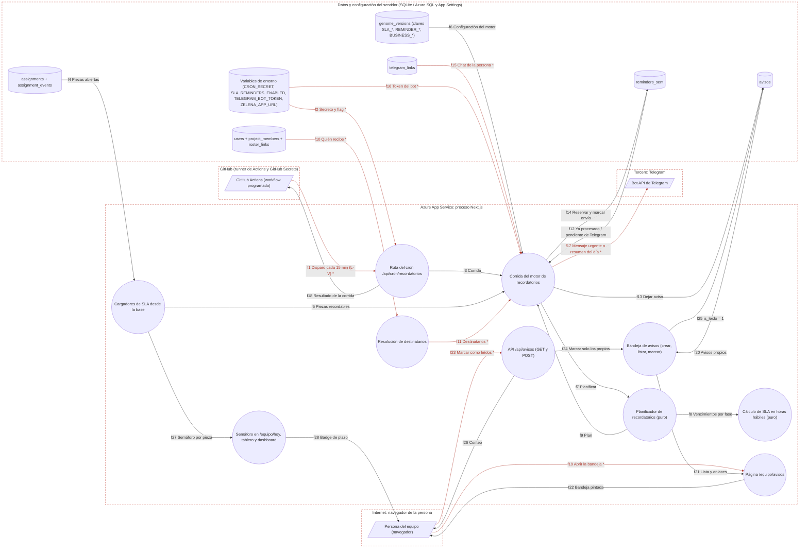

# Ficha: SLA, recordatorios y avisos

Dueño: QA (por asignar) · Revisor: John · Fecha: 2026-10-21 · Commit de referencia: 0e07d8f · Revisada contra wp/32-release (`4032c7c`) el 2026-10-24: §7 y §8 (lo marcado «en `4032c7c`» cita líneas de ese commit)

## 1. Resumen

Mide cuándo vence cada entrega del tablero en **horas hábiles** (L-V 08:00–18:00, `America/Bogota`, sin festivos) y avisa a quien tiene que actuar. Tiene tres partes:

- **SLA y semáforo** (`sla.ts`, puro; `sla-db.ts`, cargadores). Por estado y prioridad calcula la fase que corre (primera respuesta, entrega, revisión o bloqueo), su vencimiento y el estado `A tiempo · Por vencer · Vencida · Sin plazo`. Lo pintan `/equipo/hoy`, el tablero de cada proyecto, `/equipo/proyectos` y el dashboard (`SlaBadge`). Lo usa también la gamificación para el bono de puntualidad (`aprobadaATiempo`).
- **Motor de recordatorios** (`recordatorios.ts`, puro; `recordatorios-db.ts`, corrida). Un workflow de GitHub Actions llama a `POST /api/cron/recordatorios` cada 15 minutos de lunes a viernes. La corrida decide qué recordar (9 tipos: `p1_asignada`, `p1_sin_respuesta`, `vence_pronto`, `vence_hoy`, `vencida`, `revision_pendiente`, `bloqueo`, `escala_supervisor`, `escala_founder`), a quién (dueño, quien estructura o revisa el proyecto, supervisores, founder), deja el aviso en la bandeja y, si la persona vinculó Telegram, se lo manda: lo urgente (P1) al momento y agrupado; lo demás en un resumen diario desde las 08:00.
- **Bandeja de avisos** (`avisos.ts`, `/equipo/avisos`, `/api/avisos`). Cada persona ve los avisos de todas sus identidades y los marca como leídos. No existe "cuándo leyó".

Quién lo usa: todo el que entra a `/equipo` (equipo interno y quien trabaja por proyecto). El founder y los supervisores reciben además los escalamientos. Lo gobierna la flag `SLA_REMINDERS_ENABLED`: apagada, el motor no escribe ni envía nada y la bandeja dice que los recordatorios están en pausa. Los plazos (genoma `SLA_*`, `REMINDER_*`, `ESCALATE_*`, `BUSINESS_*`) se versionan en el genoma, no en código.

Casos de uso: ver si una entrega va a tiempo; recibir lo urgente al momento; recibir un resumen diario; enterarse como supervisor de lo que se trabó; probar el motor sin efectos (`?simular=1`) antes de encender la flag.

## 2. Diagrama (DFD)

Archivo: [`docs/dfd/sla-recordatorios-y-avisos.tm7`](../dfd/sla-recordatorios-y-avisos.tm7), más la imagen exportada [`docs/dfd/sla-recordatorios-y-avisos.svg`](../dfd/sla-recordatorios-y-avisos.svg). Los dos se generan desde la fuente [`docs/dfd/sla-recordatorios-y-avisos.json`](../dfd/sla-recordatorios-y-avisos.json) con `python docs/dfd/generar_tm7.py docs/dfd/sla-recordatorios-y-avisos.json --estricto`, que pasa: cada `codigo` existe en el repo. La fuente tiene 20 elementos (3 actores, 10 procesos, 7 almacenes), 28 flujos (9 sensibles) y 5 fronteras de confianza.

Vista para GitHub (salida de `--mermaid`): `[/ /]` actor, `(( ))` proceso, `[( )]` almacén, cada `subgraph` es una frontera de confianza y los flujos con `*` y en rojo llevan datos sensibles.

Lectura: de izquierda a derecha, GitHub dispara la ruta del cron, que solo hace de puerta; la corrida carga las piezas abiertas, le pide al planificador puro qué recordar (que a su vez usa las horas hábiles de `sla.ts`), resuelve las personas, deja los avisos y, fuera de toda transacción, habla con Telegram. Abajo, la persona lee y marca su bandeja; el semáforo de los tableros sale de los mismos cargadores de SLA.

## 3. Recorrido de una acción

Acción elegida: **el lunes a las 09:30 el cron avisa a la dueña de una entrega P1 que le asignaron a las 09:00; ella la ve en `/equipo/avisos` y la marca como leída.** (Es exactamente el caso que recorre la prueba de la sección 8).

1. **Pantalla o componente:** no hay pantalla que dispare la corrida. La dispara `.github/workflows/recordatorios.yml`, job `disparar`, con `cron: "*/15 12-23 * * 1-5"` (UTC = 07:00–18:59 en Bogotá). La persona después abre `/equipo/avisos` (`app/equipo/avisos/page.tsx#EquipoAvisosPage`), que pinta `src/components/AvisosLista.tsx#AvisosLista` con el botón «Marcar como leídos» y un enlace «Ver la entrega» por aviso. En su tarjeta de `/equipo/hoy` la misma pieza muestra `SlaBadge`: «A tiempo · vence hoy 11:00».
2. **Llamada al backend:** el workflow hace `curl -X POST "$APP_URL/api/cron/recordatorios" -H "x-cron-secret: $CRON_SECRET"` (`APP_URL` = `vars.ZELENA_APP_URL` o `https://www.zelena.tech`; secreto en GitHub Secrets; timeout 60 s; falla el job si el HTTP no es 200). Desde la bandeja, `AvisosLista` hace `fetch("/api/avisos", { method: "POST", body: { ids: [<no leídos>] } })` con la cookie `zelena_session`.
3. **Ruta y controlador:** `app/api/cron/recordatorios/route.ts#POST`: límite de 20 por minuto por IP (`rateLimit`), `autorizarCron(cabecera, cronSecret())` en tiempo constante, `?simular=1` opcional y `correrRecordatorios(getDb(), { simular, appUrl: appBaseUrl() })`. Para la bandeja, `app/api/avisos/route.ts#POST`: `getSession` (401 si no hay), límite de 30 por minuto por wallet+IP, `personaActiva` (fila `users` activa, 403 si no), zod `{ ids?: number[] ≤ 500 }` y `marcarLeidos`.
4. **Lógica de negocio:** en `src/lib/recordatorios-db.ts#correrRecordatorios`:
   - candado en memoria (`globalThis.__zelenaRecordatorios`, 5 min); flag `SLA_REMINDERS_ENABLED`; `esHorarioHabil(ahora)`;
   - guarda de arranque `activadoDesde = MIN(reminders_sent.created_at) ?? ahora`: lo vencido antes de esa fecha no escala y su `vencida` va al resumen;
   - `planificarRecordatorios` (puro, `src/lib/recordatorios.ts`): la P1 está `Asignada`, sin primera respuesta → `p1_asignada` (inmediato; «Primera respuesta antes de 11:00» = inicio 09:00 + `SLA_P1_RESPONSE_H` 2 h hábiles); su entrega vence hoy a las 17:00 (09:00 + `SLA_P1_RESTORE_H` 8 h) → `vence_hoy` (inmediato porque es P1). `p1_sin_respuesta` aún no (lleva 0,5 h < `REMINDER_P1_NO_RESPONSE_H` 1 h). Low no genera nada; Backlog tampoco;
   - `resolverDestinatarios`: el destino `persona` es la dueña si está activa, no es demo ni un `pending:` sin vincular; los escalamientos nunca van al dueño ni a sus identidades y solo a quien puede ver la pieza (`piezasVisiblesPara`);
   - tope `REMINDER_MAX_INMEDIATOS` (3) por persona y corrida; lo no urgente solo se procesa desde `REMINDER_DIGEST_HOUR` (08:00);
   - por cada (clave, persona) nueva, en una transacción síncrona: `crearAviso` + `INSERT reminders_sent (is_telegram = 0)`; un choque con el UNIQUE cuenta como "ya procesado";
   - Telegram fuera de transacción: los inmediatos de hoy de la persona van en **un** mensaje («Lo urgente de ahora: · … · … Ver en Zelena: …/equipo/avisos»), sin `parse_mode`, cortado a 4000 caracteres; al confirmarse, `is_telegram = 1`. El resumen diario sale una vez por persona y día (clave `digest:<día>`).
   - Semáforo (`src/lib/sla.ts#evaluarSla`): pieza `Asignada` sin respuesta → la más próxima entre respuesta (11:00) y entrega (17:00) → fase `respuesta`; quedan 1,5 h hábiles de una ventana de 2 h; umbral = min(25 % × 2 h, 10 h) = 0,5 h → `a_tiempo`. A las 10:45 pasa a `por_vencer`.
   - Bandeja: `marcarLeidos` solo toca filas cuya `wallet` está en `identidadesDe(sesión)`; los ids ajenos se ignoran en silencio.
5. **Base de datos:** lee `assignments`, `assignment_events`, `initiatives`, `genome_versions`, `users`, `project_members`, `roster_links`, `telegram_links` y `reminders_sent`; escribe `avisos` (INSERT) y `reminders_sent` (INSERT y `UPDATE is_telegram = 1`). La bandeja lee `avisos` (todas las identidades, máx. 100 en la página y 50 en la API) y escribe `UPDATE avisos SET is_leido = 1`.
6. **Respuesta y qué hace la pantalla con ella:** el cron responde `200` con **solo conteos**: `{ enabled: true, simulado: false, evaluadas: 1, avisosCreados: 2, inmediatosEnviados: 1, digestEnviados: 0, errores: 0, porTipo: { p1_asignada: 1, vence_hoy: 1 }, destinatarios: 1 }`; el workflow imprime `HTTP 200` y termina. La bandeja responde `{ ok: true, marcados: 1, noLeidos: 1 }` y `AvisosLista` hace `router.refresh()`: el aviso pierde la etiqueta «nuevo» y se ve atenuado.
7. **Casos de falla:**
   - cron: `429` por límite; `503 { error: "sin_configurar" }` si falta `CRON_SECRET` o tiene menos de 32 caracteres; `401` sin cabecera o con otra; `200 { omitido: "flag_apagada" | "fuera_de_horario" | "en_curso" }`; `500 "No se pudo completar la corrida."` sin detalle (el job falla). Si Telegram falla, `errores++`: el aviso ya quedó en la bandeja y la fila sigue en `is_telegram = 0` para la corrida siguiente (un inmediato de un día anterior ya no sale por Telegram).
   - bandeja: `401` sin sesión, `403` si la cuenta no está activa, `400` si los ids no son enteros positivos, `429` por límite; en el navegador, «Error de red.» o el texto de error de la API.

## 4. Elementos del DFD en el código

| Elemento | Tipo | Archivo y función | Notas |
| --- | --- | --- | --- |
| Persona del equipo (navegador) | Cliente externo | `apps/web/src/components/AvisosLista.tsx#AvisosLista` | Componente de cliente de la bandeja; también ve `SlaBadge` en sus tableros. |
| GitHub Actions (workflow programado) | Cliente externo | `.github/workflows/recordatorios.yml#disparar` | `permissions: {}`, `concurrency: recordatorios`, solo corre en `zelena-tech/zelena-dapp`. GitHub solo dispara `schedule` desde la rama por defecto. |
| Bot API de Telegram | Cliente externo | `apps/web/src/lib/telegram.ts#createTelegramTransport` | Único punto que abre conexión con Telegram; el token va en la URL. |
| Ruta del cron | Proceso | `apps/web/app/api/cron/recordatorios/route.ts#POST` | Solo puerta: límite, secreto, `simular`; `maxDuration = 60`. |
| Corrida del motor | Proceso | `apps/web/src/lib/recordatorios-db.ts#correrRecordatorios` | Candado, flag, horario, guarda de arranque, reserva y envío. |
| Planificador | Proceso | `apps/web/src/lib/recordatorios.ts#planificarRecordatorios` | Puro y determinista; textos, claves y destinos abstractos. También `renderInmediatos` y `renderDigest`. |
| Resolución de destinatarios | Proceso | `apps/web/src/lib/recordatorios-db.ts#resolverDestinatarios` | La corrida usa la variante interna `resolver` con caché por corrida. |
| Cálculo de SLA | Proceso | `apps/web/src/lib/sla.ts#evaluarSla` | Más `sumarHorasHabiles`, `horasHabilesEntre`, `venceEntrega`, `aprobadaATiempo`, `formatoVence`. Apto para cliente. |
| Cargadores de SLA | Proceso | `apps/web/src/lib/sla-db.ts#slaDeAsignaciones` | Y `cargarPiezasAbiertas`, `cargarPiezaSla`, `slaConfig`. Consultas por tandas de 400 (límite de SQL Server). |
| Semáforo en tableros | Proceso | `apps/web/src/components/SlaBadge.tsx#SlaBadge` | Texto de `src/lib/semaforo.ts#semaforo`; lo usan `app/equipo/hoy/page.tsx`, `app/equipo/proyectos/page.tsx`, `app/equipo/proyectos/[slug]/page.tsx` y `app/equipo/dashboard/page.tsx`. |
| Página /equipo/avisos | Proceso | `apps/web/app/equipo/avisos/page.tsx#EquipoAvisosPage` | Puerta propia `equipoActor`; aviso de pausa si la flag está apagada. |
| API /api/avisos | Proceso | `apps/web/app/api/avisos/route.ts#POST` | El `GET` existe pero ninguna pantalla lo llama (ver hallazgos). |
| Bandeja de avisos | Proceso | `apps/web/src/lib/avisos.ts#marcarLeidos` | Y `crearAviso`, `avisosDe`, `contarNoLeidos`, `enlacesDeAvisos`. |
| assignments + assignment_events | Almacén | `apps/web/src/lib/schema.sql#assignments` | `assignment_events` es append-only; da el inicio del reloj y los momentos de entrega/aprobación. |
| genome_versions | Almacén | `apps/web/src/lib/genome.ts#getActiveGenome` | Mezcla lo guardado con `GENOME_DEFAULTS`. |
| users + project_members + roster_links | Almacén | `apps/web/src/lib/schema.sql#project_members` | Roles `estructura` y `revisa` para la supervisión por proyecto. |
| avisos | Almacén | `apps/web/src/lib/schema.sql#avisos` | `UNIQUE (wallet, clave)`; solo cambia `is_leido`. |
| reminders_sent | Almacén | `apps/web/src/lib/schema.sql#reminders_sent` | `UNIQUE (clave, wallet)`; solo cambia `is_telegram` 0 → 1. |
| telegram_links | Almacén | `apps/web/src/lib/schema.sql#telegram_links` | Lo escribe la feature Telegram; aquí solo se lee el chat. |
| Variables de entorno | Almacén | `apps/web/src/lib/config.ts#cronSecret` | Y `isSlaRemindersEnabled`, `telegramBotToken`, `appBaseUrl`. Se leen en cada llamada. |

## 5. Flujos de datos

Los marcados **(S)** llevan datos sensibles (credencial, sesión o dato personal).

| Flujo | De → a | Protocolo | Datos que viajan |
| --- | --- | --- | --- |
| f1 **(S)** | GitHub Actions → Ruta del cron | HTTPS | `POST /api/cron/recordatorios`, cabecera `x-cron-secret` (credencial), `?simular=1` opcional |
| f2 **(S)** | Variables de entorno → Ruta del cron | process.env | `CRON_SECRET` (≥ 32), `SLA_REMINDERS_ENABLED` |
| f3 | Ruta del cron → Corrida | llamada en proceso | `{ simular, appUrl }` |
| f4 | assignments → Cargadores de SLA | SQL | piezas con `status <> 'Hecha'` y sus eventos |
| f5 | Cargadores → Corrida | llamada en proceso | `PiezaRecordable[]` (título, dueño, proyecto, motivo de bloqueo) |
| f6 | genome_versions → Corrida | SQL | `BUSINESS_*`, `SLA_*`, `REMINDER_*`, `ESCALATE_*` |
| f7 | Corrida → Planificador | llamada en proceso | piezas, configuración con `activadoDesde`, `ahora` |
| f8 | Planificador → Cálculo de SLA | llamada en proceso | vencimientos por fase en horas hábiles |
| f9 | Planificador → Corrida | llamada en proceso | `Recordatorio[]`: tipo, clave, destino abstracto, inmediato, texto, enlace |
| f10 **(S)** | users/project_members/roster_links → Destinatarios | SQL | estado, rol, supervisión, membresías, vínculos (datos de personas) |
| f11 **(S)** | Destinatarios → Corrida | llamada en proceso | wallets canónicas deduplicadas por identidad |
| f12 | reminders_sent → Corrida | SQL | `(clave, wallet)`, `dia`, `is_inmediato`, `is_telegram`, `MIN(created_at)` |
| f13 | Corrida → avisos | SQL | `INSERT` (wallet, clave, tipo, assignment_id, texto) |
| f14 | Corrida → reminders_sent | SQL | `INSERT`; `UPDATE is_telegram = 1`; `INSERT digest:<día>` |
| f15 **(S)** | telegram_links → Corrida | SQL | `telegram_user_id` (dato personal) |
| f16 **(S)** | Variables de entorno → Corrida | process.env | `TELEGRAM_BOT_TOKEN` (credencial), `ZELENA_APP_URL` |
| f17 **(S)** | Corrida → Bot API de Telegram | HTTPS | token en la URL, `chat_id`, texto con títulos de entregas y nombre del proyecto |
| f18 | Ruta del cron → GitHub Actions | HTTPS | `ResultadoCorrida`: solo conteos |
| f19 **(S)** | Persona → Página /equipo/avisos | HTTPS | `GET` con cookie `zelena_session` |
| f20 | avisos → Bandeja | SQL | avisos de todas las identidades de la persona |
| f21 | Bandeja → Página | llamada en proceso | `AvisoRow[]` + enlace al tablero del proyecto |
| f22 | Página → Persona | HTTPS | HTML con textos de avisos |
| f23 **(S)** | Persona → API /api/avisos | HTTPS | `POST { ids? }` con cookie `zelena_session` |
| f24 | API → Bandeja | llamada en proceso | wallet de la sesión (leída de `users`), ids |
| f25 | Bandeja → avisos | SQL | `UPDATE is_leido = 1` solo en filas propias |
| f26 | API → Persona | HTTPS | `{ ok, marcados, noLeidos }` |
| f27 | Cargadores → Semáforo | llamada en proceso | `Map<id, SlaResultado>` |
| f28 | Semáforo → Persona | HTTPS | «A tiempo · vence jue 14:00», «Por vencer · quedan 3 h hábiles», «Vencida · desde ayer 18:00» |

## 6. Dependencias con otras features

- **Login y sesión**: `getSession` (cookie `zelena_session`) en `/api/avisos`; `equipoActor` (`src/lib/authz.ts`) como puerta de `/equipo/avisos`.
- **Tablero y asignaciones (equipo / talento por proyecto)**: los eventos que mueve `applyAssignmentAction` (`src/lib/team.ts`) son el reloj del SLA; `piezasVisiblesPara`, `project_members` y `identidadesDe`/`principalFounder` (`src/lib/identidades.ts`) deciden destinatarios.
- **Genoma**: todos los números salen de `getActiveGenome`.
- **Telegram**: usa `telegram_links` (la vinculación es de esa feature), `createTelegramTransport`, `sendMessage` y `constantTimeEquals` de `src/lib/telegram.ts`. Sin `TELEGRAM_BOT_TOKEN`, solo bandeja.
- **Gamificación**: `aprobadaATiempo` (bono de puntualidad al aprobar) en `src/lib/team.ts:785` y `src/lib/gamificacion.ts:303`.
- **Dashboard**: `plazosDelEquipo` (`src/lib/dashboard.ts:176`) usa `slaDeAsignaciones`.
- **Menú**: el enlace «Avisos» (`src/lib/menu.ts`, `AVISOS_EN_MENU`).
- **Despliegue**: el workflow tiene que estar en la rama por defecto y la App necesita `CRON_SECRET`, `SLA_REMINDERS_ENABLED`, `ZELENA_APP_URL` en App Settings.

## 7. Amenazas relevantes

| Amenaza | Categoría | Elemento | Estado | Justificación |
| --- | --- | --- | --- | --- |
| Alguien de Internet llama al cron para generar avisos o mensajes | Suplantación | Ruta del cron (f1) | Mitigada | Sin secreto configurado responde 503 y con cabecera distinta 401 (`app/api/cron/recordatorios/route.ts:32-38`); comparación en tiempo constante, también sin cabecera (`src/lib/recordatorios-db.ts:94-103`); secreto de 32+ caracteres (`src/lib/config.ts:260-263`). |
| Reenvío (replay) de una petición válida del cron | Manipulación | Corrida (f1, f13, f14) | Mitigada | La corrida es idempotente por `(clave, wallet)`: se consulta antes y dentro de la transacción y el UNIQUE cuenta como "ya procesado" (`src/lib/recordatorios-db.ts:487-556`). Probado en la sección 8 (segunda corrida: 0 avisos, 0 mensajes). |
| La respuesta del cron expone wallets, nombres o textos | Divulgación de información | Ruta del cron (f18) | Mitigada | Responde solo `ResultadoCorrida` con conteos (`src/lib/recordatorios-db.ts:50-63`); el error 500 no lleva detalle (`route.ts:44-46`). La prueba comprueba que la respuesta no contiene la wallet ni el título. |
| Dos corridas a la vez duplican mensajes | Denegación de servicio | Corrida | Aceptada | Candado en memoria de 5 min (`src/lib/recordatorios-db.ts:450-463`) y `concurrency: recordatorios` en el workflow (`recordatorios.yml:7-9`). El candado no sirve con varias instancias; se acepta porque producción es una sola instancia (`recordatorios-db.ts:20-21`). Si se escala, se pierde esta garantía (la idempotencia por fila sigue). |
| El límite de tasa se evade cambiando `X-Forwarded-For` | Denegación de servicio | Ruta del cron, API /api/avisos | Mitigada | Desde `05a2f4e` y `642e412`: `clientIp` ya no toma el primer valor de `X-Forwarded-For` (lo manda el cliente) sino el último, que agrega el frontal de App Service, y solo cree `X-Azure-ClientIP` si `X-Azure-FDID` es el de nuestro Front Door (`apps/web/src/lib/rate-limit.ts:46-62` y `78-93` en `4032c7c`); el mapa se poda de cubetas vencidas (10-19). Tests: `rate-limit.test.ts`. Con eso ya no crece sin tope. Queda que el `Map` es por proceso; en el cron el secreto se valida igual. |
| Un escalamiento de un proyecto de cliente llega a quien no participa | Divulgación de información | Destinatarios (f10, f11) | Mitigada | Se descarta a quien no podría ver la pieza (`src/lib/recordatorios-db.ts:259-269` y `:320`); destinatario válido = activo, no demo, no `pending:` (`:242-247`); el dueño nunca recibe su escalamiento (`:317`). |
| Títulos y nombres de proyecto (que pueden ser de cliente) salen a Telegram | Divulgación de información | Corrida → Telegram (f17) | Aceptada | La vinculación es voluntaria por persona y el texto habla de la entrega, nunca de la persona (`src/lib/recordatorios.ts:8-11`, `VOCABULARIO_PROHIBIDO` en `:108-121`). Queda abierta la pregunta de nombrar a Telegram como encargado en `/privacidad` (sección 9). |
| Un título con formato rompe o falsea el mensaje de Telegram | Manipulación | Corrida → Telegram (f17) | Mitigada | `sendMessage` no manda `parse_mode` (`src/lib/telegram.ts:268`); títulos recortados a 140 y en una línea (`recordatorios.ts:169-172`); mensaje cortado a 4000 caracteres para que Telegram no lo rechace en bucle (`recordatorios.ts:413-459`). |
| Leer o marcar avisos de otra persona | Elevación de privilegios | API /api/avisos (f23-f25) | Mitigada | `marcarLeidos` filtra por `identidadesDe(sesión)` (`src/lib/avisos.ts:100-118`); la persona se lee de `users`, no de los claims (`app/api/avisos/route.ts:25-29`). Probado: otra persona marca 0. |
| Robo de la cookie de sesión para leer la bandeja | Suplantación | Persona → Página / API (f19, f23) | Aceptada | Depende de la feature de login: cookie `httpOnly`, `sameSite: "lax"`, `secure` en producción (`src/lib/session.ts:19-25`). Ver ficha de login y sesión. |
| Avalancha de avisos al encender el motor sobre backlog viejo | Denegación de servicio | Planificador | Pendiente | Existe la guarda de arranque (`src/lib/recordatorios.ts:205-208`), pero mientras `reminders_sent` está vacía `activadoDesde` es "ahora" en cada corrida (`recordatorios-db.ts:157-164`, `:478`): lo que vence en ese intervalo nunca escala. Fijado en la prueba como HALLAZGO. |
| Corridas fallidas sin rastro | Repudio | Ruta del cron | Pendiente | El `catch` de la ruta descarta el error sin registrarlo (`route.ts:44-46`) y la corrida no deja log propio; solo queda el `HTTP <código>` en GitHub. |
| El token del bot aparece en un log de error | Divulgación de información | Variables de entorno (f16) | Mitigada | El mensaje de `TelegramError` no incluye la URL (`src/lib/telegram.ts:249-251`) y los fallos de envío solo suman `errores` (`recordatorios-db.ts:585-587`). |
| El secreto del cron se filtra desde GitHub | Divulgación de información | GitHub Actions (f1) | Mitigada | Viene de `secrets.CRON_SECRET`, el job no tiene permisos (`permissions: {}`) y solo imprime el código HTTP (`.github/workflows/recordatorios.yml:6`, `:18-25`). |

## 8. Prueba de caracterización

Archivo: `apps/web/src/lib/caracterizacion/sla-recordatorios-y-avisos.test.ts` (12 casos, pasan contra `4032c7c`, wp/32-release, sin cambios: ninguna corrección de la release toca este flujo ni sus dos hallazgos; las IP de prueba van en un `X-Forwarded-For` de un solo valor, que la regla nueva de `clientIp` sigue tomando). Se corre con `cd apps/web && npx vitest run src/lib/caracterizacion/sla-recordatorios-y-avisos.test.ts`.

Qué cubre, por las rutas reales y contra una base SQLite en memoria con `schema.sql` + `seedTeam` (inyectada en `globalThis.__zelenaDb`):

- puerta del cron: 503 `sin_configurar`, 401, flag apagada, fuera de horario (sábado) y `?simular=1` (cuenta sin escribir);
- **flujo principal**: lunes 09:30, P1 asignada a las 09:00 → la ruta crea los avisos `p1_asignada` y `vence_hoy` con su texto exacto, dos filas en `reminders_sent` con `is_telegram = 1`, **un** `sendMessage` al chat vinculado con el texto agrupado, y responde solo conteos;
- idempotencia (segunda corrida no hace nada) y reintento cuando Telegram falla;
- bandeja: `GET /api/avisos` (orden y campos), `POST` propio (marca 1), ajeno (marca 0), todos, y entrada inválida (400);
- semáforo de la misma pieza: fase `respuesta`, `A tiempo · vence hoy 11:00`, quedan 1,5 h; a las 10:45 `por_vencer`;
- dos HALLAZGOS fijados: P1 sin dueño en Backlog («Vencida» sin recordatorio) y la guarda de arranque que se mueve.

Dobles: reloj (`vi.useFakeTimers({ toFake: ["Date"] })`), sesión (`@/lib/session`) y `fetch` (borde con Telegram). Las reglas finas de cada tipo de recordatorio ya las cubren `recordatorios.test.ts` (38), `recordatorios-db.test.ts` (47), `sla.test.ts` (37) y `avisos.test.ts` (8).

## 9. Preguntas abiertas

- ¿`.github/workflows/recordatorios.yml` está en la rama por defecto del repo? GitHub solo dispara `schedule` desde ella. En las referencias locales la rama por defecto es `develop` y no lo tiene (solo `ci.yml`), y `src/lib/menu.ts` dice que el repo no tiene `main`; la spec WP31 §4.C.6 pide `main`. **Confirmado con la API de GitHub el 2026-10-21:** la rama por defecto es `develop`, su `.github/workflows` solo trae `ci.yml` y Actions no tiene registrado ningún workflow de recordatorios, así que el cron no corre en producción.
- ¿Qué valor tiene hoy `SLA_REMINDERS_ENABLED` en producción, y se corrió la simulación antes de encenderlo, como pide la spec?
- Una P1 sin responsable en Backlog sale «Vencida» en el semáforo pero no genera ningún aviso. ¿Debe avisar a supervisión?
- ¿La guarda de arranque debe fijarse al encender la flag (un dato) en vez de a la primera fila escrita?
- ¿`/privacidad` debe nombrar a Telegram como destino de los títulos de entregas y nombres de proyecto?
- El workflow corre de 07:00 a 18:59 en Bogotá, pero el horario hábil es 08:00–18:00: 8 de las 48 corridas diarias responden `fuera_de_horario`. ¿Se ajusta el cron o el horario?
- ¿Para qué es el `GET /api/avisos` y `contarNoLeidos` si ninguna pantalla los usa (no hay contador de no leídos en el menú)?
