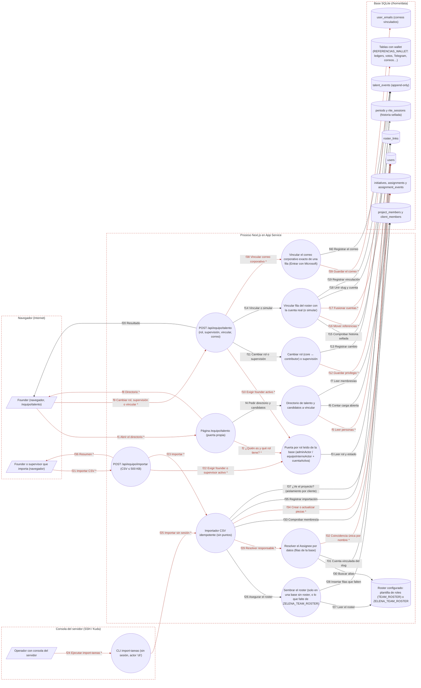

# Ficha: Talento e importador

Dueño: QA (por asignar) · Revisor: John · Fecha: 2026-10-21 · Commit de referencia: 0e07d8f · Revisada contra wp/32-release (`4032c7c`) el 2026-10-24: DFD, §3, §4, §5, §7, §8 y §9 (lo marcado «en `4032c7c`» cita líneas de ese commit)

## 1. Resumen

Qué hace: es la parte de la herramienta interna donde **las personas y sus roles son datos de la base**, no código. Tiene tres piezas:

- **Directorio `/equipo/talento`**: lista a todas las personas del registro (sin cuentas demo), por orden alfabético, con su rol (founder, core, contributor), si supervisa, si firmó el acuerdo de contribución, su vínculo (interno, externo o mixto, derivado de sus proyectos), sus proyectos con su rol en cada uno y su **carga abierta** (piezas no terminadas; sirve para repartir, nunca para evaluar).
- **Cambios de talento (solo founder)**: pasar a alguien de `core` a `contributor` o al revés, dar o quitar supervisión, vincular el **correo corporativo exacto** de una fila para que entre con Microsoft (desde `74e9321`) y **vincular** una fila del roster (`pending:<slug>`, la persona del equipo antes de tener cuenta) con la cuenta real con la que entró. Vincular mueve su trabajo, sus puntos y su historial a esa cuenta (`vincularPrincipal`), sin reescribir lo ya sellado en una época cerrada o en un rito cerrado.
- **Importador CSV** (founder o supervisor desde la web, o cualquiera con la consola del servidor con `packages/scripts/import-tareas.mjs`): carga el backlog con columnas Iniciativa, Title/Task Name, Assignee, Status, Priority, Size, Due… Es idempotente (`import_key`), resuelve cada Assignee por datos (alias del roster → cuenta vinculada o `pending:<slug>`; si no, nombre único) y **no emite puntos ni reputación**.

Quién lo usa: el founder (todo), los supervisores (ven el directorio e importan) y, por consola, quien opera el servidor. Un `contributor` o una persona `core` sin supervisión ve un aviso y un enlace a su día.

Casos de uso: repartir trabajo viendo la carga; dar acceso a un externo (rol contributor + membresía); nombrar o quitar supervisores; unir la fila del roster con la wallet de la persona cuando entra por primera vez; subir el backlog real sin versionarlo en el repo (el repo es público).

## 2. Diagrama (DFD)

Archivo: [`docs/dfd/talento-e-importador.tm7`](../dfd/talento-e-importador.tm7), más la imagen exportada [`docs/dfd/talento-e-importador.svg`](../dfd/talento-e-importador.svg). Los dos se generan desde la fuente [`docs/dfd/talento-e-importador.json`](../dfd/talento-e-importador.json) con `python docs/dfd/generar_tm7.py docs/dfd/talento-e-importador.json --estricto`, que pasa: cada `codigo` existe en el repo. La fuente tiene 24 elementos (3 actores, 12 procesos, 9 almacenes), 40 flujos (20 sensibles) y 4 fronteras de confianza. Revisada contra `4032c7c`: el roster del código pasa a ser una plantilla de roles (`b97448a`), el importador mira si quien importa ve el proyecto (`5e80c34`, flujo f37) y la ruta de talento vincula correos corporativos (`74e9321`: proceso `correo`, almacén `user_emails` y flujos f38-f40).

Leyenda: los flujos con `*` y en rojo llevan datos sensibles (sesión, credenciales, privilegios, datos personales o puntos); cada `subgraph` es una frontera de confianza.

Lectura: el founder entra al directorio y desde ahí cambia roles o vincula; quien importa sube el CSV por la web; el operador puede hacer lo mismo por consola **sin pasar por ninguna puerta**. Las tres entradas llegan a la misma lógica (`importTasks`, `vincularPrincipal`, `cambiarRol`), y el roster en código (`TEAM_ROSTER`) sigue alimentando la siembra y la resolución de nombres.

## 3. Recorrido de una acción

Acción elegida: **el founder importa un CSV de backlog desde `/equipo/talento#importar`** (y, como acción complementaria, vincula después la fila del roster de la persona con su cuenta real).

1. Pantalla o componente: `app/equipo/talento/page.tsx` (`EquipoTalentoPage`) pinta la sección «Importar CSV» con `src/components/TeamImportCsv.tsx` (`TeamImportCsv`). La persona pega el texto o sube el archivo (`leerArchivo` lo lee con `File.text()` y rechaza más de 500 KB) y pulsa importar (`importar`).
2. Llamada al backend (endpoint y datos enviados): `POST /api/equipo/importar` con `Content-Type: application/json` y cuerpo `{ "csv": "<texto del CSV>" }`; viaja la cookie `zelena_session` (JWT firmado, httpOnly).
3. Ruta y controlador: `app/api/equipo/importar/route.ts` → `POST` (líneas 30-74): `getSession` (401 si no hay), `equipoInternoActor` + `cuentaActiva` + `puedeVerTodoElEquipo` (403 si no es founder o supervisor activo, líneas 35-43), `rateLimit` 10 por minuto por wallet e IP (429, línea 44), tope de 500 KB por `content-length` y por bytes reales (413, líneas 49 y 59), `importarSchema` (400) e `importTasks(db, csv, actor.wallet, new Date(), actor)`: desde `5e80c34` la ruta pasa el actor (línea 65 en `4032c7c`).
4. Lógica de negocio (validaciones, permisos, cálculos): `src/lib/team-import.ts` → `importTasks` (462-647). `parseCsv` aguanta BOM, comillas y CRLF; la cabecera se normaliza a nombres canónicos y exige `Task Name` e `Iniciativa` (si falta, `Error` → 400). `seedTeamRoster` asegura las filas `pending:<slug>` (483); desde `b97448a` solo siembra la plantilla de roles en una base sin roster, o lo que falte de `ZELENA_TEAM_ROSTER` (`team.ts:225-268` en `4032c7c`). Todo va en UNA transacción (497-645). Por fila, primero (desde `5e80c34`) `puedeImportarEn`: si quien importa no es founder y no ve el proyecto con ese nombre o el proyecto donde ya está la pieza (`puedeVerProyecto`, aislamiento por cliente), la fila sale como error «no puedes importar en el proyecto «…»» sin tocar nada ni contar creada o actualizada (`team-import.ts:530-534` y `670-676` en `4032c7c`). Después, `mapRow` valida el vocabulario (estado, prioridad, horizonte, tamaño, fecha) sin adivinar; sin responsable todo entra como Backlog; con responsable solo nace `Asignada` (o `Hecha` como historia), nunca En curso, En revisión ni Bloqueada (313-319). `resolver` busca el Assignee: desde `b97448a`, `slugDelEquipo` (alias del roster configurado o slug, solo si ese slug tiene fila `pending:` o `roster_links` en la base) → `walletDeRoster` (cuenta vinculada o `pending:<slug>`); si no, nombre visible único entre activos no demo; si no, la wallet exacta; si no, error de fila (`team-import.ts:348-375` y `talento.ts:176-186` en `4032c7c`). Un contributor sin supervisión solo recibe trabajo en proyectos donde es miembro (`faltaMembresia`, 388-404 y 531-545). Si la pieza ya existe (`import_key`), el tablero manda: no se toca una Hecha ni una en revisión, el responsable solo cambia en Backlog, no se mueve de proyecto, y cada cambio deja su evento con los nombres de los campos (576-630). Nunca escribe en `points_ledger` ni en `reputation_events`.
5. Base de datos (tablas o modelos leídos y escritos): lee `users`, `roster_links`, `project_members`, `initiatives`, `assignments`, `genome_versions` (zona horaria). Escribe `users` (filas `pending:` que falten), `initiatives` (upsert), `assignments` (INSERT o UPDATE), `assignment_events` (`crear`, `asignar`, `reasignar`, `editar`, con `day` en la zona del genoma y `created_at` explícito) y una fila `importar` en `talent_events` con los conteos.
6. Respuesta y qué hace la pantalla con ella: `200 { ok, created, updated, initiatives, errors: [{line, title, reason}], warnings: [{line, title, warning}] }`. `TeamImportCsv` muestra el resumen (creadas, ya existentes, errores y avisos por línea) y llama a `router.refresh()`.
7. Casos de falla: 401 sin sesión; 403 si no es founder o supervisor activo; 429 por ráfaga; 413 por tamaño; 400 si el cuerpo no trae CSV, si el CSV está vacío o falta una columna obligatoria (la ruta reconoce estos errores por el **texto** del mensaje, línea 69); errores de fila (vocabulario desconocido, persona no encontrada o ambigua, falta de membresía, proyecto que quien importa no ve) no abortan la importación: se devuelven en `errors`; cualquier otro error → 500 «No se pudo importar el CSV.» y la transacción se revierte entera.

Acción complementaria: **el founder vincula la fila `pending:<slug>` con la cuenta real**.

1. Pantalla: en la fila de la persona (`TeamTalentRow`, solo si `vinculable`), el founder elige la cuenta entre `candidatosAVincular` y pulsa revisar: primero se **simula** (`simularVinculo`) y la confirmación nombra la cuenta completa de destino y cuántos registros se moverán.
2. Llamada: `POST /api/equipo/talento` con `{ action: "vincular", slug, wallet, simular: true }` y luego sin `simular` (y con `conservarSellado: true` si hay historia sellada y el founder lo acepta).
3. Ruta: `app/api/equipo/talento/route.ts` → `POST` (44-95): 401, `adminActor` + `cuentaActiva` (403), `rateLimit` 30/min (429), `talentoAccionSchema` (400) y `vincularPrincipal`. Desde `74e9321` la misma ruta acepta `{ action: "correo", wallet, email }` → `vincularCorreoCorporativo` (`route.ts:81-84` y `talento.ts:805-844` en `4032c7c`): solo founder, solo el dominio de `ZELENA_CORPORATE_DOMAIN`, cuenta activa y no demo, un correo por fila y sin choques, y el de una cuenta founder solo lo vincula su dueño; deja `correo_corporativo` en `talent_events` sin el correo.
4. Lógica: `src/lib/talento.ts` → `vincularPrincipal` (548-668). Solo founder; la fila de otra persona nunca va a una cuenta founder ni a una identidad del founder que vincula; la fila del founder solo a una cuenta que ya es founder; sin demos; destino activo, con acuerdo firmado y sin otra vinculación; el `pending` no puede tener firmas. Si hay historia sellada (puntos o reputación de épocas no `Open`, ritos `Closed`) → 409, salvo `conservarSellado`, que deja lo sellado en la fila del equipo convertida en alias `alumni`. En una transacción: por cada referencia de `REFERENCIAS_WALLET` descarta choques de UNIQUE (gana el destino) y mueve el resto; la cuenta toma el rol y la supervisión más altos; borra el `pending` (o lo deja como alias); inserta `roster_links` y `talent_events`. `simular: true` hace todo y revierte.
5. Base de datos: lee `users`, `roster_links`, `cla_signatures`, `periods`, `rite_sessions`; escribe las 32 columnas de `REFERENCIAS_WALLET`, `users`, `roster_links`, `talent_events`.
6. Respuesta: `{ ok, movidas, descartadas, conservadas, simulado, resumen }`; la UI muestra «Se moverán N registros (…). No se puede deshacer.» y, al confirmar, refresca: la persona aparece con su cuenta real.
7. Casos de falla: 409 «Esa fila del equipo ya está vinculada.», cuenta ya vinculada, inactiva o sin acuerdo; 409 con `historiaSellada: true` (la UI ofrece vincular sin mover lo cerrado); 400 por destino no permitido; 404 si la fila o la cuenta no existen; 500 genérico con rollback.

## 4. Elementos del DFD en el código

| Elemento | Tipo | Archivo y función | Notas |
| --- | --- | --- | --- |
| `fundador` Founder (navegador, /equipo/talento) | Cliente externo | `apps/web/src/components/TeamTalentRow.tsx` → `TeamTalentRow` | Componente de cliente: confirma con la cuenta COMPLETA de destino; primero simula (`enviar` con `simular: true`) y luego confirma. |
| `importa` Founder o supervisor que importa (navegador) | Cliente externo | `apps/web/src/components/TeamImportCsv.tsx` → `TeamImportCsv` | Componente de cliente: lee el archivo con `File.text()`, rechaza > 500 KB antes de enviar y muestra el `ImportSummary`. |
| `operador` Operador con consola del servidor | Cliente externo | `packages/scripts/import-tareas.mjs` → `process.argv` | Quien tiene la consola del servidor (o un clon local). No pasa por sesión ni por puertas: la base se abre directamente (`DATABASE_FILE`). |
| `pag_talento` Página /equipo/talento (puerta propia) | Proceso | `apps/web/app/equipo/talento/page.tsx` → `EquipoTalentoPage` | Server component (`force-dynamic`). Puerta propia en las líneas 54-60: sesión → `equipoInternoActor` → `cuentaActiva` → `puedeVerTodoElEquipo`. Solo el founder ve acciones (`rolPuedeAdministrar`, línea 64). |
| `api_talento` POST /api/equipo/talento (rol, supervisión, vincular, correo) | Proceso | `apps/web/app/api/equipo/talento/route.ts` → `POST` | Líneas 44-95. Puerta `adminActor` + `cuentaActiva` (50), límite 30/min (56), `talentoAccionSchema` (61), traduce `TeamError` a su estado (85-93). Desde `74e9321`, acción `correo` (81-84 en `4032c7c`). |
| `api_importar` POST /api/equipo/importar (CSV ≤ 500 KB) | Proceso | `apps/web/app/api/equipo/importar/route.ts` → `POST` | Líneas 30-74. Puerta `equipoInternoActor` + `cuentaActiva` + `puedeVerTodoElEquipo` (35-43), límite 10/min (44), 500 KB (49 y 59), errores de forma por texto del mensaje (69). |
| `cli_importar` CLI import-tareas (sin sesión, actor 'cli') | Proceso | `packages/scripts/import-tareas.mjs` → `openDatabase` | Adaptador propio de la base (better-sqlite3 o node:sqlite, líneas 79-122); llama a `importTasks(db, csv, null)` en el nivel superior del script (línea 174). `--dry-run` usa `mapRow` (150-171). |
| `authz` Puerta por rol leído de la base (adminActor / equipoInternoActor + cuentaActiva) | Proceso | `apps/web/src/lib/authz.ts` → `actorEstricto` | `actorEstricto` (58-73) lee `users` y NO cae a la cookie; lo usan `adminActor` (80-84) y `equipoInternoActor` (90-94). No mira `status`: por eso las rutas de talento suman `cuentaActiva` (talento.ts:101). |
| `directorio` Directorio de talento y candidatos a vincular | Proceso | `apps/web/src/lib/talento.ts` → `directorioTalento` | `directorioTalento` (188-283): sin demo, orden alfabético, sin rankings. También `candidatosAVincular` (296-318). |
| `rol_supervision` Cambiar rol (core ↔ contributor) o supervisión | Proceso | `apps/web/src/lib/talento.ts` → `cambiarRol` | `cambiarRol` (366-388) y `cambiarSupervisor` (391-408). Solo founder (`exigirFounder`, 90), nunca sobre sí ni sobre un founder (`personaEditable`, 327-336); 409 si perdería acceso a sus piezas (375-382). |
| `vincular` Vincular fila del roster con la cuenta real (o simular) | Proceso | `apps/web/src/lib/talento.ts` → `vincularPrincipal` | `vincularPrincipal` (548-668): reglas en 553-601, una transacción en 608-660, la simulación revierte lanzando `SimulacionVinculo` (659-666). |
| `correo` Vincular el correo corporativo exacto de una fila (Entrar con Microsoft) | Proceso | `apps/web/src/lib/talento.ts` → `vincularCorreoCorporativo` | Desde `74e9321` (805-844 en `4032c7c`). Es la única forma de que una cuenta de Microsoft llegue a una fila existente: la puerta de Entra ya no adivina por nombre ni por prefijo del correo. La pantalla es `CorreoCorporativoForm` en `/equipo/talento` (solo founder). |
| `importador` Importador CSV idempotente (sin puntos) | Proceso | `apps/web/src/lib/team-import.ts` → `importTasks` | `importTasks` (462-647): parser propio (`parseCsv`, 68), mapeo puro (`mapRow`, 245), una transacción para todo el archivo (497-645). Desde `5e80c34` recibe el actor y aplica `puedeImportarEn` antes de cada fila (530-534 y 670-676 en `4032c7c`). |
| `resolver` Resolver el Assignee por datos (filas de la base) | Proceso | `apps/web/src/lib/team-import.ts` → `resolver` | `resolver` (347-372): alias del roster → `walletDeRoster`; si no, coincidencia ÚNICA de `display_name`; si no, la wallet exacta. Desde `b97448a` el alias pasa por `slugDelEquipo` (`talento.ts:176-186` en `4032c7c`): solo cuenta un slug con fila o vínculo en la base. |
| `sembrar_roster` Sembrar el roster (solo en una base sin roster, o lo que falte de `ZELENA_TEAM_ROSTER`) | Proceso | `apps/web/src/lib/team.ts` → `seedTeamRoster`, `hayRosterEnLaBase` | `seedTeamRoster` (team.ts:229-248): solo inserta lo que falta y respeta `roster_links`; además fuerza `role='founder'` donde `is_founder = 1` (247). Desde `b97448a` (225-268 en `4032c7c`), sin `ZELENA_TEAM_ROSTER` no inserta nada en una base que ya tiene filas `pending:` o `roster_links`. Lo llaman `seedTeam` (arranque) e `importTasks` (team-import.ts:483). |
| `roster_codigo` Roster configurado: plantilla de roles (`TEAM_ROSTER`) o `ZELENA_TEAM_ROSTER` | Almacén de datos | `apps/web/src/lib/roles.ts` → `TEAM_ROSTER`, `rosterConfigurado`, `rosterDelEntorno` | Desde `b97448a` (roles.ts:65-176 en `4032c7c`) la constante es una PLANTILLA de roles (Founder, Operaciones, Finanzas, Producto, Plataforma, Contenido), sin personas; el roster real vive en la base o en la variable opcional `ZELENA_TEAM_ROSTER` (JSON, sin valor en `.env.example`). El founder ya no se reconoce por un slug del código sino por datos (`identidades.ts#slugsFounder`). |
| `t_users` users | Almacén de datos | `apps/web/src/lib/schema.sql` → `users` | PK `wallet`. `role`, `is_supervisor`, `status`, `cla_signed`, `invited_by`. |
| `t_roster_links` roster_links | Almacén de datos | `apps/web/src/lib/schema.sql` → `roster_links` | Una fila por slug vinculado. Evita que el arranque recree `pending:<slug>`. |
| `t_talent_events` talent_events (append-only) | Almacén de datos | `apps/web/src/lib/schema.sql` → `talent_events` | Append-only, sin FK a `users` a propósito (sobrevive a la vinculación). |
| `t_trabajo` initiatives, assignments y assignment_events | Almacén de datos | `apps/web/src/lib/schema.sql` → `initiatives`, `assignments`, `assignment_events` | `assignments.import_key` (UNIQUE) da la idempotencia del CSV. |
| `t_project_members` project_members y client_members | Almacén de datos | `apps/web/src/lib/schema.sql` → `project_members`, `client_members` | UNIQUE (initiative_id, wallet, rol_proyecto). `client_members` decide quién ve un proyecto de cliente (lo lee el importador desde `5e80c34`). |
| `t_user_emails` user_emails (correos vinculados) | Almacén de datos | `apps/web/src/lib/schema.sql` → `user_emails` | Correos vinculados a una cuenta; `is_corporate = 1` para el de Microsoft. Lo escribe la acción `correo` (desde `74e9321`). |
| `t_referencias` Tablas con wallet (REFERENCIAS_WALLET: ledgers, votos, Telegram, correos…) | Almacén de datos | `apps/web/src/lib/talento.ts` → `REFERENCIAS_WALLET` | Lista de 32 (tabla, columna) que la vinculación mueve; un test de team-talento.test.ts la contrasta con schema.sql. |
| `t_sellado` periods y rite_sessions (historia sellada) | Almacén de datos | `apps/web/src/lib/talento.ts` → `SELLADO` | `SELLADO` (talento.ts:483-489): filas de épocas no `Open` y de ritos `Closed`. Sin `conservarSellado` → 409. |

## 5. Flujos de datos

| Flujo | De → a | Protocolo | Datos que viajan |
| --- | --- | --- | --- |
| f1 Abrir el directorio | `fundador` → `pag_talento` | HTTPS | **[sensible]** GET /equipo/talento?vinculo=interno\|externo; cookie de sesión (JWT) |
| f2 ¿Quién es y qué rol tiene? | `pag_talento` → `authz` | Llamada en proceso | **[sensible]** wallet de la sesión |
| f3 Leer rol y estado | `authz` → `t_users` | SQL | role, is_supervisor, is_founder; status (cuentaActiva) |
| f4 Pedir directorio y candidatos | `pag_talento` → `directorio` | Llamada en proceso | filtro interno/externo; slug de la fila; wallet del actor |
| f5 Leer personas | `directorio` → `t_users` | SQL | **[sensible]** nombre visible, wallet, rol, supervisión, acuerdo firmado, estado, demo |
| f6 Contar carga abierta | `directorio` → `t_trabajo` | SQL | COUNT de piezas no Hechas por responsable |
| f7 Leer membresías | `directorio` → `t_project_members` | SQL | proyecto, rol de proyecto, vínculo interno/externo |
| f8 Directorio | `pag_talento` → `fundador` | HTTPS | **[sensible]** HTML: nombres, wallets cortas, rol, acuerdo, carga, membresías y candidatos a vincular |
| f9 Cambiar rol, supervisión o vincular | `fundador` → `api_talento` | HTTPS | **[sensible]** POST JSON {action, wallet, role \| isSupervisor \| slug \| email, simular?, conservarSellado?}; cookie de sesión |
| f10 Exigir founder activo | `api_talento` → `authz` | Llamada en proceso | **[sensible]** wallet de la sesión |
| f11 Cambiar rol o supervisión | `api_talento` → `rol_supervision` | Llamada en proceso | actor, wallet destino, role core\|contributor o isSupervisor |
| f12 Guardar privilegio | `rol_supervision` → `t_users` | SQL | **[sensible]** UPDATE users SET role \| is_supervisor |
| f13 Registrar cambio | `rol_supervision` → `t_talent_events` | SQL | INSERT acción rol\|supervisor, actor, destino, {de, a} |
| f14 Vincular o simular | `api_talento` → `vincular` | Llamada en proceso | actor, slug, wallet destino, simular, conservarSellado |
| f15 Comprobar historia sellada | `vincular` → `t_sellado` | SQL | estado de periods y rite_sessions de las filas del pending |
| f16 Mover referencias | `vincular` → `t_referencias` | SQL | **[sensible]** DELETE de choques y UPDATE de la wallet en 32 columnas (puntos, reputación, votos, Telegram, correos…) |
| f17 Fusionar cuentas | `vincular` → `t_users` | SQL | **[sensible]** rol y supervisión más altos; DELETE del pending (o alias alumni con conservarSellado) |
| f18 Unir slug y cuenta | `vincular` → `t_roster_links` | SQL | INSERT slug, wallet, linked_by |
| f19 Registrar vinculación | `vincular` → `t_talent_events` | SQL | INSERT vincular con conteos movidas, descartadas, conservadas |
| f20 Resultado | `api_talento` → `fundador` | HTTPS | JSON {ok, movidas, descartadas, conservadas, simulado, resumen}, {ok, nuevo} (correo) o {error, historiaSellada} |
| f21 Importar CSV | `importa` → `api_importar` | HTTPS | **[sensible]** POST JSON {csv}: proyecto, título, responsable, estado, prioridad, tamaño, fecha; cookie de sesión |
| f22 Exigir founder o supervisor activo | `api_importar` → `authz` | Llamada en proceso | **[sensible]** wallet de la sesión |
| f23 Importar | `api_importar` → `importador` | Llamada en proceso | **[sensible]** texto CSV, wallet de quien importa y su actor (aislamiento por cliente) |
| f24 Ejecutar import-tareas | `operador` → `cli_importar` | Consola local (proceso Node) | **[sensible]** ruta del CSV, --dry-run, DATABASE_FILE |
| f25 Importar sin sesión | `cli_importar` → `importador` | Llamada en proceso (import dinámico) | **[sensible]** texto CSV; createdBy null (eventos a nombre de 'cli') |
| f26 Asegurar el roster | `importador` → `sembrar_roster` | Llamada en proceso | ninguno (efecto: filas pending que falten) |
| f27 Leer el roster | `sembrar_roster` → `roster_codigo` | Lectura en memoria | slug, nombre, rol, supervisión (plantilla de roles, o el roster de `ZELENA_TEAM_ROSTER` si está) |
| f28 Insertar filas que falten | `sembrar_roster` → `t_users` | SQL | INSERT pending:slug que falte, solo con `ZELENA_TEAM_ROSTER` o en una base sin roster, y nunca un slug de roster_links; UPDATE role founder donde is_founder = 1 |
| f29 Resolver responsable | `importador` → `resolver` | Llamada en proceso | **[sensible]** Assignee tal como viene en el CSV |
| f30 Buscar alias | `resolver` → `roster_codigo` | Lectura en memoria | nombre normalizado → slug del roster configurado; solo cuenta si ese slug tiene fila pending o roster_links en la base |
| f31 Cuenta vinculada del slug | `resolver` → `t_roster_links` | SQL | slug → wallet |
| f32 Coincidencia única por nombre | `resolver` → `t_users` | SQL | **[sensible]** wallet y display_name de activos no demo |
| f33 Comprobar membresía | `importador` → `t_project_members` | SQL | ¿el contributor es miembro del proyecto? |
| f34 Crear o actualizar piezas | `importador` → `t_trabajo` | SQL | **[sensible]** upsert initiatives; INSERT/UPDATE assignments (título, descripción, responsable, plazo); INSERT assignment_events crear\|asignar\|reasignar\|editar |
| f35 Registrar importación | `importador` → `t_talent_events` | SQL | INSERT importar con conteos (nunca el contenido) |
| f36 Resumen | `api_importar` → `importa` | HTTPS | **[sensible]** JSON {created, updated, initiatives, errors[{line, title, reason}], warnings} |
| f37 ¿Ve el proyecto? (aislamiento por cliente) | `importador` → `t_project_members` | SQL | initiatives.client_id, client_members y project_members de quien importa (`puedeVerProyecto`); solo con actor (ruta web); el founder ve todo |
| f38 Vincular correo corporativo | `api_talento` → `correo` | Llamada en proceso | **[sensible]** actor, wallet de la fila, correo exacto, dominio de `ZELENA_CORPORATE_DOMAIN` |
| f39 Guardar el correo | `correo` → `t_user_emails` | SQL | **[sensible]** ¿el correo ya es de otra fila? ¿la fila ya tiene uno?; INSERT email, is_corporate = 1 |
| f40 Registrar el correo | `correo` → `t_talent_events` | SQL | INSERT correo_corporativo con el dominio, nunca el correo |

## 6. Dependencias con otras features

- **[login-y-sesion](login-y-sesion.md)**: `getSession` (`src/lib/session.ts`) y la cookie JWT; la autorización real es `actorEstricto` de `src/lib/authz.ts` (también la usan admin, clientes y equipo). `identidadesDe` / `mismaPersona` (`src/lib/identidades.ts`) tratan `pending:<slug>` y la cuenta vinculada como una persona gracias a `roster_links`; `vincularPrincipal` es además el camino por el que alguien que entró por Entra queda con su trabajo y su acuerdo en una sola cuenta.
- **[proyectos-y-membresias](proyectos-y-membresias.md)**: comparte `src/lib/team.ts` (`createAssignment`, `upsertInitiative`, `agregarMiembro`, `TeamError`) y la tabla `project_members`; `/equipo/proyectos` enlaza a `#importar`. Pasar a alguien a contributor exige que sea miembro de los proyectos de sus piezas abiertas.
- **[gamificacion-y-epocas](gamificacion-y-epocas.md)**: `vincularPrincipal` mueve `points_ledger` y `reputation_events` y se detiene ante épocas no `Open` (`SELLADO`). El importador NO emite puntos; además, su evento `crear` cuenta como «le dio la pieza» (`leDioLaPieza`, `src/lib/team.ts:924`): quien importó no aprueba esas piezas salvo que sea founder.
- **[ritos-y-comunidad](ritos-y-comunidad.md)**: `rite_sessions` y `rite_attendance` están en `REFERENCIAS_WALLET` y en `SELLADO`.
- **[telegram](telegram.md)** y **[clientes-y-grafo](clientes-y-grafo.md)**: `telegram_links`, `bot_drafts`, `bot_actions`, `user_emails`, `client_members` y `graph_imports` se mueven al vincular.
- **[dashboard](dashboard.md)**: lee `assignments.closed_at` y `assignment_events.day`, que escribe el importador (ver la pregunta sobre piezas «Hecho» importadas en la sección 9).
- **[admin](admin.md)**: comparte la puerta `adminActor`; `/admin` no muestra el directorio, pero el founder administra talento solo desde `/equipo/talento`.
- **[00-esqueleto](00-esqueleto.md)** (arranque): `seedIfEmpty` llama a `seedTeam` en cada arranque (siembra del roster, `src/lib/seed.ts:87`; desde `b97448a`, solo la plantilla de roles en una base sin roster, o lo que falte de `ZELENA_TEAM_ROSTER`).
- **[login-y-sesion](login-y-sesion.md)** (Entra, desde `74e9321`): la puerta corporativa (`resolveEntraLogin`) solo llega a una fila existente por el `oid` ya vinculado o por el correo exacto que el founder vinculó aquí (`user_emails`).

Dependencias inversas anotadas al integrar (la otra ficha ya las tenía; la guía pide anotarlas en las dos):

- **[academia](academia.md)**: `vincularPrincipal` reescribe la wallet en `academia_awards` y `reading_sessions`.
- **[actividades](actividades.md)**: `vincularPrincipal` (`src/lib/talento.ts:548`, `:609-627`) mueve `owner_wallet`, `assignment_events.actor_wallet` y `checkins` (y borra los check-ins que chocan); el importador crea piezas con `createAssignment` sin evento `crear` (`src/lib/team-import.ts:555`).
- **[agora-y-hitos](agora-y-hitos.md)**: el Ágora aplica su propia regla B8 (`violatesB8` y `FOUNDER_WALLET`, `src/lib/admin.ts:76-82`) en vez de `reglaB8` con las identidades de `src/lib/identidades.ts`, así que vincular identidades no la cambia.
- **[sla-recordatorios-y-avisos](sla-recordatorios-y-avisos.md)**: `identidadesDe` y `principalFounder` (`src/lib/identidades.ts`) deciden a quién se escala un recordatorio.
- **[sitio-publico-y-formularios](sitio-publico-y-formularios.md)**: el menú cambia con el rol: `esEquipoInterno` y `puedeVerTodoElEquipo` (`src/lib/roles.ts`) deciden «Mi día», «Proyectos», «Talento» y «Clientes» (`src/components/Nav.tsx:35-38`), así que cambiar un rol desde `/equipo/talento` cambia el menú de esa persona.

## 7. Amenazas relevantes

| Amenaza | Categoría | Elemento | Estado | Justificación |
| --- | --- | --- | --- | --- |
| Alguien usa una cookie robada o forjada para actuar como founder en `/api/equipo/talento` | Suplantación | `api_talento`, f9 | Mitigada | JWT firmado que no arranca con secreto ausente o débil en producción (`apps/web/src/lib/jwt.ts:7-15`, verificación en 48-50); cookie httpOnly, SameSite=Lax y Secure en producción (`apps/web/src/lib/session.ts:19-25`); el rol se lee de `users`, nunca de la cookie (`apps/web/src/lib/authz.ts:58-73`). |
| Un sitio externo dispara un POST de cambio de rol con la cookie del founder (CSRF) | Manipulación | `api_talento`, `api_importar` | Mitigada | La cookie es `SameSite=Lax` (`apps/web/src/lib/session.ts:21`): no viaja en un POST de otro sitio; el cuerpo es JSON. |
| Un supervisor o una persona core se da rol o supervisión | Elevación de privilegios | `rol_supervision`, f12 | Mitigada | `adminActor` exige rol founder leído de la base (`apps/web/app/api/equipo/talento/route.ts:49-55`) y la lógica lo repite (`exigirFounder`, `apps/web/src/lib/talento.ts:90-92`); nunca sobre sí mismo ni sobre otro founder (`talento.ts:327-336`). |
| Una cuenta dada de baja que conserva su rol sigue gestionando talento o importando | Elevación de privilegios | `authz` | Mitigada | Las dos rutas suman `cuentaActiva` (`apps/web/app/api/equipo/talento/route.ts:50`, `apps/web/app/api/equipo/importar/route.ts:39`) porque `actorEstricto` no mira `status`. |
| El founder (o un mal clic) vincula la fila de otra persona con su propia cuenta y se queda con su trabajo y sus puntos | Elevación de privilegios | `vincular`, f16 | Mitigada | Destino con rol founder o identidad del actor → 400; fila con rol founder → 409; fila del founder solo a un founder (`apps/web/src/lib/talento.ts:575-594`); la UI simula primero y confirma con la cuenta completa (`apps/web/src/components/TeamTalentRow.tsx:142-195`). |
| La vinculación reescribe filas de una época ya cerrada y cambia una raíz Merkle anclada | Manipulación | `vincular` → `t_referencias` | Mitigada | `historiaSellada` + 409 `HISTORIA_SELLADA` (`apps/web/src/lib/talento.ts:599-601`); con `conservarSellado` esas filas se excluyen del UPDATE y del DELETE (`talento.ts:613`). |
| Inyección SQL por los nombres de tabla y columna que arma `vincularPrincipal` | Manipulación | `vincular` | Mitigada | Tablas y columnas salen de la constante `REFERENCIAS_WALLET` (`talento.ts:426-459`), nunca de la entrada; los valores van con parámetros `?` (`talento.ts:616-627`). |
| Un CSV fabrica estados (pieza «en revisión» sin que nadie la enviara) o reparte trabajo a quien no ve el proyecto, para luego aprobarlo | Manipulación | `importador`, f34 | Mitigada | Con responsable solo nace `Asignada` o `Hecha` (`apps/web/src/lib/team-import.ts:313-319`); membresía exigida para contributors (531-545); nombre ambiguo → error de fila (365); el importador no escribe ledgers. |
| Un supervisor que no participa en un cliente importa piezas en su proyecto, pisa las que ya tiene (la `import_key` es predecible) o usa los contadores de creadas y actualizadas como oráculo | Elevación de privilegios / Divulgación de información | `importador`, f23, f37 | Mitigada | Desde `5e80c34`: la ruta pasa el actor (`apps/web/app/api/equipo/importar/route.ts:65` en `4032c7c`) e `importTasks` revisa `puedeImportarEn` ANTES de resolver el responsable o contar nada: fuera de su alcance, la fila sale con el mismo error exista o no la pieza (`apps/web/src/lib/team-import.ts:530-534` y `670-676` en `4032c7c`). Tests: `team-import.test.ts` («importTasks con actor: aislamiento por cliente») y `caracterizacion/talento-e-importador.test.ts` (caso 7, por la ruta). La consola (`cli`, sin actor) no filtra: es el founder en su máquina. |
| Un CSV enorme o una ráfaga de importaciones bloquea el proceso | Denegación de servicio | `api_importar`, f21 | Mitigada | 500 KB por cabecera y por bytes reales (`apps/web/app/api/equipo/importar/route.ts:49-61`) y 10 peticiones por minuto (44). |
| El límite de tasa se esquiva rotando `X-Forwarded-For` | Denegación de servicio | `api_talento`, `api_importar` | Mitigada | Desde `05a2f4e` y `642e412`: `clientIp` ya no toma el primer valor de `X-Forwarded-For` (lo manda el cliente) sino el último, que agrega el frontal de App Service, y solo cree `X-Azure-ClientIP` si `X-Azure-FDID` es el de nuestro Front Door (`apps/web/src/lib/rate-limit.ts:46-62` y `78-93` en `4032c7c`); el mapa se poda de cubetas vencidas (10-19). Tests: `rate-limit.test.ts`. Queda que el `Map` es por proceso; además la clave lleva la wallet y solo un founder o supervisor autenticado llega ahí. |
| Quien tiene la consola importa sin sesión ni puertas | Elevación de privilegios | `cli_importar`, f24-f25 | Aceptada | Requiere acceso de shell al servidor, que ya da acceso total al archivo de la base (`packages/scripts/import-tareas.mjs:71-75`). |
| Una importación por consola no deja quién la hizo: el actor queda como `cli` | Repudio | `cli_importar` → `importador` | Pendiente | `importTasks(db, csvText, null)` (`packages/scripts/import-tareas.mjs:174`) registra eventos y `talent_events` a nombre de `cli` (`apps/web/src/lib/team-import.ts:487` y 636). Propuesta: exigir un `--actor` o una variable con la wallet de quien opera. |
| El founder niega haber cambiado un rol o vinculado una fila | Repudio | `rol_supervision`, `vincular`, `correo` | Mitigada | Cada cambio inserta en `talent_events` (append-only) en la misma transacción, con actor, destino y detalle (`talento.ts:115-122`, 385, 400-405, 653-658); el correo corporativo deja `correo_corporativo` con el dominio y sin el correo (`talento.ts:836-841` en `4032c7c`). |
| Un correo corporativo mal vinculado (o el de otra persona del tenant) hereda una fila del equipo, incluida la del founder, al entrar con Microsoft | Elevación de privilegios | `correo`, f38-f39 | Mitigada | Desde `74e9321`: solo founder (`exigirFounder`), solo el dominio corporativo, cuenta activa y no demo, el correo no puede ser de otra fila ni la fila tener ya uno (409), y el de una cuenta founder solo lo vincula su dueño (403) (`apps/web/src/lib/talento.ts:805-844` en `4032c7c`). La puerta de Entra ya no asigna filas por nombre ni por prefijo del correo. Tests: `entra.test.ts`. |
| Nombres de personas del equipo en el repositorio público (roster en el código) | Divulgación de información | `roster_codigo` | Mitigada | Desde `b97448a`: `TEAM_ROSTER` es una plantilla de roles sin personas (`apps/web/src/lib/roles.ts:65-114` en `4032c7c`); el roster real vive en la base o en `ZELENA_TEAM_ROSTER`, cuyo valor no se versiona (`roles.ts:116-176`). Una base con filas propias no recibe la plantilla (`team.ts:225-268`). Tests: `roster-plantilla.test.ts` y el barrido de nombres de `contenido-publico.test.ts`. |
| Los supervisores ven nombres, wallets, estado del acuerdo y carga de todo el equipo | Divulgación de información | `pag_talento`, f8 | Aceptada | Es la función de supervisión (spec WP31 §4.A.7); la página exige `puedeVerTodoElEquipo` (`apps/web/app/equipo/talento/page.tsx:60`), muestra wallets cortas y no expone correos; los contributors ven un aviso sin datos. |

## 8. Prueba de caracterización

Archivo: [`apps/web/src/lib/caracterizacion/talento-e-importador.test.ts`](../../apps/web/src/lib/caracterizacion/talento-e-importador.test.ts). Se corre con `cd apps/web && npx vitest run src/lib/caracterizacion/talento-e-importador.test.ts` y **pasa (8 de 8)** contra `4032c7c` (wp/32-release).

Qué flujo cubre, llamando a las **rutas reales** (`POST /api/equipo/importar` y `POST /api/equipo/talento`) contra una base SQLite temporal en memoria con `schema.sql` y `seedTeam` (igual que `team-talento.test.ts`):

1. Importar el CSV: crea el proyecto y dos piezas, el Assignee se resuelve a `pending:<slug>`, «En curso» entra como «Asignada» con aviso, cada pieza abre con un evento `crear` del founder, no hay puntos ni reputación y queda un `talent_events` `importar` con los conteos.
2. El directorio muestra la fila pendiente con carga 1 y la cuenta real como candidata.
3. Simular la vinculación devuelve los conteos sin dejar huella; vincular de verdad mueve la pieza, borra el `pending`, crea `roster_links` y el evento; una segunda vinculación → 409.
4. Reimportar no duplica ni reasigna (y `updated` cuenta filas que ya existían aunque no cambien); `seedTeam` no recrea la fila vinculada ni pisa el rol.
5. Pasar a contributor con piezas fuera de sus proyectos → 409; tras `agregarMiembro`, el cambio se guarda con su evento `rol`.
6. Puertas: sin sesión 401; un contributor → 403 en las dos rutas; el founder no cambia su propio rol.
7. Aislamiento por cliente (nuevo, `5e80c34`): una supervisora que no participa en un cliente importa en el proyecto de ese cliente; la ruta responde 200 con la fila como error «no puedes importar en el proyecto «Proyecto de cliente»», 0 creadas y 0 actualizadas. Tras sumarla a `client_members`, la misma fila entra.

Cambios al revisarla contra wp/32-release: la persona del roster sale de la plantilla de roles (`b97448a`; el primer `core` sin supervisión, hoy `finanzas`), sin escribir su nombre, y el Assignee se resuelve por datos (`slugDelEquipo`); la ruta de talento importa `@/lib/config` desde `74e9321` (`corporateDomain`), así que la prueba lo resuelve al módulo real como los demás alias (sin eso la suite no cargaba); y se suma el caso 7. La prueba deja `ZELENA_TEAM_ROSTER` vacío (`vi.stubEnv`) para no depender del entorno.

Cómo se arma: la sesión se simula con un `vi.mock` de `@/lib/session`; los alias `@/lib/*` de las rutas se resuelven a los módulos reales (vitest no lee los `paths` del tsconfig) y las rutas leen la base temporal a través del singleton `globalThis.__zelenaDb` de `lib/db.ts`. Ningún dato real: wallets inventadas y la persona del roster se elige por su rol, sin escribir su nombre. Las reglas finas ya tienen pruebas propias: `src/lib/team-talento.test.ts` (48), `src/lib/team-import.test.ts` (43), `src/lib/roster-plantilla.test.ts` (9) y, para el correo corporativo, `src/lib/entra.test.ts`.

## 9. Preguntas abiertas

- **Piezas «Hecho» importadas cuentan como cerradas hoy.** `createAssignment` pone `closed_at = new Date()` a toda pieza que nace `Hecha` (`apps/web/src/lib/team.ts:361`), y el dashboard cuenta «cerradas esta semana / época» por `closed_at` (`team.ts:659-661`, `apps/web/src/lib/dashboard.ts:257`). El importador dice que la historia «no es una entrega aprobada hoy» (`team-import.ts:569-571`). ¿Se deja `closed_at` en NULL (o se toma de una columna del CSV)?
- **¿El roster en código se retira?** Respondida en parte por `b97448a`: `TEAM_ROSTER` es una plantilla de roles que solo se siembra en una base sin roster, el roster real vive en la base o en `ZELENA_TEAM_ROSTER`, y el founder se reconoce por datos (`identidades.ts#slugsFounder`, que `talento.ts:109` reutiliza en `4032c7c`: el duplicado se fue). Sigue abierto: `seedTeamRoster` vuelve a poner `role='founder', is_supervisor=1` donde `is_founder = 1` en cada arranque (`team.ts:267` en `4032c7c`).
- **`--dry-run` de la consola no anticipa la importación real**: usa `mapRow` con la resolución pura del roster (`packages/scripts/import-tareas.mjs:150-171`), no `resolver`, ni la membresía, ni si la fila crea o actualiza. ¿Se reemplaza por `importTasks` dentro de una transacción que se revierte, como la simulación de `vincularPrincipal`?
- **¿Quién importó por consola?** Hoy queda `cli` (sección 7, Pendiente).
- **Importar crea proyectos por otro camino**: `upsertInitiative` no deja `proyecto_crear` en `talent_events`, no valida el nombre como `crearProyecto` y puede subir el horizonte de un proyecto sin evento (`team.ts:279-295`). ¿Se unifica con `crearProyecto`?
- **`updated` del resumen cuenta filas que ya existían aunque no cambie nada** (`team-import.ts:576`); la consola lo imprime como «Asignaciones actualizadas». ¿Se separa en «actualizadas» y «sin cambios»?
- **Errores de forma reconocidos por texto**: la ruta convierte a 400 los `Error` cuyo mensaje empieza por «Falta la columna» o «El CSV está vacío» (`apps/web/app/api/equipo/importar/route.ts:69`); un cambio de redacción los volvería 500. ¿Un tipo de error propio?
- **Nombres duplicados con sentido opuesto**: `slugVinculado` en `talento.ts:110` recibe un slug y devuelve la wallet; en `identidades.ts:31` recibe una wallet y devuelve el slug. `ORDEN_ROLES_PROYECTO` (`talento.ts:45-51`) duplica `ROLES_PROYECTO` (`roles.ts:214`) «para no depender de un paquete aún sin fusionar», que ya se fusionó.
