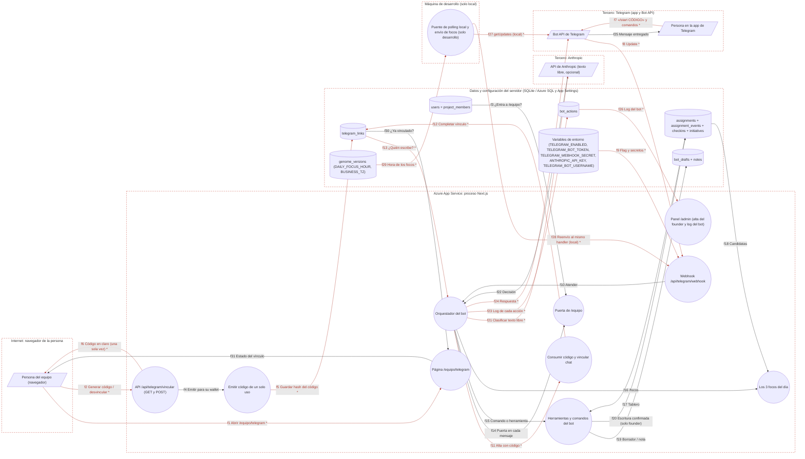

# Ficha: Telegram

Dueño: QA (por asignar) · Revisor: John · Fecha: 2026-10-21 · Commit de referencia: 0e07d8f

## 1. Resumen

Un bot de Telegram para el equipo. Nació (WP19) como asistente personal del founder para capturar tareas, notas y check-ins desde el chat; desde WP31-C2 **cualquiera que entra a `/equipo` puede vincular su Telegram** para recibir el resumen de sus entregas y lo urgente (eso lo manda la feature de recordatorios) y consultar lo suyo con comandos.

Piezas:

- **Vinculación** (`/equipo/telegram`, `POST /api/telegram/vincular`): la app genera un código de un solo uso (`ZBOT-` + 10 hex, vence en 30 min, en la base solo su hash). La persona escribe `/start CÓDIGO` al bot y queda vinculada su cuenta de Telegram a su wallet (el founder, a su identidad de equipo).
- **Webhook** (`POST /api/telegram/webhook`): Telegram entrega cada mensaje; la ruta exige la flag `TELEGRAM_ENABLED`, el *secret token* y el `TELEGRAM_BOT_TOKEN`, y delega en `handleUpdate`.
- **Comandos deterministas** (sin modelo): `/pendientes [filtro]`, `/focos` (los 3 focos del día, reordenables con «focos 2 1 3»), `/ayuda`, «cierra N», «sube la prioridad de N», `/nota <texto>`.
- **Texto libre con modelo** (opcional, `ANTHROPIC_API_KEY`): solo para quien ve todo el equipo (founder y supervisores). El modelo solo puede elegir una de 5 herramientas y toda escritura queda como **borrador** que hay que confirmar con un botón. Escribir en el tablero por Telegram es solo del founder (`is_authorized`).
- **Focos del día programados**: solo existen en el puente de polling local (`packages/scripts/telegram-bot.mjs`). En producción los focos se piden con `/focos`.
- **Log** (`bot_actions`), visible en `/admin`.

Quién lo usa: el founder (escritura), supervisores (lectura con modelo), el resto del equipo interno y quien trabaja por proyecto (solo lectura, solo lo suyo, su texto nunca llega al modelo).

## 2. Diagrama (DFD)

Archivo: [`docs/dfd/telegram.tm7`](../dfd/telegram.tm7), más la imagen exportada [`docs/dfd/telegram.svg`](../dfd/telegram.svg). Los dos se generan desde la fuente [`docs/dfd/telegram.json`](../dfd/telegram.json) con `python docs/dfd/generar_tm7.py docs/dfd/telegram.json --estricto`, que pasa: cada `codigo` existe en el repo. La fuente tiene 22 elementos (4 actores, 11 procesos, 7 almacenes), 31 flujos (17 sensibles) y 6 fronteras de confianza.

Vista para GitHub (salida de `--mermaid`): `[/ /]` actor, `(( ))` proceso, `[( )]` almacén, cada `subgraph` es una frontera de confianza y los flujos con `*` y en rojo llevan datos sensibles.

Lectura: arriba, la vinculación desde el navegador (la app emite el código y guarda su hash). En el centro, Telegram empuja cada mensaje al webhook, el orquestador identifica a la persona por su `telegram_user_id`, vuelve a pasar la puerta de `/equipo` en **cada** mensaje y responde por la Bot API; solo el texto libre de quien ve todo el equipo sale a Anthropic. Abajo, el puente de polling solo existe en una máquina de desarrollo.

Nota: `f7` y `f25` unen dos actores (la persona y los servidores de Telegram) porque ese tramo no pasa por el sistema. Microsoft Threat Modeling Tool no genera amenazas para ellos; la sección 7 analiza a mano el código de vinculación y el webhook (`f8`).

## 3. Recorrido de una acción

Acción elegida: **una persona del equipo interno (sin supervisión) vincula su Telegram y pide sus focos del día con `/focos`.** (Es el caso que recorre la prueba de la sección 8).

1. **Pantalla o componente:** `/equipo/telegram` (`app/equipo/telegram/page.tsx#EquipoTelegramPage`) con `src/components/BotLinkPanel.tsx#BotLinkPanel` en modo `equipo`: pasos «Genera tu código» y «Escríbele al bot «/start CÓDIGO». Vence en 30 minutos.», y el botón «Generar código» (deshabilitado si el bot no está encendido y configurado). Después, la app de Telegram.
2. **Llamada al backend:** `fetch("/api/telegram/vincular", { method: "POST", body: "{}" })` con la cookie `zelena_session`. Luego la persona escribe `/start ZBOT-XXXXXXXXXX` y `/focos`; Telegram hace `POST /api/telegram/webhook` con el *update* JSON y la cabecera `x-telegram-bot-api-secret-token`.
3. **Ruta y controlador:**
   - `app/api/telegram/vincular/route.ts#POST`: `getSession` (401) → `equipoActor(session, db)` leído de la base (403 «Telegram se vincula desde el equipo…») → límite 10/min por wallet+IP (429) → `walletParaVinculo` → `issueLinkCode` (o `unlinkTelegram` si `action: "desvincular"`).
   - `app/api/telegram/webhook/route.ts#POST`: flag apagada → 404; `verifyWebhookSecret` → 401; límite 120/min por IP (responde 200 `skipped`); sin `TELEGRAM_BOT_TOKEN` → 503; cuerpo ilegible → 200 `skipped`; si no, `handleUpdate({ db, transport, claude: apiKey ? cliente : null, transcriber: null }, raw)`.
4. **Lógica de negocio:**
   - Emisión (`src/lib/bot-store.ts#issueLinkCode`): la wallet debe existir (404) y no tener ya un chat (409); código `ZBOT-` + 5 bytes aleatorios en hex; se guarda `sha256` del código normalizado y `code_expires_at = ahora + 30 min`; emitir de nuevo reemplaza el pendiente; `is_authorized = canAuthorizeWrite` (solo el founder y solo si no hay otra fila autorizada). El founder se vincula con `principalFounder` (su fila del roster).
   - Alta (`src/lib/bot-agent.ts#handleUpdate` → `intentarAlta` → `bot-store.ts#consumeLinkCode`): se ignoran grupos; si el `telegram_user_id` no está vinculado y el texto es `/start <código>`, se busca por hash, se exige que no esté consumido ni vencido, se escribe `telegram_user_id`, `linked_at` y se borra el hash (un solo uso). Responde la bienvenida de lectura o la de escritura según `is_authorized`.
   - Cada mensaje siguiente: `equipoActor` se recalcula (si la persona pasó a alumni, deja de ver y escribir); `canWrite = is_authorized && equipo`. Los comandos se reconocen con expresiones ancladas (`RE_FOCOS`, `RE_PENDIENTES`…) y **no** pasan por el modelo.
   - `/focos` (`src/lib/bot-tools.ts#focosDelDia`): candidatas = su trabajo abierto (`assignmentsForOwner`) más, solo si ve todo el equipo, la bandeja del founder (`founderInbox`); orden: vencidas hoy o antes, lo que espera al founder, prioridad, fecha, id; las 3 primeras. Reordenar no escribe nada.
   - Texto libre: si `soloLoPropio` (core sin supervisión, contributor o sin acceso a `/equipo`) responde `soloComandosLectura` sin llamar a nadie; sin modelo, `soloComandos`; con modelo, `tool_choice` obliga a una de 5 herramientas, la de escritura con confianza < 0,6 se convierte en pregunta, y lo que escribe queda como borrador (`bot_drafts`) hasta pulsar «Confirmar».
5. **Base de datos:** `telegram_links` (INSERT/UPDATE en la emisión; UPDATE en el alta; UPDATE a NULL al desvincular); lee `users`, `project_members`, `roster_links`, `assignments`, `initiatives` (y `assignment_events`, `checkins` en otros comandos); escribe `bot_actions` en cada rama (sin el texto del usuario); `bot_drafts`, `notes`, `assignments`, `checkins` solo en el camino de escritura del founder.
6. **Respuesta y qué hace la pantalla con ella:** la vinculación responde `{ ok, code, expiresAt, willAuthorizeWrite: false, status }`; `BotLinkPanel` muestra `/start <código>` una sola vez y hace `router.refresh()`. El webhook responde a Telegram `200 { ok: true, attended: true }`; la respuesta a la persona viaja aparte por `sendMessage`: tras el alta, «Listo, quedaste vinculado. Por aquí te llega el resumen de tus entregas y lo urgente.» + la lista de comandos de lectura; tras `/focos`, «Tus 3 focos de hoy, …» con las piezas numeradas y «Responde «focos 2 1 3» para reordenarlos, o «ok» si están bien.».
7. **Casos de falla:**
   - vinculación: 401, 403, 429, 404 «Esa cuenta no existe en la dapp.», 409 «Esa cuenta ya tiene Telegram vinculado.», 500 «No se pudo generar el código.».
   - webhook: 404 (flag), 401 (secret), 503 (sin token), 200 `skipped` (límite, cuerpo inválido, error interno: nunca se filtra el detalle).
   - alta: código malo, consumido o vencido → «Ese código no sirve…»; otra cuenta de Telegram ya vinculada → «Esta cuenta de Telegram ya está vinculada.».
   - `telegram_user_id` desconocido: no se contesta nada y queda en el log con su id (`sender_ref`); mensajes de grupo: se ignoran; audio: «Todavía no puedo convertir audio a texto…».
   - quien está en lectura intenta «cierra N», «sube la prioridad», `/nota` → «En esta versión solo John escribe en el tablero desde Telegram…».
   - excepción inesperada → «Algo falló de mi lado y no hice el cambio.» y línea `error` en el log con solo el nombre del error.

## 4. Elementos del DFD en el código

| Elemento | Tipo | Archivo y función | Notas |
| --- | --- | --- | --- |
| Persona del equipo (navegador) | Cliente externo | `apps/web/src/components/BotLinkPanel.tsx#BotLinkPanel` | Modo `equipo` en `/equipo/telegram`; modo `admin` en `/admin`. |
| Persona en la app de Telegram | Cliente externo | `apps/web/src/lib/telegram.ts#parseUpdate` | Lo que escribe llega normalizado a `BotUpdate`; grupos y updates raros se descartan. |
| Bot API de Telegram | Cliente externo | `apps/web/src/lib/telegram.ts#createTelegramTransport` | Única conexión con Telegram; `sendMessage`, `answerCallback`. |
| API de Anthropic | Cliente externo | `apps/web/src/lib/bot-agent.ts#createClaudeClient` | `fetch` directo a `/v1/messages`, sin SDK; modelo de `ANTHROPIC_BOT_MODEL` o el de `config.ts`. |
| Página /equipo/telegram | Proceso | `apps/web/app/equipo/telegram/page.tsx#EquipoTelegramPage` | Puerta propia `equipoActor`. |
| API /api/telegram/vincular | Proceso | `apps/web/app/api/telegram/vincular/route.ts#POST` | También `GET` (estado del vínculo). No mira si el bot está encendido. |
| Puerta de /equipo | Proceso | `apps/web/src/lib/authz.ts#equipoActor` | Se usa en la vinculación y en cada mensaje del bot. |
| Emitir código | Proceso | `apps/web/src/lib/bot-store.ts#issueLinkCode` | Con `generateLinkCode`, `hashLinkCode`, `canAuthorizeWrite`, `walletParaVinculo`. |
| Webhook | Proceso | `apps/web/app/api/telegram/webhook/route.ts#POST` | Solo puerta; siempre 200 tras validar. |
| Orquestador del bot | Proceso | `apps/web/src/lib/bot-agent.ts#handleUpdate` | `atenderComando`, `atenderTextoLibre`, `atenderBoton`, `BOT_SYSTEM_PROMPT`. |
| Consumir código | Proceso | `apps/web/src/lib/bot-store.ts#consumeLinkCode` | Un solo uso; borra el hash. |
| Herramientas y comandos | Proceso | `apps/web/src/lib/bot-tools.ts#runBotTool` | `BOT_DISPATCH` congelado (5 herramientas), `renderPendientes`, `avanzarPieza`, `subirPrioridadPieza`, `confirmDraft`, `discardDraft`. |
| Los 3 focos del día | Proceso | `apps/web/src/lib/bot-tools.ts#focosDelDia` | Y `renderFocos`, `reordenarFocos`. `debeEnviarFocos` y `horaDeLosFocos` existen pero la app no las usa. |
| Panel /admin | Proceso | `apps/web/app/admin/page.tsx#AdminPage` | Alta del founder (`founderTeamWallet`) y últimas 50 filas del log. |
| Puente de polling local | Proceso | `packages/scripts/telegram-bot.mjs#main` | Solo desarrollo: `getUpdates` → reenvía al webhook local; manda `/focos` sintético a la hora `DAILY_FOCUS_HOUR`. |
| telegram_links | Almacén | `apps/web/src/lib/schema.sql#telegram_links` | Índices únicos parciales por `telegram_user_id` y por `link_code_hash`. |
| users + project_members | Almacén | `apps/web/src/lib/schema.sql#users` | Rol, supervisión, estado, acuerdo, membresías. |
| Tablero | Almacén | `apps/web/src/lib/schema.sql#assignments` | Con `assignment_events`, `checkins`, `initiatives`. |
| bot_drafts + notes | Almacén | `apps/web/src/lib/schema.sql#bot_drafts` | La pieza ya estructurada, nunca el mensaje crudo. |
| bot_actions | Almacén | `apps/web/src/lib/schema.sql#bot_actions` | Append-only; `sender_ref` solo para remitentes no vinculados. |
| genome_versions | Almacén | `apps/web/src/lib/genome.ts#dailyFocusHour` | `DAILY_FOCUS_HOUR` (7) y `BUSINESS_TZ` para la fecha de las pistas. |
| Variables de entorno | Almacén | `apps/web/src/lib/config.ts#telegramStatus` | `isTelegramEnabled`, `telegramBotToken`, `telegramWebhookSecret`, `anthropicApiKey`, `telegramBotUsername`. |

## 5. Flujos de datos

Los marcados **(S)** llevan datos sensibles (credencial, sesión o dato personal).

| Flujo | De → a | Protocolo | Datos que viajan |
| --- | --- | --- | --- |
| f1 **(S)** | Persona → Página /equipo/telegram | HTTPS | `GET` con cookie `zelena_session` |
| f2 **(S)** | Persona → API vincular | HTTPS | `POST {}` o `{ action: "desvincular" }` con cookie |
| f3 | users/project_members → Puerta | SQL | estado, rol, supervisión, acuerdo, membresías |
| f4 | API vincular → Emitir código | llamada en proceso | wallet (founder → identidad de equipo) |
| f5 **(S)** | Emitir código → telegram_links | SQL | `link_code_hash` (hash de credencial), vencimiento, `is_authorized` |
| f6 **(S)** | API vincular → Persona | HTTPS | código en claro, una sola vez |
| f7 **(S)** | Persona en Telegram → Bot API | Telegram | texto del mensaje (incluye el código) e id de Telegram |
| f8 **(S)** | Bot API → Webhook | HTTPS | update JSON + cabecera *secret token* |
| f9 **(S)** | Variables de entorno → Webhook | process.env | flag, *secret token*, token del bot, clave de Anthropic |
| f10 | Webhook → Orquestador | llamada en proceso | update, transporte, cliente de Claude o `null` |
| f11 **(S)** | Orquestador → Consumir código | llamada en proceso | código, `telegram_user_id` |
| f12 **(S)** | Consumir código → telegram_links | SQL | `telegram_user_id`, `linked_at`; hash a `NULL` |
| f13 **(S)** | telegram_links → Orquestador | SQL | wallet e `is_authorized` del remitente |
| f14 | Orquestador → Puerta | llamada en proceso | wallet vinculada (en cada mensaje) |
| f15 | Orquestador → Herramientas | llamada en proceso | comando o herramienta + contexto del actor |
| f16 | Orquestador → Focos | llamada en proceso | contexto del actor |
| f17 | Tablero → Herramientas | SQL | trabajo abierto, agregados del dashboard |
| f18 | Tablero → Focos | SQL | `assignmentsForOwner` + `founderInbox` |
| f19 | Herramientas → bot_drafts/notes | SQL | borrador estructurado, estado, nota |
| f20 | Herramientas → Tablero | SQL | escritura confirmada por el founder; `UPDATE priority` de «sube la prioridad» |
| f21 **(S)** | Orquestador → Anthropic | HTTPS | `x-api-key`, texto libre, nombres de proyectos visibles, fecha |
| f22 | Anthropic → Orquestador | HTTPS | `tool_use` + input |
| f23 **(S)** | Orquestador → bot_actions | SQL | wallet o `sender_ref` (id de Telegram), acción, resultado, detalle |
| f24 **(S)** | Orquestador → Bot API | HTTPS | token en la URL, `chat_id`, texto, botones |
| f25 | Bot API → Persona en Telegram | Telegram | respuesta |
| f26 **(S)** | bot_actions → Panel /admin | SQL | últimas 50 acciones (wallet, acción, detalle) |
| f27 **(S)** | Puente local → Bot API | HTTPS | token en la URL, `getUpdates` |
| f28 **(S)** | Puente local → Webhook | HTTP localhost | update + *secret token*; `/focos` sintético |
| f29 **(S)** | genome_versions/telegram_links → Puente local | SQL (archivo SQLite) | `DAILY_FOCUS_HOUR`, `telegram_user_id` autorizado |
| f30 | telegram_links → Página | SQL | si hay `telegram_user_id`, `linked_at` |
| f31 | Página → Persona | HTTPS | estado del vínculo |

## 6. Dependencias con otras features

- **Login y sesión**: `getSession` en la vinculación; `equipoActor` y `adminActor` (`src/lib/authz.ts`).
- **SLA, recordatorios y avisos**: usa `telegram_links` (que crea esta feature) para mandar lo urgente y el resumen; reutiliza `createTelegramTransport`, `sendMessage` y `constantTimeEquals`. El enlace «Recibir también por Telegram» de `/equipo/avisos` lleva aquí.
- **Tablero / equipo y talento por proyecto**: `assignmentsForOwner`, `visibleAssignments`, `applyAssignmentAction`, `createAssignment`, `upsertCheckin`, `proyectosVisibles`, `walletDeRoster` (`src/lib/talento.ts`), `identidadesDe`/`principalFounder`.
- **Dashboard**: `founderInbox`, `blockedWithAge`, `initiativeBars`, `loadByPerson`, `epochSnapshot`, `riteHealth`, `buildDashboard`; `buildTodayDigest` (`src/lib/digest.ts`).
- **Genoma**: `DAILY_FOCUS_HOUR`, `BUSINESS_TZ`.
- **Admin**: alta del founder y log del bot en `/admin`.
- **Privacidad (sitio público)**: `/privacidad` declara que se guarda el id de chat.

Dependencias inversas anotadas al integrar (la otra ficha ya las tenía; la guía pide anotarlas en las dos):

- **Ritos y comunidad** ([ritos-y-comunidad.md](ritos-y-comunidad.md)): el alcance «ritos» del bot reutiliza `riteHealth` del dashboard, que cuenta check-ins y no asistencia a ritos.

## 7. Amenazas relevantes

| Amenaza | Categoría | Elemento | Estado | Justificación |
| --- | --- | --- | --- | --- |
| Vincular la cuenta de otra persona adivinando un código | Suplantación | Consumir código (f7, f11, f12) | Mitigada | 40 bits aleatorios (`src/lib/bot-store.ts:97-99`), un solo uso (`:256-258`), vence en 30 min (`:93`, `:252`), en la base solo el hash (`:106-108`). |
| Peticiones falsas al webhook sin pasar por Telegram | Suplantación | Webhook (f8) | Mitigada | Flag apagada → 404 y *secret token* en tiempo constante, que rechaza si no está configurado (`app/api/telegram/webhook/route.ts:31-40`, `src/lib/telegram.ts:33-64`). |
| El código en claro queda a la vista | Divulgación de información | API vincular → Persona (f6) | Aceptada | Se muestra una sola vez (`app/api/telegram/vincular/route.ts:48-54`, `BotLinkPanel.tsx:98-103`) y vence en 30 min; si se filtra antes de usarlo, el titular lo ve vinculado en `/equipo/telegram` y puede desvincular. |
| Alguien en lectura escribe en el tablero por Telegram | Elevación de privilegios | Herramientas (f15, f20) | Mitigada | `canWrite = is_authorized && equipo` (`src/lib/bot-agent.ts:288-294`); `is_authorized` solo para el founder y una sola fila (`bot-store.ts:128-139`); `runBotTool` bloquea escrituras (`bot-tools.ts:532-546`); «cierra N» y «prioridad» rechazan (`bot-agent.ts:507`, `:520`). Probado en la sección 8. |
| Un externo ve el tablero interno por Telegram | Divulgación de información | Orquestador / Herramientas (f17, f24) | Mitigada | `soloLoPropio` (`bot-tools.ts:333-335`) limita estado y focos a lo propio (`bot-tools.ts:560-564`, `:799-809`); la puerta se recalcula en cada mensaje (`bot-agent.ts:285-294`). |
| El modelo ejecuta algo no previsto (inyección en el texto) | Elevación de privilegios | Orquestador → Anthropic (f21, f22) | Mitigada | Tabla congelada de 5 herramientas (`bot-tools.ts:520-526`), herramienta desconocida → pregunta (`bot-agent.ts:629-643`), escritura solo vía borrador propio de un solo uso (`bot-tools.ts:871-892`). |
| Texto libre y nombres de proyectos (incluso de cliente) salen a Anthropic | Divulgación de información | Orquestador → Anthropic (f21) | Pendiente | Solo para quien ve todo el equipo y solo proyectos visibles (`bot-agent.ts:243-252`, `:559-561`), pero `/privacidad` no nombra a Anthropic ni a Telegram como encargados (`app/privacidad/page.tsx:17-22`). |
| Nombres de personas del equipo en el prompt, en un repo público | Divulgación de información | Orquestador (`BOT_SYSTEM_PROMPT`) | Pendiente | `src/lib/bot-agent.ts:109` enumera a las personas del equipo; además quedó desactualizado: el roster ahora es dato (`/equipo/talento`). |
| Cambiar la prioridad sin rastro | Repudio | Herramientas (f20) | Pendiente | `subirPrioridadPieza` hace `UPDATE assignments SET priority` sin evento en `assignment_events` y sin mirar si la pieza está en revisión (`src/lib/bot-tools.ts:747-768`); solo queda la línea en `bot_actions`. |
| Acciones del bot sin trazabilidad | Repudio | Orquestador → bot_actions (f23) | Mitigada | Cada rama llama a `logBotAction` (`src/lib/bot-store.ts:342-353`) y `/admin` lo muestra (`app/admin/page.tsx:60`). |
| Telegram reenvía un update y se procesa dos veces | Denegación de servicio | Webhook (f8) | Pendiente | `update_id` se lee pero nunca se usa para deduplicar (`src/lib/telegram.ts:111`); fijado en la prueba. Impacto bajo: las escrituras pasan por un borrador de un solo uso, pero se duplican respuestas, borradores y log. |
| Ráfaga de peticiones al webhook | Denegación de servicio | Webhook (f8) | Mitigada | El *secret token* se valida antes que todo (`webhook/route.ts:37-40`); luego 120/min por IP (`:42-44`). |
| El detalle de un error interno llega al usuario o a Telegram | Divulgación de información | Webhook / Orquestador | Mitigada | La ruta responde `skipped: "error_interno"` (`webhook/route.ts:70-73`); el log guarda solo `e.name` (`bot-agent.ts:301-313`); el error de Anthropic no lleva el cuerpo (`bot-agent.ts:156-159`). |
| Ids de Telegram de desconocidos guardados sin plazo | Divulgación de información | bot_actions (f23) | Aceptada | Es el mínimo para diagnosticar un id que insiste, sin contenido (`bot-agent.ts:276-281`, comentario de `schema.sql` sobre `sender_ref`); falta definir retención (sección 9). |
| Token del bot en la URL de la Bot API | Divulgación de información | Variables de entorno (f9, f24, f27) | Aceptada | Así funciona la Bot API; el token no se registra ni aparece en errores (`src/lib/telegram.ts:234-252`). |

## 8. Prueba de caracterización

Archivo: `apps/web/src/lib/caracterizacion/telegram.test.ts` (12 casos, pasan). Se corre con `cd apps/web && npx vitest run src/lib/caracterizacion/telegram.test.ts`.

Qué cubre, por las rutas reales y contra una base SQLite en memoria con `schema.sql` + `seedTeam`:

- vinculación: 401 sin sesión, 403 para quien no entra a `/equipo`; el código tiene la forma `ZBOT-` + 10 hex, la base guarda solo su hash, vence en ~30 min y queda en lectura; `GET` de estado;
- webhook: 404 con la flag apagada, 401 sin o con otro *secret token*;
- **flujo principal**: `/start CÓDIGO` vincula el chat, borra el hash y responde la bienvenida de lectura; el mismo código no sirve dos veces; `/focos` propone sus focos (solo lo suyo) y `/pendientes` lista su trabajo;
- su texto libre no llega a Anthropic aunque haya clave, y no deja borrador ni texto en el log; «cierra N» queda rechazado y la pieza no cambia;
- remitente desconocido ignorado y registrado; desvincular;
- tres HALLAZGOS fijados: `update_id` repetido se atiende dos veces; la API emite códigos con el bot apagado; `debeEnviarFocos` usa la hora del servidor.

Dobles: sesión (`@/lib/session`) y `fetch` (borde con Telegram y Anthropic). La orquestación fina (borradores, confirmación, `/nota`, audio, supervisión con modelo) ya la cubren `bot-agent.test.ts` (36), `bot-store.test.ts` (28) y `telegram.test.ts` (19).

## 9. Preguntas abiertas

- Los «focos del día» programados solo existen en el puente local (`packages/scripts/telegram-bot.mjs:192-203`), con la hora del servidor (`getHours()`), y `DAILY_FOCUS_HOUR` (7) cae fuera del horario hábil (08:00). En producción nadie los envía. ¿Se quiere ese envío (por el mismo cron de recordatorios) o se retira la promesa?
- `BOT_COPY.soloLectura` y `BOT_SYSTEM_PROMPT` hablan de «John» y de una lista fija de personas. ¿Se reescriben para todo el equipo y se saca la lista del prompt (el roster ya es dato)?
- ¿Se debe nombrar a Telegram y a Anthropic en `/privacidad` como destinos de datos?
- ¿Cuánto tiempo se guardan `bot_actions` (con ids de Telegram de desconocidos) y los borradores resueltos?
- ¿La vinculación debe negarse cuando el bot está apagado (hoy la UI deshabilita el botón, la API no)?
- ¿Se deduplican los updates por `update_id`?
- `subirPrioridadPieza` replanifica sin evento y aunque la pieza esté en revisión (la spec WP31 §4.A.5 dice que en revisión no se replanifica). ¿Se pasa por la máquina de estados del tablero?
